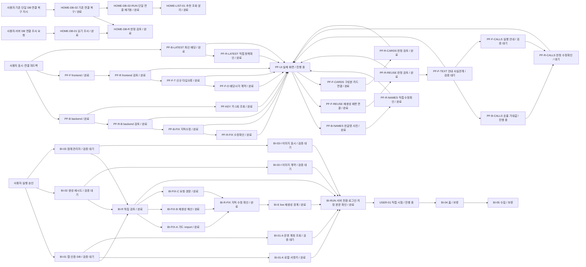

# benchmark 작업 상태

## 현재 요청 — 완료 기능 커밋·푸시·배포 완료 (2026-11-14 04:07 KST 확인)

사용자가 요청한 커밋·push·배포와 운영 프론트 표시 확인을 완료했다. 기능 커밋 **b2ac969ac3c9310c0544dd6b898e63c0209a39f3**을 origin/main에 push했고 원격 SHA 일치를 확인했다. Vercel `dpl_4vcuPMirkBvJ4g6jk5EyqcxFUrUn` READY를 운영 alias로 승격했고, Koyeb `13237d92-1e6f-453f-b4a8-841a2d413255`가 active/HEALTHY다. 운영 홈의 추천 경기·기존 안내 문구·맨시티–풀럼 저장본문5섹션/점수2:1·사진로드와 운영 도메인 /document의 complete=true/run493ef4a9… 일치를 확인했다. [배포 근거](docs/implementation/match-preview/production-release-2026-11-14.md). 과거421삭제·무관한 기획 정리·로컬 생성물은 커밋에서 제외해 작업트리에 보존했다.

| 배포 작업 | 담당 | 상태 | 수용 기준·다음 행동 |
|---|---|---|---|
| REL-BUILD | 구현 DeepSeek flash-1017/max task_40c66363b150·ctx_a26c70951ea2; 독립 확인 task_6e9ef6efe50a·ctx_c4bbae665bf9 / term_9aa0c6aa… | 완료 | [보완 명세](docs/implementation/match-preview/release-build-brief.md)·[독립 확인 범위](docs/implementation/match-preview/release-build-review-brief.md). 지정26검사·local build exit0 및 Vercel 원격 build 통과. 독립 검토4조건/SHA 일치·차단0을 root 수용, 편집 종료·백그라운드0. 잉여 캐스트/fixture available 미단언은 참고로만 보존 |
| REL-PUBLISH | GPT 조정자 / REL-BUILD | 완료 | b2ac969 push/원격SHA 일치, 동일commit source를 Vercel/Koyeb 기존 프로젝트로 배포. 운영 추천1557474·문구·본문5섹션/complete=true/저장run일치, 사진6개 포함main이미지12개 로드 확인. 기존DB/모델secret·tyo/small/1인스턴스 보존, 승인 자동생성 설정 연결. 배포 검증용 수집/모델/승인POST·migration0 |

의존성: REL-BUILD(완료) → REL-PUBLISH(완료). 배포 검증 완료 **2 / 2 작업**. 남은 필수 작업·구현/검토 워커0, 로컬 서버2개 보존. 이번 보완용 DeepSeek 두 터미널도 보고/빈입력창 확인 후 종료해 ptyKilled=true를 확인했다. 기존 기능·실수집 수용은 유지한다. 다음 후보는 본문 구조화이며 신규 구현을 시작하지 않는다. 운영 스크린샷은 도구의 frame timeout2회로 확보하지 못했고 DOM·API·이미지로드 근거와 기존 사용자 화면 수용을 구분해 기록했다.

사용자의 “워커 정리 먼저” 지시에 따라 완료·빈 입력창을 직접 확인한 DeepSeek 워커 터미널 7개를 종료했다. `worker-release`는 기존/보관 터미널이라 retained·processAction=none을 반환했으므로 그 결과를 종료로 간주하지 않았다. 사용자 명시 정리 요청으로 확인된 7개 handle만 개별 `terminal close`했고 모두 `ptyKilled=true`를 확인했다. 마지막 터미널 목록은 워커 0개·서버 2개이며, 내부 조사 보조 에이전트도 남아 있지 않다(root만 존재). 백엔드 term_c31916c2…/PID85956/8000 및 프론트 term_560b0b24…/PID67430/5173을 포트 목록으로 재확인해 보존했다. 과거 Task·Dispatch 기록·보고서·제품 파일은 삭제하지 않았고 새 작업은 시작하지 않았다. 아래 실제 수집·프리뷰·검사 완료 판정은 유지한다.

사용자는 **기간을 받는 새 엔드포인트를 만들고 실제 수집 후 두 경기의 프리뷰 생성을 확인하며, 해당 엔드포인트의 두 경기에만6시간 조건을 예외 허용**하라고 명시했다. [수정 설계](docs/superpowers/specs/2026-11-13-preview-collection-test-endpoint-design.md)와 [구현·실행 계획](docs/superpowers/plans/2026-11-13-preview-collection-test-endpoint.md)에 반영했다. 조정자가 앞서 제안한 별도 시험 프로세스·가상11월21일18:00 판정·함수 입력 치환은 폐기한다. 실제 현재 시각을 쓰고 요청별 명시적 예외를 전달한다. 대상은 첼시–리즈1557470·토트넘–입스위치1557476(둘 다11월22일00:00 KST), 경기 수집 기간은11월21일21:30~22일00:00 양 끝 포함이다. 다른 경기와 정기 수집의6시간 정책은 유지한다.

**기간 지정 실제 수집→두 경기 자동 생성→저장→홈 최신 조회까지 완료했다.** 최종 수집ID **67adc7a9-8fc5-484b-ae53-d807930c256e**는06:08:53~06:14:43 KST에 실행됐고 수집 성공·두생성 성공·실패/건너뜀0이다. 첼시 새 문서248ccbc6…와 토트넘eb2323c1… 모두live·5섹션·홈complete=true이며 각 홈 문서가 이번run_id를 반환한다. 저장 입력의 경기 식별/순위읽기 available·readable=true·양팀순위2행도 확인했다. 최초시험에서 발견한 reader 전달누락은 DeepSeek의 한파일 수정·49 passed와 별도 한정 확인을 거쳐 실제 재시험으로 해소했다. 정기수집409는 타 작업을 건드리지 않고 정상종료를 기다려 해결했다. POST시도3회 중 실제시험2회이며 원 실행은 보존했다. [실행·결함수정·최종 근거](docs/implementation/match-preview/preview-collection-live-evidence.md).

실제 수집 연동의 완료 판정은 유지한다. 11월14일 지연된 검토 메일에서 기존 검사 하나의 버전 고정값 불일치가 보고됐고 조정자가 해당 node ID만 실행해 1 failed를 재현했다. DeepSeek가 availability의 과거 해시 고정을 배당 제공자 버전 변경의 영향 관계 검사로 바꿔 1 passed를 확인했고 별도 DeepSeek가 같은 리비전의 세 수용 기준을 모두 확인해 보완을 수용했다. 제품 manifest는 무변경이다. [한정 명세](docs/implementation/match-preview/collection-version-test-brief.md)·[독립 확인 범위](docs/implementation/match-preview/collection-version-test-review-brief.md). 배당 원시 기준 시각 표시는 아래 11월12일21:44 실제 화면 기록을 재사용한다. 현재 진행 중인 구현·검토와 차단항목은 없다.

01:59 지연 HP-REVIEW(task_87c001a41446·ctx_be89721ace26) 분류: e2e 갱신 완료·격리 l3 제외는 기존 결정과 일치한다. 다만 11월14일 추가 절이 인용한 approved=[]·승인 POST 0·본문 실표시 미완은 11월13일 승인 전 조회의 재전달이며 현재 상태를 새로 조회한 결과가 아니다. [실제 화면 근거](docs/implementation/match-preview/home-stored-preview-browser-evidence.md)의 02:33 승인 5건 성공 → 02:43 정확한 5섹션 조회 → 02:50~52 사진·reveal·실화면 수용과 사용자 최종 패스가 후속 확정 근거다. 승인 초기화/비활성화가 새로 발생했다고 추정하지 않고 추가 승인·DB 조사·브라우저·검사를 시작하지 않는다. 검토자의 당시 관측 기록은 보존한다.

02:03~05 지연 HOME-DB 보고 처리: [단일 연결 검토 §9](docs/implementation/match-preview/home-db-single-connection-review.md)는 URL·도달 가능한 DB가 없는 검사 환경의 실패로 한정해 수용하고, 재구성되지 않은 25/2 수치는 채택하지 않는다. [권한 재확인](docs/implementation/match-preview/home-db-final-runtime-verify-report.md)·[연결 조사 §8](docs/implementation/match-preview/home-db-connection-investigation.md)의 새 GRANT 불필요 판정은 읽기 근거로 보존한다. 원래 public 쓰기 권한이 있다는 사실은 권한 분리가 구현됐다는 뜻이 아니다. 옛 home_preview_* 표 부재는 알려진 옛 메타데이터 경로이며 현재 홈 저장본문은 /document를 사용하므로 새 표·마이그레이션을 시작하지 않는다.

보고된 로컬 백엔드 중단은 root도 새로 확인했다(Orca workspace 포트8000 없음, health가 다른 앱의 version0.5.0 응답). 기존 서버 터미널 term_c31916c2-591f-43b0-bcd1-801b30806912의 종료·빈 셸을 확인한 뒤 기존 `/bin/sh scripts/run_benchmark_dev.sh`를 한 번 실행했다. PID85956 startup complete·health `{status:ok}`를 확인했고, 프론트5173 경유 추천 GET은1557474를 반환했다. 실제 /document GET에서 맨시티493ef4a9…·첼시248ccbc6…·토트넘eb2323c1… 모두 available/complete=true/5섹션을 반환했다. 첼시의 첫 호출은 실행 도구가 응답 전 반환해 본문을 확보하지 못했으므로 완료 대기 시간을 둔 1회 재조회로 확인했다. 제품·자격 파일·DB 권한 변경 및 조정자의 수집·생성·승인 POST는 0이며 브라우저 검사를 반복하지 않았다. 다른 프로젝트 컨테이너·프론트는 건드리지 않았다.

| 후속 ID | 담당·선행 | 상태 | 근거·다음 행동 |
|---|---|---|---|
| PC-VERSION-TEST | DeepSeek flash-1017/max 구현 task_5be18902bc5d·ctx_5be9411bfbc1 / 별도 검토 task_9d64fe895e70·ctx_3bf9c586f616 / PC-LIVE 계약 축 변경 | 완료 | 한 함수 보완 1 passed(0.38s), 검사 c700e3d3…44da·manifest d518c7a3…570d 무변경을 root와 별도 검토자가 확인. 관계 단언·기존 odds/구현 연결 단언·대역 복원/DB fixture 미사용의 세 기준 충족, 요구 위반0. 검토는 기존 실행 근거 재사용·편집/직접 실행0·백그라운드0. 구현자의 허용 외 별도 값 확인·컴파일은 추가 수용 근거로 삼지 않음 |

후속 의존성: PC-LIVE(완료) → PC-VERSION-TEST(완료). 해당 보완의 검증 완료는 **1 / 1 작업**이며 앞선 실제 연동 **4 / 4**와 구분한다. 현재 로컬API는 PID85956/기존 서버 터미널, 프론트는 기존5173을 유지한다(11월14일02:05 확인). 다음 기능 후보는 본문 구조화(선수·팀 내부ID와 한글/사진 연결)이고 상세 계약·기존 기록 전환을 확정하기 전이므로 아직 구현하지 않는다.

사용자 요청으로 기존 관리자 기능을 통해 과거2/미래2를 한 경기씩 실제 생성했다. 네 요청 모두 종료돼 기술적 생성·저장·재조회·관리자 렌더 확인은 **4 / 4 경기**다. 사용자는 미래 내용과 다른 대진 생성 시험을 명시적으로 통과 처리했다. **2026-12-06 맨유–코번트리 결과를 자료가 부족한 미래 경기의 최소 내용 구성 사례로 수용**했다. 이 판단을 새 자동 길이·점수·출처 수 문턱이나 모든 미래 호출의 성공 보장으로 확대하지 않는다. [경기별 결과와 링크](docs/implementation/match-preview/collection-sample-results.md).

선수 사진·한글 이름은 후속 본문 구조화 단계에서 이름 검색→DB 내부 선수 ID 확인→한글/사진 연결 방향으로 다룬다. 기존 사진·매체 관측은 완료한 수집 연결의 선행 조건이 아니다. 수집 연결의 지적4건 수정22 passed, endpoint 보완66 passed, reader 보완49 passed는 각각의 범위/리비전 근거로 보존하고 합산하지 않는다. 실제 수집·모델·자동 생성 저장·홈 조회는 위 PC-LIVE 근거로 확인했다. 구현자의 허용 외 변이 실험은 범위 초과로 기록하고 추가 검증 근거로 쓰지 않는다.

홈 연결은 완료했다. 사용자 승인한 맨체스터 시티–풀럼 저장본5섹션이 기본 홈 첫 진입에 자동 표시되고 원본과 일치한다. PID13279에서 사진6개·팀로고4개 로드, 예상점수2:1, 매체/배당, 섹션별 흐림→선명, 8:2/정사각형 점수 배치, 390px와 테마를 실제 확인했다. 승인 근거 연결과 사진 해석기 연결의 독립 검토도 수용했다. 사용자가 보던 홈을 새로고침해 프리뷰 구역을 열었다. [최종 실제 근거](docs/implementation/match-preview/home-stored-preview-browser-evidence.md).

사용자 최종 확인(2026-11-13): “현재 결과대로 나오면 좋습니다. 보여지는 것에는 패스입니다.” 홈 표시·디자인 수용을 명시 확인했다. 이를 새 경기 본문이나 다른 워크플로우 버전의 내용 승인으로 확대하지 않는다. 다음 작업 안내 요청에 따라 PC-SAMPLES → 관측 결함만 수정 → PC-CONNECT 순서를 안내한다. 새 생성 실행을 시작한 것은 아니다.

03:20 사용자 요청: 본문 스키마를 자세히 보고 구조화 방향을 논의한다. 읽기 조사 결과 현재는 섹션 body(TEXT)와 모듈 payload의 부분 structured(JSON)가 함께 있고, AI 전망 문단·선수 도입문은 프론트가 body에서 추출한다. 홈 structured 내부 계약도 unknown으로 받는다. 섹션별 구조화 본문을 표시의 기준으로 삼는 방향을 논의하며 구체적인 저장 변경·마이그레이션은 아직 확정하지 않았다. 기존 화면 수용은 유지하고 표본 생성/수집 연결은 미착수 상태로 보존한다.

03:27 목적 확인 및 저장 조사: 사용자는 DB 내부 ID로 선수·팀과 한글 정보를 연결하기 위해 구조화를 원한다. [조사 결과](docs/planning/2026-11-13-preview-content-structure-findings.md)에 코드와 실제 관리자 detail의 저장 payload를 대조했다. 주목 선수4명은 내부 player_id가 저장되지만 team_id는 없고, 부상2명은 player_id=null이며 조회 때 보강한다. 본문에는 이름 참조가 없고 같은 선수의 한글 표기도 서로 다르다. ID 확인 규칙·본문 참조·섹션 계약·기존 기록 전환을 설계 대상으로 정리했으며 구현 방식은 아직 확정하지 않았다. 이는 GPT의 사실 조사이며 독립 리뷰가 아니다.

03:32 후속 순서 논의: 사용자는 기능 동작 확인을 우선해 수집 연결 후 곧바로 구조화하는 방향을 선호하며 순서 판단을 요청했다. 기존 PC-CONNECT의 입력·출력과 현재 수집 hook/새 생성 서비스는 본문·player_id·structured 내부 필드를 직접 읽지 않음을 추가 코드 조사로 확인했다. 조정자 권고는 **PC-SAMPLES → PC-CONNECT → PC-ACCEPT → 본문 구조화**이며, 수집은 생성 호출·실행 상태·실행 ID 연결에 한정한다. 후속 구조화 때 기존 저장본을 보존하고 확인 가능한 자료만 새 형식으로 변환한다. 누락된 ID·합쳐진 문장을 전부 자동 복원할 수 있다고 전제하지 않는다. 이는 순서 권고이며 구조화 상세 설계·구현의 신규 승인으로 기록하지 않는다.

기존 홈 수용 결과와 사용자 승인5행은 보존했다. 이번에는 모델 생성과 새 개발 실행 저장만 수행했으며 제품·테스트 코드 변경, 승인 POST, 운영 수집·배포는 하지 않았다. 수집 연결은 미착수다. 기본 e2e의 브라우저1223 부재와 기존 타입 오류8건은 별도 환경/기존 한계로 남는다.

01:56 추가 검토 msg_e31136e56439 수용: 실제 경로의 `home-preview-live.spec.ts`는 HP-FIX에서 갱신한다. 함께 지목된 `home-preview-l3.spec.ts`는 현재 사용하지 않는 격리 DB/8017 전용 opt-in 검사로 직접 확인돼 현재 완료 조건에서 제외하고 과거 계약 후속으로 남긴다. 새 skip/환경/마이그레이션은 만들지 않는다. 옛 최근5경기표·출처접기·data-gap UI를 복원하지 않으며, 필수 선수/부상·사진·로고·매체·배당은 기존 저장본문 컴포넌트에서 계속 확인한다.

사용자 추가 기준: **첫 진입 즉시 저장본문, 기존 섹션별 스크롤 흐림→선명, 문서 없음은 안내 문구만, 킥오프 전 6시간 이내 미생성은 문제 안내**, 맨체스터 저장본과 과거·미래 실경기 및 디자인 확인. [확인 기준](docs/superpowers/plans/2026-11-13-home-stored-preview-acceptance.md)에 정리하고 현재 구현 워커에 msg_7e5b040ce870으로 전달했다. 새 작업/검토자를 만들지 않고 HP-IMPL·HP-HOME의 수용 범위에 반영한다. 실제 과거·미래 자료의 문서 유무는 추정하지 않고 읽기 조회로 후보를 확인한다.

**다음 계획 논의(00:32 KST):** 사용자가 다른 미래·과거 경기의 실제 생성 확인 후 수집 로직 연결을 요청하고 grill-me를 지정했다. [결정 기록](docs/planning/2026-11-13-preview-collection-decisions.md)에서 과거 경기의 의미·성공 기준·수집 실패 격리를 논의한다. GPT `/root/collection_facts`는 현행 hook/중복/실패 처리의 읽기 전용 사실 조사만 수행한다. 이 논의는 HP-IMPL을 중단하거나 새 구현·유료 생성·수집 실행을 승인한 것으로 처리하지 않는다.

00:38 KST 후속 확정: 과거 시험은 배당 등 과도한 검증·다른 대진 기술 동작 확인, 재시도 후 정상 생성도 성공, 섹션 구성 및 미래 내용 완성도는 사용자 확인, 경기별 실패 격리, 실패 경기의 새 후속 자동 재시도는 제외. 현행 수집 조사 완료. 표본·자료 없음 표현·부분 수집 실패 조건·조기 관리자 문서와 수집 생성 관계는 다음 질문으로 남겼다. 실제 생성/새 구현은 아직 시작하지 않았다.

00:42 KST 추가 확정: 과거2/미래2, 실제 자료 없음은 명시하며 생성하되 확보 가능한 API 자료 누락은 결함, 기존 문서가 있어도 수집 새 문서가 최신본이다. 사용자가 수집 자체의 실패 기준 설명을 요청했으므로 Q6은 미확정이다. 현재는 리그·시즌 대상의 일부 하위 오류도 전체 partial_failed를 만들고 프리뷰 전체를 막는 구조임을 코드로 확인 중이다.

00:45 KST Q6 최신 확정: **API 최신화 실패에도 기존 DB로 프리뷰 생성을 시도**한다. 전체/대상 수집 성공만을 조건으로 삼는 앞선 권고를 대체한다. 기존 생성 AI/검색을 활용하고 별도 검증용 AI 게이트는 제안하지 않는다. [다음 구현 계획 초안](docs/superpowers/plans/2026-11-13-preview-collection-integration.md)을 작성했다. 전체 이해 최종 확인 전이며 실호출/새 구현/수집은 미착수다.

00:48 KST 사용자 전체 이해·계획 반영 승인. [수집 연결 계획](docs/superpowers/plans/2026-11-13-preview-collection-integration.md)을 확정하고 과거1557445/1557459·미래1557470/1557503 네 후보를 저장 조회로 선정했다. 실제 생성은 미실행이며 기존 사용자 직접 생성 방식을 유지한다. 수집 연결은 표본 본문 확인 후 배정한다.

| 후속 작업 ID | 담당·선행 | 상태 | 확인 결과·다음 행동 |
|---|---|---|---|
| PC-DESIGN | GPT / 사용자 Q1~Q7 및 새 엔드포인트·두 경기6시간 예외 명시 | 완료 | [수정 설계](docs/superpowers/specs/2026-11-13-preview-collection-test-endpoint-design.md)·[구현 계획](docs/superpowers/plans/2026-11-13-preview-collection-test-endpoint.md). 별도 시험 프로세스/가상시각 방식 폐기. 기존 표본·PC-CONNECT 수용 유지 |
| PC-SAMPLES | GPT 기존 관리자 생성·증거 확인 / PC-DESIGN·사용자 진행 요청 | 완료 | 4경기 실제 생성·저장 재조회·관리자 렌더와 사용자 최종 통과. 본문 수4/5/5/3, 없음 사유 기록. [경기별 기록](docs/implementation/match-preview/collection-sample-results.md). 12월6일 미래 본문을 최소 구성 사례로 수용; 사진/매체 관측은 후속 |
| PC-CONNECT | DeepSeek flash-1017/max / 근거 보완 task_f2bef2cfc156·ctx_33784e2b844e / term_00fb0f6f-2685-4565-a679-071b3346cf68 | 완료 | 세션 팩토리·상위 수집 예외·사전 승인·비예외 FAILED 분류 수정과 실제 두 진입점 합성 검사 보완을 독립 확인 후 수용. [구현 보고](docs/implementation/match-preview/preview-collection-connect-report.md). 최신22 passed, 편집 종료·백그라운드0. 구현 완료이며 실수집 성공을 의미하지 않음 |
| PC-ACCEPT | 별도 DeepSeek flash-1017/max + GPT 수용 / task_bd4a916a331e·ctx_46b7ab8f858a / term_9d0849e4-06fa-4b85-9d5c-e2c7cc9cb609 | 완료 | [검토 보고서의 지적1~4 수정 확인](docs/implementation/match-preview/preview-collection-connect-review.md) 수용. 허용 pytest1회22 passed(0.65s), 기존14·19와 미합산. 조정자 현재4파일 SHA256 일치 확인, 새 직접 회귀 없음. 보고서만 편집·편집 종료·백그라운드0. 실제 연동은 PC-LIVE에 남김 |
| PC-LIVE | GPT 실제 API 조작·수용 / DeepSeek 조회기보완task_c47f539df3d3·독립확인task_a376b22b29b4·읽기확인task_c571d57f62b8 종료 | 완료 | 재시험67adc7a9…06:14:43 종료·수집성공·두live생성성공·실패0. 첼시248ccbc6…/토트넘eb2323c1…각5섹션·경기/순위readable=true·홈최신run_id/complete=true 확인. 첫실행보존·정기수집409정상대기·추가승인/배포0. [최종근거와본문링크](docs/implementation/match-preview/preview-collection-live-evidence.md). 남은필수작업없음 |

| 작업 ID | 담당·모델 / 실행 식별자 | 선행 | 상태 | 수용 기준·확인 결과·다음 행동 |
|---|---|---|---|---|
| SC-FACTS | GPT 조정자·GPT `/root/preview_schema_explainer` 사실 조사 / 03:27 KST | 사용자 내부 ID·한글 연결 목적 설명 | 완료 | [저장 구조·전환 제약 조사](docs/planning/2026-11-13-preview-content-structure-findings.md). 저장 코드와 기존 실행의 실제 payload 대조, ID 유지/누락·조회 보강·본문 참조 부재를 구분. 제품·검사·DB 변경0, 독립 리뷰 아님. 구체 저장 계약 논의는 다음 단계이며 구현 미배정. |
| HP-DESIGN | GPT 조정자 | 사용자 홈 연결 요청·최신 자동 표시 선택 | 완료 | 사용자 “진행해주세요” 승인. 실행 계획 작성·범위 대조 완료. |
| HP-IMPL | DeepSeek flash-1017 Max / 원 task_9d224765099b·ctx_4b910b75399a / 후속 task_158df76a14f4·ctx_da69f86aebc5 / term_00fb0f6f-2685-4565-a679-071b3346cf68 | HP-DESIGN·HP-FIX 제품수정 | 완료 | [구현 보고](docs/implementation/match-preview/home-stored-preview-report.md)·독립검토·현재 claimed 선택함수/지연응답검사를 root 대조. 코드작성과 직접 연결은 수용. 실제 공개본문 수용은 HP-HOME 별도. 후속Dispatch의 timeout/바인딩failed는 실제 산출물과 구분해 유지. |
| HP-REVIEW | 별도 DeepSeek flash-1017 Max / 원 task_3ecdde8f62c3·ctx_70ed73266232 / 최종 task_00ec1c21f564·ctx_e343232d5eea / term_9d0849e4-06fa-4b85-9d5c-e2c7cc9cb609 | HP-IMPL·HP-FIX 인계 | 완료 | [최종 검토](docs/implementation/match-preview/home-stored-preview-review.md) 수용: 지적1·2 해결·e2e현재계약/필수연결 직접위반0. 최종sha25660f8a9ab…dcf8 root대조, 최종단계 재실행0. 자동후속task_771adb4a33e1/ctx_2df9803726ca는바인딩failed이나 원완료와최종status msg_903cab9a7688이같은산출물증명. 부상e2e단언누락은참고,실제표시확인은HP-HOME유지. 추가작업/종료재시도/답신 중단지시. |
| HP-FIX | 원 DeepSeek flash-1017 Max / task_f9ea6dafb0e3·ctx_6c2df9d6ade4 / term_00fb0f6f-2685-4565-a679-071b3346cf68 | HP-REVIEW 1차 지적·원 구현 편집종료 | 완료 | [보고서 HP-FIX절](docs/implementation/match-preview/home-stored-preview-report.md)·EDITINGSTOPPED·백그라운드0·독립최종확인을결합해수용. backend14/컴포넌트5·합성e2e14는각각의근거로사용. e2e기본1223부재실패,1254임시지정최신14pass(6.7s),설정무변경·임시삭제;기본명령성공아님. 검사수는독립대조15→14정본,구현자의13→14주장미채택. 환경정비와참고는현재차단항목아님. |
| HP-APPROVAL | 구현DeepSeek flash-1017 Max task_7b072af32b2c·ctx_e1c2576bf9b8 / 독립검토task_7538f88f24e1·ctx_0580c4198f99 | 실제 사용자승인POST 오류 | 완료 | [구현](docs/implementation/match-preview/home-approval-time-fix-report.md)·[검토](docs/implementation/match-preview/home-approval-time-review.md)수용. import1줄·합성1pass·실제5POST성공(PID4626). 새승인5개의근거ID일치확인. 버전문자열차이로인한홈누락은별도HP-EVIDENCE이며시각수정재검사안함. |
| HP-EVIDENCE | 구현 DeepSeek flash-1017 Max / task_66da7817c991·ctx_a31d26fdbc8a / 독립 검토 task_126bd8506a35·ctx_be6a4e631764 | 실제 5승인 후 홈 1섹션만 반환 | 완료 | [구현](docs/implementation/match-preview/home-approved-evidence-report.md)·[독립 검토](docs/implementation/match-preview/home-approved-evidence-review.md) 수용. 문서 검사 15 passed, 읽기 전용 근거 배선 확인, root 실제 GET에서 정확한 5섹션/complete=true 확인. 새 worker-start 무효과 거부 후 안내된 기존 dispatch로 배정·완료됐으며 별도 lifecycle 복구는 하지 않는다. 사진 누락은 HP-PHOTO로 분리. |
| HP-HOME | GPT 조정자 | HP-IMPL·HP-EVIDENCE·HP-PHOTO·사용자 저장버전 승인 | 완료 | [실제 근거](docs/implementation/match-preview/home-stored-preview-browser-evidence.md): 정확한5섹션/본문 일치, 사진6/로고4 로드, 점수2:1, 매체/배당, 있음→없음 날짜 이동→기본 있음, 스크롤 누적 선명도, 데스크톱8:2/208정사각형·390폭318정사각형/테마 확인. 과거/6시간/지연응답은 명시된 API·직접검사로 확인하며 실제 화면을 만들었다고 하지 않는다. 사용자가 보던 홈도 표시 완료. |
| HP-PHOTO | 구현 DeepSeek flash-1017 Max / task_f60867e8aef3·ctx_f4f4db5f61a4 / 검토 task_cd023d686b75·ctx_fcd2ad1e80e1 | HP-EVIDENCE 인계·실제 사진 누락 | 완료 | [구현](docs/implementation/match-preview/home-photo-connection-report.md)·[독립 검토](docs/implementation/match-preview/home-photo-connection-review.md) 수용. 해석기 전달1줄/대표검사16 passed, 승인·원문·내부ID 비공개 보존. PID13279 실제 GET과 홈에서 사진6개/팀로고4개 정상 로드 확인. 추가검사·새생성 없이 종료. |

의존성: HP-DESIGN → HP-IMPL(완료) → HP-REVIEW 1차 → HP-FIX(완료) → HP-REVIEW 최종(완료). 사용자 저장버전 승인 → HP-APPROVAL(완료) → HP-EVIDENCE(완료) → HP-PHOTO(완료) → HP-HOME(완료). 확정 실행 작업의 검증 완료 **7 / 7 (HP-IMPL·HP-REVIEW·HP-FIX·HP-APPROVAL·HP-EVIDENCE·HP-PHOTO·HP-HOME)**. 필수 연결과 실제 화면 수용을 완료했으며 추가 검토·회귀 반복은 하지 않는다.

후속 의존성: PC-DESIGN(완료) → PC-SAMPLES(완료) → PC-CONNECT(완료) → PC-ACCEPT(완료) → PC-LIVE(완료:조회기보완·독립수용·실제재시험·최신조회). 실행 작업 검증 완료 **4 / 4 (PC-SAMPLES·PC-CONNECT·PC-ACCEPT·PC-LIVE)**. 코드와 실제 연동은 확인했고 새본문의사용자내용평가는별개다. 사진·한글/본문 구조화는 후속 후보이며 새 구현은 미배정이다.

코드 조사 보조 `/root/home_preview_recon`과`/root/collection_facts`의 GPT 읽기조사는 종료했다. 구현·독립 검토 역할이 아니며 이후 현황은 상단 작업표가 정본이다. 수집 연결 계획과 실제 표본 확인의 사용자 승인이 모두 충족됐다. 아래의 이전 시각별 미착수·확인 대기 기록은 당시 이력이다.

아래는 이전 완료 범위와 인계 이력이며, 홈 연결 완료 또는 이번 설계 승인 근거가 아니다.

---

마지막 상태 기록: 2026-11-12 23:52 KST. 포테이토 모드 공통 지침 고정을 완료했다. AGENTS.md 자동 전달과 새 DeepSeek Max 워커의 전문 읽기를 원본 로그에서 확인했고, 독립 문서 확인의 수용 기준 5개 충족 보고를 수용했다. PM 범위 **2 / 2 작업** 완료다. 기술적 강제 장치는 추가하지 않았으며 다음 배정에서도 실제 읽기 기록을 확인한다. 이전 PF **22 / 22**, 디자인 **7 / 7 작업**의 수용 상태는 유지한다. 작성 책임: GPT 오케스트레이터.

## 현재 목표와 범위

현재 요청인 포테이토 모드의 Orca 워커 공통 지침 고정을 완료했다. AGENTS.md에 기본 적용·실제 로딩 확인·기존 정책 우선 규칙을 추가하고 새 워커의 읽기 기록으로 확인했다. [근거](docs/implementation/match-preview/poteto-worker-audit.md). 제품 개발·호출 래퍼 구현은 하지 않았으며 남은 필수 작업은 없다.

| 작업 ID | 담당·실제 모델 / 실행 식별자 | 선행 | 상태 | 결과와 다음 행동 |
|---|---|---|---|---|
| PM-POLICY | GPT 조정자 | 사용자 고정 적용 승인 | 완료 | AGENTS.md 225행부터 공통 규칙 추가. diff 공백 검사 통과. 새 DSH 74f0dacf의 seq 18 자동 전달·seq 26/27 전문 읽기와 독립 판정을 결합해 수용 |
| PM-POLICY-VERIFY | DeepSeek flash-1017 Max / task_b167a20b6bf4 / ctx_7afcbfa12581 / term_00fb0f6f-2685-4565-a679-071b3346cf68 | PM-POLICY 문서 변경 | 완료 | 5개 기준 충족·위반 0 보고, seq 99 원칙 전문 읽기와 seq 113 worker_done 확인. 상태 succeeded/settled/idle. 제품·문서 편집과 테스트 없음 |

**현재 디자인 요청:** AI 전망/점수 비율은 최신 지시의 **8:2**, 점수 패널은 **가로=세로**다. 큰 점수·실제 우세팀명은 패널 중앙에 유지한다. 로고/테마/하단 공통 패널 변경은 완료된 상태다. [수정·수용 기준](docs/superpowers/plans/2026-11-12-preview-design-adjustments.md)의 PD-SQUARE가 앞선6:4를 대체한다. CSS 한정 구현 → 독립 확인/실제 화면 확인 순서, 이전 완료 범위를 다시 열지 않는다.

| 작업 ID | 담당·실제 모델 / 실행 식별자 | 선행 | 상태 | 결과와 다음 행동 |
|---|---|---|---|---|
| PD-F | DeepSeek flash-1017 Max / task_cd7e8f7de691 / ctx_b0fdbe435890 / term_dc6b52fd-f990-48c8-a3b4-2bc362a3eed1 | 사용자 디자인 네 항목 | 완료 | [보고서](docs/implementation/match-preview/pd-design-report.md): 기존9검사·패딩 정정·臨시맵 제거 수용. 실제6:4/패딩8px12px/로고4/테마/390폭 정상. 추가 점수 변경은 PD-SCORE로 분리 |
| PD-R | DeepSeek flash-1017 Max / task_9d17c276cb3e / ctx_92222cd7d973 / term_0219574c-f2d0-4b1d-93eb-c73841b3e6ec | PD-F | 완료 | [독립 검토](docs/implementation/match-preview/pd-design-review.md) 요구 충족·리셋 결함 수정 확인, 기존9검사 재사용. root 실제 화면 근거와 결합 수용. 참고는 확대하지 않음 |
| PD-B | DeepSeek flash-1017 Max / task_62de3b7a7913 / ctx_c43921422bde / term_0fb214fa-553c-4fad-98d8-9ba1eb7e7081 | 실제 players팀ID 부재 | 완료 | [구현](docs/implementation/match-preview/pd-player-team-report.md)·독립검토 수용. City13/50·Fulham4/36 실제 로고4개 정상. PID99004 반영, 기존대표2/관련11검사 재사용, 저장 payload/DB쓰기/모델/HTTP0 |
| PD-R-B | DeepSeek flash-1017 Max / task_f6f80eb885a1 / ctx_3bcba7634c21 / term_2e2f5fe1-3ace-4187-939a-cfbf976d37ca | PD-B | 완료 | [독립 검토](docs/implementation/match-preview/pd-player-team-review.md) 수용기준5개충족/차단0·EDITINGSTOPPED 문서 확인. root가 현재코드/실제화면과 결합 수용. 참고는 후속 후보, 재기동필요 문장은 PID99004 반영 근거로 해소 |
| PD-SCORE | DeepSeek flash-1017 Max / task_f2a09cb58b95 / ctx_c49e511d23a6 / term_dc6b52fd-f990-48c8-a3b4-2bc362a3eed1 | 사용자 추가 점수 요구 | 완료 | 10검사·실제112px/중앙/실제팀명/390폭 확인. 추가부분 독립 확인 task_c9191a1090ea / ctx_92082a0329fd / term_0219574c… 의 요구충족·위반0 수용. [검토](docs/implementation/match-preview/pd-design-review.md) |
| PD-UI | GPT 조정자 | PD-F/PD-B/PD-SCORE | 완료 | 실제 저장493ef4a9에서 6:4·큰점수/중앙/실제팀명·로고4/사진6·하단공통높이/3업체·테마색/390px넘침0 확인. 새 생성/모델/배당재조회0 |
| PD-SQUARE | DeepSeek flash-1017 Max / task_417c5f54b5b2 / ctx_0152260d6916 / term_dc6b52fd-f990-48c8-a3b4-2bc362a3eed1 | 사용자8:2/정사각형요청 | 완료 | body.css만 변경. root1667/1100/390 실측·독립CSS확인 task_236b36d79310 / ctx_e15037ebf3a3의5조건충족 수용. 8:2·정사각형·중앙·넘침0, 새검사/빌드0 |

완료한 실행 단위는 **사용자 피드백의 부상 이름·사진, 배당 연결, 주목 선수·AI 전망 중복 수정**이다. [한정 수정 계획](docs/superpowers/plans/2026-11-12-preview-feedback-fixes.md). 부상 사진은 DB 선수 ID에서 검증된 외부 ID를 거쳐 주목 선수와 같은 media 주소를 사용한다. 사용자 최신 지시에 따라 6시간 나이 제한 없이 조회 당시 최신 실제 배당과 원시 갱신 시각을 표시하며, 배당만 갱신한 구성본에서도 기존 사진·카드를 유지한다. 로컬 관리자에 반영됐으며 운영 배포·기본 전체 생성의 승인 기록 변경은 하지 않았다. 시간대 표시 수정·홈/수집 연결은 이 완료 단위 범위 밖이다.

개발한 프리뷰 로직을 **원래 benchmark 백엔드 안에 통합**하고 원래 관리 화면에서 경기 번호로 생성·저장·재조회한다. 사용자가 직접 결과를 시험한 뒤 같은 생성 서비스를 기존 수집과 경기별 홈에 연결한다.

사용자가 새 계획과 원래 관리 화면의 프리뷰 탭 위치를 확인하고 **작업 배정·병렬 실행을 지시했다**. BI-01~03 구현을 재개했다. 실제 DeepSeek Max 세션 세 개를 같은 작업트리에 배정했고 각 착수를 확인했다. 최신 사용자 제공 AGENTS.md의 구현 모델 제한에 따라 프론트도 C에게 인계했으며 root는 코드 편집을 멈추고 계획·연결 확인·수용을 맡는다. 실제 모델 생성·수집·배포는 이번 확인 범위가 아니며 사용자가 생성 버튼을 누른다.

- [새 실행 계획](docs/superpowers/plans/2026-11-12-benchmark-preview-integration.md)
- [사용자 요구·연결 기준](docs/superpowers/specs/2026-11-12-benchmark-preview-integration.md)
- [이전 진행 이력](docs/implementation/match-preview/progress-history-through-2026-11-12.md)

## 현재 사실과 미해결

### 최신 인계·검증 상태 (아래 04시 이력보다 우선)

- 23:28 PD-SQUARE 종료: [독립 검토 마지막 절](docs/implementation/match-preview/pd-design-review.md)의5조건충족/회귀없음 완료 보고를 수용했다. 검토자의1100/390확인필요는root23:26실측으로이미충족했고 같은검사를반복하지않았다. 최종패널은넓은화면234.609정사각형/1100폭185.812정사각형/390폭282정사각형, 실제팀명·중앙유지. 현재사용자요청모두완료, 추가제품수정/재생성/승인요청없음.

- 23:26 PD-SQUARE 실제 확인: 저장493ef4a9·기존로그인화면에서1667px의 열938.391/234.609=8:2, 패널234.609×234.609. 1100px는743.188/185.812=8:2, 패널185.812×185.812. 390px는1열/패널282×282/문서폭390. 세화면 모두 점수·라벨·맨체스터시티우세가 패널안/중앙이며 본문높이와독립적으로정사각형. 스크린샷 fdae1741/5fe49c9e/7993c00c를직접열어확인(만료임시증거), 1667폭으로복원. 구현보고서의 산술예상319/206/340px는 실제컨테이너폭을반영하지않은추정이므로 이실측을정본으로사용. 새CSS검사·모델·재생성·외부배당조회0. 한정독립확인후종료한다.

- 23:23 PD-R-B 최종 worker_done 수신: 앞서 직접 읽고 수용한 보고서와 동일한 통과/차단0 판정이다. 기존 완료 상태 유지, 추가 검토·수정·재기동 없음. 현재 작업은 사용자 후속 PD-SQUARE뿐이며 과거6:4 실측을 새8:2 완료 근거로 사용하지 않는다.

- 23:15 디자인 최종 수용: PD-R-SCORE 완료 보고와 [점수 한정 검토](docs/implementation/match-preview/pd-design-review.md), PD-R-B가 작성·EDITINGSTOPPED로 남긴 [팀ID 독립 검토](docs/implementation/match-preview/pd-player-team-review.md)를 현재 구현/검사/실제 화면과 대조했다. 두 검토 모두 요구충족·차단0. 각 보고서의 root실제화면/서버반영 필요는23:03~10의 PID99004·로고·점수·테마·모바일 실측으로 충족했다. PD-R-B 최종 알림 전 문서 산출물을 직접 확인했으며 이후 알림은 동일 판정 확인만 한다. 미지원 입력·타입기존8·기존마진리셋·옛별도화면문구 등의 참고는 현재 작업으로 확대하지 않는다. 추가 제품 작업/사용자 승인 대기는 없다. 기본 전체 생성 승인·운영배포·홈/수집 연결은 이 디자인 범위 밖이다.

- 23:10 PD-SCORE 실제화면 수용: 저장493ef4a9의 예상점수2:1은112px, 라벨/점수/맨체스터시티우세 그룹의 좌우·상하 중심은 패널 중심과 일치(패널 x943.3/w469.2/y334.9/h334.9, 그룹상단418.3/하단586.3). 6:4 열703.8/469.2 유지. 로고4·선수사진6 모두 naturalWidth>0. 390px에서는 점수64px/패널282px/문서폭390으로 가로넘침없고 실제팀명보존. desktop 스크린샷810380bb, mobile46013f8b를 직접 열어 확인한 만료 임시증거이며 화면을 원래 넓은폭/어두운테마로 복원했다. 독립 확인은 점수추가부분만 ctx_92082a0329fd에 배정했고 기존디자인전체/참고를재개하지않는다.

- 23:04 PD-R 수용 및 기록 정정: [보고서](docs/implementation/match-preview/pd-design-review.md)는 네 디자인 요구/패딩 수정 충족으로 판단했고 root23:03 실제화면 근거와 일치한다. 단 보고서의 previewView mtime 원인을 PD-B라고 한 문장은 잘못된 귀속이다. 실제 해당 변경자는 PD-F이며 임시 매핑은 제거됐고 PD-B는 backend2파일만 소유했다. 이번 완료 근거는 현재 코드/실측이며 이 귀속 오류로 새 코드 검토를 반복하지 않는다. 추가 점수 요구는 PD-SCORE 별도 진행이며 인계 뒤 변경 부분만 독립 확인한다.

- 23:03 실제 화면 복구/디자인 확인: PID99004에서 저장493ef4a9를 다시 읽어 본문 표시 정상, 주목/부상 팀 로고4개 모두 media teams50/36 naturalWidth>0, 팀헤더 padding8px12px 실측. 밝은 테마 패널 rgb255/255/255, 어두운 테마 rgb20/27/38로 변경·주변 패널과 일치. 390px 화면 문서폭390/프리뷰316, 전망·근거→점수 세로배치·가로넘침0을 screenshot 직접 열어 확인. 하단 매체/배당 공통패널·3업체 유지. 임시증거 6c78dca4(어두운하단), b5bf9505(밝은하단), a98ba2b5(좁은전망) Orca스크린샷이며 만료자료다. 새 점수 확대/중앙/실제팀명은 아직 구현 전이므로 PD-UI 최종완료는 보류한다.

- 23:01 서버/복구 확인: PD-B 인계·편집 종료 확인 후 PID80968 정상 종료, 같은 런처에서 PID99004 startup complete 및 `/health` 200 확인. previewView의 임시 팀 맵/미정의 injuryRows 참조는 제거됐고 기존 players.team_external_id 및 구성본 연결은 보존됐다. CSS 여백 선택자 정정 인계도 수신했으며 실제 본문/로고/패딩 확인을 재개한다. 새 사용자 점수 요구는 같은 프론트 소유자에게 전달 중, 신규 생성/모델/배당 재조회0.

- 22:56 PD 통합 경계 정정: root의 실제 응답 배경 메일을 받은 PD-F가 후속으로 previewView에 부상 행 기반 팀 맵을 작성 중인 것을 확인했고, 미정의 injuryRows 참조로 실제 본문 render error가 나타났다. PD-B의 서버 팀ID 연결과 중복되므로 신규 프론트 매핑 편집을 즉시 중단하도록 현재 구현 세션을 interrupt했다. 본인 후속 추가만 제거하고 기존 구성본 연결/인계된 디자인은 보존, CSS 헤더 여백 충돌 1건만 수정하도록 명시했다. 편집자 한 명을 유지하며 root 제품 편집0. 시각 확인은 화면 복구 후 재개한다. 이는 완료 범위가 아니며 실제 복구 전 성공으로 기록하지 않는다.

- 22:39 PF-R-CALLS 수용: [한정 독립 확인](docs/implementation/match-preview/pf-refresh-call-review.md)에서 W-2/W-3 충족·위반0, backend5/frontend13 유효 근거 재사용 확인. root가 로그인된 run493ef4a9의 실제 재생성 패널을 펼쳐 배당 재사용은 모델0/필요시API1회, 새 수집은 자료검색모델 및 외부API조회라는 안내를 직접 확인했다. 재생성 버튼은 누르지 않았고 실제 refresh/모델/배당조회0, 저장된 화면 GET만. PID80968 반영 근거와 합쳐 PF-F-TEXT/B-CALLS/F-CALLS/R-CALLS/UI를 완료한다. 디자인 PD 범위는 계속 진행 중이며 아직 완료로 간주하지 않는다.

- 22:37 호출 수 수정 서버 반영: 기존 PID45723에 정상 종료를 요청하고 연결 종료 대기 후 SIGINT로 종료, 실제 프로세스 종료를 확인했다. 같은 서버 터미널/기존 런처에서 PID80968 startup complete·`/health` 200 `{status:ok}` 확인. 설정·DB·모델·전체 생성 변경/호출0. PF-R-CALLS는 별도 한정 검토 진행 중이다. PD-F는 실제 팀 ID 누락과 레이아웃 수정 진행 중이며, 실제 페이지는 로그인 세션 만료로 로그인 상태다. 사용자에게 재로그인 안내를 한 번 보냈고 PD-UI는 인증 후 기존 저장 화면으로 확인한다.

- 22:24 PF-F-CALLS 인계: [UI 보고서 §8](docs/implementation/match-preview/pf-reuse-ui-report.md). odds refresh 자료검색모델/외부API호출안내, reuse모델0유지, 응답no_model_call·실제모델전송값표시, modelFreeSection→oddsSection 의미정정. 기존해당1파일13passed·EDITING STOPPED·settled/succeeded idle확인. root보고서대조,독립수정확인대기. backend PF-B-CALLS는실제DeepSeek화면에서기존고정식으로대표검사실패→계획수식복원후검사단계착수확인,인계전이므로재기동하지않는다.

- 22:21 W-2/W-3 재개: PF-R-REUSE 후속 `task_2ad391268837 / ctx_ea97e66cc346`이 실제소스에서 odds refresh의 discovery_outlook 모델1개 참여를 확인했다. root도 regeneration_logical_call_ids와 반환 expected_model_calls의 section_id별0/1고정이 다름을 대조했다. 원래 실행493ef4a9는reuse여서모델0실측은유효하고사진/배당표결과에영향없다. 하지만 PF-F-TEXT에서refresh도모델0이라지시한root전제가잘못됐으므로22:16의전범위완료판정중이안내부분을정정한다. 오류를기존문제/참고로넘기지않고계획상기대모듈수·실제모델전송수·배당API전송을구분하는최소수정만한다.
- PF-B-CALLS `task_2b7d68cf6a22 / ctx_84f32822f128 / term_0fb214fa-553c-4fad-98d8-9ba1eb7e7081`: 실제DeepSeek idle/편집종료확인후배정. bundle_pipeline의기대값을기존participating_module_ids계획과맞춤·기존직접대표검사만, 호출/모델/예산/승인버전/실제DB/HTTP변경0. PF-F-CALLS `task_1a1db6773b33 / ctx_76b997753c37 / term_dc6b52fd-f990-48c8-a3b4-2bc362a3eed1`: 다른파일에서refresh조사모델호출안내와응답따른모델전송표시만수정, reuse0유지. 기존해당test1파일만,새기능/추가생성0. 같은표시문제2차정정이므로더확장하지않고모순이면원인보고. 인계후PF-R-CALLS는이두지적수정만확인한다.

- 22:16 최종 수용: [구성본 카드 독립 확인](docs/implementation/match-preview/pf-composed-cards-review.md)은 수용기준6개충족/위반0, 기존37검사재사용·제품편집/추가검사/HTTP0. root가문서내용과settled/succeeded/idle·EDITING STOPPED를확인했다. 22:04 실제493ef4a9 화면의사진6장·카드·제목각1개·배당3업체/원시시각과결합해PF-F-CARDS/PF-UI완료. 새모델호출0,배당섹션1회만생성했고과거run/승인보존. 22:15세션만료후문구추가화면은미확인이나두Vue대조/직접10검사로수용,추가로그인/생성반복없음. 기존타입오류8건·검토참고는별도후속후보이며현재작업을확대하지않는다.

- 22:15 PF-F-TEXT 인계 수용: [UI 보고서 §7](docs/implementation/match-preview/pf-reuse-ui-report.md). 두 Vue 문구/주석과 기존 단언3줄만 변경·대표 SectionRegenerationPanel.test.ts 10 passed 1회·EDITING STOPPED. root가 odds reuse의 자료재사용+필요시배당API1회/모델0, odds refresh 모델0, 결과의 external_calls0을 provider0으로단정하지않는문구, 묶음미확인표현을 현재파일에서 대조했다. 상태/prop/API/호출동작 변화없어 별도검사/재검토확대0. 브라우저는 세션만료로그인으로 바뀌어 이문구의 추가실제화면은미확인이나 앞선22:04 카드/사진/배당실측은유효하다. 단순문구추가확인을위해사용자재로그인이나새생성요청하지않는다.
- PF-R-CARDS는22:14 실제 DeepSeek 화면에서 선택행 연결/진단/대표검사 대조 후 보고서작성단계임을확인했다. 제품3파일은인계후변경없음. 이기존한정검토의보고만남았으며더후보나워커를추가하지않는다.

- PF-R-REUSE [독립 검토](docs/implementation/match-preview/pf-reuse-ui-review.md) 차단0 및 31검사 근거 대조 수용. 기능 배선/실제 버튼 활성은 완료다. 단 현재 추가한 배당 설명의 "저장된 줄만"·odds refresh 모델 발생·응답 external_calls0의 외부전체0 해석과 묶음 조회실패/없음 문구 상충은 실제동작에 맞게 최소 정정한다. PF-F-TEXT에 두 Vue 문구와 필요시 기존 단언만 맡겼으며 새 기능/새 상태/새 API/새검사/장부 확장은 하지 않는다. 독립검토 완료4파일의 원구현자에게 소유권 반환, 카드 연결3파일은 계속 편집 종료 유지.

- 22:04 PF-F-CARDS 인계 및 실제화면: [구성본 카드 보고서](docs/implementation/match-preview/pf-composed-cards-report.md), preview.ts/previewView.ts/MatchPreviewBody.test.ts만 변경·대표37검사/신규타입오류0(기존8유지). root가 별도탭a72d1f69에서 저장run493ef4a9를 다시열어 AI전망·주목선수·부상·외부매체·배당 h2각1개, 주목4+부상2 media 사진모두 naturalWidth>0 및 팀배지2개, 배당3업체와 원시observedAt 그대로 확인했다. 새 생성/모델/배당재조회0이며 저장GET만. 임시스크린샷 `/var/folders/hs/x2j36t7x5ks_6wp26py6s4nm0000gn/T/orca-browser-screenshots/8424d40a-c7a8-45bb-a171-dca0834e904d-screenshot.png` 직접열어 카드/사진/배당동시표시확인(만료임시자료).
- PF-F-CARDS 실제Task는 자동후속 `task_42b8447dc8c5 / ctx_4b157b173e18`이었다. root의status보고지시와 열린Task가엇갈려 worker_stopped 알림이났지만 제품실패/편집재개가아니다. 현재Task에기존근거로worker_done만등록하도록reply(msg_92b9baed14a3)했고 succeeded완료보고수신. 추가검사0. PF-R-CARDS `task_98aa9a78571f / ctx_422af2718b88 / term_0219574c-f2d0-4b1d-93eb-c73841b3e6ec`에구성본연결3파일만한정독립검토배정(실제모델/정상idle화면확인후worker-start). 기존37검사재사용/실제HTTP0.
- PF-R-REUSE는22:03실제화면에서bundleId/선택결과경로검토착수확인. root가 발견한 배당문구의 "저장된 채택 줄만" 설명은실제로provider1회보완가능한현재동작과다르므로동일문구정확성기준에서검토하도록msg_90464be398bf 전달했다. 이문구외새일반화/추가실행없음.

- 21:52 [최신 배당 정책 독립 확인](docs/implementation/match-preview/pf-latest-odds-review.md) 수용: 최신 레코드 선택·나이 제한 제거·원시시각 보존·버전49923b1c 충족/차단0. 추가검사0, root 실제 배당값·시각·모델0 실측과 결합해 PF-B-LATEST 완료. 공개표 시각의 의미/미사용 인자는 참고이며 후속확대하지 않는다.
- PF-F-REUSE [4파일 인계](docs/implementation/match-preview/pf-reuse-ui-report.md): 31검사 통과·명시 타입검사 기존8유지/변경컴포넌트0·EDITING STOPPED. root 실제 원run d96fe824 재생성영역을 펼쳐 odds를 골랐을 때 묶음없음 문구가 사라지고 재생성 버튼 활성·배당모델0 문구 확인. 추가 생성POST0. PF-R-REUSE `task_78c3d2a7dcad / ctx_2c22a9d92c6e / term_0fb214fa-553c-4fad-98d8-9ba1eb7e7081`에 해당4파일 한정 읽기검토 배정, 기존31검사 재사용.
- PF-F-CARDS: 종전 추가메일 msg_9456b9db2a7a는 4파일 인계에 포함되지 않았다. 같은 구현 세션 term_dc6b52fd-f990-48c8-a3b4-2bc362a3eed1에 원문을 직접재전달(msg_de17327e0b5d), 완료4파일은 편집종료/검토로 넘기고 lib/api/preview.ts 및 필요 view/type/기존직접검사만 소유한다. 새run493ef4a9의 구성본 items가 선택한 정확한ID의 source-run 구조화행만 GET로 연결해 카드·사진6장·제목1개·배당3행 유지, 외부실호출/재생성0이 완료조건. 실제 소비/착수 미확인.

- PF-R-LATEST 전달 복구: ctx_19dfff4228a0 완료 후 자동후속 전달 timeout(`msg_followup_54148615e3dc8490638e67c8`). 실제 터미널은 종료되지 않고 보관메일 조회중이라 대체 검토자/새 작업을 만들지 않았다. escalation reply는 dispatch_inactive로 무전송 확인. 지원된 legacy terminal 주소로 한정 지시 원문을 직접 재전달(`msg_48025f3c569d`, term_0219574c-f2d0-4b1d-93eb-c73841b3e6ec)하고 메일 조사 중단·기존36검사 재사용·새 보고서만·status로결과보고를 명시했다. terminal-only 전달은 종료 후 비내구성이므로 실제 소비 전 착수/완료로 간주하지 않는다.

- 21:47 PF-R-FIX 수용: [직접 수정 확인](docs/implementation/match-preview/pf-odds-fix-review.md)에서 공개3업체 미만 보완·생성/재생성 공통경로·1회가드·파서명시예외·배당 버전축 분리 충족. 08ed203a→49923b1c 차이는 사용자 후속 정책 변경이므로 결함이 아니다. 보고서의 서버 재기동/실행 필요는 root21:40 완료 근거로 해소됐다. 메시지는33검사1회, 보고서는33이후36재실행도 기록하므로 반복검사를 추가 수용기준으로 삼지 않고 기존 근거만 사용한다. 최신 정책 검토 지시는 현재 검토 세션의 메일 소비 턴에 있어 중복 배정하지 않는다. 기존 지적의 전체 재심사·추가후보 구현 없음.

- 21:44 PF-UI 실제 근거: PID32173 정상 종료 후 같은 런처로 PID45723 startup complete·health `{status:ok}`. 사용자 run d96fe824를 다시 읽어 주목선수4장 및 부상 마크게히67971/조슈아킹389315 media 사진2장 모두 naturalWidth>0, 제목 각1개를 확인했다. [이름 독립 검토](docs/implementation/match-preview/pf-injury-name-review.md)는 차단0, 기존 검사 근거 재사용·별도 순수 함수 확인이며 실제화면은 root 근거다.
- 배당만 1회 실제 실행: 기존 API `regenerateSection`에 live/reuse·base d96fe824·기존5개 선택 결과 ID를 명시했다. 새 run `493ef4a9-0e14-4436-8a97-d6de7ce034a7`, 결과 `f6cc06ca-ea0c-423d-8eb2-c437b2348080`, section_odds@49923b1c5dcb467a, succeeded/ready·attempt_count0·no_model_call true. 21:40:49~21:40:57 KST. 원run/승인 무변경, 새 preview_dev 결과와 구성본에 다른4섹션 선택 보존. 실제 값은 William Hill 1.4/4.8/6.5, Bet365 1.44/4.75/6.25, Marathonbet 1.46/4.9/6.5이고 모두 observedAt=2026-11-08T12:52:18+00:00. GET3오류없음·실제 배당 표/시각 화면 확인. API external_calls=0은 모델 전송 장부 값이며 provider GET 무호출 증거로 사용하지 않는다. 임시 화면 `/var/folders/hs/x2j36t7x5ks_6wp26py6s4nm0000gn/T/orca-browser-screenshots/24380f0b-4c93-44ea-8dbc-624ca70f8908-screenshot.png`(만료 임시자료).
- 현재 UI 결함 2건: (1) 원run의 information-bundle GET에는 bundle-524b60b9eb084a06가 있지만 PreviewPanel이 bundleId를 전달하지 않아 재사용 버튼이 disabled. (2) 새run은 reader가 원run의4개본문을 골랐지만 자기 section-results에는 odds1행뿐이라 사진/카드 구조화 값 없이 일반본문 fallback, 제목중복이 재발. PF-F-REUSE `task_b8539757b7f0 / ctx_42dc68a4565f / term_dc6b52fd-f990-48c8-a3b4-2bc362a3eed1`에 관리자 묶음 prop·성공결과열기·선택결과ID전달 및 기존 composition/items+source-run sectionResults의 정확한 선택ID 연결만 배정. 코드/기존대표검사만, 새실행/브라우저/backend/DB변경 금지. 추가 범위 메시지 msg_9456b9db2a7a는 소비 미확인이다. 카드 복구 전 새run 전체화면 완료로 표시하지 않는다.

- 21:38 PF-B-LATEST 인계: [최신 배당 보고서](docs/implementation/match-preview/pf-latest-odds-report.md). 6시간 제외 제거·업체별 최신값 선택·원시 갱신 시각 보존·시각 미상 null, 공개 우선/3업체/1회호출 유지. 배당 버전 `49923b1c5dcb467a`, 다른 섹션 버전/과거 저장본 보존 보고. 대표36검사 통과 및 실제 응답 모양 대역의 3행 채택 증거이며 아직 새 정책의 실제HTTP 성공 증거는 아니다. root가 파일/보고서/DeepSeek idle·EDITING STOPPED를 확인했다. PF-R-FIX 세션에 직접 정책 변경 한정 독립 확인을 전달(msg_178e89b2bbbb), 이름은 PF-R-NAMES와 분리. PID32173/소유터미널을 확인하고 SIGTERM 요청했다.

- 21:32 사용자 확정 변경: 배당은 6시간 전이어도 해당 경기에서 조회되는 최신 실제 값을 채택한다. 아래 6시간 제한 유지·오래된 값 미채택은 당시 이력이며 현재 수용 기준이 아니다. PF-B-LATEST `task_583e9e8965e4 / ctx_79366b1fb5f1 / term_0fb214fa-553c-4fad-98d8-9ba1eb7e7081` 후속 ready. 실제 DeepSeek flash-1017 Max 세션을 재사용한다. 배당 채택 경로·자체 버전·기존 대표 검사만 소유한다. 최신 레코드 선택, 실제 관측 시각 보존, 공개 우선·최대 3업체·실행당 provider 1회 유지가 수용 기준이다. 인계 후 root가 서버를 한 번 재기동하고 사용자 run d96fe824를 base로 배당 섹션만 1회 실행한다(모델 0회, preview_dev 새 실행, 과거 결과·승인 보존).
- PF-B-NAMES 인계: [한글 이름 수정 보고서](docs/implementation/match-preview/pf-injury-korean-name-report.md). localized_names의 저장 한국어 이름 정확 일치가 빠져 있었고 이를 추가했다. 기존 영문 run 3명 보존, 새 한글 run 2명은 내부/외부 ID 549/67971 및 139/389315와 media 사진 주소가 복구됐다는 실제 READONLY 증거가 있다. 기존 대표 2파일 54 passed 보고, root 보고서 확인·settled/succeeded idle 및 EDITING STOPPED 확인. 저장 payload 무변경이며 서버 PID32173에는 아직 미반영이다. 직접 변경의 독립 확인과 실제 화면 반영이 남았다.

- 21:25 PF-UI 실측: 사용자가 로그인 후 새 전체생성을 직접 시작했다(21:21:29~21:23:25 KST). 원래탭578d8257의 실행은 d96fe824-bc38-4402-bb2c-9f16fdee4b3b succeeded/6회/retry0/GET3종오류없음. root는 요청을건드리지않고 별도탭a72d1f69에서 기존run6c2ce4c2를열어 마크게히/앙투안세메뇨/톰케어니 한글명·사진3장naturalWidth>0 및 이미지실제확인, 홈맨시티/원정풀럼·제목각1개를확인했다. 임시스크린샷 `/var/folders/hs/x2j36t7x5ks_6wp26py6s4nm0000gn/T/orca-browser-screenshots/cec30277-430c-4218-b7b3-8bc0c39c642f-screenshot.png`(만료임시자료).
- 반면 **사용자 새run의 부상 마크게히/조슈아킹은 player_id/external_player_id/photo_url 모두null**이고 team_id13/4·외부팀ID50/36은정상이다. 신규실행의 한글이름 저장경로에 사진미연결이남았으므로 전체수용하지않는다. PF-B-NAMES `task_542725af3061 / ctx_0bc02c87ca14 / term_0fb214fa-553c-4fad-98d8-9ba1eb7e7081` 후속ready: 해당이름/부상투영최소경로·기존대표검사만소유, 영문기존run/한글신규run둘다확인. 하드코딩/추정ID/저장원문수정/새모델·HTTP/전체생성금지. 같은부상문제2차수정이며 더실패하면확장하지않고최소범위보고.
- 새run의 배당은 section_odds@08ed203a23b234b5로실행됐고 실제provider진단에95.5h경과로미채택이기록됐다. availablefalse/odds[]는현재신선도규칙에맞으며키부재나호출미연결이아니다. 신선도완화·root추가실행0. 원PF-R-B가자발적수정재확인26passed/차단0을추가보고해근거를재사용하고PF-R-FIX에는중복검사시작금지·현재확인분만마무리하도록전달했다. 기존검토의원판정을뒤집은이력은보존한다.

- 21:20 PF-B-FIX 인계: [한정 수정 보고서](docs/implementation/match-preview/pf-odds-fix-report.md), 공개 채택업체3미만 보완을 생성/재생성 같은 경로로 연결·1회제한·사이트우선 유지, 명시파서예외를 미제공 처리. section_odds 버전61e09b66690638fb→08ed203a23b234b5, 기존run/다른섹션 버전 보존 보고. 기존대표2파일30passed·제품4파일(하나주석)/검사1파일·EDITING STOPPED/idle 확인. 보고서의 배당섹션1회 실행 제안은 현재94.2h미채택 상태에서 같은 빈결과가 예상되므로 추가 실행하지 않는다.
- PF-R-FIX `task_3aa58cd30ccc / ctx_19dfff4228a0 / term_0219574c-f2d0-4b1d-93eb-c73841b3e6ec` 실제 DeepSeek flash-1017 Max 확인·보고서읽기 착수. 소유는 별도 수정확인 보고서만, 원지적3항목/직접회귀 외 재검토·새재현코드·추가워커 금지. 원검토자는 완료 후 메일조회중으로 새 제품쓰기 소유가 없으며 이번 확인은 기존지적의 수정확인1회다.
- PF-UI 최종반영: PID6254 SIGTERM 정상shutdown/프로세스종료 확인 후 같은 서버터미널·런처로 PID32173 startup complete·health본문 `{status:ok}` 확인. 프론트5173 재시작0·모델/DB쓰기0. 관리자 로그인 필요상태여서 사용자에게 로그인 후 같은run 읽기 확인을 요청했다. 생성버튼은 누를 필요 없다고 안내했다. 최종 독립확인과 실제부상화면 둘 다 완료 전 전체완료로 보고하지 않는다.

- 21:06 PF-F-O 수용: parseOdds가 서버 정본 observedAt과 기존 observed_at을 모두 소비하는 실제 키 목록 대조. 대표파일 수정전1fail/3pass→수정후4pass 및 해당두파일 타입0오류 보고, 기존8오류 유지. 제품 parser1곳·대표검사만 변경, 편집종료·settled/succeeded idle 확인. 추가 frontend 개선은 만들지 않는다.
- PF-R-B [독립 보고서](docs/implementation/match-preview/pf-backend-review.md) 완료 수신. 부상 name-only 투영·원문보존·GET무호출 확인 수용. 보고서가 참고로 분류한 공개1행의 보완호출 누락은 명시 요구사항 위반이므로 PF-B-FIX에서 수정한다. 결과의미를 바꾸는 provider 연결의 기존 워크플로우 구현버전 갱신과 지원 파서예외의 선택배당 미제공 처리를 함께 한정 배정. 기존 충돌ID/팀ID 저장본·키없는예산차감·장부 확대는 후속 참고로 유지. 검토자의 실제 키없음/읽기0 설명은 검토범위의 옛 상태이며 PF-KEY 실측1회HTTP200근거가 최신이다. 기존50검사 보고를 더 확대/반복하지 않는다.
- PF-B-FIX `task_850a3646cdcb / ctx_941db6d04b65 / term_0fb214fa-553c-4fad-98d8-9ba1eb7e7081` 후속ready: backend해당파일·기존대표검사만 소유. 실제HTTP/모델/DB/키/서버변경0, 공개1+provider2/공개3일때0호출/기존명시파서예외/버전분리만 검사. 인계 후 원 지적항목만 독립 수정확인하며 전체 재심사 금지. PF-R-B 참고메일 자동후속timeout(`msg_followup_336e54d1a0d7a20282cd9cfb`)으로 옛검토를 재시작하지 않는다.

- 21:04 PF-UI 서버 반영: PID29814 SIGTERM 후 HTTP연결2개가 남아 종료 대기했으며 SIGINT로 종료를 완료했다(`Finished server process`, ps없음). 기존 term_c31916c2에서 `/bin/sh scripts/run_benchmark_dev.sh`를 실행해 PID6254/startup complete/Orca workspace8000 확인. 프론트5173 PID67430 보존, startup 후 원래앱 health본문 `{status:ok}`와 홈 GET200 확인. 기동 직전 다른 로컬 서비스가 반환한 `{status:ok,version:0.5.0}`은 benchmark 근거에서 제외했다. 관리자 화면은 로그인 경로로 돌아가 현재 실제 부상 사진/한글명 확인은 미완이다. 반복 로그인 요청을 줄이기 위해 검토/남은 표시 연결 후 사용자 화면 확인을 한 번에 진행한다. 새 생성·모델호출·배당 재조회·DB쓰기0(root).

- 21:01 PF-F-T 인계 수용: 실제 SectionResultView 구조 타입과 신규검사 픽스처 정렬로 해당6오류0, 영향28검사 통과. 명시app타입검사 총17→8이며 남은8은 기존 별도 오류로 구분. `types.ts`와 신규검사만 변경·편집종료/idle 확인. 배당 서버 observedAt을 frontend parseOdds가 읽지 못하는 실제 계약 불일치는 현재 배당 관측시각 보존 수용기준에 포함되므로 PF-F-O `task_52922377ecd8 / ctx_1331afbb56f3`에 parser 및 대표검사만 한정 배정했다. 타입잔여8·전체빌드·다른표시 개선은 추가하지 않는다.
- 21:03 PF-UI 실제 확인을 검토와 병렬로 진행하도록 순서를 조정했다. PF-B 제품편집 종료가 확인돼 root가 소유PID29814/기존런처/서버터미널을 대조하고 SIGTERM 정상 종료를 요청했다. 현재 `Waiting for connections to close`이며 종료·새기동은 아직 미확인이다. 프론트5173·DB·모델호출 무변경. 독립 검토 완료나 전체 수용으로 표현하지 않는다.

- 20:46 PF-R-F의 미배달 메일 문의(`msg_9b3a0f24ef7d`)에 원 참고내용(root19:49 실제화면 확인)을 답변(`msg_001f64249c55`)했다. 추가 수정/검토 배정이 아님을 명시하고 읽기전용 검토자의 직접 수정 제안은 거부했다. 완료된 검토/메일함 반복 조사를 끝내도록 전달했으며 물리 종료를 확인한 것은 아니다. 신규 타입오류 수정은 원래 구현자 PF-F-T가 단독 소유한다. 자동후속 실패 ctx_67bf553ae3bc는 재시작하지 않는다.

- 20:43 PF-R frontend [독립 보고서](docs/implementation/match-preview/pf-frontend-review.md) 수신. 중복·본문/근거/점수 보존·배당 진단의 기능 확인 수용. 보고서의 실제 화면 미확인/로그아웃 문장은 검토자 자신의 범위이며 root19:49 실측(각제목/본문1회·사진4로드)은 유효하다. `npm run type-check` exit0은 실제 검사파일0개이므로 타입안전 근거로 채택하지 않는다. 명시 `vue-tsc -p tsconfig.app.json --noEmit`17오류 중 신규 MatchPreviewBody.test.ts6건은 이번 직접 회귀이므로 검토자의 참고 분류와 달리 한정 수정 대상으로 결정했다. 기존 다른 오류·도입문구/비정상 빈배당 참고는 후속으로 유지하고 현재 수정 범위를 확대하지 않는다.
- PF-F-T `task_29d1a4554209 / ctx_29d0455c1589 / term_dc6b52fd-f990-48c8-a3b4-2bc362a3eed1` 후속 ready. 소유 신규검사 및 필요시 SectionResultView의 실제 구조필드만, 다른 제품/tsconfig/package 수정 금지. 영향vitest와 명시 app 프로젝트 검사1회로 신규오류 제거 확인 후 종료. 검토자 대상 참고메일의 자동후속 timeout(`msg_followup_72b47405c5c01ab2338f9785`)은 실제 제품 실패가 아니며 완료 검토를 재시작하지 않는다.
- PF-R-B20:43 화면은 기존 resolver 경로 조사 중이며 보고서 미작성. 입력 형태의 범용 강화/추가 재현코드 작성 금지·명시 수용기준의 실제 위반 중심으로 검토를 마무리하도록 전달했다. 이 전달의 실제 소비는 완료 보고에서 확인한다.

- 20:08 PF-KEY 수용: [키/실제 조회 보고서](docs/implementation/match-preview/pf-key-report.md). 원래 Koyeb benchmark-v3/api secret을 외부 preview-dev.env에 추가, root mode600 확인. 기존9개 키의 존재/길이 보존 보고이며 내용동일성을 별도 해시로 확인한 것은 아니다. 비밀값 비출력·임시사본 삭제·제품편집0·settled/succeeded idle 확인. fixture1557474 `/odds`1회 HTTP200/errors[]/results1·경기일치·9북메이커의1X2 존재, record update2026-11-08T12:52:18Z로94.2h 경과하여6h기준 모두 제외, sent1/available false/quotes0. 키 부재 문제와 최신자료 부재를 구분한다. 같은 빈 결과를 만들 배당 섹션 재생성/조회 반복은 하지 않는다. 원래 run 보존, 신선도 완화 미적용. 아직 실행PID29814에는 새키/코드 미반영이며 검토 후 root가 기존 런처로 재기동한다. 검사109 vs19/152/45는 서로 다른4명령으로 정정됐고 추가검사0; 과도한 이전 검사 범위는 향후 기준으로 채택하지 않는다.

- 20:00 PF-B 인계: [보고서](docs/implementation/match-preview/pf-backend-report.md), 제품5파일+검사1파일 변경. 이름-only 부상 행의 검증 ID/한글명/외부ID·사진 투영 및 배당 provider 연결 구현 보고. EDITING STOPPED와 settled/succeeded·idle 확인. root는 frontend가 이미 team_external_id를 소비함을 대조했으므로 해당 계약 추가 수정은 불필요하다. 테스트109passed 메시지와 보고서19/152/45 수치가 달라 기존 산출물로 정정 요청; 과도한 검사 확대는 재실행/추가 수용기준으로 채택하지 않는다. 현재 서버에는 아직 반영하지 않았다.
- PF-KEY `task_7d9f1b747f2b / ctx_2c17b050fc82 / term_0fb214fa-553c-4fad-98d8-9ba1eb7e7081` 후속 ready: 원래 Koyeb benchmark-v3/api 설정의 기존 API 키를 외부0600 자격파일에 연결하고 fixture1557474 한건 provider 읽기. 소유는 해당 외부 키/별도 보고서뿐이며 PF-B 제품 편집 금지. 운영설정·새 키·서버·DB쓰기 변경0 원칙. 현재 키가 없다는 로컬 확인만으로 원래 서비스에도 없다고 단정하지 않는다.
- PF-R-B `task_f0ddd62bba6b / ctx_78a7e8deb1e9 / term_2e2f5fe1-3ace-4187-939a-cfbf976d37ca` 배정: 실제 DeepSeek flash-1017 Max 화면 확인, 읽기 전용 backend6파일·위 수용기준만 검토. PF-R frontend와 파일 범위 분리. 실제 key/provider 확인은 PF-KEY에만 맡긴다.

- 19:49 PF-F 인계: [구현 보고서](docs/implementation/match-preview/pf-frontend-report.md), 표시2파일·검사2파일 변경. vitest3파일28passed·type-check0 보고. worker-show settled/succeeded·idle 및 편집 종료 보고 확인. root 실제 로그인된 동일 run6c2ce4c2에서 AI 전망/주목 선수/부상·결장/매체 제목 각1개, 선수 도입/전망 첫 문장 각1회, 기존 선수 사진4개 정상 로드 확인. 이전19:48 로그아웃 관측은 사용자의 재로그인으로 해소됐다. PF-R frontend 한정 독립 검토 `task_63200218aeb9 / ctx_1c65467e00cb / term_a5e1af7e-85b9-4999-a3e9-282aa1f979d9`: 실제 DeepSeek flash-1017 Max·cwd·보고서 읽기 착수 확인. backend 편집 범위는 이번 검토에서 제외하고 PF-B 인계 후 별도 확인한다. 전체 검사를 반복하지 않는다.

- 19:24 PF-B 질문 `msg_41f63c3f4fc9`에 답변(`msg_2316bf6bf9ea`): 같은 경기 두 팀 범위의 기존 resolve_player가 확인한 이름만 reader에서 한글명·외부ID·사진으로 연결한다. 워커는 Marc Guéhi/Antoine Semenyo/Tom Cairney가 기존 로스터에서 각각 마크 게히/앙투안 세메뉴/톰 케어니로 결정적 해석 가능하다고 보고했다. 원문 ID null을 DB에 덮어쓰지 않는다. 배당은 bundle 경로에 API-Football `/odds` fallback이 없는 것으로 보고되어 기존 계획대로 구현하도록 했다. 현재 경기1557474 1회 provider 읽기는 이미 허용된 범위이며 전체 수집 금지와 구분했다. GET reader 외부 호출 금지·사이트 우선/최대3개 고유 북메이커·실제1X2/출처·관측시각 보존·합성값 금지. 신규 배당을 기존 실행에 반영하려면 먼저 실제 가용성과 최소 별도 실행 방법을 보고한다. 답변 전달은 구현/실제 읽기 완료 증거가 아니다.

- 19:14 PF 작업 착수: 두 TUI에서 실제 `deepseek-ai/deepseek-v4.1-flash-1017 · Max` 및 cwd를 확인한 뒤 supervised worker로 연결했다. PF-B `task_19f7c1e2ce36 / ctx_bfc789a4673c / term_0fb214fa-553c-4fad-98d8-9ba1eb7e7081`은 계획·backend 조사 실제 착수 확인. PF-F `task_ba564a1365ce / ctx_0c8a6db180b8 / term_dc6b52fd-f990-48c8-a3b4-2bc362a3eed1`는 previewView/중복 본문 경로 조사 착수 확인. 기존 서버·저장본 보존, root 제품 편집0. 완결된 변경·검사 근거 인계 전 완료로 기록하지 않는다.

- 19:11 TIME-CHECK-01: 사용자의 생성 시각 확인 요청에 실제 관리 페이지와 기존 GET 클라이언트로 저장 결과를 대조했다. 현재 run `6c2ce4c2-68c5-4d9b-8863-ac068e063c58`, fixture1557474, mode live, status succeeded, failure_code null. API requested_at `2026-11-12T10:05:12.228096+00:00`(19:05:12 KST), finished_at `2026-11-12T10:07:10.790728+00:00`(19:07:10 KST). 이전 run9c079eea는11/11 실행이므로 이번 저장 결과와 다르다. 모델 전송 장부6건·retry0·unresolved_sends 빈 목록. 인증된 reader/section-results/detail GET200 및 실제 전망·선수·부상·매체 본문 표시 확인. 브라우저 시간대는 Asia/Seoul인데 PreviewPanel.vue의 formatMoment가 원문 앞16자만 잘라 이력에 requested_at을 표시하므로 UTC/요청시각 의미가 사라진다(351~353,490행). 사용자 문의의10:05는 오늘19:05 실행 요청시각이며 완료시각은19:07이다. 제품 수정·새 생성·모델 재호출0. 한국 시간·KST와 요청/완료 구분 표시는 후속 수정 후보이며 이번에는 원인 확인만 했다. 사용자 콘텐츠 승인이나 홈 연결 완료로 확대하지 않는다.

- 19:03 CONNECT-CHECK-01 확인 완료(기능 전체 완료 아님): 사용자 요청 범위는 새 프리뷰 기능의 현재 연결 확인이다. 수용 기준은 실행 서버·공개 GET·관리자 진입·현재 호출 경로 대조이며, 기존 독립 검토를 반복하거나 생성·수집·DB쓰기·제품 수정은 하지 않았다. Orca ports에서8000 PID29814/5173 PID67430 확인. `GET /health`200, 프론트 경유 `/api/v1/home/recommendations`200·fixture1557474 1건, `/home/fixtures/1557474/prematch`200·`preview:null`·publication unavailable/outside_generation_window. 홈 화면에서도 대진과 생성예정 안내만 표시된다. 소스상 ManagementView→PreviewPanel→관리자 bundle-runs→`app.services.match_preview.generate_match_preview`→기존 LangGraph 연결은 존재한다. 반면 홈 `read_preview`는 여전히 HomePreviewPublication/Version을 읽고 수집 worker는 기존 ProductionPreviewGenerator를 사용한다. 새 preview_dev 저장본의 홈 연결(BI-04), 수집의 새 생성 서비스 호출(BI-05)은 아직 미구현이다. 로그인 없는 관리자 runs 및 기존 run9c079eea의 preview GET은401, `/admin?tab=preview` 진입은 실제 로그인 화면으로 이동했다(page578d8257). 따라서 인증 후 저장 본문 표시·새 생성 성공은 이번에도 미검증이며 BI-01~03 완료 수치는 변경하지 않는다. 다음 단계는 기존 ADMIN 로그인 후 저장본 조회 확인, 홈/수집 연결은 별도 후속 범위다.

- 18:37 HOME-LIST-01 수용: service의 publication/version 42P01만 SAVEPOINT로 복구해 미제공 처리, 다른 SQL 오류는 전달. HEAD 계약3파일 원문 복원(root diff0 확인), 나머지3파일 삭제 상태 보존. 대표 검사1 passed 및 READ ONLY 인프로세스 추천200/prematch200/없는경기404 보고 수용. root가 PID4177 정상 종료 후 같은 런처로 PID29814 기동. 프론트 경유 비인증 `/api/v1/home/recommendations` 실제200·items1·fixture1557474 맨체스터 시티/풀럼, `/home/fixtures/1557474/prematch`200·publication unavailable·preview null, `/admin/preview/runs`401 확인. 실제 브라우저5173 홈에서 두 팀·추천 경기·21:30 KST 표시 확인(page578d8257). 로그인/새생성/유료호출0. 저장된 새 preview_dev 본문의 홈 연결(BI-04)과 수집 자동 연결(BI-05)은 별도 보류이며 기존 화면의 정기생성 안내가 그 구현 완료 증거는 아니다.
- 완료 워커2개 HOME-LIST-01/HOME-DB-R도 guarded worker-release 영수증 released/closed_agent_terminal/captured 확인. 최종 terminal inventory에서 agent terminal0개, 서버/일반 셸만4개 남았다. 과거 Dispatch 기록은 보존하며 메일 timeout을 이유로 재시작하지 않는다.

- HOME-LIST-01 중간 인계: 첫 오류42P01/home_preview_publication 실측과 SAVEPOINT 복구 후 같은 세션 조회 정상, 추천1557474 한 경기·prematch 미제공 확인 보고. 남은 실제 GET500은 워크트리에서 삭제된 기존 JSON 계약 자산 FileNotFoundError다. 필요한 tracked schema3개(recommendations/response/payload)만 HEAD 원문으로 worktree 복원하도록 소유 범위를 추가했다(msg_e60a8e68319b). 디렉터리 일괄복원/다른3개/내용변경/스테이징0. 실제 라이브 서버 반영은 완료 인계 후 root가 한다. 광범위 tests/unit 25/2 실행은 요청 범위 이탈이며 재실행하지 않는다.
- HOME-DB-R 완료 보고 수신: 단일 자격 증명·ADMIN/공개 조회·preview_dev/별도Base 경계 차단0. [검토 보고서](docs/implementation/match-preview/home-db-single-connection-review.md). 24/67 검사 수치는 직접 명령 산출물이 확보되지 않아 수용 근거에서 제외하고 실제 연결·권한/재시작/GET 근거와 구분한다. USER 로그인200은 ADMIN 생성 허용이 아니며 옛 기대 불일치로 판정. alembic/이전 대상검사 관련 후속 참고는 현재 홈 조회 수정에 확대하지 않는다. 이미 적용한 권한·재시작은 검토자의 마지막 확인 이후 근거로 기록한다.

- 18:01 사용자 명시 요청으로 미사용 워커 정리: 실제 화면에서 옛 HM/AC 워커(term_56fd9ebf) Held·작업종료, BI-A(term_aa6f203c)·B(term_7bb8aca4)·C(term_33bc1d6e) 완료/idle 확인. 자동 worker-release는 identity_unproven 또는 external_terminal로 회수하지 않았으므로 이를 종료 성공으로 기록하지 않았다. 사용자가 직접 요청한 기존 터미널 정리로 확인된 네 handle만 close했고 각 ptyKilled=true 영수증 및 후속 terminal inventory에서 제거를 확인했다. 서버 셸·현재 구현/검토는 닫지 않았다. 현재 agent terminal은 HOME-DB-R/HOME-LIST-01 두 개뿐,8000 PID4177·5173 PID67430 유지. 과거 Dispatch 이력은 삭제/재실행하지 않는다.

- 17:52 HOME-DB-02 실행 준비 인계 수용: [보고서](docs/implementation/match-preview/home-db-final-runtime-report.md). 외부0600 파일에 원래 DATABASE_URL 1건, 기존 키/JWT/모델 설정 보존. 같은 DB 원래 계정에 기존 preview_dev14표만 권한 보완해16/16표 SELECT/INSERT/UPDATE/DELETE, public28표 권한·소유권·역할 무변경. 데이터행쓰기/생성0. root가 소유 PID66697의 정상 종료를 확인한 뒤 같은 서버 터미널에서 기존 런처를 실행해 PID4177 startup complete 확인. 실제 GET health200, 5173 경유 admin/preview/runs401, home/recommendations503. 프론트·목업 서버는 재시작하지 않았다.
- HOME-LIST-01 task_2c890a4ef331 / ctx_9ac39693f266 / term_35032ad8-31d2-42fd-8113-90d4ddd8efb2 배정. [한정 범위](docs/implementation/match-preview/home-list-without-publication-brief.md): 실제 오류를 READ ONLY로 확인하고 알려진 프리뷰 저장소 부재만 기존 미제공 계약으로 처리해 정상 추천 경기 목록을 보존. public 테이블 생성/자동발행/프리뷰 모델호출 없음. 단일 DB 변경 검토와 파일 소유가 겹치지 않는다.

- HOME-DB-02 인계: core DATABASE_URL 하나로 caller 통합 및 launcher 덮어쓰기 제거 보고. 원래 Koyeb benchmark-v3/api 연결을 값 비출력으로 확인했고 기존 public 전체 권한은 있으나 preview_dev 생성 저장표의 권한이 부족하다. root가 [마지막 실행 준비](docs/implementation/match-preview/home-db-final-runtime-brief.md)로 같은 구현자에게 기동용0600 단일 DATABASE_URL과 기존 preview_dev 표의 원래 계정 권한만 보완하도록 전달했다. 앞 계획의 새 GRANT 전면 금지는 root가 넣은 제한이며 이번 사실에 따라 이 범위만 정정한다. 새 역할·소유권 이전·public 데이터/구조 변경은 없다. 전달/실제 착수는 구분한다.
- [HOME-DB-R 한정 검토](docs/implementation/match-preview/home-db-review-brief.md) 시작 요청. 제품 편집 없이 단일 설정·ADMIN/공개 조회·저장 스키마 경계만 확인한다. 구현자의 24/67 검사 보고는 재사용하고 추가 전체 preview suite 실행은 범위 이탈로 기록한다. 원래 home publication 표 부재는 별도이며 재시작만으로 추천 GET200이 된다고 아직 주장하지 않는다.
- HOME-DB-R 실제 착수 확인: task_3992c0aeb4c7 / ctx_9bd74de62a44 / term_41354270-7aae-463b-91d3-0e0dfbaf53da. DeepSeek flash-1017 Max 화면과 배정서·현재 설정 읽기 확인. HOME-DB-02 후속 자동재개 ctx_2318e440d39c/task_06911af05e71는 readiness timeout으로 실패했고 기존 세션이 Orca 메일 상태 조사 중이었다. 원래 완료 Dispatch guarded release 영수증 closed_agent_terminal/captured로 물리 종료를 확인한 뒤 동일 후속 Task만 재시도한다. 제품 코드 소유 중복 없음.
- 후속 동일 Task 재시도 ctx_0c3faddc75ec / term_8ed9f01e-b9b0-4dc9-a494-bf32a551816f ready. 실제 DeepSeek flash-1017 Max 화면 확인. 시작 메시지의 check --from 옵션이 현재 CLI와 맞지 않아 --terminal 문법과 마지막 실행 준비 정본 경로를 전달했다. 자격 파일/권한 변경 착수·완료는 아직 미확인이다.

- 16:31 사용자 재시작 문의에 runtime 확인: Orca ports의8000 PID66697·5173 PID67430·목업5174 PID62559 그대로이며 프론트 경유 home/recommendations GET503이다. HOME-DB-02 화면은 core/session/caller 조사·구현 중으로 완료 인계 전이다. 이 상태를 반영 완료로 표현하지 않고, 수정/한정 확인 후 루트가 백엔드 재시작·실제 GET 확인한다. Docker8000은 다른 프로젝트 second-brain-api-1이라 해당 환경/비밀정보를 열지 않으며 구현자에게 후보 제외를 전달했다. 서버중단/제품편집/유료호출0(루트).
- HOME-DB-01 추가 확인 수용16:28: 보고서§7에서 현재 PREVIEW_DATABASE_URL==PREVIEW_DEV_DATABASE_URL, preview_dev16표 SELECT/INSERT/UPDATE/DELETE true, schema USAGE/CREATE true, sequence0을 확인했다. 현재 저장 권한은 있으며 읽기 연결 문제와 구분한다. repo .env 부재·git 미추적만으로 원래 전체 권한 연결이 존재하지 않았다고 단정한 문장은 채택하지 않는다. HOME-DB-02에 msg_94267ec0adc6로 사실과 이 한계를 전달했고 기존 프로젝트 설정 출처만 확인하도록 했다. HOME-DB-01은 Orca의 guarded worker-release 영수증 `released / closed_agent_terminal / captured`로 물리 종료 확인, 옛 후속메일 조사 재시작 없음.
- 사용자 질문에 따른 판단 경위 대조: 초기 기존 데이터 무변경/DB 권한 분리 조건을 근거로 선택한 전용 DSN 구조를 통합 계획에서도 고정 계약으로 유지했다. 원래 연결 재사용 여부를 명시적인 설계 선택으로 드러내지 않았고, BI-01의 읽기 권한 부족 보고·홈503을 통합 결과의 결함보다 후속 연결 문제로 남긴 것이 조정자의 오류다. 관련 brainstorming(기존 맥락 확인·중요 미확정 선택 드러내기), outcome-oriented-execution(최종 구조 기준) 지침은 존재하나 이 판단에 제대로 적용되지 않았다. 추가 전면 조사/스킬 신설 없이 현재 복구 계획의 수용 기준을 원래 DATABASE_URL 재사용·모든 caller 동일 자격 증명·기존 일반 조회 실제 확인으로 고정한다. 현재 복구 구현은 계속 진행한다.
- HOME-DB-02 착수16:25: `task_d8182b8fad2b / ctx_23c9b8e5cf28 / term_ab0a842d-5dd0-4745-8325-04dce148719c`. 실제 DeepSeek flash-1017 Max 화면과 core config/db/launcher 읽기 착수를 확인했다. 원래 DATABASE_URL 출처를 확인하면서 단일 연결 복구를 구현하며 새 역할/GRANT/원래 비밀값 복제0. HOME-DB-01은 settled이지만 activity working이므로 실제 종료라고 표시하거나 강제 해제하지 않았다. 보고서 읽기 작업과 제품 파일 소유는 겹치지 않는다.
- **16:25 최종 사용자 지시가 아래 권한 분리 제안보다 우선한다.** 원래 benchmark DATABASE_URL과 기존 계정의 전체 읽기/쓰기 권한을 그대로 재사용하고 프리뷰 caller도 같은 설정을 사용한다. 별도 일반 읽기 계정/통합 제한 계정/GRANT/프로비저닝 스크립트 제안은 모두 폐기했으며 실제 적용0이다. [복구 계획](docs/superpowers/plans/2026-11-12-backend-read-connection-repair.md)을 이 기준으로 교체했다. 기존 데이터/저장 결과를 실제 변경하거나 새 프리뷰를 생성하는 작업은 하지 않는다.
- HOME-DB-01 인계: 현재PID66697 환경에서 일반 DATABASE_URL==fixture 전용 URL, 모두 같은 DB 대상·역할만 분리임을 실측했다. 첫 실패 league_sync_target SELECT42501; 번역2표도 권한 없음. 기존 home_preview_publication/version은 모든 스키마에서 부재42P01. preview_dev_app은 개발16표 읽기·쓰기 권한 있음/공개 영역 권한 없음 보고. [조사 보고서](docs/implementation/match-preview/home-db-connection-investigation.md)의 권한 추가·새 저장표 제안은 최종 사용자 지시 전 내용이므로 채택하지 않는다. repo .env가 없어서 원래 DATABASE_URL과 실제 값 비교는 아직 못 했으며 복구 구현자가 기존 설정 출처를 확인해야 한다. 미소비 메일 자동재개 timeout을 이유로 같은 조사를 재시작하지 않는다.
- 16:19 사용자 요청으로 수정 전에 프리뷰 생성 결과를 실제 저장할 권한이 있는지 우선 확인한다. HOME-DB-01에 msg_e542fd804dd7로 preview_dev writer의 현재 연결/필요 테이블 INSERT·UPDATE·SELECT 및 sequence 사용 권한을 메타데이터로만 확인하도록 전달했다(소비 여부는 결과에서 확인). 소스상 API/service는 app.preview.db 세션, send_ledger도 같은 세션 팩토리, 저장 모델은 preview_dev 명시다. 과거 실제 저장 증거와 현재 권한을 구분한다. HOME-DB-02는 미배정·DB 권한/비밀파일 수정0이며 수정 승인 자체는 유지한다.
- 사용자 최신 지시로 읽기 조사에 이어 **원래 백엔드 일반 DB 연결과 필요한 SELECT 권한 복구**가 승인됐다. [한정 복구 계획](docs/superpowers/plans/2026-11-12-backend-read-connection-repair.md). HOME-DB-01은 읽기 조사 그대로 마무리하고, HOME-DB-02는 별도 파일 소유로 명시 BENCHMARK_READ_DATABASE_URL·전용 일반 읽기 역할을 구현한다. 기존 운영 데이터 쓰기/공개 관리자 DSN/자동 생성은 승인 범위가 아니다. 적용 전 한정 검토 후 같은 구현자가 적용하며 사용자 재승인을 요구하지 않는다.
- HOME-DB-01 착수16:14: `task_15c3feca7364 / ctx_1898958bf2c0 / term_0124b931-adf2-46a7-890b-c43abd32db45`, 실제 DeepSeek flash-1017 Max 화면·배정서 읽기를 확인했다. 루트 소스 대조: 런처69행의 일반 DB URL fallback은 fixture 역할이며, 홈 API는 app.db.get_db_session을 사용한다. 추천 조회 첫 자료 경계는 active_pairs의 LeagueSyncTarget 조회, 프리뷰 발행 조회는 기존 HomePreviewPublication/Version 모델이다. 정확한 런타임 역할/대상·현재 첫 실패와 표 존재는 워커 결과 대기. 현재8000 리스너 PID66697 유지 확인, 서버 제어0.
- 사용자 후속 요청: 서버가 DB에 어떤 연결/역할로 접속하는지 실제 읽기 조사한다(HOME-DB-01). 설정·권한·제품 코드 변경은 범위 밖이며 로그인 보류와 독립이다. [한정 조사 배정서](docs/implementation/match-preview/home-db-connection-investigation-brief.md): 루트는 런처→앱 DB→홈 서비스 소스 경로, DeepSeek은 실제 대상 일치·필요 SELECT 권한·표 존재·첫 실패를 확인한다. 모델/테스트/DB쓰기/서버변경0. 옛 완료 작업을 재개하지 않는다.
- 16:11 공개 조회 요구 재확인: 추천 경기와 독자용 프리뷰 본문은 로그인 여부와 무관하게 제공하고 생성·재생성만 ADMIN으로 제한한다. 소스상 `/home/recommendations`·`/home/fixtures/{id}/prematch`와 프론트 fetch에는 인증 요구가 이미 없으며, 관리자 API는 별도 require_preview_admin을 사용한다. 현재503은 방문자 접근 거부가 아니라 서버 DB 읽기/저장 구조 연결 문제다. 공개 조회를 위해 관리자 API 전체를 열거나 생성 권한을 완화하지 않는다. 프리뷰 미생성·개별 프리뷰 조회 실패가 정상 경기 목록을 막지 않아야 한다. 기존 관리자 시험 결과를 자동 공개 승인으로 바꾸거나 수집을 자동 실행하는 요구로 확대하지 않는다.
- 16:06 사용자 질문에 따라 `5173/api/v1/home/recommendations` GET을 확인해 HTTP503·`home_preview_storage_unavailable`를 재현했다. 원래 홈 서비스는 LeagueSyncTarget·팀/리그 번역과 기존 HomePreviewPublication/Version을 같은 DB 세션으로 조회하며, 선택 경기의 publication 조회 실패도 목록 전체503으로 처리한다. 런처는 일반 조회에 BENCHMARK_READ_DATABASE_URL 또는 fixture 읽기 역할을 사용한다. 기존 BI-01 실DB 점검에서 번역2표·league_sync_target SELECT 부족 및 public.home_preview_publication/version 부재가 확인됐고, 현재 서버 로그에도 league_translation 권한 거부가 남아 있다(해당 traceback은 관리 번역 조회). 이번 확인에서 DB 권한/테이블을 재조사하거나 변경하지 않았다. 홈 목록 복원과 새 preview_dev 결과의 홈 연결은 미완이며 로그인 보류와 별개다. 추가 모델·생성·검사·워커·서버 변경0.
- 15:23 B-4/B-5 중복 완료 보고(`task_03a9b1c731a7 / ctx_5b1f9d1fd5af / term_f9da1d65-2f29-434e-a733-f676711bfb3e`)를 받았다. Orca 상태에서 이미 해결한 옛 실패 Dispatch `ctx_7eae51f2d950`의 후속임을 확인했다. 워커는 편집0·기존 검사 반복 결과를 보고했으며 새 구현이나 추가 수용 조건으로 취급하지 않는다. settled/succeeded·idle·reclaimable 확인 후 worker-release 영수증은 `already_released / processAction=none / archive=terminal [captured]`였다. 새 워커·메일 재전송·재검사는 배정하지 않았고 로그인 보류는 유지한다.
- 15:17 사용자 응답 "나중에 로그인하겠습니다"에 따라 BI-RUN 인증 후 확인과 USER-01 시험을 보류했다. 추가 생성·검사·워커 시작·서버 변경을 하지 않는다. 이어 도착한 과거 Dispatch들의 메일 재개 실패 알림은 모두 "No effects were applied"이며 새 작업 지시나 실제 생성 실패로 취급하지 않는다. 옛 유료 실행/목업/이미지 작업을 재전송하거나 다시 실행하지 않는다. 사용자가 로그인 완료 또는 재개를 알리면 마지막 실측 이후 상태부터 확인한다.
- **현재 실행 상태(07:56)**: canonical `frontend/`의 Vite가 5173(PID67430, term_560b0b24-465b-452b-8ac5-852a65d4340a)에서 mock=false·로컬8000 프록시로 동작한다. 새 `scripts/run_benchmark_dev.sh`로 통합 benchmark API8000(PID66697, term_c31916c2-591f-43b0-bcd1-801b30806912)을 기동했다. 기존 소유 프로세스 PID89659/45779만 확인 후 종료했고 목업5174 PID62559는 보존했다. `/health`200 status ok, OpenAPI title=benchmark API/90경로·원래 auth/home와 preview 경로 함께 존재, 프론트 `/api/v1/admin/preview/runs`는 무인증401로 로컬 백엔드까지 도달 확인. 생성 POST/새 모델 호출0.
- 브라우저 실제 확인: `http://127.0.0.1:5173/admin?tab=preview`에서 원래 benchmark 로그인 화면으로 이동했고 필수 이메일/비밀번호 및 비어 있을 때 비활성 로그인 버튼을 확인했다. 기존 ADMIN 계정으로 직접 로그인하도록 사용자 입력 요청을 보냈다. 비밀번호를 채팅으로 요구하거나 인증 우회/계정 복제하지 않았다. 실제 계정 로그인·인증 후 프리뷰 탭/저장 결과 조회는 아직 미검증. 브라우저 page578d8257-8d01-464d-9910-f369ef86b41e. 화면 캡처는 Orca 임시 경로(700a7b71-… screenshot, 24시간 만료)이며 인계 사실은 이 문서에 남긴다.
- 기동 후 home/recommendations GET503도 확인했다. 기존 A 보고의 public 홈 읽기권한/공개용 테이블 부재는 이번 관리자 연결과 구분하며, 새 grant/public migration/관리자 DSN 우회로 해결하지 않았다. 프리뷰 탭 직접 진입은 독립 경로다. 홈 공개·수집 자동 연결은 BI-04/05 보류 유지.
- BI-E 인계 수용: E-1 version_manifest import 실제 존재, E-2는 _save_draft 직후 저장행의 version/quality/unavailable을 확정해 새 구성본과 응답에 공통 사용함을 root가 대조했다. 수정 전 UnboundLocalError/NameError 관측 및 수정 후 대표 append/replace1통과·기존 reuse와 함께2통과 보고를 수용하고 재실행하지 않았다. 부모 구성본·다른 선택 ID/버전·이전 원문 보존 단언 포함. worker-release(ctx_077fe0433f6d)=closed_agent_terminal 확인. 이번 구현/검토 워커는 모두 종료됐다. 새 전체 검토 없이 실제 연결 단계로 이동했다.
- 07:40 BI-R-FIX 인계 수용: 기존 B-1 요청 필드/B-2~B-5/D-1 및 D-2 원 재현 사례 해소. 해당 수정 작업은 완료로 기록하되 원래 관리자 실사용 통합은 미완이다. D-2의 동일 섹션/version 번호 충돌 조합과 R-1/R-2는 비차단 후속 후보로 유지한다. 검토자가 기존 소스에서 새 정적 발견 E-1(version_manifest 미정의)·E-2(구성본 복사 전 quality/unavailable/새 row 미확정)를 보고했고 root가 실제 live 반환/복사 도달 경계를 대조했다. 최초 검토 누락이며 직전 수정의 회귀라고 단정하지 않는다. 이 사용자 경로를 예외로 통과시키지 않고 [두 경계 최소 배정서](docs/implementation/match-preview/bi-live-regeneration-errors-brief.md)로 BI-E에 인계했다.
- BI-E `task_582cb480c452 / ctx_077fe0433f6d / term_954dbcb4-aed2-467e-871c-026c378935a7`: 실제 DeepSeek flash-1017 Max·배정서 읽기 및 두 함수 조사 착수 확인07:40. API/bundle_pipeline 두 경계와 기존 integration 대표 사례만, 기록 transport로 수정 전/후 저장·응답 확인. 전체 suite/유료/외부HTTP/운영DB0. R-FIX 워커는 closed_agent_terminal로 정리 완료. 새 전체 리뷰를 배정하지 않는다.
- 서버 전환 준비만 읽기 확인: 런처는 같은 운영 DB의 identity 읽기/preview_dev 쓰기를 분리하고 scheduler·home 자동 실행 없이 하나의 app.main을 기동한다. 실제 포트는 기존5173 PID89659·8000 PID45779·목업5174 PID62559 그대로다. E 수정 인계 후 연결 확인 단계에서 root가 전환하며 아직 서버를 바꾸지 않았다.
- 07:02 BI-FIX-B 최종 인계: 두 파일만 수정, refresh 조사+작성·reuse 작성만·배당 작성0 유지. RecordedTransport 대표검사에서 조사3+작성3과 각4번째 거부 보고, 파일별 integration28/pipeline17/retry20 통과 보고. root는 실제 helper/주입 경계를 확인했으며 지정 범위보다 넓은 pipeline 검사와 선실행 절차 이탈은 기록으로 남기고 재검사하지 않는다. worker-release는 closed_agent_terminal 확인. 완료 후 미소비 메일의 자동 후속 실패 알림은 이미 완료된 동일 지시이므로 새 구현/재전송하지 않는다.
- BI-R-FIX는 `task_f06bb3afe59a / ctx_dbb53b423d25 / term_88916f59-91ac-479e-ad2b-7426f678c5c4`에 한정 배정. 실제 DeepSeek flash-1017 Max와 배정서·원 지적 읽기 착수 확인07:02. A/B/C 제품 편집 종료 후 B-1~B-5/D-1/D-2만 확인하며 제품/검사/스크립트 작성·실행·네트워크·DB0, 기존 보고서 수정 확인 절만 작성한다. 참고 R-1/R-2는 후속 후보로 유지한다.
- 07:00 BI-FIX-B 질문(msg_da1665d5f8b9): 수정/대표검사 추가 완료, integration 파일28통과·retry_budget20통과 보고. 사전 순서 확인 전에 DB 검사를 실행했다고 자진 보고했으며 단일 node 명령과28통과를 혼재해 최종 명령별 근거 구분이 필요하다. root는 이미 A 종료·pytest0 후06:37 msg_7bfe97c6dbb3로 순서를 전달했음을 알리고, 재검사하지 말고 실제 명령/결과/시각·참여 모듈·EDITING STOPPED를 한 번 인계하도록 msg_7afbc1996da8로 회신했다. 범위보다 넓은 파일 전체 검사·순서 확인 미준수는 반복검사로 보완하지 않는다. root 소스 대조: 실제 재생성과 예산이 같은 조사 그룹 선택 함수를 사용하고 participation IDs를 최초 전송 전에 주입하는 변경 존재. 아직 최종 완료 인계 전이다.
- 06:45 BI-FIX-C 완료 인계: 두 버튼 mode:live 명시, sections_error 보존·화면 오류/빈 목록 구분, reader 선택 본문·sources fallback이 실제 파일에 존재함을 root가 대조했다. 영향4파일 vitest33통과/type-check0 보고, HTTP/DB/모델0·EDITING STOPPED. worker-release는 closed_agent_terminal 확인. B-2 완료 뒤 [원 지적 한정 수정 확인](docs/implementation/match-preview/bi-integration-fix-recheck-brief.md)으로 A/C/B의 수정 경계만 확인한다. 검토/스크립트/테스트 전체 반복 없음. C가 기록한 기존 R4 인증 테스트 실패는 이번 수정 원인 근거가 없어 현재 범위 밖 참고로 유지한다.
- 06:37 BI-FIX-A 완료 인계: unit auth fixture의 첫 동작에 기존 assert_safe_test_database가 배치돼 환경 변경/create_engine/DDL보다 앞섬을 root가 확인했다. B-5 대상 테스트2·스크립트9에서 preview config/db import 이관을 대조했고 인증 제품3파일 최종 해시는 모두 불변이다. 워커 증거: 잘못된 대상 거부1회, auth13통과, preview2파일 collect30, 스크립트9 import/compile 통과. 보고의 추가3스크립트는 이미 지정9개에 포함된 파일이며 별도 범위 확장이 아니다. 새 전체 검사 없이 지적 한정 수정 확인 대기. 해당 워커 worker-release는 closed_agent_terminal 확인. root가 pytest 프로세스0을 확인한 뒤 B에게 지정 DB 검사를 순차 진행하도록 msg_7bfe97c6dbb3 전송(전송 영수증이며 소비 확인은 별도).
- 06:33 독립 검토 R 완료 인계: 차단 B-1/B-2/B-4/B-5, B-3는 최종 소스상 해소, 비차단 D-1/D-2와 참고 R-1/R-2로 분류했다. 기존 auth/runtime 최종21통과 인계는 재사용하며 검토 때문에 같은 검사를 반복하지 않는다. R의 보고 파일을 확인하고 `worker-release(ctx_282fce8f1bf0)`가 closed_agent_terminal로 종료된 것을 확인했다. 후속은 수정 지적의 한정 확인만이며 새 전체 검토 없음. 가드/import와 프론트 수정은 기존 담당이 진행, B-2는 [별도 한정 배정서](docs/implementation/match-preview/bi-review-regeneration-budget-fix-brief.md)로 task_dd6a855cf0b5 / ctx_af5e486fd709 / term_545f8321-6e0e-42f4-94cb-e1218197c8f0에 배정했다. 실제 DeepSeek flash-1017 Max·배정서 읽기 착수 확인. DB 검사는 A 종료 확인 후 순차 실행하도록 명시했다.
- 06:30 워커 복구: BI-01-A 완료 후 후속 메일이 `task_3a51d3f837b4 / ctx_7eae51f2d950`에서 agent_readiness timeout으로 실패했다. 완료된 원 터미널을 `worker-release`로 정리해 **closed_agent_terminal** 영수증을 확인한 뒤, 같은 Task의 `--retry-of`로 복구했다. 새 `ctx_e9c592bce377 / term_03bca863-53b0-4ae0-8097-9676bf491936` 화면에서 실제 DeepSeek flash-1017 Max와 B-4/B-5 대상 파일 조사 착수를 확인했다. 제품 인증 수정은 보존, 새 Task/중복 구현/모델 대체 없음. 검토 R과 frontend 한정 수정 C도 별도 파일에서 진행 중이며 재생성 예산 B-2는 다음 배정 단위다.
- A/B/C 모두 코드 작성 완료를 보고했다. **구현 인계 완료이며 실제 서버·로그인 통합 완료는 아니다.** BI-01~03은 독립 검토와 실제 연결 확인을 기다린다.
- A: 한 FastAPI 앱에 원래 benchmark 라우터와 preview를 병합하고, 원래 JWT/ADMIN과 `preview_dev` 로컬 세션을 연결했다. [인계 보고서](docs/implementation/match-preview/bi01-integration-report.md)의 직접 runtime/auth 17 통과, 영향 검사 39 및 66 통과를 인계했다. 최신 msg_c6a228ba12fa는 분리 loopback `preview_bi01_test`에서 직접 17 통과와 두 테스트DB의 다른 세션 0·pytest 프로세스 0·EDITING STOPPED를 확인했다. 이 증거를 재사용하며 같은 검사를 다시 지시하지 않는다.
- B: `generate_match_preview` 단일 진입점, 경기 한 번 생성에서 논리 모듈별 최초 포함 3회, 기술 오류만 한 재시도 루프, 부분 본문/원문 저장을 인계했다. 지정 5파일 96 통과 및 기록 transport 저장 경계 확인 보고. 전체 8회·시험집합 누적 차감·전역 1800초 제한은 새 생성 경로에서 제거했다고 보고했으며 독립 검토에서 실제 caller를 대조한다. 실제 유료 생성은 하지 않았다.
- C: 원래 ManagementView의 프리뷰 탭과 저장 결과 본문 어댑터를 인계했다. type-check exit 0, PreviewPanel 12 + MatchPreview 8 통과 보고. 실제 로그인/브라우저 연결과 외부 선수 ID·팀 로고 필드 소비는 남아 있다.
- 독립 검토 R: `task_9966b18acd43 / ctx_282fce8f1bf0 / term_cbdbdf5c-67ff-4da4-b4b5-82d85b4e2030`, 실제 `deepseek-ai/deepseek-v4.1-flash-1017`, Max. root 화면 확인과 ACK(msg_7eb843649e65)로 착수 확인. [한정 검토 배정서](docs/implementation/match-preview/bi-integration-review-brief.md) 기준 읽기 전용 1회이며 새 pytest/모델/HTTP/DB 연결은 하지 않는다. 산출물은 `docs/implementation/match-preview/bi-integration-review.md` 한 개다.
- **실행 서버는 아직 이전 상태다:** 마지막 실제 확인의 5173은 `out/benchmark-connected/frontend`, 8000은 기존 preview 앱이다. 새 코드 브라우저·기존 계정 로그인은 미검증이며 root가 수용 후 전환한다.
- 원래 home/management 조회에는 기존 읽기 역할의 권한 부족이 있고 `home_preview_publication/version` 표도 없다(A 보고). 이를 해결하려 새 public migration/grant나 관리자 DSN 우회를 실행하지 않았다. 프리뷰 관리자 연결에 필요한 범위와 후속 홈 공개 범위를 구분한다.
- 사진·로고는 현재 nullable 상태다. 저장 internal ID를 API-Football 외부 ID로 가정하지 않는다. 기존 경기 범위 names 조회의 external_id를 표시 계약에 연결하는 보완은 아직 미완료이며, 현 소유자의 실제 편집 종료 확인 뒤 최소 범위로 인계한다.
- 이미지 결정(05:21): 새 grant 없이 기존 names 조회로 확인한 외부 ID와 API-Football 공개 CDN 규칙을 사용한다. [공식 선수 사진 규칙](https://www.api-football.com/documentation-v3)과 `out/home-preview-mock/evidence-photos.json`의 기존 선수·팀 이미지 로드 증거를 확인했다. B의 "사진 URL 열 권한이 필수" 판단은 이 방식에는 해당하지 않는다. A도 fixture_ro의 team.logo_url SELECT 가능을 정정했다(msg_c5062f796e1d). player.photo_url 열 권한은 늘리지 않는다. 미확인 ID는 null, 기존 내부 player_id/team_id는 그대로 보존한다.
- B 표시 보완 지시: structured 선수/부상에 external_player_id/team_external_id/photo_url, reader.fixture에 home/away_team_external_id 및 logo_url을 nullable로 추가. section_structured/section_preview와 필요한 preview_admin 조회 주입 경계만 수정. 기존 저장 본문/버전·생성·예산은 불변. 96검사 재실행 없음. terminal reply msg_085a8e5d665e와 dispatch 지시는 같은 작업이며 중복 실행 금지를 명시했다. 후속 `task_e1900ba10686 / ctx_4e6eeebf54b1`는 agent_readiness timeout으로 실패했다. 실제 B 화면은 live/working·메일 대기열이며 이미지 편집 미착수 확인을 출력 중이었다. 준비 시간초과를 프로세스 종료로 취급하지 않고 재시도/대체 배정을 하지 않는다. 지시 실제 소비·착수는 아직 미확인이다.
- B 후속 확인(msg_71eedade4d2b 수신 후): conftest 갱신 후 96통과를 다시 보고했으나 이미지 결정은 여전히 미수신이라고 했다. root가 터미널 inbox를 읽기 전용 조회해 결정 msg_085a8e5d665e의 `handled=false`를 확인했다. 실제 화면은 메일 알림을 처리하는 live 턴이므로 재시작/대체/중복 전송하지 않는다. 같은 지시가 소비되지 않은 전달 문제이며 새 권한 승인 요청이나 추가 96검사 필요성으로 해석하지 않는다.
- B 이미지 후속 인계 수신(msg_e96d96b6a3c1, 05:34): section_structured/section_preview/preview_admin 실제 수정 확인. structured v2, 내부 player_id 보존 + external_player_id/photo_url, 부상 team_external_id, fixture 외부ID/배지 주입 코드가 있다. 실 저장본 홀란드533→1100, 팀13→50/4→36 및 원문·버전 불변을 보고했다. Orca worker_done은 옛 Dispatch sender_not_assignee로 거부됐고 현재 후속 Dispatch도 failed이므로 **Orca 완료 등록과 실제 산출물 인계를 구분**한다. 이 기록을 위해 구현을 다시 실행하지 않는다. 수용 검증 대기이며 players 행의 team_id/team_external_id는 현재 투영 코드에 없어 제안 계약 전부가 구현됐다고 표시하지 않는다.
- 범위 준수 기록: B는 금지한 CDN HTTP 확인4회와 지정 대표 범위보다 넓은 기존 검사(12/13/52 통과)를 보고했다. 이를 요청한 추가 검증으로 소급 정당화하지 않으며 새 검사·HTTP를 지시하지 않는다. 생성 모델 호출/권한 변경/DB 쓰기는 없다고 보고했다.
- C 표시 보완 인계: `task_f7ebeb6877d5 / ctx_25f6f760b45d`. type-check exit0, PreviewPanel15/SectionStructuredView11/MatchPreview8 = 34통과 보고 및 EDITING STOPPED. root가 parser의 optional 외부ID/photo_url과 reader.fixture logo_url→팀 배지, 사진 실패시 이름 유지 경로를 대조했다. C 보고의 "B 필드 아직 없음"은 작업 시점 차이로 현재 파일에는 존재한다. 실 HTTP/login/browser는 아직 미검증. 새 검사 없이 기존 근거를 사용한다.
- 로컬 기동 설정 확인(05:37): preview-dev.env/model-live.env 모두 mode0600, 런처 요구 DB/비로컬 동의 키는 존재하지만 JWT_SECRET_KEY는 두 파일에 없다. 값은 출력하지 않았다. [로컬 서명키만 보완하는 배정서](docs/implementation/match-preview/bi-local-signing-key-brief.md)로 별도 DeepSeek 관리 세션을 시작 중이다. 기존 계정/운영 키/DSN 수정 없이 새 로컬 키만 추가, 서버·DB·HTTP·모델·검사 호출 없음.
- 사용자 재확인: 로그인 계정·비밀번호 해시·권한은 **기존 운영 DB 원장 그대로** 읽는다. 별도 계정 DB/복제 계정은 만들지 않는다. 로컬 JWT 키는 인증 후 발급 토큰 서명용이며 계정 원장의 대체가 아니다. 개발 로그인 세션/새 프리뷰 쓰기는 같은 DB의 preview_dev에만 둔다.
- 실제 계정 조회 배선 미충족 확인: auth.py의 login/refresh 및 core.sessions.current_user가 app.db.get_db_session을 사용하고, 새 런처의 DATABASE_URL 기본값은 fixture_ro DSN이다. PREVIEW_IDENTITY_DATABASE_URL을 export하는 것만으로 이 세 caller가 identity_ro로 바뀌지 않는다. A의 "identity_ro 권한 충분" 보고를 실제 로그인 연결 완료로 수용하지 않는다. 기존 운영 계정용 읽기 역할을 실제 로그인·refresh·me/권한 조회 경계에 연결하는 최소 수정과 기존 자료 연동 확인이 필요하다. 새 grant/계정 복제/관리자 DSN 우회는 해결책으로 쓰지 않는다.
- BI-01-K 완료: 로컬 전용 JWT 키를 기존 0600 파일에 한 줄 추가했고 기존 항목 보존·값 미노출을 보고했다. root도 키 항목1개/비어 있지 않음과 mode600만 확인했다. 계정 DB/기존 계정/운영 키는 변경하지 않았다. 이 완료는 로그인 배선 완료가 아니다.
- 계정 조회 수정 BI-01-A 배정: `task_c8899009f151 / ctx_91fb243af25c / term_b3f7bffa-a87d-4543-a9a1-a9f7c5d5cf08`. 기존 A가 실제 idle·EDITING STOPPED임을 화면 확인하고 새 관리 DeepSeek 세션에 app/db.py·auth.py·core.sessions 및 직접 두 검사만 인계했다. [배정서](docs/implementation/match-preview/bi-auth-account-wiring-brief.md). 계정용 운영 DB 읽기 역할을 실제 세 caller에 연결, 원래 운영 프로필 동작·경기 조회 연결은 보존. 새 계정/키/권한/서버 변경 없음.
- 06:21 BI-01-A 인계(msg_a8fed2c12576): login/refresh/current_user가 get_auth_db_session을 사용하도록 수정, 로컬은 기존 identity_ro·운영 프로필은 기존 DB 연결 유지. root가 3제품/2검사 git blob 해시를 모두 대조해 보고와 일치 확인. 같은 실제 DB 대상과 public.app_user SELECT 가능/쓰기 권한 없음, 21검사 통과 보고. 계정 데이터 복제/변경·사용자 비밀번호 로그인0. 풀러의 readonly 세션 옵션 일부 무시는 역할의 쓰기 권한 없음으로 보완된다고 보고했으며 세션 옵션만으로 안전하다고 표현하지 않는다. 실제 브라우저 로그인 미검증.
- 06:25 최종 인계 정정(msg_ec3d03f4c641): app/db.py blob `c11b3b6316a161cd891e57c1ebac2e770fdf2e8c`, runtime test `1f349b2ba8550dc2d19f82d99420309aefe2450a`가 직전 값을 대체하며 root 재대조 일치. 운영 프로필의 auth dependency는 같은 요청의 base Session 객체를 재사용하고 로컬만 identity 세션을 쓴다. 최종21통과 보고. 단, auth test hash `320fb51608662dbc0227058fcfcd2c042dd20dfc`에는 여전히 DDL 전 assert_safe_test_database가 없어 "기존 가드 유지" 주장은 수용하지 않는다. B-4/B-5 후속 지시 msg_39c12e5fc614의 실제 이행은 별도 대기다.
- 독립 검토 보고서 작성 확인: [BI 통합 검토](docs/implementation/match-preview/bi-integration-review.md). B-1 재생성 요청 mode 누락, B-2 refresh 참여 모듈 집합/파생 예산 불일치, B-3 계정 연결 누락(위 수정 인계됨), B-4 unit auth 검사 DDL 전 대상 가드 없음, B-5 잔여 preview import 이관, D-1 조회 실패를 빈 결과로 표시, D-2 구성본 타 실행 본문 누락. R은 수정 중인 B-3를 최신 파일로 대조 중이며 최종 메시지는 대기. 새로운 전체 검토를 만들지 않는다.
- B-4는 현재 unit auth 검사에 _dbguard 호출이 실제 없고 tests/conftest.py도 없음을 root가 확인했다. BI-01-A의 "가드 유지" 보고는 이 파일에는 적용되지 않아 정정 대상으로 기록했다. A에게 **추가 pytest 전에** 기존 가드 연결과 B-5 표의 11파일 import만 수정하도록 msg_39c12e5fc614로 한정 배정했다. 운영DB 테스트/새 grant/전체suite 금지.
- frontend B-1/D-1/D-2는 [한정 배정서](docs/implementation/match-preview/bi-review-frontend-fixes-brief.md)로 새 관리 DeepSeek 세션에 배정 중이다. 기존 C idle·EDITING STOPPED 화면 확인 후 소유권 이전. B-2 backend 예산 수정은 현재 검토 결과의 다음 실행 단위로 남기며 모델 호출로 확인하지 않는다.
- 04시 공유 테스트DB 잠금은 A/B가 같은 DB를 동시에 초기화한 조정 문제였다. A 최종 검사 DB를 분리했고 최신 A 보고에서 연결 0·pytest 없음이다. B의 이전 `stop_unknown`은 이후 완료 보고/settled로 갱신됐지만 물리 터미널 종료 증거는 아니다. 완료 워커에 중복 메일·검사 재시작을 지시하지 않는다.

### 이전 관측 이력 (04:49~04:57)

- A가 원래 benchmark main/auth/management/home/수집 소스를 복원했다. 현재 디스크의 app/main.py에 원래 benchmark 라우터와 preview 라우터가 함께 등록돼 있고 로컬 인증·런처 코드도 있다. 직접 검사 최종 결과·독립 검토는 대기이며 실행 중인8000은 전환하지 않았다.
- A 공통 계약 `app.preview.config`(PreviewSettings/get_settings), `app.preview.db`(독립 Base/SCHEMA/get_db), `app.preview.access`(원래 JWT+ADMIN, 실제 user_id/email/role)가 준비됐다. B 자기 소유 파일 import 이관 정본 보고(msg_556950ae70f2)를 받았고 root도 지정 제품·스크립트의 옛 config/db/auth import 0을 확인해 A에 전달했다. 통합 검사 완료는 별도 대기다.
- 원본 /admin은 AdminView → ManagementView의 네 탭이다. 확인한 소스에는 경기 번호 단건 생성 UI가 없다. 계획은 원래 관리 화면의 프리뷰 탭을 대상으로 하며, 별도 /admin/sections를 원래 화면이라고 간주하지 않는다.
- 04:49 실제 서버 확인: 5173 PID89659 cwd=out/benchmark-connected/frontend, 5174 PID62559 cwd=out/home-preview-mock/original-frontend. 8000 OpenAPI는 여전히 Match Preview/33경로이며 원래 management·auth/me가 없다. 디스크 통합 코드와 실행 서버가 아직 다르다. 서버 변경 없음.
- 로컬 인증 코드가 추가됐다: 기존 login_user의 touch_last_login=False 경로와 benchmark_sessions 개발 저장소, 별도 로컬 cookie/JWT 설정을 사용하도록 원래 auth와 런처를 연결 중이다. 기존 계정 무변경·원격세션 무쓰기 직접 검사 최종 증거 및 실제 로그인은 아직 확인되지 않았다.
- 중단된 AC-01의 경기 식별자·예산 부분 변경이 남아 있다. 코드에 파생 예산 변경과 옛8회 주석/상수가 함께 있어 완료로 취급하지 않는다. BI-02가 실제 caller/장부까지 확인해 인계한다.
- 새 계획의 재시도는 **경기 한 번 생성 중 각 모듈 최초 포함3회**다. 전체8회·다른경기/시험집합 누적 제한은 제거 대상. 부분 본문은 저장·표시, 성공 판단은 사용자다.
- B 기준선 검사: 배정된 5파일에서 68 passed / 3 failed. 실패3건은 잔여 trial-set 게이트이며 B가 실제 코드 기준으로 수정 중이다. 완료 증거가 아니다.
- B 마지막 통과 보고: retry_budget20 / bundle_sections15. conftest의 옛 import는04:16 수정돼 코드상 해소됐다. 새 생성 for_generation 경로에 모듈별3회와 전체기한 비활성, trial prior 비차감 코드가 있지만 연결 검사 최종 결과는 미보고다.
- 04:50 지연 원인 확인: A/B pytest가 같은 loopback55432/preview_mp01_test를 동시에 초기화해 DROP public → 다른 검사 transaction → INSERT 잠금 대기가 발생했다. root가 읽기전용 pg_stat_activity로 확인 후 B pytest PID58954만 SIGTERM, A58989 유지. 운영DB/워커프로세스 변경 없음. 이는 코드 실패 결과가 아니라 검사 조정 중단이다. A 검사·연결 종료 후 B 검사로 순서를 고정해 두 담당자에게 알렸다.
- 조치 후04:51 확인: 두 pytest PID는 종료됐고 테스트DB의 Lock 대기는 없어졌다. idle 연결은 남아 있어 연결 정리·검사 최종 결과는 A/B 보고가 필요하다. 잠금 해소를 검사 통과로 간주하지 않는다.
- 정정04:56: 순차 실행 지시는 워커 TUI의 `Queued · delivered after the turn`에 쌓여 실제로 읽히지 않았다. A/B가 새 pytest PID62711/62774를 다시 병렬 실행했고 같은 로컬DB의 DROP→transaction→INSERT 잠금이 재발했다. root의 이전 조정 전달은 실행 적용 완료가 아니었다.
- root가 B의 반복 실행을 제어하려 worker-stop을 요청했으나 `external_terminal; processAction=none; stop_unknown`으로 거부됐다. worker-show도 live/working이며 중단 확인되지 않았다. 우회 종료·대체 워커 배정·재시작하지 않는다. 코드/서버/운영DB 보존. B 현재 턴의 실제 중단 확인이 필요하다.
- A 화면에서 신규 runtime/auth 직접 검사17 passed(2.68초)를 확인했다. 이후 영향 auth3파일 검사로 넘어갔으나 최종 인계는 미수신. B는 pipeline 검사 프로세스가04:57에도 존재했다.
- canonical frontend에는 원본296파일을 복원했고 preview 기능36파일은 보존했다. 중복10파일 백업은 `out/benchmark-integration-backup/frontend-before-bi03/manifest.json`에 있다. npm ci 완료. 부분 프록시/JWT client 변경과 미사용 import 정리는 C에게 인계했다. 현재5173 서버는 아직 이전 복사본이다.
- C가 원래 ManagementView 프리뷰 탭·DB 저장 결과 어댑터·확정 본문 디자인 연결을 인계하고 EDITING STOPPED를 보고했다. type-check exit0, PreviewPanel12/기존 MatchPreview8 통과 보고. root가 실제 파일/호출 경로를 확인했으며 브라우저·기존 로그인·새로고침 확인은 아직 미검증이다.
- 이미지 경계: 저장 internal player_id와 API-Football 외부ID가 달라 C는 사진/로고를 null로 표시했다. 기존 names 읽기 객체에 external_id가 있으므로 B에게 기존 권한·경기 범위 안에서 API 표시 필드를 nullable로 보완하도록 전달했다. 새 모델/HTTP/DB쓰기 없음. 필드 확정 뒤 C에 최소 소비 변경을 인계한다.

## 작업표

현재 승인 범위는 BI-01~03이다. BI-02의 생성/재시도 구현은 BI-01과 파일을 분리해 병렬 진행하고, 앱 연결 검사는 BI-01의 공통 계약을 받은 뒤 한다. BI-03의 frontend는 C 단독 소유다. 사용자 시험 후 BI-04~05는 별도 후속 계획으로 구체화한다.

| ID | 담당/모델 | 선행 | 상태 | 수용 기준·다음 행동 |
|---|---|---|---|---|
| PF-B | DeepSeek flash-1017 Max / task_19f7c1e2ce36 / ctx_bfc789a4673c | 사용자 수정 요청 | 완료 | 후속 이름/배당 구현·독립검토·실제사진/배당 표 확인까지 완료. 새 구성본 카드 표시 연결은 PF-F-CARDS로 분리 |
| PF-KEY | DeepSeek flash-1017 Max / task_7d9f1b747f2b / ctx_2c17b050fc82 | PF-B 인계 | 완료 | 20:08 외부0600 키 연결·실제1회HTTP200 보고 수용. 9행은94.2h전 값으로 미채택. 최신 배당 표시 완료 아님; 실행 서버 반영은 PF-UI |
| PF-R-B | 독립 DeepSeek flash-1017 Max / task_f0ddd62bba6b / ctx_78a7e8deb1e9 | PF-B 인계 | 완료 | 21:06 보고 수신. 수용기준과 다른3항목을 PF-B-FIX로 분리, 다른 참고는 후속. 자동메일timeout 재시작0 |
| PF-B-FIX | DeepSeek flash-1017 Max / task_850a3646cdcb / ctx_941db6d04b65 | PF-R-B | 완료 | 21:47 독립 직접확인3항목 충족·root실제provider 배당표 확인. 옛버전08ed203a는후속정책49923b1c로갱신, 과거근거보존 |
| PF-B-NAMES | DeepSeek flash-1017 Max / task_542725af3061 / ctx_0bc02c87ca14 | PF-UI 실제실패 | 완료 | 21:44 독립 검토 차단0 및 PID45723 실제 원run 사진2장/기존카드 정상 로드 확인. 선택구성본의 별도 표시 누락은 PF-F-REUSE |
| PF-B-LATEST | DeepSeek flash-1017 Max / task_583e9e8965e4 / ctx_79366b1fb5f1 | 사용자 최신 배당 지시 | 완료 | 21:52 버전49923b1c·직접36검사·실제493ef4a9 3업체/원시시각·독립확인차단0 수용 |
| PF-R-LATEST | 독립 DeepSeek flash-1017 Max / term_0219574c-f2d0-4b1d-93eb-c73841b3e6ec / msg_d3e04256cb95 | PF-B-LATEST 인계 | 완료 | 21:50 status보고/문서확인. 한정정책충족·추가pytest/실호출0·차단0 |
| PF-R-NAMES | 독립 DeepSeek flash-1017 Max / task_33f6e8c5d84c / ctx_5dd14b811976 | PF-B-NAMES 인계 | 완료 | 21:40 보고/본문확인·차단0·편집종료 idle. 기존54검사 재사용·직접 함수 확인, root 실제화면 결합해 수용 |
| PF-F-REUSE | DeepSeek flash-1017 Max / task_b8539757b7f0 / ctx_42dc68a4565f | PF-UI 실제 재생성 연결 실패 | 완료 | 4파일/31검사·독립검토차단0·실제묶음/버튼확인·후속문구정정10검사수용. 구성본 카드 연결은PF-F-CARDS |
| PF-R-REUSE | 독립 DeepSeek flash-1017 Max / task_78c3d2a7dcad / ctx_2c22a9d92c6e | PF-F-REUSE 인계 | 완료 | 한정읽기검토차단0·기존31검사대조수용·제품수정/재검사0. 현재문구정확성만PF-F-TEXT에정정 |
| PF-F-CARDS | DeepSeek flash-1017 Max / task_42b8447dc8c5 / ctx_4b157b173e18 | PF-UI 새run 구성본 카드 누락 | 완료 | 22:16대표37검사·실제493ef4a9 사진6장/카드/제목1개/배당3행·독립검토6기준충족 수용 |
| PF-R-CARDS | 독립 DeepSeek flash-1017 Max / task_98aa9a78571f / ctx_422af2718b88 | PF-F-CARDS 인계 | 완료 | 22:16문서/settled succeeded idle확인·요구사항위반0·기존37검사재사용·제품/추가실호출0 |
| PF-F-TEXT | DeepSeek flash-1017 Max / task_386f5e2bfae0 / ctx_0162a3d67678 | PF-R-REUSE 문구 지적 | 완료 | 잘못된 refresh 전제는 PF-B/F-CALLS로 정정 완료. 독립 확인과 실제 화면 안내 확인, 과거 근거 보존 |
| PF-B-CALLS | DeepSeek flash-1017 Max / task_2b7d68cf6a22 / ctx_84f32822f128 | W-3 응답기대값 불일치 | 완료 | 기대값을 기존 참여계획 길이로 수정·직접5검사·독립 확인 수용. PID80968 반영, 실제 refresh0 |
| PF-F-CALLS | DeepSeek flash-1017 Max / task_1a1db6773b33 / ctx_76b997753c37 | W-2 refresh 모델0 오안내 | 완료 | 직접13검사·독립 확인 수용. 실제 패널에서 reuse모델0/API보완 및 refresh모델발생 구분 확인 |
| PF-R-CALLS | DeepSeek flash-1017 Max / task_ec9a84fff32f / ctx_b7ae92a61519 / term_0219574c-f2d0-4b1d-93eb-c73841b3e6ec | PF-B/F-CALLS | 완료 | W-2/W-3 충족·위반0, [보고서](docs/implementation/match-preview/pf-refresh-call-review.md). 기존5/13검사 재사용·제품편집0 |
| PF-R-FIX | 독립 DeepSeek flash-1017 Max / task_3aa58cd30ccc / ctx_19dfff4228a0 | PF-B-FIX | 완료 | 21:47 보고서대조·3항목충족 수용. 후속 사용자 정책은 별도 PF-R-LATEST. 현재 세션은 queued메일 소비중이며 물리종료 아님 |
| PF-F | DeepSeek flash-1017 Max / task_ba564a1365ce / ctx_0c8a6db180b8 | 사용자 수정 요청 | 완료 | 기능검사28·독립검토·root화면중복제거 확인. 타입검사0파일주장 정정, 신규타입오류는PF-F-T해소 |
| PF-R | 별도 DeepSeek flash-1017 Max / task_63200218aeb9 / ctx_1c65467e00cb | PF-F 인계 | 완료 | 보고 수신20:42. 기능검토 수용, 타입0파일검사 증거 정정. 신규6오류는 PF-F-T로 분리. 참고메일 재개 timeout은 재시작하지 않음 |
| PF-F-T | DeepSeek flash-1017 Max / task_29d1a4554209 / ctx_29d0455c1589 | PF-R 지적 | 완료 | 신규6오류0·28검사 통과·실제계약타입 확인21:01. 기존8오류 구분 |
| PF-F-O | DeepSeek flash-1017 Max / task_52922377ecd8 / ctx_1331afbb56f3 | PF-F-T 계약발견 | 완료 | 21:05 parser정본/기존키 소비 root대조·대표4검사/해당파일타입0오류 보고 수용, 편집종료 |
| PF-UI | GPT 조정자 | PF-B/PF-F·검토 | 완료 | 실제사진6장·배당3업체/원시시각·카드유지 및 호출안내 구분 확인, PID80968 반영. 실제 refresh/추가 모델0 |
| CONNECT-CHECK-01 | GPT 조정자 / 2026-11-12 19:03 KST | 기존 구현·검토 근거 | 완료 | 현재 서버·실제 GET·홈/관리자 진입·호출 경로 대조 완료. 홈/수집 미연결 확인. 인증 후 본문 검증은 BI-RUN에 남김; 제품 전체 성공 의미 아님 |
| BI-01 | DeepSeek flash-1017 Max, task_f226b3be2155 / ctx_a74d583b9de1 | 승인 완료 | 검증 대기 | 코드/계정 읽기 연결·독립 확인 완료. 통합8000 health200·90경로. 기존 ADMIN 실제 로그인 확인 남음 |
| BI-02 | DeepSeek flash-1017 Max, task_852b6f310e6b / ctx_95e18ba7cef8 | BI-01 계약 이관 완료 | 검증 대기 | 생성·재시도·저장 및 E-1/E-2 대표 수정 수용. 인증 후 저장본 조회·사용자 직접 생성 남음. root 실제 생성0 |
| BI-03 | DeepSeek flash-1017 Max, task_c8be0225c3d1 / ctx_06731c8b6940 | 코드 인계됨 / 실제 연결 BI-01·02 | 검증 대기 | 원래frontend5173으로 전환, 로컬API401·로그인 화면 실측. nullable 이미지·강조·선택 본문 코드 수용. 로그인 후 탭/본문 확인 남음 |
| BI-R | 독립 DeepSeek flash-1017 Max, task_9966b18acd43 / ctx_282fce8f1bf0 | A/B/C 인계 | 완료 | 읽기 전용1회 보고서 수용, 차단4건은 BI-FIX에 분리. 검토 완료는 제품 수용 완료가 아님. 터미널 closed_agent_terminal 확인 |
| USER-01 | 사용자 | BI-03 | 진행 중 | 19:05 직접 생성한 run6c2ce4c2 성공·본문 표시 확인. 시각 문의 해소. 콘텐츠/워크플로우 승인 여부는 미확정 |
| BI-04 | 후속 계획, 미배정 | USER-01 확인 | 보류 | 저장본 독자 JSON·경기별 홈 연결. 추천 정책과 확정 디자인 유지 |
| BI-05 | 후속 계획, 미배정 | BI-04·워크플로우 확인 | 보류 | 원래 수집 종료 hook → BI-02 서비스 → DB → 홈. 새 실행 엔진 없음 |

기존 BI-02/03 수용 범위 안의 남은 표시 연결:

| 하위 ID | 담당 | 상태 | 범위 |
|---|---|---|---|
| BI-02-I | B / task_e1900ba10686 / ctx_4e6eeebf54b1 (Orca failed) | 검증 대기 | 실제 3파일·완료 status 확인, lifecycle 등록 거부는 별도. players 팀ID 추가 필드는 미구현. 재실행 없이 표시 계약 수용 확인 |
| BI-03-I | C / task_f7ebeb6877d5 / ctx_25f6f760b45d | 검증 대기 | nullable 소비 실제 파일·34검사/타입체크 인계 확인. 저장 응답의 실제 화면 확인 남음 |
| BI-01-K | DeepSeek flash-1017 Max / task_ffa159326e32 / ctx_c69606f8d96e | 완료 | 로컬키1개·비어 있지 않음·mode600 root 확인. 기존 계정/DSN 보존. 인증 실연결은 별도 |
| BI-01-A | DeepSeek flash-1017 Max / task_c8899009f151 / ctx_91fb243af25c | 검증 대기 | 3 caller 수정·5해시 대조, 실제 동일 DB 읽기·21검사 보고. 사용자 로그인 미검증 |
| BI-FIX-A | DeepSeek flash-1017 Max / task_3a51d3f837b4 / ctx_e9c592bce377 | 완료 | 가드·11파일 import root대조 + 독립 확인 해소. auth13/collect30/import9 근거 재사용. 워커 종료 |
| BI-FIX-C | DeepSeek flash-1017 Max / task_df04595dd8ba / ctx_627c4781fac7 | 완료 | B-1 요청필드/D-1/D-2 원 사례 해소 확인. vitest33/type-check0. live 결과의 별도 E-1/E-2는 BI-E로 분리. 워커 종료 |
| BI-FIX-B | DeepSeek flash-1017 Max / task_dd6a855cf0b5 / ctx_af5e486fd709 | 완료 | 실제 참여 모듈 예산 독립 확인 해소. integration28/pipeline17/retry20 근거 재사용. 검사 범위/순서 이탈 기록, 워커 종료 |
| BI-R-FIX | 독립 DeepSeek flash-1017 Max / task_f06bb3afe59a / ctx_dbb53b423d25 | 완료 | 원 지적 수정 확인 보고서9절 수용. E-1/E-2 별도 실제 경계 수정 필요, 워커 종료 |
| BI-E | DeepSeek flash-1017 Max / task_582cb480c452 / ctx_077fe0433f6d | 완료 | 두 경계 실제 수정·저장응답 일치 대표검사 수용, root 소스 대조. 워커 물리 종료 |
| HOME-DB-01 | DeepSeek flash-1017 Max / task_15c3feca7364 / ctx_1898958bf2c0 | 완료 | 런타임 연결 분리·첫42501·홈표부재42P01·preview_dev 쓰기 권한 보고 수용. 수정 제안은 최종 지시로 폐기 |
| HOME-DB-02 | DeepSeek flash-1017 Max / task_d8182b8fad2b / ctx_23c9b8e5cf28 | 완료 | 단일 URL 코드·한정 검토 차단0·실제 재기동/공개조회200 확인. 기존 preview_dev16표 권한 보완 포함, 새 계정/소유권 이전0 |
| HOME-DB-R | DeepSeek flash-1017 Max / task_3992c0aeb4c7 / ctx_9bd74de62a44 | 완료 | 한정 검토 보고서 수용: 단일 연결·권한 경계 차단0. 24/67 개수 증거 미채택. 홈 목록 수정은 별도 |
| HOME-DB-02-RUN | DeepSeek flash-1017 Max / task_06911af05e71 / ctx_0c3faddc75ec + root 재기동 | 완료 | 단일 기동값·preview_dev16/16표 권한 보고 수용. PID4177 health200/admin401. 공개 추천503은 별도 HOME-LIST-01 |
| HOME-LIST-01 | DeepSeek flash-1017 Max / task_2c890a4ef331 / ctx_9ac39693f266 | 완료 | 필요 schema3 원문복원, 알려진 저장소부재만 미제공. 실제5173 추천200·맨시티/풀럼 표시, prematch200/관리자401 확인18:37 |
| BI-RUN | GPT 조정자 / 원래 프론트5173·통합API8000 | BI-E | 완료 | 19:11 로그인된 관리자 화면·사용자 생성 run6c2ce4c2 저장 본문 및 상세 GET200 확인. 실제 전망/선수/부상/매체 표시. 사용자 콘텐츠 승인·홈 연결과 별개 |

이번 구현 계획의 검증 완료 작업: **0 / 3 (BI-01~03)**. 기존 프리뷰 기능·목업의 완성 비율이 아니다.

## 기존 워커와 변경 보존

이번 실행 워커는 아래 세 세션이다. TUI에서 정확한 모델·Max·cwd를 확인했고 A/B는03:15 명령 실행, C는03:23 착수 ACK를 확인했다. root 문서, A/B backend 두 집합, C frontend를 분리했다.

- A: term_aa6f203c-3d67-459f-a1d1-15fa83743fee / ctx_a74d583b9de1. [BI-01 배정서](docs/implementation/match-preview/bi01-worker-brief.md). 원본 앱/인증/DB/설정·런처 소유.
- B: term_7bb8aca4-724d-47ec-8ed7-2b9fb7e407ca / ctx_95e18ba7cef8. [BI-02 배정서](docs/implementation/match-preview/bi02-worker-brief.md). preview_admin/공통생성서비스/생성·재시도 파일 소유.
- C: term_33bc1d6e-e8bb-457b-b6a7-3befe0a129c2 / ctx_06731c8b6940. [BI-03 배정서](docs/implementation/match-preview/bi03-worker-brief.md). frontend만 소유. root의 복원 부분 변경과 기존 목업 레이아웃을 인계했다.
- C 종료 상태: worker_done·EDITING STOPPED와 worker-show settled/succeeded·idle 확인. worker-release 결과는 external_terminal로 retained/processAction none이므로 물리 종료했다고 표시하지 않는다. 후속은 이미지 API 필드가 준비되면 좁은 작업으로 전달한다.
- A는 config/db/access 계약부터 제공, B 소유 파일의 import는 B가 이관한다. 같은 파일 동시 편집 금지. 테스트 conftest·장부 import는 A 소유, B는 변경 필요 시 인계 요청.
- R: term_cbdbdf5c-67ff-4da4-b4b5-82d85b4e2030 / ctx_282fce8f1bf0. Orca 직접 `worker-start --agent dsh`로 감독 연결, 05:13 실제 모델·작업 화면 및 이후 ACK 확인. 구현과 별도 읽기 전용 독립 검토1회 진행 중. 중복 전체검토/유료 smoke 없음.

이전 작업 상태:

| 이전 작업 | 마지막 확인 상태 | 처리 |
|---|---|---|
| AC-01 task_a5e848d9d621 / ctx_fc126409a089, DeepSeek term_56fd9ebf-b23c-4bc3-898d-02b6718fb95e | Held 입력 화면 재확인. assignment abandoned로 fence. release는 identity_unproven으로 retained(프로세스 종료 아님) | 재개/재사용하지 않음. 부분 diff는 새 담당자 인계, 자동 종료했다고 주장하지 않음 |
| LC-01 task_7da6fe169979 / ctx_6f2e0788387d, DeepSeek term_47d3bec1-26f9-48e4-9e63-cb51ae11b859 | worker-stop stopped, closed_agent_terminal, ptyKilled=true | 종료 확인. 재시작하지 않음 |
| AC-02 별도 preview 프론트 UI | 잘못된 대상에 연결, 생성/GET client와 강조 렌더만 재사용 후보 | 원래 관리 UI 완료로 간주하지 않음 |

## 재사용할 결과

- 실제 저장 프리뷰 run: 9c079eea-6f66-46bb-83e2-460850f0a22f, fixture1557474, outlook v2 결과 fad82246-8fdf-48db-8db0-5641f576476d.
- [저장 독자 결과 증거](docs/implementation/match-preview/evidence/ps05-live/reader-preview-9c079eea.json)
- [기존 홈 디자인 목업 보고서](docs/implementation/match-preview/home-preview-mock-report.md). 목업의 합성 배당을 실제 DB 값으로 옮기지 않는다.
- 기존 app/preview LangGraph·검색AI요약·장부·섹션/구성본·40000 설정·이름 강조 프롬프트를 재사용한다. 새로 만드는 프리뷰 엔진이 아니다.

## 다음 행동

PF-B/PF-F 완료 알림을 받아 변경 파일·편집 종료·직접 검사 증거를 확인하고 별도 DeepSeek 한정 검토에 배정한다. 이후 현재 관리자 저장본에서 실제 본문/사진/배당 가용성/중복을 확인한다. 사용자 콘텐츠·워크플로우 승인은 아직 진행 중이며 수집/홈 활성화는 BI-04/05 후속이다. 추가 전체 생성이나 과거 검사를 자동 재실행하지 않는다.
