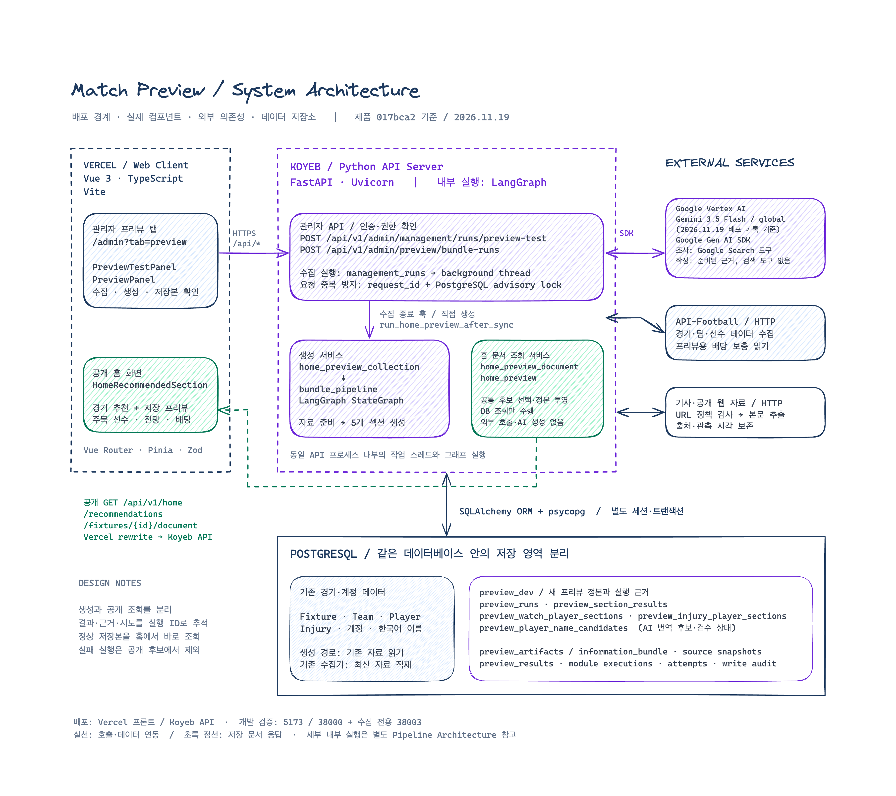

# benchmark

경기 전 프리뷰를 읽는 축구 팬과 수집·생성을 운영하는 관리자를 위한 축구 정보 서비스다. 흩어진 경기 기록과 외부 근거를 모아 주목 선수, 부상·결장, 외부 전망, 배당, AI 전망을 생성하고 저장된 결과를 홈에서 제공한다. 경기·팀·선수 조회와 방송용 정보 화면도 포함한다.

[서비스 열기](https://benchmark-v3-steel.vercel.app) · [기능별 구현 문서](docs/portfolio/README.md) · [아키텍처 도식](docs/portfolio/assets/README.md)

서비스 주소는 2026-11-19 배포 확인 기록 기준이다. 현재 가용성을 상시 확인하는 표시가 아니다.

## 이용 흐름

- 독자는 홈에서 경기 프리뷰를 읽고 경기·팀·선수 기록을 찾아본다.
- 관리자는 기존 관리자 계정으로 로그인해 프리뷰 탭에서 기간 수집, 생성 결과, 저장 문서와 홈 반영 상태를 확인한다.
- 방송 화면은 경기 정보를 오버레이·프로그램용 화면으로 구성한다. 구현 소스는 있지만 운영 인증·OBS·라이브 경기의 전체 연동 검증은 별도로 남아 있다.

## 기술 구성

| 구간 | 기술 | 역할 |
|---|---|---|
| 웹 클라이언트 | Vue 3 · TypeScript · Vite / Vercel | 경기 조회, 관리자 화면, 저장 프리뷰 표시 |
| API 서버 | FastAPI · Uvicorn / Koyeb | 인증, 수집·생성 실행, 저장 문서 조회 |
| 프리뷰 생성 | LangGraph · Vertex AI | 근거 조사, 섹션 작성, 모델 호출·재시도 제어 |
| 데이터 저장 | PostgreSQL | 기존 경기·계정 자료와 `preview_dev` 실행·정본 자료 |

그림은 프리뷰 기능 범위다. 생성 엔진은 FastAPI 프로세스 안에서 실행되며 별도 마이크로서비스가 아니다. [배포 구조](docs/portfolio/deployment/README.md)와 [생성 엔진 상세](docs/portfolio/preview-generation/README.md)에서 처리·저장 경계를 설명한다.

## 기능별 구현 문서

각 문서는 해결하려는 문제, 구성 요소의 역할, 실제 요청과 저장 흐름, 설계 선택, 검증 근거와 남은 한계를 설명한다. 프리뷰 도식은 이전 포트폴리오 작업의 Excalidraw 원본과 PNG를 함께 제공한다.

| 기능 | 구현 설명 | 확인 범위 |
|---|---|---|
| 홈 추천·저장 프리뷰 | [홈 README](docs/portfolio/home/README.md) | 추천 목록과 저장 문서 조회, 실패 실행 제외 |
| 경기·팀·선수·기록 조회 | [축구 데이터 README](docs/portfolio/match-data/README.md) | DB 기반 API와 화면 연결 소스 |
| 프리뷰 생성 엔진 | [생성 엔진 README](docs/portfolio/preview-generation/README.md) | LangGraph 조사·수집·섹션 작성·정본 저장 |
| Vertex AI 호출 제어 | [모델 호출 README](docs/portfolio/vertex-ai/README.md) | 단일 호출 통로, 재시도, 예산, 전송 장부 |
| 수집·실행 관리 | [수집 관리 README](docs/portfolio/collection/README.md) | 기간 수집, 실행 기록, 수집 후 자동 생성 |
| 선수 정본·이름 번역 | [선수 저장·번역 README](docs/portfolio/player-storage/README.md) | 선수 슬롯 정본, AI 이름 후보, 기존 번역 편집 |
| 로그인·권한·개발 세션 | [인증 README](docs/portfolio/auth/README.md) | 기존 계정 재사용, 서버 권한 검사, 개발 세션 분리 |
| 방송 오버레이·프로그램 화면 | [방송 README](docs/portfolio/broadcast/README.md) | 별도 HTML 진입점, 스냅샷 API와 캐시 구성 소스 |

[포트폴리오 전체 목차와 읽는 순서](docs/portfolio/README.md) · [배포 구조와 검증 기록](docs/portfolio/deployment/README.md) · [Excalidraw 도식 원본](docs/portfolio/assets/README.md)

뉴스 관리·문맥 연결과 자연어 검색은 미구현 범위로 분류해 기능 목록에서 제외했다. 기존 소스에 뉴스 목록 조회 API가 있는 것과 뉴스 관리 기능이 완성된 것은 구분한다.

## 소스와 로컬 실행 안내

구현 소스는 `lebind12/preview-api-migration` 브랜치에 있다. 이 문서의 기준 리비전은 [제품 `017bca2`](https://github.com/lebind12/benchmarkV3/tree/017bca2ae67bb4957e81964ae1c9ca3b3edd422d)이며 main 병합을 의미하지 않는다. 현재 로컬 main 작업트리는 기획·문서 보관용으로 정리되어 여기서 바로 앱을 실행할 수 없다. 이 로컬 정리에 따른 소스 삭제는 커밋하지 않았으므로 원격 main의 파일 구성과는 다르다.

| 확인할 내용 | 구현 리비전의 파일 |
|---|---|
| 백엔드 의존성 | [pyproject.toml](https://github.com/lebind12/benchmarkV3/blob/017bca2ae67bb4957e81964ae1c9ca3b3edd422d/pyproject.toml) |
| 프론트 의존성과 실행 스크립트 | [frontend/package.json](https://github.com/lebind12/benchmarkV3/blob/017bca2ae67bb4957e81964ae1c9ca3b3edd422d/frontend/package.json) |
| 환경 변수 예시 | [.env.example](https://github.com/lebind12/benchmarkV3/blob/017bca2ae67bb4957e81964ae1c9ca3b3edd422d/.env.example) |
| 실행·배포 경계와 확인 기록 | [배포 README](docs/portfolio/deployment/README.md) |

새 환경에서 재현 가능한 설치·실행 가이드는 아직 정리하지 않았다. 위 파일은 소스와 설정의 진입점이며 환경 예시만 복사하면 바로 실행된다는 뜻은 아니다. 구현 리비전의 README에는 11월 9일의 “앱 없음” 안내가 남아 있지만, 해당 트리에는 `app/`과 `frontend/` 소스가 존재한다. 현재 구현 설명은 이 문서와 기능별 README를 기준으로 읽는다.

## 구현 상태와 문서 기준

문서 확인일은 **2026-11-19**다. 프리뷰는 두 경기의 다섯 섹션 저장·공개 API 일치를 확인한 기록이 있다. 소스 확인에 그친 기능과 실제 연동까지 확인한 기능은 위 표와 각 README에서 구분한다. 두 경기 결과를 서비스 전체의 성공률이나 정확도 수치로 확대하지 않는다. 자세한 리비전과 근거는 [문서 읽기 기준](docs/portfolio/README.md)에 모았다.

이 프로젝트는 코딩 에이전트가 구현·검사를 수행하고 사용자가 요구사항과 수용 기준을 정한 작업 기록을 갖는다. 요구 결정·아키텍처 조정·결과 검증과 직접 코드 작성의 기여는 구분한다.

## 기획·작업 이력

- [내부 작업 진행표](Plans.md)
- 기획 보존 문서 (`docs/planning/README.md`, 로컬 보존 자료): 11월 9일 정리 시점의 기록. 이후 구현 상태는 위 기능 문서와 작업 기록을 따른다.
- 서비스 공통 기획 (`docs/planning/service.md`, 로컬 보존 자료)
- 수집·번역 관리 기획 (`docs/planning/management.md`, 로컬 보존 자료)

2026-11-09의 기존 README 안내 보존

아래는 당시 main 작업트리 정리를 설명한 안내다. 공개 저장소에 포함하지 않은 로컬 문서는 파일 경로만 남겼다. 이후 별도 브랜치에서 진행된 구현의 현재 상태를 뜻하지 않는다.

### benchmark — 공통 서비스·홈·관리·방송 기획

**기획 보관 / 개발 코드 삭제 / 재개발 미착수** · 2026-11-09

현재 워크트리: `/Users/woolee/benchmark`

브랜치: `main`

- 이 워크트리의 주요 기획 (`docs/planning/service.md`, 로컬 보존 자료)
- 네 워크트리의 전체 기획 (`docs/planning/README.md`, 로컬 보존 자료)
- 미결정과 재개 조건 (`docs/planning/open-questions.md`, 로컬 보존 자료)
- 사용자 결정과 삭제 범위 (`docs/decisions/2026-11-09-planning-only-worktrees.md`, 로컬 보존 자료)
- 기획 원문·출처 (`docs/planning/source-index.md`, 로컬 보존 자료)
- 정리 검증 기록 (`docs/planning/cleanup-record.md`, 로컬 보존 자료)

소스·테스트·마이그레이션·개발 도구·의존성·로컬 환경·생성물은 삭제했다. 실행할 로컬 앱은 없다. 기획 참고본의 완료·테스트 수치·실행 명령은 과거 기록이다.

후속 요청으로 AX·뉴스 문맥·뉴스 데이터 워크트리 3개를 삭제했다. 현재 이 main 기본 저장소에 모든 기획과 Git 이력을 보존한다. 이번 파일 변경은 커밋하지 않은 로컬 상태다. 원격 서비스와 DB 상태는 이 정리로 변경하지 않았다.

