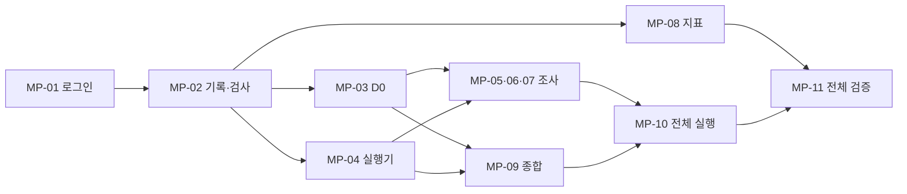
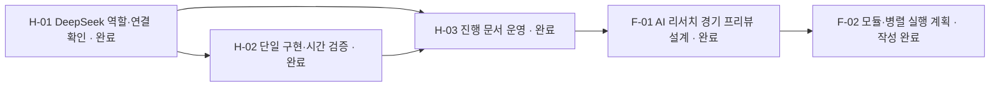

# 2026-11-10 진행 기록 보관본

2026-11-11 00:24 KST에 긴 기록을 현재 [Plans.md](../../../../Plans.md)에서 이동했다. 당시 설명·판단은 과거 상태이며 최신 사용자 기준과 현재 상태는 루트 진행 문서를 따른다. /tmp 경로는 임시 자료다. 원본의 저장소 상대 링크는 보관 위치에 맞춰 조정했다.

# benchmark 작업 상태

마지막 갱신: 2026-11-10 23:49 KST. 작성 책임: GPT 오케스트레이터.

## 현재 상황

- 사용자가 사실 근거와 AI 판단의 검증 경계를 명확히 했다. 사실/사실로 서술하는 원인·경위는 API·검색 자료로 확인한다. 주목선수·관전포인트·예상스코어는 AI의 선정/해석이며 결론 자체를 증명하는 외부 출처를 요구하지 않는다. 판단에 사용한 사실을 검증하며 API 근거만으로도 충분할 수 있다.
- 부상 API 상태·사유를 활용하고 실제 발생 날짜/경기/경위는 프리뷰에 필요한 범위에서 보완한다. 완벽한 경위 확보를 완료 기준으로 삼지 않는다. 미확인 부분은 단정하지 않고 관리자에 기록하며 사용 가능한 섹션 전체를 버리지 않는다. 이 최신 기준을 설계§5·품질§8과 구현계획에 반영했다.
- 기존 R1 검증은 사실/AI해석이 섞인 항목 전체를 탈락시켜 사용 가능한 의견까지 버리는 문제가 있었다. 검색 citation0은 실제 관측이지만 AI의 선정 자체가 검증 실패라는 설명은 부정확했다. 새 task_586a073e2cb7/ctx_4d5c9c255499에 사실·판단 분리와 저장응답 재검증을 배정했다. 추가모델/API0, 대표 변경회귀만 허용한다. ready는 접수이며 실제 착수 미관측이다.
- 내부ID 노출 수정 task_545d427e7496는1a9bee1로 완료 보고를 받았다. 관측회귀1건 failing→pass, 후보본문v2를 append했고 원문/v1/구조화근거는 보존했다. 호출0/승인0이며 backend 재시작 전이다. 새 기준 수정과 함께 재시작을 한 번 요청받도록 했다.
- /admin/sections의 경기·섹션 선택/실행/본문/근거/사용자승인 UI는 연결됐다. R1 실제모델1회와 MIME비교1회는 모두 citation0이었다. R2/R3는 통합·녹화응답 검사까지, S1/전체파이프라인/체크포인트는 미구현이다. 추가 유료실험은 중단했다.
- 전용 backend8000은 sh scripts/run_preview_dev.sh, frontend5173은 Vite로 유지한다. 기존 로그인 복구 후 로그인/세션/실행목록200 확인. 운영 기존 계정/경기는 읽기전용, 신규 기록 preview_dev만 쓰는 경계다.
- 현재 단일 DeepSeek·Max 담당이 새 기준 반영을 수행하며 Plans.md/설계/정책은 조정자 소유다. 기존808 삭제·다른 dirty 변경은 보존한다. 광범위 검사 반복·배포/push·임의 모델/권한 변경을 하지 않는다.

## 경기 프리뷰 기획

사용자가 2026-11-10에 `brainstorming` 스킬로 AI 리서치 기반 경기 프리뷰 기획을 시작하도록 요청했다.
음성입력의 오타는 문맥으로 해석하고, 요구사항의 의미가 달라지는 경우에만 확인한다.

| ID | 작업과 수용 기준 | 담당 | 선행 작업 | 상태 | 현재 결과와 다음 행동 |
|---|---|---|---|---|---|
| F-01 | 프리뷰의 사용자 가치·범위·접근 대안·데이터 확인 방법을 정리하고 설계 문서를 검토받기 | GPT, brainstorming | 기존 기획·폐기 결정 확인 | 완료 | [설계](../../../../docs/superpowers/specs/2026-11-10-match-preview-design.md)를 사용자가 확정하고 구현 계획을 요청했다. 최종 모델·연결 환경과 후속 자동화 마감은 명시한 선행 조건으로 유지한다. |
| F-02 | 설계에 맞춰 모듈별 파일·입출력·병렬 관계·검사 화면·지표·검증 기준을 계획하고 자체 검토 | GPT, writing-plans | F-01 | 완료 | [구현 계획](../../../../docs/superpowers/plans/2026-11-10-match-preview.md) 작성·자체 검토 완료. 사용자가 계획대로 실행을 승인했다. |

설계·계획 문서 작성은 F-01~F-02 두 건 완료다. 제품 구현 완료율을 의미하지 않는다. 승인된 MP-01~MP-11은 아래 실행 표에서 추적한다.
F-02 연결 지점 조사 워커: Task `task_c9edfd1915f6`, Dispatch `ctx_284182fe5816`, 세션 `structworker_66880afe-cb99-43a3-b290-22823443d81c`. 15:29 KST succeeded 보고의 현재 코드 부재·과거 파일 경로·검증 명령 근거를 확인해 조사 완료로 수용했다. 실행기는 Codex, 상세 모델은 보고에 없어 미확인이다. 읽기 전용 조사만 수행했고 사용자도 별도 소스가 없다고 확인했다. 조정자가 이를 최소 앱 신규 작성 계획에 반영하고 계획 자체 검토를 직접 마쳤다.
설계 검토 워커: Task `task_8aceebd25cc0`, Dispatch `ctx_462fa5b107fb`, 세션 `structworker_d0a646ad-6d50-4dc4-beaf-17f9c6085bdb`. 15:13 KST에 succeeded 완료 보고와 설계 §5·§7·§8의 질문 근거를 조정자가 확인해 검토 작업을 완료로 수용했다. 실행기는 Codex이며 상세 모델은 보고에 없어 미확인이다. 파일 수정·구현은 없었다. 일부 자료 누락 질문에는 이후 사용자가 독자용 화면에서 안내를 없애고 관리자 기록·지표로 확인하도록 답해 반영했다. 추가 지표 세부는 조정자가 점검했고 이전 독립 검토의 범위로 주장하지 않는다. 이후 사용자가 설계를 확정했으며 1시간 전 마감의 엄격성은 후속 자동화에서 정한다.
이번 설계와 구현 계획은 새 요구를 기준으로 한다. 과거 프리뷰의 생성 구조, 화면 구성, 모델과 세부 항목을 자동 승계하지 않는다.
개발 중 원문 응답·변환 결과·다음 입력·최종 프리뷰를 사람이 확인할 수 있어야 한다는 기존 사용자 요구를 기획에 반영한다.
구현 모델 DeepSeek 전용과 조정자 GPT/Opus의 역할 제한은 유지한다. 제품의 AI 제공자는 GCP Vertex AI다. 사용자 후보는 3.8·3.7이며 공식 모델명으로 Gemini 3.8 Flash와 3.7 Flash를 검토한다. 최종 모델 선택은 아직 확정하지 않았다.
사용자의 실행 승인에 따라 pstack으로 개발한다. 확정한 설계와 실행 방식을 다시 선택하도록 묻지 않는다.

## 경기 프리뷰 개발 실행

승인된 구현 작업은11건이다. 로그인은 사용자 직접 확인 완료, 호출 검사·실행기·지표는 기반 연결 검증을 마쳤다. 실제 연구 본문은 MP-05~07에서 개발하고 사용자 검토·승인을 별도로 기록한다. 작업 수는 제품 완성도나 남은 시간을 나타내지 않는다. 파일 범위·수용 조건·검증 명령은 [구현 계획 §3·§6](../../../../docs/superpowers/plans/2026-11-10-match-preview.md)에 있다. GPT는 조정·문서·실행 증거 확인을 맡고 구현·독립 검토는 각각 별도 DeepSeek 세션이 수행한다.

| ID | 결과와 수용 기준 | 구현 담당 | 선행 | 상태 | 근거와 다음 행동 |
|---|---|---|---|---|---|
| MP-01 | 기존 운영 계정 기반 ADMIN 로그인, 권한·만료·로그아웃, 사용자 직접 시험 | DeepSeek 연결 담당, GPT 조정 | 실제 운영 연결·인증 스키마 확인 | 완료 | HEAD3f154a6 구현·검증 증거와 사용자 정상 로그인 확인을 수용. 사용자가 로그아웃을 직접 시험했는지는 미확인이나 기존 자동 검증 증거는 보존. 다음 MP-02 배정 |
| MP-02 | 지속 기록·진단 검사·버전 비교·undo·섹션 승인 기록 | 원 담당 종료, 공통 연결 인계 | MP-01 완료 | 기반 확인 | SectionResult 저장·승인 연결까지 MP-04 구현/검증 보고. mock 승인은 거부하며 실제 연구 본문에 대한 사용자 승인은 아직 없음 |
| MP-03 | 경기 선택·D0 API 자료·출처 보존 | 원 담당 종료, MP-05 연결 소유 | MP-02 공통 계약 | API 연결 잔여 | 실제 저장 경기50건 읽기·선택 화면 검증 보고. API-Football live 미검증이며 MP-05 필요 자료 보완에 공통 transport로 연결 |
| MP-04 | LangGraph 섹션 실행기·429·예산·재생·승인 연결 | 원 담당 및 마무리 담당 종료 | MP-02 공통 계약 | 연결 검증 완료 | 실제 Chromium16/16·모델 공통 전송1회200 보고 확인. 실연구 품질·체크포인트 재개·전체 파이프라인은 후속 범위 |
| MP-05 | 경기력·주목 선수 섹션과 실제 본문 검사 | 구현 담당 종료, 진단 ctx_622099e4dcf5 | MP-03·04 계약 | 실결과 보완 | 6326a5f 등 통합 구현. live1회200·API근거 본문, 인용0으로 선수/관전포인트 전부 제외. 원문 기반 인용0 진단 배정 |
| MP-06 | 부상·결장 섹션과 불확실성 보존 | 전용/통합 담당 종료 | MP-03·04 계약 | live 검증 잔여 | 모듈·섹션 factory·패널 등록 완료 보고. 기록 응답 검증 통과, 실제 연구/사용자 승인 미검증 |
| MP-07 | 배당·외부 전망 섹션과 근거 검사 | 전용/통합 담당 종료 | MP-03·04 계약 | live 검증 잔여 | 통합 구현 완료 보고. 최종25 backend/8 UI, 실패/재시도 집계 수정. 실제 연구·D0 odds·사용자 승인 미검증 |
| MP-08 | 지표·차트·분모·실행 상세 연결 | 전용/통합 담당 종료 | MP-02 저장 계약 | 연결 검증 완료 | 집계 집중 검사·필터 유지·실제 브라우저 왕복 이동 확인 보고. 실제 연구 live 표본 기반 지표는 후속 실행 후 검증 |
| MP-09 | S1 종합과 진단 없는 독자용 프리뷰 | DeepSeek 종합 담당, 미배정 | MP-03·04 및 조사 계약 | 대기 | 명시적인 모의 결과로 조사 모듈과 병렬 가능 |
| MP-10 | 전체 실행·재개·중복 방지·재종합 | DeepSeek 통합 담당, 미배정 | MP-03~07·09 | 대기 | 공통 파일 소유권 순차 인계 |
| MP-11 | 전체 테스트·실호출·브라우저·운영 안내 | DeepSeek 구현·독립 검토, GPT 증거 확인 | MP-08·10 | 대기 | mock·replay·live 증거를 구분해 인계 |

### 실행 순서와 파일 소유권

- **Blocking first steps:** MP-01 로그인·권한 검증 후 MP-02 지속 기록·검사 화면을 검증한다.
- **Independent workstreams:** 이후 MP-03·04·08을 최대 3개 DeepSeek 워커로 병렬 배정한다. 준비된 다음 작업은 다른 독립 작업의 완료를 기다리지 않는다.
- **Shared mutable state:** 공통 설정·마이그레이션·라우터·등록부는 통합 소유자 한 명이 편집한다. Plans.md는 조정자만 편집한다. 병렬 워커는 분리된 자기 파일만 수정한다.
- **Smallest safe decomposition:** 앱 환경·인증·로그인 검증을 한 소유자가 맡고, 검사 화면까지 검증한 다음 모듈별로 분리한다. 함수별 워커나 반복 설계 경쟁은 추가하지 않는다.

### pstack 실행 체크리스트

전체 실행은 figure-it-out의 검증 단위별 흐름을 사용한다. how의 연결 조사는 F-02 결과를 재사용하고 실제 코드와 계약의 차이만 추가 확인한다.

- [x] Read the Principles section of the poteto-mode skill.
- [x] Phase A: Frame. 완료 조건은 ADMIN이 실제 경기 프리뷰를 생성하고 호출·근거·지표를 확인하는 것. 첫 단위는 로그인이다. 현재 앱 부재와 기존 미커밋 삭제를 확인했다.
- [x] Phase B: Design the workflow. 승인된 MP-01~MP-11과 선행·병렬 관계를 사용한다. skip: 확정 설계를 다시 architect·arena로 경쟁 구현하지 않는다.
- [ ] Phase C: Run the loop. 각 작업의 동작 실패·수정·통과·실제 화면 증거를 확인한 뒤 선행 조건을 해제한다.
- [ ] Phase D: Keep the audit trail. 프로젝트 지침에 따라 결정·상태·근거는 이 문서에 기록하고 긴 출력은 작업 보고서로 연결한다.
- [ ] Phase E: Verify and hand back. 현재 체크아웃의 전체 경로를 검증하고 미검증 실호출을 완료로 처리하지 않는다.

### 배정·결정·실행 증거

| 확인 시각 KST | 작업 | 관측·결정 | 근거·판정 |
|---|---|---|---|
| 2026-11-10 16:06 | 착수 | 사용자 실행 승인. 로그인과 검사 화면을 먼저 완성한다. | 현재 사용자 요청, 구현 계획 §4 |
| 2026-11-10 16:06 | MP-01 환경 | 신규 DSH 화면에서 deepseek-ai/deepseek-v4.1-flash-1017, Max effort, 정확한 cwd와 정상 입력란을 확인. 설정 변경 없음 | terminal term_148aaf2a-9dc4-44e8-9a9e-a8cec2c87393, launch operation 1794294353581-649ae12bb7314fb29053d329ab122811 |
| 2026-11-10 16:09 | MP-01 배정 | 동일 터미널을 감독 워커로 연결. 로그인·권한·로컬 DB·브라우저 검증과 파일 소유권을 전달. 워커는 Plans.md를 수정하지 않음 | Run run_06eac11a43f8, Task task_28f1abd002b5, Dispatch ctx_ab58528dc487, ready. 실제 작업 시작 시각·검증은 아직 미관측 |
| 2026-11-10 16:10 | MP-01 착수 보고 수신 | 워커가 세션 메타데이터의 provider=hive, model=deepseek-ai/deepseek-v4.1-flash-1017, reasoningEffort=max, profile=dsh-tui와 cwd를 확인했다. 보고한 시작은 16:09:03 KST. Python 3.11.4·Node 22.19.0·npm 11.11.0·Docker 실행을 확인했고 격리 로컬 PostgreSQL 컨테이너로 환경을 구성할 예정 | status msg_c0167aac8277, 동일 Task·Dispatch. 시작 확인, 테스트·화면 통과 증거는 아직 없음 |
| 2026-11-10 16:27 | MP-01 완료 보고 검토 | DeepSeek 보고의 pytest 23, Vitest 9, Chromium E2E 3 통과 출력과 코드·실패 선행 출력을 확인. 로컬 커밋 0f2c37e·af494fc는 확인했으나 수용 전 결함 수정 필요 | [MP-01 보고](../../../../docs/implementation/match-preview/MP-01-report.md), [증거](../../../../docs/implementation/match-preview/evidence/). NOT VERIFIED |
| 2026-11-10 16:28 | 실제 화면 확인 | Orca 브라우저에서 /admin/runs 비로그인 접근이 /admin/login으로 이동하고 이메일·비밀번호·로그인 폼이 렌더링됨을 관측 | browser page 8893b982-2b34-4d6b-86dd-88a4ac268e85. 로그인 후 화면은 아직 조정자가 직접 조작하지 않음 |
| 2026-11-10 16:28 | 검증 결함 발견 | conftest의 public 스키마 삭제가 전용 test DB 이름을 검사하지 않음. docker port에서 0.0.0.0·[::] 바인딩 확인. 합성 입력으로 로그인 422가 password 객체를 그대로 반환함을 관측. E2E 만료·비ADMIN 명칭은 실제 쿠키 삭제·익명 검사와 다름 | tests/preview/conftest.py, frontend/e2e/preview-access.spec.ts, docker port 출력, 로컬 curl HTTP 422. 실비밀번호는 사용·출력하지 않음 |
| 2026-11-10 16:29 | 수정·독립 검토 배정 | 기존 DB·개발 프로세스와 미커밋 작업을 소유한 DeepSeek에 수정 재배정. 전용 로컬 test DB 보호, 데이터 보존하며 루프백 바인딩, 오류 입력 비노출, 증거 표현 정정·검증 요구. 별도 Codex는 읽기 전용 검토만 수행 | 수정 Task task_c84bf222b4a3, Dispatch ctx_ac8391d43805, same terminal. 검토 Task task_eb91b6745e33, Dispatch ctx_58a6826039a2, session structworker_5e421d9e-7f69-4aa5-8c5c-f431709ee593. 둘 다 ready 배정 증거, 실제 착수는 미관측 |
| 2026-11-10 16:31 | 원 구현 독립 검토 완료 | 기존 지적을 재확인했고 실패한 로그아웃의 무조건 화면 이동, 실패 E2E trace의 자격 증명 캡처 설정을 추가 지적. 조정자가 현재 signOut·Playwright 설정·과거 실패 출력의 3개 ModuleNotFoundError를 직접 확인해 수정·증거 정정을 수용. 검토 범위에서 추가 서버 권한 우회는 발견되지 않음 | Task task_eb91b6745e33 / Dispatch ctx_58a6826039a2 worker_done. 코드 변경 없음. 원 구현의 검토 완료이며 수정본 수용은 아님 |
| 2026-11-10 16:31 | 추가 지적 전달 | DeepSeek에 실패 로그아웃·추적 파일 비밀값 보호·실패 기록의 혼합 유형 정정·주석의 사실 일치·프론트 만료 처리 증거를 요청. 동일 수정 작업으로 합쳐 기획 재수행 없이 진행 | ctx_ac8391d43805에 msg_2b4762fa76ed 전달. 전체 23건이 동작 실패라는 기존 표현은 정정 대상이며 원래 증거는 보존 |
| 2026-11-10 16:35 | 검토 모델 변경 | 사용자 요청으로 독립 검토 워커를 DeepSeek 전용으로 변경. 기획·조정은 GPT/Opus 유지. 구현·검토 세션 분리, 검토 읽기 전용, 실제 모델 확인과 대체 금지를 정책·계획·설계에 반영. 원래 Codex 검토를 재실행하지 않고 수정본부터 적용 | AGENTS.md, CLAUDE.md, 구현 계획·설계. 확인된 모델 deepseek-ai/deepseek-v4.1-flash-1017, Orca dsh 실행 경로. 활성 수정 워커에 msg_7ea7ccddf4b5 전달 |
| 2026-11-10 16:38 | MP-01 수정 보고 수신 | task_c84bf222b4a3 완료 보고. 전체 pytest 46건은 guard 11·redaction 10을 포함하며 별도로 합산하지 않음. 워커 보고 커밋 1c8d46a·38e42e6·5a56d83·8087614, 백엔드 pid48806·Vite pid38811. 검토 전 수용 보류 | [수정 보고](../../../../docs/implementation/match-preview/MP-01-report.md), evidence/09~16. 자체 검증 보고이며 독립 검토는 아직 없음 |
| 2026-11-10 16:38 | DeepSeek 독립 검토 배정 | 신규 DSH의 정상 화면에서 deepseek-ai/deepseek-v4.1-flash-1017·Max·cwd 확인 후 읽기 전용 검토 배정. 기존 지적만 집중 확인하고 새 설계·구현·파괴적 DB 테스트 금지 | terminal term_f7719a43-6d3e-428d-8709-60318eab03f1, Task task_58c6b12dca94, Dispatch ctx_117246f5b015, ready. 실제 착수 아직 미관측 |
| 2026-11-10 16:39 | 추가 지시 전달 실패 알림 | Orca가 완료된 수정 워커에 미열람 지시를 이어 전달하지 못했다고 알림. timeout이며 메일은 보존됨. 로그아웃 실패·테스트 아티팩트·과거 실패 기록 정정이 반영됐다고 주장하지 않음. 검토 결과의 누락 항목을 통합해 다음 DeepSeek 수정 작업에 전달 | escalation msg_followup_2cfea005a3940042781a005a, dispatch ctx_ac8391d43805. 중복 구현 워커는 시작하지 않음 |
| 2026-11-10 16:47 | 추가 수정 보고 수신·최신 검토 지시 | 구현 워커가 앞서 누락 가능성이 있던 지적까지 반영했다고 status 보고. 조정자가 HEAD4595436과 보고서의 2차 수정·증거17~21 참조를 확인. 로그아웃 실패 후 동일 세션으로 재시도, 합성 카나리로 trace 유출 재현·차단·음성 대조, 혼합 실패 유형 정정·401 프론트 처리 증거를 보고함 | status msg_d6c026cb973e, Task task_c84bf222b4a3. pytest46·Vitest16·E2E5·artifact-safety PASS는 자체 검증 보고. 독립 검토에 msg_a160412e55d9로 최신 리비전 전달. 수신·최신 리비전 검토 완료는 아직 미관측 |

17:07 KST 검토·후속 수정 기록: DeepSeek 검토 task_58c6b12dca94 / ctx_117246f5b015가 HEAD4595436에서 완료됐다. 보고된 실제 모델은 hive / deepseek-ai/deepseek-v4.1-flash-1017 / max다. 기존 수정 항목을 확인했고 guard 단독 pytest11 통과와 합성 422 확인을 보고했으나 URL의 query host·dbname 우회와 clean git archive의 테스트 수집 ImportError를 지적해 미수용 판정했다. 후속 수정 task_17bc8aa05ecc / ctx_4eefd3564dde는 신규 terminal term_0f1769ef-941a-4caa-bb31-5c29d91b944a에 배정했다. 화면에서 동일 DeepSeek 모델·Max·cwd·정상 입력을 확인했고 ready만 수신, 실제 착수는 아직 미관측이다. 재현성 수용 범위는 새 MP-01 프리뷰 테스트이며 예전 서비스 재구축이나 809개 삭제 일괄 커밋을 요구하지 않는다. 보고서의 모킹·tsx 의존성·추가 파일 목록 표현도 정정 요청했다.

완료 검토 디스패치 ctx_117246f5b015의 후속 메일 timeout 알림 msg_followup_425059e29e3b3c02a5d9b707은 별도 기록한다. 검토 보고 자체가 최신 HEAD4595436을 명시했으므로 같은 검토를 중복 배정하거나 실패한 메일을 반복 전달하지 않는다.

검토 스킬 적용 범위: poteto-mode에 따른 구현·독립 검토 분리, 검토 워커의 no-comments 지침을 활용한 읽기 전용 주석 점검, 조정자의 principle-prove-it-works에 따른 실제 코드·출력·화면 확인이다. 인증·DB·비밀값·증거 검토 항목은 MP-01 수용 기준에 맞춰 작성했다. interrogate 다중 모델 절차 전체를 실행한 것으로 주장하지 않는다.
모델 설정 확인에서 사용자 홈의 pstack 모델 규칙 파일은 없었다. 변경은 프로젝트 AGENTS.md의 최우선 역할·실행기 규칙에 반영했다. Orca 전체의 기본 Codex 모델이나 다른 프로젝트 설정은 변경하지 않았으며, 이 프로젝트의 리뷰를 Codex 기본값으로 시작하는 경로를 금지했다. 새 DeepSeek 독립 검토는 위 기록대로 실제 실행·완료됐다.

MP-01 배정문은 `/tmp/match-preview-mp01-brief.md`에 있는 임시 자료다. 수용 범위의 영구 기준은 구현 계획 MP-01이다. [워커 보고서](../../../../docs/implementation/match-preview/MP-01-report.md)와 [기동 안내](../../../../docs/implementation/match-preview/MP-01-local-setup.md)가 생성됐다. 현재는 원 구현 보고이며 위 지적 사항의 수정 보고를 기다린다. 후속 테스트 전 전용 DB 보호를 먼저 확인한다.
16:49 KST 전달 문제 후속: 구현 워커는 미열람 두 지시를 이미 읽고 4595436에 반영했으며, 실패한 과거 디스패치 ctx_1760ec6993d7의 미열람 표시만 남았다고 보고했다. msg_5117af067371에 추가 구현 지시가 없음을 답하고 반복 mailbox 확인을 중단하도록 전달했다. reply msg_94150ee80b36은 live terminal-only mailbox에 접수됐고 터미널 종료 후 내구성은 보장되지 않는다. 메일 표시 자체를 해소했다고 주장하지 않으며, 최신 수정본의 독립 검토는 ctx_117246f5b015에서 계속 처리한다.
조정자는 착수 시 추적 파일의 미커밋 상태 838행을 관측했다. 워커의 시작 보고에는 기존 삭제 847건이 기록되어 있다. 집계 기준·시점이 달라 동일한 값으로 간주하지 않으며 실제 인계 때 파일별 diff로 범위를 확인한다. 일괄 복구·스테이징하지 않는다. 운영 DB·배포·공개 홈 연결은 현재 범위에 없다. 실제 제품 모델·API 인증·계정 한도 확인은 후속 실호출의 선행 조건이며 MP-01·02 로컬 검증을 막지 않는다.

### 사용자에게 확인된 목적과 내용

- 목적은 경기 관련 사전 정보를 알고 시청하면서 경기를 더 재미있게 즐기도록 돕는 것이다.
- 대상은 축구를 어느 정도 알고 있으며 경기 관련 정보를 찾으려고 사이트를 방문하는 이용자다.
- 서비스를 이용하는 스트리머가 추천 경기의 프리뷰를 중계 준비에 활용하는 것이 구체적인 이용 맥락이다.
- 경기에서 주목할 관전 포인트와 최근 활약으로 눈여겨볼 선수를 소개한다.
- 핵심 선수의 부상·결장 여부와 해당 결장이 전력에 미치는 영향을 다룬다.
- 공개 배당과 스포츠 매체의 경기 흐름·결과·예상 스코어를 조사해 함께 참고한다. 실제 베팅을 하지 않는 이용자에게도 경기 전망을 이해하는 자료로 활용한다.
- AI는 수집 자료를 종합해 자신의 예상과 그 이유를 제시한다. 단순히 자료를 나열하는 것만으로는 목표를 충족하지 않는다.
- 반드시 포함할 사이트나 선호 매체는 없다. 검색 결과를 최대한 활용해 자료를 조사하는 방식을 원한다.
- 사용자는 주제별 조사 후 종합을 선택했다. 각 모델 호출을 모듈화해 의도대로 개발됐는지 개별 확인하고, 모듈의 조사 결과를 조합해 최종 프리뷰를 만들기를 원한다.
- 기존에 연결된 데이터 API를 함께 사용한다. 검색 결과가 없을 때도 API 정보를 활용하며, 부상처럼 API로 직접 조회할 수 있는 정보는 적극 사용한다.
- 완성된 프리뷰 화면에는 자료 누락·미확보 메시지를 표시하지 않는다. 관련 진단은 실행 로그와 관리자 대시보드에서만 확인한다.
- 실행 결과를 표·그래프·빈도 등 지표로 확인하고, 개발 이후 유지보수에서도 문제 원인을 찾아 수정·보완할 수 있어야 한다. 검사 도구는 임시 개발용으로 끝내지 않는다.

1차는 관리자 요청·검사·프리뷰 확인이며 공개 홈 연결은 후속이다. 출력 구성·자료 채택·호출 상한의 초기 값은 구현 계획에 제안했다. Vertex AI 최종 모델과 실제 인증·계정 제한, 후속 자동화 마감·공개 정책은 선행 확인 사항으로 남는다.
조정자의 제안은 확인된 사실·외부 전망·AI의 해석을 구분해 근거를 따라갈 수 있게 하는 것이다. 이는 사용자 확정 사항과 구분한다.
독자 수준에 맞춰 기초 규칙 설명보다 이번 경기의 전력 변화, 관전 포인트와 판단 근거에 비중을 두는 방향을 제안한다. 전문 용어와 세부 분석의 깊이는 추가로 구체화한다.

### 실행 기록과 유지보수에 대한 설계 반영

사용자 요구를 [설계안 §6~§9](../../../../docs/superpowers/specs/2026-11-10-match-preview-design.md)에 반영했다. 독자용 데이터와 관리자 진단을 분리하고, 로그·실행 이력·집계 지표·원래 요청과 응답·수정 전후 재생 비교를 하나의 경로로 연결한다. 프리뷰에 없는 자료 항목은 생략하되 누락 원인과 API 보완 이력은 내부에 보존한다.

초기 지표는 프리뷰 완료율, 모듈 실행 성공률, 자료 확보율·누락 사유, API 보완 빈도, 429·오류율, 재시도·복구, 처리 시간, 제공되는 사용량으로 제안했다. 기간·분모·표본 수를 함께 표시하고 논리적 실행과 요청 시도, 운영과 개발·모의·재생을 구분한다. 실제 구현·집계·화면 검증은 아직 하지 않았다.

### 사용자에게 확인된 제공 단계

| 단계 | 사용자 요청 | 아직 정하지 않은 내용 |
|---|---|---|
| 1차 목표 | 관리자만 특정 경기를 선택해 생성을 요청할 수 있다. 요청한 경기의 프리뷰를 생성하는 기능을 먼저 구현·검증한다. | 관리자 검사 화면과 프리뷰, 모듈 재실행을 설계에 포함했다. 호출 상한·최소 앱 범위는 구현 계획 검토 대상이다. |
| 최종 목표 | 기존 홈의 추천 경기 우선순위를 활용한다. 수집 로직과 연결해 추천 대상 경기의 프리뷰를 자동 생성하고 홈에서 바로 확인하게 한다. | 수집과 생성의 실행 순서·실패 처리·중복 생성 방지 |

사용자는 이전에 홈의 우선순위 기반 추천 경기를 설명했고, 이번 계획 단계에서는 이전 구현을 지워 별도 소스가 없다고 확인했다. 운영 서비스·DB 상태를 로컬 코드 부재만으로 판단하지 않는다. 1차는 최소 앱을 새로 만들고 홈·수집 기반의 재구축·연결은 후속에 다룬다.
조정자는 1차에 검증한 생성 기능을 최종 자동화에서도 재사용하는 방향을 제안한다. 이는 구체적인 설계·실행 방식의 확정을 뜻하지 않는다.

### 생성 시간과 완료 목표

- 사용자는 최종적으로 수집 과정에서 자동 생성할 것이므로, 한 경기의 생성에 20~30분 정도 걸려도 괜찮다고 했다.
- 이는 허용 가능한 소요 시간의 예시다. 30분 강제 종료나 비용 한도를 확정한 것은 아니다.
- 사용자가 말한 늦어도 "1시간 전"의 완료 기준은 조정자가 "경기 시작 1시간 전까지 프리뷰 완성"으로 해석해 전달했다. 정확한 시간 기준은 설계 검토에서 확인할 해석으로 구분한다.
- 사용자는 생성 완료 이후 선발·결장 등 중요한 새 정보가 확인되더라도 프리뷰를 갱신하는 기능은 필요하지 않다고 했다. 완료 후 자동 갱신을 요구 범위에 넣지 않는다.
- 조정자는 정보의 시점을 알 수 있도록 생성 시각과 자료 기준 시각의 표시를 제안한다. 수동 재생성 허용 여부는 아직 확정하지 않았다.

### Vertex AI와 재호출

사용자는 현재 연결된 GCP Vertex AI를 제품의 리서치·프리뷰 생성에 활용하고, HTTP 429를 적절히 판단하는 재호출 로직을 포함하도록 요청했다. 음성입력의 "볼텍스 AI"와 "서재 호출"은 문맥상 Vertex AI와 재호출로 해석했다.

2026-11-10 확인 범위는 다음과 같다.

- 로컬 gcloud 실행기와 활성 인증 항목을 확인했다. gcloud의 ai/region은 미설정이다. 이것만으로 애플리케이션의 인증 경로·리전·모델을 확정할 수 없다.
- 현재 프리뷰의 실제 모델 ID, endpoint, 적용 할당량과 생성 호출 성공 여부는 미검증이다. 유료 생성 호출이나 설정 변경은 하지 않았다.
- [공식 API 오류 안내](https://docs.cloud.google.com/vertex-ai/generative-ai/docs/model-reference/api-errors)는 429 원인으로 할당량 초과와 공유 서버 용량 부족 등을 구분한다. [공식 429 안내](https://docs.cloud.google.com/vertex-ai/generative-ai/docs/provisioned-throughput/error-code-429)는 상한을 둔 지수 백오프와 호출 집중 완화를 권고한다.
- [과거 프리뷰 재시도 기록](../../../../docs/planning/reference/news-context/docs/features/home-preview-retry-policy.md)은 당시 정책·구현의 참고 자료다. 과거 모델·재시도 횟수·시간·슬롯 정책을 이번 요구로 자동 승계하지 않는다.

구체적인 설계에 포함할 조정자 제안은 다음과 같다.

- 상태 코드와 제공자 오류 상세, 적용 할당량을 함께 확인한다. 429 코드만으로 원인을 확정하지 않는다. 원인이 불명확하면 미확인으로 기록하고 제한된 재시도만 허용한다.
- 일시 오류는 제공자가 반환한 유효한 대기 지침이 있으면 반영하고, 없으면 상한을 둔 지수 백오프와 무작위 지연을 사용한다. 동일 오류를 즉시 반복하지 않는다.
- 여러 경기·단계가 동시에 호출해도 공유 호출량과 동시성을 제한한다. 429가 지속되면 호출 집중을 낮춘다. 할당량 상향·리전·모델·과금 방식 변경은 재시도와 별도 판단으로 다룬다.
- 정상적으로 끝난 단계의 입력·결과를 보존하고 실패한 호출을 중심으로 재개한다. SDK와 작업 큐의 재시도가 중첩되지 않도록 전체 호출 횟수와 누적 대기 시간을 함께 관리한다.
- 재시도 횟수·전체 소요 시간·경기별 완료 기한에 상한을 둔다. 상한에 도달하면 실패 원인과 보존된 결과를 보여주며 성공으로 표시하지 않는다. 구체적인 수치는 모델·할당량·실측 이후 설계에서 정한다.
- 관리자에게 현재 단계, 오류 분류, 시도 횟수, 대기 이유와 다음 재시도 시각을 보여준다. 인증정보를 기록에 노출하지 않는다.

### 제품 모델 후보

사용자는 Argon을 고려했지만 429 응답이 너무 잦아 더 낮은 3.8 또는 3.7을 생각하고 있다고 했다. 이는 사용자 경험에 대한 보고이며 이번 세션에서 원인이나 발생률을 측정한 것은 아니다.

| 후보 | 공식 문서에서 확인한 내용 | 기획에서의 위치 |
|---|---|---|
| Gemini 3.8 Flash, `gemini-3.8-flash` | Google Search grounding, URL context, 구조화 출력 지원. | 조정자의 우선 검토 제안. 현재 프로젝트의 성공률과 프리뷰 품질은 미검증. |
| Gemini 3.7 Flash, `gemini-3.7-flash` | 공식 모델이며 2027-01-28 종료 예정. Google은 3.8 Flash로의 이전을 안내한다. | 비교 후보. 신규 기능의 장기 기본 모델로는 종료 일정을 고려해야 함. |

출처는 [3.8 Flash 모델 문서](https://docs.cloud.google.com/gemini-enterprise-agent-platform/models/gemini/3-8-flash), [3.7 Flash 모델 문서](https://docs.cloud.google.com/gemini-enterprise-agent-platform/models/gemini/3-7-flash), [모델 수명 주기](https://docs.cloud.google.com/gemini-enterprise-agent-platform/models/model-versions)다. 2026-11-10에 확인했다.
공식 지원과 현재 프로젝트의 실제 호출 가능성은 구분한다. 낮은 등급의 모델이라는 이유만으로 429가 줄어든다고 단정하지 않는다. 비교할 때는 자료 조사 품질, 근거 일치, 출력 유효성, 429·재시도 횟수와 완료 시간을 함께 확인한다.
유료 비교 실행이나 모델 설정 변경은 이번에 하지 않았다. 3.7로의 자동 대체 정책도 확정하지 않았다.

### 검색 출처와 조사 방식

사용자는 필수 사이트가 없으며 검색 결과를 최대한 활용하고 싶다고 했다. 고정된 사이트 목록에만 조사 범위를 제한하지 않는다.

[Google Search grounding 공식 안내](https://docs.cloud.google.com/gemini-enterprise-agent-platform/models/grounding/grounding-with-google-search)를 확인했다. 검색이 활용된 응답에는 검색어, 출처 링크, 생성 문장과 출처의 연결 정보가 포함될 수 있다. 관련성이 부족하면 근거 메타데이터가 빠질 수 있으므로 검색 도구를 켰다는 사실만으로 조사 성공으로 처리하지 않는다. 이 메타데이터를 기사 전체 원문이나 검색 내부의 모든 동작 기록으로 간주하지 않는다. 출처와 제공된 Search Suggestions의 표시 요구도 설계에서 반영한다. 현재 프로젝트에서의 실제 호출은 미검증이다.

아래 비교에서 사용자가 두 번째 접근을 선택했다. 접근 선택과 세부 설계 승인은 구분한다.

| 접근 방식 | 장점 | 고려할 점 |
|---|---|---|
| 한 번의 요청으로 검색·조사·프리뷰 작성 | 호출 단계와 운영 구조가 단순하다. | 조사 중간 결과를 따로 확인하거나 실패한 주제만 재시도하기 어렵다. |
| 주제별로 조사하고 근거를 남긴 뒤 프리뷰 종합 | 부상·전력, 최근 흐름·주목 선수, 배당·외부 전망을 각각 확인하고 실패한 단계만 재시도할 수 있다. | 호출 수와 연결 구조가 늘며, 단계 간 중복 자료와 상충 정보를 정리해야 한다. |

선택한 방식을 [확정 설계](../../../../docs/superpowers/specs/2026-11-10-match-preview-design.md)에 구체화했다. API 기초 자료, 주제별 조사 3회, 근거·형식 검사, 종합 1회와 관리자 검사 화면으로 구성한다. API 조회·형식 검사는 모델 호출과 구분하고 재시도는 개별 시도로 기록한다. 독립 조사는 제한된 동시성으로 실행하며 검색이 없을 때 API 근거를 사용하되 누락·실패·불확실성은 내부에 보존한다. 파일·작업·상한의 초기 값은 구현 계획 검토 대상이다.

기존 보존 문서와 [API-Football 공식 문서](https://www.api-football.com/documentation-v3)에서 부상·배당·예측 경로를 확인했다. 이번에 현재 계정의 API나 모델을 직접 호출하지 않았다. 사용자 확인에 따라 최소 앱과 API 연결을 새로 작성하며 실제 인증·계정 제한을 확인한 뒤 실호출 검증을 한다.

## 완료된 하네스 작업

이 표의 확정 작업은 H-01~H-03 세 건이다. 제품 완성도와는 별개다.
현재 검증 완료 3건 / 확정 작업 3건이다. H-03은 문서 반영 완료이며, 새 정책으로 여러 워커를 운영한 실증은 P-01에 남아 있다.

| ID | 작업과 수용 기준 | 담당 | 선행 작업 | 상태 | 결과·근거와 다음 행동 |
|---|---|---|---|---|---|
| H-01 | 구현을 DeepSeek에만 배정하고 실제 실행 모델을 확인 | GPT 조정, DeepSeek 연결 확인 | 없음 | 완료 | [모델 정책](AGENTS.md), [Claude 안내](CLAUDE.md). 정책과 단일 실행 경로를 확인했으며 파일 쓰기 권한을 기술적으로 차단하는 장치는 아니다. |
| H-02 | pstack으로 작은 도구를 구현하고 실제 CLI·테스트·시간을 확인 | DeepSeek 구현, GPT 검토 | H-01 | 완료 | 테스트 13/13, 프리뷰와 trace 일치. 아래 검증 기록 참조. 다중 워커 실행은 확인하지 않았다. |
| H-03 | 오케스트레이터의 진행표·흐름도·검증 후 다음 작업 배정 책임을 문서화 | GPT | H-01, H-02의 기록 | 완료 | AGENTS.md, CLAUDE.md, Plans.md에 반영. 문서 링크 대상의 존재와 표·도식의 상태 일치를 확인했고 git diff --check가 통과했다. 코드 변경은 없다. |

## 현재 작업 흐름

실선은 현재 작업의 선행 관계다. P-01은 별도로 남긴 미배정 후보이며 지금 기획의 선행 조건은 아니다.

현재 MP-01 후속 수정 워커가 중단 보고했고 재개 여부 질문 중이다. 남은 범위는 URL 가드·새 테스트 실패·커밋 소스의 프리뷰 테스트 재현성·보고 정정이다. 기능 모듈 병렬 구현은 MP-02 검증 후 시작한다.
기존 `out/progress-snapshot.html`은 2026-11-09에 생성된 과거 스냅샷이며 이 문서와 자동 연동되지 않는다. 현재 작업 상태는 이 문서를 기준으로 확인한다.

## 다음 후보와 미검증 사항

아래 항목은 후속 범위 검토용이며 자동 실행 목록이 아니다.

| ID | 후보 | 시작 전에 정할 내용 | 확인할 결과 |
|---|---|---|---|
| P-01 | DeepSeek 워커 2~3개의 병렬 구현·통합 시험 | 작은 기능 범위, 공통 데이터 계약, 파일별 소유자, 통합 담당자 | 실제 동시 실행, 변경 충돌, 통합 테스트와 전체 소요 시간 |
| P-02 | 모든 개발에 적용할 데이터 흐름 검사 도구의 공통 정책 확정 | 프리뷰의 구체 요구는 F-01 설계에 포함했다. 프로젝트 전체에 적용할 공통 정책 범위는 별도 확정 | 프리뷰의 실행 대시보드·입출력 추적·지표는 F-01에 따라 구현·검증하며 이 후보의 확정을 기다리는 선택 기능이 아님 |
| P-03 | pstack·Grilling·Superpowers·Hallmark의 최종 라우팅과 단순 작업 경로 | 기존 초안의 중복 조사·설계·검토 규칙 정리 | 작은 작업의 절차 제한과 필요한 병렬 작업 배정 기준 |

## 단일 워커 검증 기록

2026-11-10에 임시 폴더에서 mock AI JSON을 HTML 프리뷰와 단계별 trace로 변환하는 도구를 구현했다.
제품 기능 구현이나 실시간 AI 호출 시험은 아니다.

- 실행 모델은 `deepseek-ai/deepseek-v4.1-flash-1017`이다. 시작 화면은 Low, 완료 화면은 Max로 표시됐다. 변경 시점과 원인은 미확인이므로 Low 고정 성능으로 인용하지 않는다.
- DeepSeek 작업은 준비 68.76초, 구현·자체 검증 56.24초, 첫 보고서 작성 38.43초다. 첫 보고서까지 약 2분 43초다.
- 조정자 준비부터 독립 검증까지 관측 시간은 약 5분 54초다. 작업 1회 결과이며 평균이나 병렬 성능이 아니다.
- 최초·최종 테스트와 GPT 재실행 모두 13개가 통과했다. 실제 CLI의 정상·오류 경로와 저장된 trace의 HTML이 프리뷰 파일과 일치함을 확인했다.
- 코드 작성과 로컬 CLI 검증은 완료했다. live AI 연결, 브라우저 시각 검증, 여러 워커의 통합은 실시하지 않았다.
- 프로젝트의 `poteto-mode`와 Feature 문서를 사용한 간소화 실행이다. DSH 전용 포트의 전체 경로, arena와 중첩 워커는 검증하지 않았다.
- 완료 작업은 `task_7db78514288e`, Dispatch는 `ctx_abf479e9367a`, 터미널은 `term_f860b910-030d-49c8-a8ed-8a7e556e66fc`다. 추가 지시가 없는 완료 세션이다.

원본은 임시 자료이며 정리 시 없어질 수 있다. [조정자 검토](/tmp/pstack-timed-smoke.tj9nZ7/COORDINATOR.md), [워커 보고서](/tmp/pstack-timed-smoke.tj9nZ7/REPORT.md), [시각 기록](/tmp/pstack-timed-smoke.tj9nZ7/timing/events.log), [프리뷰](/tmp/pstack-timed-smoke.tj9nZ7/demo/preview.html), [단계별 데이터](/tmp/pstack-timed-smoke.tj9nZ7/demo/trace.json)를 참조한다. 워커 보고서의 Low 유지 주장은 조정자 검토의 정정과 함께 읽는다.

## 제품 개발 상태

2026-11-09에 사용자 요청에 따라 네 워크트리의 개발 코드를 삭제했다. 완료된 작업은 기획 정리와 로컬 파일 정리이며 제품 개발 완료를 의미하지 않는다.

후속 요청에 따라 AX·뉴스 문맥·뉴스 데이터 워크트리 3개도 삭제했다. 기획 모음은 `/Users/woolee/benchmark` 기본 저장소에 통합 보존한다.

| 분야 | 기획 | 구현 | 현재 검증 |
|---|---|---|---|
| 공통 서비스·홈·방송 | 보존·정리 | 삭제 | 기능 테스트 미실행 |
| 수집 관리·번역 검수 | 보존·정리 | 삭제 | 기능 테스트 미실행 |
| 자연어 검색 AX | 보존·정리 | 삭제 | 실제 모델·E2E 미실행 |
| 뉴스 문맥 연결 | v6 설계안·결정 보존 | 삭제 | 실제 모델·E2E 미실행 |
| 뉴스 데이터 수집 | 요구·수용 기준 보존 | 삭제 | 적재·DB 검증 미실행 |

AI 리서치 기반 경기 프리뷰는 2026-11-10에 새 기획을 시작했고 실행 승인 후 MP-01을 배정했다. 기획 원문의 과거 완료·PASS·배포 기록을 현재 상태로 가져오지 않는다. 현재 구현의 E2E 검증 결과는 위 실행 표에서 별도로 확인한다.

[기획 모음](../../../../docs/planning/README.md) · [현재 결정](../../../../docs/decisions/2026-11-09-planning-only-worktrees.md) · [정리 확인](../../../../docs/planning/cleanup-record.md)

## 최근 운영 결정

| 날짜 | 결정 | 이유·근거 |
|---|---|---|
| 2026-11-10 | F-01 경기 프리뷰 기획 착수 | 사용자가 brainstorming을 명시했다. 현재 단계는 사용자 가치와 요구사항 확인이며, 과거 프리뷰 구조를 자동 복원하지 않는다. |
| 2026-11-10 | 기존 Plans.md를 현재 진행 상황의 기준 문서로 확장 | 사용자가 전체 맥락과 다음 작업을 지속해서 확인하도록 요청했다. 기존 기획 모음도 이 문서를 작업 상태로 연결한다. |
| 2026-11-10 | 워커 완료 보고와 검증 완료를 분리 | 보고만으로 인수하지 않고 수용 기준의 증거를 확인한 뒤 다음 의존 작업을 배정한다. |
| 2026-11-10 | 상태 변화 때 변경된 행을 갱신하고 준비된 독립 작업을 배정 | 중복 문서와 반복 조사로 개발이 지연되는 것을 줄인다. 별도 실시간 감시 도구는 이번에 구현하지 않았다. |

### 2026-11-10 18:02 운영 연결 출처 확인

현재 파일뿐 아니라 Git 로컬/원격 참조 54개에서 Supabase 연결 흔적을 검색했고 기존 config.py의 배포 환경 주입 경로를 확인했다. koyeb apps/services 조회에서 benchmark-v3/api HEALTHY, 활성 배포 6b6fbe4f-92eb-4cbe-9a09-68e1e9082287의 definition.env에 DATABASE_URL 키가 있음을 값 출력 없이 확인했다. supabase projects list에서 같은 이름의 프로젝트가 ACTIVE_HEALTHY였다. 이는 관리 API의 배포·설정 확인이며 실제 DB 연결 성공 증거는 아니다. 다른 프로젝트는 작업 대상으로 사용하지 않는다.

신규 terminal term_27c2f1a0-c4f4-4a8d-8031-92d0a6e78fdb의 정상 화면에서 deepseek-ai/deepseek-v4.1-flash-1017·Max·cwd 확인 후 task_b92d619d0ee8 / ctx_ebd5941548c9를 배정했다. ready는 배정 증거이며 실제 착수는 아직 미관측이다. 기존 배포의 비밀값은 출력·커밋하지 않고 필요한 설정만 비공개로 사용한다. 운영 배포·환경 변경은 금지하고 기존 자료 읽기·preview_dev 신규 세션 쓰기만으로 로컬 로그인 연결을 제공한다. 실제 계정 로그인은 사용자가 직접 평가하며 MP-02는 승인 이후다.

### 2026-11-10 18:16 실제 DB 접속·역할 분리 확인 보고

조사 워커 term_56d0cdb9-b844-4adf-99e9-a88f023e8737의 정정 status msg_2b8090755829를 수신했다. default_transaction_read_only=on·15초 timeout으로 실제 Supabase Postgres에 접속해 public.app_user의 bigint ID·PBKDF2 해시·대문자 ADMIN 역할을 확인했다고 보고했다. 현재 새 앱의 테이블·해시·역할·세션 저장 경로를 맞춰야 하며 사용자 로그인 성공 증거는 아직 없다. 실제 사용자 식별 정보·해시·DSN은 진행 문서에 복사하지 않는다.

보고된 개발 접속 파일은 ~/.config/match-preview/preview-dev.env, 권한0600이다. preview_dev_identity_ro는 app_user SELECT만, preview_dev_app은 public 쓰기 권한 없이 preview_dev 접근만 가진다. 이미 preview_dev의 세션·마이그레이션 테이블이 있으므로 중복 생성하지 않는다. 해당 상태는 조사 워커가 외부에서 준비된 것을 관측한 것으로, 이 보고만으로 누가 언제 생성했는지는 확정하지 않는다. 기존 Koyeb 접속 역할은 권한이 높아 앱 개발 접속에 사용하지 않는다. 현재 로그인 단계에서 fixture 권한 부족은 후속 데이터 모듈의 연결 조건으로 두고 범위를 넓히지 않는다.

현재 구현 담당 ctx_ebd5941548c9에 msg_6721da3d2840으로 경로·역할·실제 스키마를 전달했다. 기존 계정은 읽기만 하고 새 세션은 preview_dev에 저장하는 로컬 로그인 연결만 완성한다. 사용자에게 시험 준비됐다고 아직 알리지 않는다.

### 2026-11-10 18:33 사용자 로그인 시험 인계

DeepSeek task_b92d619d0ee8 / ctx_ebd5941548c9가 succeeded 보고했다. 실제 모델 deepseek-ai/deepseek-v4.1-flash-1017·Max·dsh-tui, 완료 커밋3f154a6. 기존 app_user를 읽는 PBKDF2·ADMIN 인증과 preview_dev에만 쓰는 세션을 연결했고 기존 계정 행의 갱신은 하지 않는다고 보고했다. 제한된 역할의 권한 거부 확인, backend104·frontend16·type/build·Chromium 합성 오답401 검증은 작업 보고의 증거다. 조정자는 현재 HEAD와 GET /api/v1/health의 database/identity ok, 로그인 페이지 HTTP200, 익명 /api/v1/admin/preview/runs HTTP401을 직접 확인했다.

사용자 확인 절차: http://127.0.0.1:5173/admin/login 에 기존 ADMIN 계정 입력 → /admin/runs와 이메일 표시 확인 → 로그아웃 → /admin/runs 재접근 시 로그인으로 복귀 확인. 사용자가 직접 자격 증명을 입력하며 보고서·채팅에 비밀번호를 남기지 않는다. 실제 계정 로그인 성공을 대신 주장하지 않는다. 사용자 평가·승인 이후 MP-02를 배정한다.

### 2026-11-10 18:36 사용자 로그인 확인·MP-02 배정

사용자 메시지 “네 정상 로그인 확인했습니다. 다음작업은요?”를 기존 운영 계정 로그인 단계 승인으로 수용했다. 사용자 직접 로그아웃 시험 완료까지 주장하지 않는다. MP-01의 실제 로그인과 기존 서버·권한·개발 세션 검증을 근거로 완료 처리했다. 신규 DSH terminal term_25982350-34e9-4b83-9f6f-c607ff6ae268에서 deepseek-ai/deepseek-v4.1-flash-1017·Max·cwd·정상 입력을 확인하고 task_c0757368e934 / ctx_18bbef40f307을 배정했다. ready는 배정 증거이며 실제 착수는 아직 미관측이다.

MP-02는 preview_dev의 지속 기록·공통 검사·버전 비교·보관 만료 표시·실행별 쓰기 취소를 만든다. 첫 예시는 mock으로 명시하고 외부 모델/API 호출이나 미구현 모듈 실행을 성공으로 꾸미지 않는다. GET은 저장 조회만 수행한다. 테스트는 명시한 수용 조건과 변경 영향에 제한하고 기존 로그인·운영 계정 무변경 경계를 유지한다. 공동 설정·라우터·계약은 이 통합 소유자 한 명이 편집한다. 완료 후 검사 화면과 공통 계약을 확인해 MP-03/04/08을 병렬 배정한다.

### 2026-11-10 18:38 로그인 소유권 최종 인계

이전 로그인 워커의 status msg_f9071d0c3c0d에서 DTO의 bigint 계정 ID 타입과 합성 fixture를 맞춘 커밋03e5cc6 및 read-only preview_dev_status 도구 추가를 보고했다. 조정자는 현재 HEAD03e5cc6을 확인했다. 해당 워커가 사용자 확인 전 상태로 적은 “실제 계정 로그인 미확인”은 사용자 정상 로그인 메시지로 이미 해소된 항목이며 승인을 다시 요구하지 않는다.

msg_35302e134fe6으로 이전 워커에게 추가 편집·재검사·오래된 메일 반복 확인 중단과 공통 파일 소유권 인계를 알렸다. live terminal-only 전달이므로 읽었다고 단정하지 않는다. MP-02 통합 담당 ctx_18bbef40f307에 msg_4001bbbe6f74로 최종 커밋과 DTO 변경을 전달했다. 이후 공통 인증·설정·라우터·프론트 계약의 편집은 MP-02 소유자 한 명이 맡는다.

### LangGraph·모듈별 사용자 승인 확정

사용자가 “langgraph를 활용해서 만들고 … 모듈을 추가개발 … 각 모듈별로 실행 결과를 눈으로 확인하고 조정한다음에 승인”을 지시했다. 사용자의 기술 선택과 작업 방식으로 반영했다. 승인된 개발 모듈 버전은 이후 경기에서 재사용하고 의미가 바뀌는 새 버전만 재확인한다. 매 경기/일상 구현마다 승인을 반복 요청하는 정책으로 확대하지 않는다. 독립 모듈의 구현 병렬성은 유지하고 각 승인 결과는 해당 모듈에만 적용한다.

### 2026-11-10 19:19 MP-02 기본 검사 인계·승인 기록 보완

원 작업 task_c0757368e934 / ctx_18bbef40f307 완료 보고를 수신했다. HEAD571e011 확인, health database/identity ok 직접 확인, 보고된 ui-06 검사 스크린샷을 조정자가 열어 네 탭·버전 비교·mock 라벨·취소 영역 표시를 확인했다. 이는 격리 테스트 화면의 시각 확인이며 실제 사용자의 운영 계정으로 조정자가 조작한 결과는 아니다. 집중 backend37·전체141·frontend24·type/build·격리 브라우저3 통과는 [MP-02 보고](../../../../docs/implementation/match-preview/MP-02-report.md)의 실행 증거다. 실제 개발 영역 예제는 e091436e-074d-44b9-983b-1fab31acf9c6, 외부 호출 없음. 재시작 보존과 실행별 취소 증거도 보고서에 연결돼 있다.

최신 모듈 승인 요구를 MP-05 이후로 미룬 보고는 수용하지 않고 MP-02의 공통 승인 기록·화면 표시만 좁게 보완한다. 신규 terminal term_9aaac0a1-1eea-4bf5-9813-70b6dcaaff92의 정상 화면에서 deepseek-ai/deepseek-v4.1-flash-1017·Max·cwd 확인 후 task_afbbe81620ed / ctx_5b4d74be07ea 배정, ready만 수신했다. 사용자의 실제 승인을 에이전트가 생성하지 않고 mock·미구현 모듈을 실제 승인으로 바꾸지 않는다. 기존 검사 기능을 다시 만들거나 테스트 범위를 확대하지 않는다.

원 완료 워커의 후속 메일 timeout 알림 msg_followup_6dd0383c2dff19309581c7cf도 수신했다. 최신 요구는 새 활성 보완 작업에 통합했으므로 실패 디스패치 재전달·반복 확인은 하지 않는다. 모듈 실행·LangGraph·지표는 승인 기록과 공통 기반 검증 후 이어간다.

### 섹션 워크플로우 결과 확인을 사용자 테스트로 확정

사용자는 개별 그래프 노드를 하나씩 확인하는 방식 대신 프리뷰 섹션별 생성 워크플로우를 실행하고 결과물을 확인하는 것을 테스트로 삼도록 지시했다. AGENTS.md·설계·LangGraph 결정 기록·구현 계획에 반영했다. 내부 구현의 모듈 분리는 유지하지만 사용자 조작과 승인은 섹션 워크플로우 버전으로 모은다. 한 워크플로우가 여러 노드를 포함할 수 있고 D0/검증 노드별 별도 승인은 요구하지 않는다. 노드 로그는 문제 분석 때 펼치는 상세 정보로 유지한다.

현재 MP-02는 workflow_id/version·검토한 실행/섹션 결과·후보와 승인 버전의 연결을 지원하고, 본문 생성은 MP-04~09에서 구현한다. 최소 자동 검사는 기본 권한·저장·연결 회귀에 한정하며 실제 결과 확인 없이 자동 검사 수만으로 수용하지 않는다. 승인 보완 담당에게 msg_17047234d8cf 전달은 접수됐지만 읽음·구현 완료는 아직 미관측이다. 노드 승인과 섹션 승인을 이중 체계로 만들지 않는다.

### 2026-11-10 19:32 공통 파일 중복 소유권 해소

신규 보완 워커의 escalation msg_bf5e1e021aa5를 받아 상태를 점검했다. worker-show에서 원 ctx_18bbef40f307은 state=succeeded/stage=settled이지만 liveness=live/activity=working/terminalState=retained였다. 신규 ctx_5b4d74be07ea도 live였으나 직접 보고한 파일 변경은0건이다. 원 작업의 완료 보고와 후속 메일 timeout을 편집 종료로 간주한 조정자의 판단을 정정한다.

신규 워커에는 reply msg_a0bb58701541로 무편집·추가 작업 중단·원 담당자에게 소유권 이전을 지시했다. worker-abandon ctx_5b4d74be07ea 결과 state=abandoned, processAction=none, residualResources=[]였다. 이는 할당 fencing이며 프로세스 종료 증거가 아니다. 원 terminal25982350에는 live mailbox msg_acbb93da401e로 단독 소유권·최신 섹션 워크플로우 승인 범위·현재 변경 보존을 전달했다. 터미널 종료 후 메일 내구성은 보장되지 않으며 읽음은 아직 미관측이다. 새 구현 워커나 반복 재전달은 시작하지 않는다.

AGENTS.md에 실제 편집 종료·인계 확인 전 공통 파일 대체 배정 금지를 명시했다. 원 담당자의 현재 후속 편집이 끝나면 결과를 받아 확인하고 이후 분리된 독립 작업만 병렬화한다.

### 2026-11-10 19:42 DeepSeek 워커 점검·정리

대상은 /Users/woolee/benchmark의 현재 워커/터미널이다. worker-list만 믿지 않고 현재 terminal list와7개 렌더링 화면을 대조했다. 원 MP-02 terminal25982350은 작업 중 표시·진행 목록·최근 섹션 승인 식별자 변경이 확인됐다. 나머지6개는 완료/중단/중복 취소의 최종 보고 뒤 정상 입력 대기 화면이었다. 원 담당에게 msg_83f511a59981로 단독 소유권·섹션 워크플로우 범위·최소 검증·최종 보고 후 편집 종료를 알렸다. 읽음은 아직 미관측이며 추가 대체 워커는 만들지 않았다.

정리한 실제 터미널: term_148aaf2a-9dc4-44e8-9a9e-a8cec2c87393, term_f7719a43-6d3e-428d-8709-60318eab03f1, term_0f1769ef-941a-4caa-bb31-5c29d91b944a, term_56d0cdb9-b844-4adf-99e9-a88f023e8737, term_27c2f1a0-c4f4-4a8d-8031-92d0a6e78fdb, term_9aaac0a1-1eea-4bf5-9813-70b6dcaaff92. 먼저 ctx_ebd5941548c9의 worker-release를 시도했지만 external_terminal로 retained/processAction=none이었다. 사용자의 명시적 완료 워커 정리 요청과 확인된 대기 화면을 근거로 해당6개 외부 터미널만 닫았고 전부 ptyKilled=true 수신했다. 과거 조회 목록에 남는 디스패치 이력 자체를 삭제하거나 리셋하지 않았다.

정리 후 프론트5173이 내려간 것을 발견했다. 기존 npm --prefix frontend run dev -- --host127.0.0.1 --port5173 --strictPort 명령을 새 전용 terminal term_baa21597-8ae5-4ccb-8094-dd524f05b407에서 실행해 복구했다. 실제 실행 인자는 --host와127.0.0.1, --port와5173을 각각 분리했다. 이후 /admin/runs HTTP200과 프론트 경유 /api/v1/health의 database/identity ok를 확인했다. backend8000은 정상이었다. 현재 terminal list에는 원 DeepSeek1개와 이 프론트 서버1개만 존재한다.

현재 원 담당의 섹션 워크플로우 승인 변경은 미커밋·진행 중이며 완성/검증으로 간주하지 않는다. app/preview/approvals.py에 workflow_id·workflow_version이 쓰이는 것은 범위 일치 확인일 뿐 독립 코드 리뷰를 대신하지 않는다.

### 2026-11-10 19:50 KST MP-02 최종 인계·독립 작업 병렬 배정

MP-02 최종 delta msg_da9a1d3e5e4c의 b6174b2 및 보고·증거를 확인했다. 보고 수치는 승인8·전체149 backend, frontend26·type/build·격리 브라우저4 통과이며 조정자가 독립 재실행한 수치로 표현하지 않는다. 실제4개 섹션의 승인 행은0이고 section_result_id=null이므로 승인 저장 미완료를 남긴다. 원 터미널 종료 후 남은3개 공통 변경은 MP-04에게 보존·인계했다.

병렬 작업의 Frame: 공통 계약을 유지하고 자료·실행기·지표로 분리. Fanout: terminal7fa63655/7a81555c/9102129b의 DeepSeek·Max·정상 입력 확인 후 각각 ctx_e97a28de39b0/ctx_f98b3ad466cc/ctx_af4bb6ef676a 배정 receipt ready. 이는 실제 작업 시작 관측이 아니다. Aggregate/Report: 완료 보고의 변경 파일·최소 검증·실호출 여부·연결 요구를 확인한 뒤 이 문서에 갱신한다. 추가 polling이나 중복 워커 배정은 하지 않는다.

각 작업 상세 지시는 /tmp/preview-next-0.md, /tmp/preview-next-1.md, /tmp/preview-next-2.md에 저장했고 Orca task spec에 전달했다. 공통 파일은 MP-04만 편집한다. MP-03은 기존 fixture 읽기 권한의 정확한 경계를 확인하며 권한 부재 시 독립 모의 경로 구현을 계속하고 조정자에게 알린다. MP-08은 저장 지표만 읽는다. MP-04는 실제 섹션 본문이 생기는 시점부터 결과·승인 연결을 제공하고 현재 mock scaffold를 실제 생성으로 표시하지 않는다.

### 2026-11-10 20:11 KST MP-08 구현 상태·공통 연결 요청 전달

status msg_80df65076b2c를 수신했다. 워커는 backend13 pytest·frontend10 Vitest·type-check 통과와 전용 지표 화면 구현을 보고했으며 이 메시지로 실제 착수를 확인했다. 최종 완료/통합 수용으로 간주하지 않는다. main.py 라우터 등록, /admin/metrics 경로·메뉴, select-run 이벤트의 검사 화면 연결은 단일 공통 소유자 MP-04에 msg_ed2b9a5519fa로 전달했다. 전송 접수이며 읽음·연결 완료는 미관측이다. 원 워커에는 msg_ebf798bcdcf3로 소유권 유지와 제한된 화면 증거·필터 인계 후 최종 보고를 요청했다. 추가 검토 워커나 반복 전체 검사는 배정하지 않았다.

### 2026-11-10 20:17 KST MP-04 공통 인터페이스 조기 인계

status msg_42d3030472f2로 실제 착수를 확인했다. 전용 preview_mp04_test DB에서187 pytest 통과, 공통 예산·재시도·provider·LangGraph 섹션 실행·SectionResult 저장·승인 연결을 구현했다고 보고했다. 이는 중간 자기 검증 보고이며 실제 생성/통합 완료 수용이 아니다. API 진입점·AttemptPanel·지표 연결은 작업 중이다. MP-03에 msg_d43d7790769d로 execute_request/RunBudget/NodeImplementation 인터페이스를 전달해 병렬 연결을 진행하도록 했다.

Vertex 배포 설정의 gemini-3.5-flash 관측과 실호출 성공은 구분한다. 로컬 credential hookup 미완료, live 호출0이다. msg_b502ad4d0318로 모의/재생 mode를 실제 transport와 일치시키고 광범위 테스트 반복을 줄이며 현재 범위의 화면·연결 증거로 마무리하도록 전달했다. 실제 섹션 body/일치 버전을 가진 승인 경로가 구현되었다는 보고이나, 사용자 승인 자체를 대신 생성하지 않으며 최종 연결 증거를 확인할 때 MP-02 잔여 승인 항목을 정리한다.

### 2026-11-10 20:27 KST MP-03 구현 보고·읽기 전용 연결·커밋 경합 조정

msg_70c5520a67ba 및 task_a78ea0727cd7 완료 보고를 받았다. 전용 구현 backend28/frontend15/type-check 통과 보고이며 D0는9개 논리 호출, mode=mock/external_calls=0이다. attempt_id가 있으면 executor가 이미 시도·원문을 저장한 것으로 간주해 중복 기록하지 않는 규칙을 MP-04에 msg_70146c5d6595로 전달했다. 보고서 존재와 커밋7ef8821 메시지는 직접 확인했다. 실제 API·저장 경기 조회·통합 화면 완료로 수용하지 않는다.

필요한 새 개발 읽기 역할 preview_dev_fixture_ro에 public.fixture/team/league/injury/standings SELECT만 부여하는 좁은 연결 보완을 기존 담당에게 msg_7b81e671b12f로 배정했다. 기존 역할 확대·운영 행 변경·실제 DML 시험·높은 권한 앱 연결은 금지했다. 앱 설정 PREVIEW_FIXTURES_DATABASE_URL은 MP-04 소유다. 메시지 전송 뒤 원 작업 완료 보고가 도착했으나 실제 화면은 후속 메일 알림과 Connecting 상태이므로 보완 읽음/착수는 아직 확정하지 않는다. 재전달·대체 워커 중복 배정은 하지 않는다.

공유 인덱스로 MP-03의12파일이 MP-08 커밋7ef8821에 포함됐다는 보고를 기록한다. 후속 중복 기록 수정은5a8bbb2. 이력을 재작성하지 않는다. 앞으로 이 병렬 단계의 staging/commit은 MP-04 한 명만 수행하고 MP-03/08은 남은 수정 경로를 인계하도록 각각 전달했다(msg_70146c5d6595/msg_7b81e671b12f/msg_7264dadf13f9). 파일별 구현은 병렬 유지하되 공통 Git 인덱스 작업은 직렬로 모은다.

### 2026-11-10 20:28 KST 완료 워커 메일 timeout 대응·MP-08 최종 보고

MP-03 msg_followup_dbcaacc1382ca17200aff7f8는 보완 지시의 settled dispatch 전달 timeout이다. terminal 화면을 확인하니 원 세션은 실제로 후속 메일을 조회하고 있어 새 중복 작업을 만들지 않았다. live terminal-only mailbox에 msg_36d16d315345로 좁은 원 지시 msg_7b81e671b12f를 한 번 읽어 처리하고 실패 메일 polling을 중단하도록 전달했다. 이 경로는 터미널 종료 후 비내구성이므로 읽음·권한 생성 완료는 아직 확정하지 않는다. MP-04에는 중복 provisioning을 하지 않도록 알렸다.

MP-08 task_316277a498e9 최종 완료 보고와 MP-08-report.md를 확인했다. 커밋7ef8821/0a81676/a868789, 집중 backend13/frontend10/type-check와 실제 라우터200·응답 렌더 증거35/36 보고다. 실제 브라우저/실제 live 실행 기록 지표는 아직 아니다. 공통 frontend 경로·내비게이션·select-run 연결은 MP-04에 msg_f92141d62185로 최종 인계했다. MP-08 전용 구현은 통합 대기 상태로 기록하며 제품 전체 완료나 실제 제공자 성공률로 표현하지 않는다.

### 2026-11-10 20:29 KST MP-08 후속 메일 timeout 정리

msg_followup_c8c23e1565e985181a54a899는 완료된 ctx_af4bb6ef676a에 남은 후속 메일의 전달 timeout이다. 제품 구현 실패를 뜻하지 않는다. MP-08 전용 기능의 최종 보고는 이미 수신했고 남은 통합은 MP-04에 msg_f92141d62185로 인계했으므로 MP-08 재기동·재전달·중복 작업은 하지 않는다. 현재 인계 상태를 유지한다.

### 2026-11-10 20:32 KST MP-08 편집 종료·보고서 소유권 인계 확인

msg_72b9648b08b1에서 워커가 지시를 늦게 읽었으며 그 이후 staging/commit0, 소스·검증 산출물 변경0, 인덱스 비어 있음으로 보고했다. MP-08-report.md의 출처 정정만 unstaged로 인계했다. MP-04에 msg_9467cb15884d로 보고서 소유권과 통합 요구를 전달했다. 현재 보고의 정확한7ef8821 경로 수는27개(MP08 13+MP03 14)이며 이전12개는 MP03 소스 중심 수치라 보고서·증거를 빠뜨렸다. 추가 이력 수정은 하지 않는다. MP-08은 편집 종료 보고 상태이며 지표 통합/브라우저/live 검증은 남아 있다.

### 2026-11-10 20:34 KST MP-03 실제 저장 경기 읽기 성공·편집 종료 인계

msg_402f8f0e7555에서 좁은 보완 완료를 보고했다. 신규 preview_dev_fixture_ro는 CONNECT/public USAGE와 fixture/team/league/injury/standings SELECT만 가진다. 기존 identity/app 역할은 변경하지 않았으며 기존 경기·부상·순위 실제 읽기 성공, 외부 요청0, 운영 DML 시험0으로 보고했다. 이 결과는 워커의 실연결 보고이며 조정자가 다시 운영 접속해 전수 검사하지 않는다. 비밀값은 복사하지 않고 private preview-dev.env의 PREVIEW_FIXTURES_DATABASE_URL 키만 인계했다.

범위 밖 venue/player 조인을 제거해 역할 확대 없이 조회를 맞췄다고 보고했다. venue 이름·injury player_name은 없는 값으로 유지하고 ID만 보존한다. 소스 fixtures.py·test_data.py·신규 provisioning script·MP-03-report.md의 unstaged 변경과 편집 종료를 MP-04에 msg_26a7db401d1c로 인계했다. 이미 준비된 역할 provisioning script는 재실행하지 않는다. MP-04가 설정·reader·라우트·화면을 연결하고 선별 커밋한다. 외부 API-Football과 브라우저 수준 경로는 여전히 미검증이다.

### 2026-11-10 20:54 KST MP-04 최종 보고·제한된 연결 마무리 배정

원 MP-04 task_3f117c87a4ea 완료 보고와 MP-04-report.md를 확인했다. backend233/frontend55/type/build와 mock섹션 dfd9d371 저장·재열람, 기록된429→2초→200 및 socket 차단 저장재생 증거를 보고했다. 실제 Vertex 호출0, 실제 연구 본문0이다. 신규 섹션 결과 저장·승인 연결은 구현되었으나 사용자 승인 행을 만들지 않았다. 기존 경기 reader/지표 라우트 연결도 보고에 포함돼 있다. 조정자는 /health200·/admin/runs200을 직접 확인했다.

원 terminal7a81555c는 완료 뒤 메일확인 상태였고 닫기 ptyKilled=true를 수신했다. 새 terminal_f19c7a6e-6502-4ce9-a026-6137bb923971에서 DeepSeek·Max·정상 입력·cwd를 확인한 뒤 ctx_5c5c4bad24df/task_19c509d651b1을 배정했다. ready는 배정 접수이며 실제 실행 관측은 아니다. 작업 지시는 /tmp/preview-integration-finish.md에 저장했다. 원 MP-08 파일 소유권도 이 보완 담당에게 명시적으로 인계해 필터 이벤트 변경과 수신부를 한 명이 고친다.

보완은 필터 유지·대표 실제 브라우저 동작·기존 Vertex 인증 연결과 작은1회 호출에 한한다. 기존 gemini-3.5-flash 설정을 임의 교체하지 않고 실패 시 정확한 연결 차단만 보고한다. 구현/프리뷰 전체 연구 완료나 모델 가용성을 미리 주장하지 않는다. 이후 R1/R2/R3/S1 섹션 본문 개발로 진행한다.

### 2026-11-10 20:56 KST 사용자 요청: 로컬 실행 전용 터미널 제공

Local Dev · Frontend / Backend 탭에 좌우 분할로 프론트5173(term_baa21597)와 백엔드8000(term_6ec2ef3b-6897-482f-92ce-1dd2929ab537)을 띄웠다. 프론트 기존 Vite를 유지했고 백엔드는 리스너 부재 확인 후 기존 uvicorn 명령에 --reload/--env-file private preview-dev.env를 사용해 기동했다. 실제 startup complete, /api/v1/health의 status/database/identity ok와 /admin/login200을 확인했다. 최신 소스가 로드된 앱의 health 경로는 /api/v1/health이며 이전 /health200은 과거 프로세스 관측이다. 비밀값 출력·코드 수정은 없다. 보완 담당에게 msg_a189845c286b로 핸들과 중복 기동 금지를 알렸다.

### 2026-11-10 21:00 KST 로그인 오류 조사·조정자 기동 명령 정정

사용자 지시로 backend 로그를 확인했다. 로그인 세션 INSERT에서 preview_dev.preview_admin_sessions UndefinedTable이 발생했으나 health는 접속만 확인해 ok였다. 로그의 계정 식별자·토큰 hash는 진행 문서에 복사하지 않는다. 비밀 파일 키 이름만 확인하니 PREVIEW_DEV_DATABASE_URL이 있고 앱 Settings가 받는 PREVIEW_DATABASE_URL은 없었다. 조정자가 raw uvicorn --env-file로 띄우며 기존 run_preview_dev.sh의 DEV→DATABASE 키 매핑을 건너뛴 기동 실수가 원인으로 특정됐다. 직전 운영 DB 사용 답변은 계정 읽기와 세션 쓰기를 구분하지 못한 부정확한 설명이었다.

기존 uvicorn reloader20638/server20642를 전용 터미널에서 Ctrl-C로 정상 종료 확인 후, 기존 명령 sh scripts/run_preview_dev.sh로 재기동했다(server23857 startup complete). 코드·비밀 파일·DB 스키마 변경은 없다. 이 실행기는 좁은 개발 writer DSN을 PREVIEW_DATABASE_URL로 매핑한다. 이후 /api/v1/health의 database/identity ok를 확인했으나 실제 계정 로그인 재성공까지 대신 주장하지 않는다. 보완 담당에 원인·재시작 완료를 msg_92584a5afedf로 알리고 올바른 writer 역할·세션 표 존재의 읽기 전용 확인을 요청했다. 테이블 생성/마이그레이션으로 잘못된 대상 DB를 보완하지 않는다.

### 2026-11-10 21:30 KST 연결 검증 인계·다음 연구 섹션 병렬 배정

Integration-finish-report.md와 최종 보고를 확인했다. c59c54b/886fa93/db06346,57 unit/type/build·실제Chromium16/16·Vertex1회 HTTP200 2606ms usage7/1 응답pong이 보고됐다. 실제 연구 섹션이나 사용자 승인 성공으로 확대 해석하지 않는다. 보고서 및 기존 backend 터미널에서 로그인/세션/실행 목록200을 확인했다. worker가 전용 backend를 종료해 본인31969로 바꾼 것은 사용자 터미널 요구와 맞지 않아 원 worker를 종료하고 전용 shell에서 복구했다. 임시 helper3개는 worker close 뒤 해당PID 부재와 ports목록에서8011/5174 소멸을 확인했다. 남은 실제 프론트5173/backend8000의 health ok를 직접 확인했다.

정해진 다음 MP-05/06/07을 독립 파일로 나눠 실제 DeepSeek TUI3개 모델·Max·현재경로·정상 입력 확인 후 배정했다. terminal604e1116→task_37c2999e7394/ctx_cbbd679659d0, terminal2c1b78f0→task_6cafe8dba318/ctx_ab9eb06a87a0, terminald42c894f→task_29d3e0276b2b/ctx_68e49fe1e4d7. ready는 실행착수 관측이 아니며 후속 보고로 갱신한다. 자체 검사만 반복하지 않고 실제 경기력 섹션1건을 공통 모델 경로로 생성해 사용자에게 본문·출처·버전을 제시하는 목표를 MP-05에 부여했다. API/검색 오류를 사실로 바꾸거나 source 없는 문구를 꾸미지 않는다. MP-06/07은 녹화 응답 기반으로 독립 구현 후 MP-05가 섹션 단위 통합한다.

공통 파일/인덱스 단일 소유권은 MP-05, 각 테스트 DB는 preview_mp05_test/mp06_test/mp07_test로 분리했다. 전용 서버 재시작은 조정자에게 요청하게 했다. 작업 지시는 /tmp/preview-research-0.md/1.md/2.md에 저장해 각 task spec에 전달했다. 완료된 기존 워커에 후속 지시를 쌓지 않고 이 새 감독 작업 결과를 수신한다.

### 2026-11-10 21:45 KST MP-07 초기 섹션 인터페이스 전달

msg_d6cd5799e236로 R3의 실제 착수를 확인했다. research_outlook·deterministic compose_outlook_body/sources·outlook_node_implementation과 payload reader_body/reader_sources/grounding 계약을 MP-05에 msg_848dc1bcbc61로 전달했다. 1회 정상 모델 호출로 조사하고 본문 조합은 추가 모델 호출 없이 수행한다. 미확보 사유는 관리자 진단만 유지한다. 이 보고는 초기 규격이며 최종 코드·녹화응답 수용검사·실제 생성 성공은 아직 아니다. 전송 접수만으로 MP-05 읽음을 단정하지 않고 자연스러운 다음 체크포인트에 수신/적용 확인을 요청했다. MP-07에는 msg_9c08397ae55a로 소유권·no-commit 유지와 최종 편집 종료 인계를 확인하도록 했다.

### 2026-11-10 21:54 KST MP-06 초기 부상 섹션 인터페이스 전달

msg_210afe6d5419로 R2 실제 착수를 확인했다. research_availability·research/compose node·build_availability_implementations와 D0 입력/readonly injury loader 요구를 MP-05에 전달했다. 첫 전송은 로컬 shell 인용 오류로 실행되지 않아 문자를 안전하게 인용한 단1회 전송으로 정정했다. 실제 provider 네트워크 요청/작업 중복은 없다. 전달 접수와 수신·적용은 구분한다. MP-06에는 msg_f83b7750e09d로 실제 D0 구조를 읽고 통합 adapter를 협의하며 공통 파일/인덱스 소유권을 유지하도록 답했다. 본문은 검증된 근거에서 deterministic compose하고 근거 부족은 관리자 초안으로 남긴다. 초기 규격이며 최종 구현/기록 응답 본문 검증/사용자 승인은 아직 아니다.

### 2026-11-10 22:07 KST MP-05 실제 수신 ACK·자료 계약 차이 조정

msg_59620ae6f985(R3),msg_56c176365fca(R2)는 MP-05가 실제 읽은 뒤 회신한 ACK다. 큐 전송 접수와 달리 수신/적용 방향을 확인했다. MP-05의 실제 착수도 이 보고로 확인했다. sections.py가 연구 모듈을 import하고 연구 모듈은 sections를 import하지 않으며 reader_body/claims/coverage 계약을 유지한다. 공통 registry는 실제 구현 인계 뒤에만 implemented로 바꾼다.

StoredInjury는 player_id/team_id/type_marker/reason/reported_at이고 player_name은 None이다. D0 snapshot_ids와 coverage available/unknown/call_error/not_run을 MP-05 adapter가 제공하며 빈 배열은 무부상으로 바꾸지 않는다. 각 담당자에게 msg_b5897e5045e4(R3),msg_3ff9ba1e6c1c(R2)로 이 ACK와 구체적 계약을 전달했다. 원 파일 staging은 아직 없으며 최종 편집 종료 인계 뒤 MP-05만 수행한다. 실제 본문 품질/사용자 승인 완료는 여전히 아니다.

### 2026-11-10 22:17 KST R2/R3 최종 편집 종료·통합 소유권 인계

MP-07 msg_aeee03f5d338에서9개 신규 unstaged 파일과 편집 종료를 인계받았다. 보고서 존재·후속 요구를 확인했고 MP-05에 msg_8dcc4d3676bb로 넘겼다.23 backend/8 UI/typecheck·3개 mock/replay 본문 증거이며 live/API 호출0·승인0이다. compose가 연구 sources를 다시 넣어 중복하지 않도록 전달했다. live 실패/재시도도 실제 외부 요청이면 집계돼야 하므로 성공 시만 external_calls를 세는지 통합 담당에게 좁은 확인을 요청했다. 유료 오류 재현이나 전수 검사를 요구하지 않았다.

MP-06 task_6cafe8dba318 완료 보고로 편집 종료를 확인했다.23 backend/8 UI/typecheck와 모의 전체 섹션18행 본문·출처5개 증거다. 메시지는6개 경로라고 하나 payload는 소스/테스트6개+보고서/증거2개로8개이므로 정확한 실제 경로를 통합 담당이 확인하게 했다. 최종 인계는 MP-05로 전달했다. 두 연구 모듈은 아직 실제 모델 연구·UI 연결·사용자 승인이 완료되지 않았다. 완료 워커에 재지시하지 않고 MP-05가 해당 파일 소유권과 통합/선별 커밋을 이어간다. 전송 접수와 MP-05 실제 ACK는 구분해 후속 보고로 갱신한다.

### 2026-11-10 22:22 KST R2/R3 최종 인계 실제 ACK 확인

MP-05가 msg_9730106008d1로 MP-07의9경로 실재·편집 종료 인계를 읽었다고 ACK했다. registry/section_outlook/panel 연결과 sources 중복 방지, 실제 provider attempt_count 기반 외부 호출 집계를 좁게 확인하겠다고 보고했다. 마지막 response.ok만으로 실제 전송 수를 세면 실패/재시도를 누락하므로 해당 귀속만 수정한다. 유료 오류 재현·광범위 감사는 하지 않는다.

msg_1c220e448342로 MP-06의8경로를 실제 확인했고 편집 종료 인계를 수신했다고 ACK했다. prepare_data 주입·registry/panel 연결·대표 집중 수용 검사 후 경로 한정 커밋을 계획했다. 동일 기존 검사 전체를 수시로 반복하라는 지시는 하지 않았다. backend8000/프론트5173 재시작은 통합 완료 후 조정자에게 요청하며 MP-05가 임의 대체하지 않는다. 현재 두 최종 인계 모두 큐 접수뿐 아니라 수신이 확인됐으나 통합·커밋·실제 생성 결과는 아직 진행 중이다.

### 2026-11-10 22:38 KST R3 호출 귀속 수정·재발한 편집 경합 종료

MP-07 msg_6578bd320169에서 성공 여부가 아닌 provider.sent_attempt_count(result,transport.mode) 기반 집계로 수정했고25 backend/8 UI/typecheck 통과를 보고했다. 실제 live/API 호출은0이다. 동시에 최종 인계 후 원 워커와 통합 담당이 outlook.py를 다시 편집해 순서/모의 mode 문제가 발생했다는 보고를 수신했다. 완료 보고만으로 편집 종료를 지속 보장하지 못한 운영 문제다.

MP-05에 msg_ce3e460502aa로 현재 버전 보존·원 워커 재위임 금지·단일 소유권을 통지했다. R2/R3 렌더링 화면의 정상 입력 대기와 각 편집 종료 문구를 직접 확인한 후 두 터미널을 닫았다. 모두 ptyKilled=true 수신, 파일 삭제/복구/스테이징은 하지 않았다. msg_b52c304a292d로 실제 종료 확인과 R2/R3 최종 모듈·테스트·보고서 소유권을 MP-05에게 넘겼다. 이제 완료된 두 워커가 다시 메일 때문에 편집을 재개할 수 없다. 통합 담당 수신 ACK는 후속 메시지로 확인한다. 전용 프론트/백엔드는 유지했다.

### 2026-11-10 22:40 KST 연구 섹션 화면 연결 후 전용 서버 재시작

MP-05 question msg_ee67b01a6ff8로 공통 sections factory·R1/R2/R3 등록·API·RunInspector panel·/admin/sections가 준비됐고 서버 재시작을 요청했다. 조정자는 기존 backend/frontend의 정상 종료를 실제 화면에서 확인하고 같은 전용 터미널에서 기존 실행 명령으로 재시작했다. GET /api/v1/health status/database/identity ok, frontend /admin/sections200을 확인했다.

기존 preview_model_probe.py --dry-run은 configured=True/live_enabled=True, vertex/gemini-3.5-flash/global을 출력했고 외부 호출0이었다. 이 확인은 비밀 파일 기반 설정 준비이며 사용자 인증된 /sections JSON의 실제 필드 검증을 대신하지 않는다. msg_696f29c9dcf5로 restarted와 이 제한을 MP-05에 답해 실제 섹션 수용 흐름에서 보호된 API·실제 결과를 확인하도록 했다. 추가 전송 probe나 광범위 검사를 요구하지 않았다. 실제 연구 본문·사용자 승인 결과는 아직 최종 보고 대기다.

### 2026-11-10 22:41 KST 통합 담당의 단독 소유권 실제 ACK

msg_1e58e0f6de14에서 MP-05가 R2/R3 재위임 중단·현재 파일 보존·R3 집계 순서 보존을 ACK했다. 통합 담당은 실제 전송/모드/config_error 기준 공통 helper를 사용하며 추가 live 호출/전수 감사0으로 보고했다. R3 집중23 통과 보고와 원 담당 최종25 통과 보고의 숫자가 달라 msg_2754c1200463로 최종 보고에서 버전/선택 차이만 설명하도록 했다. 숫자를 맞추기 위한 검사 추가·광범위 재실행은 요구하지 않았으며 실패/재시도 및 config_error0 의미를 보존하도록 했다. 실제 섹션 생성·최종 인계는 계속 진행 중이다.

### 2026-11-10 22:46 KST MP-05 최종 보고·내용 품질 미달 분리·무호출 진단 배정

msg_5c59d4826d41로 R3 최종25개 통과 및 중요한2개 동작 사례 보존을 보고받았다. 이는 중간23과 시점 차이였다. 이어 task_37c2999e7394 최종 완료 보고와 MP-05-report.md를 읽었다. 실제 run6e59041a는 모델1회200·API snapshot1개에 기반한442자 최신 본문이며8검색질의/0citation chunks였다. 주목선수/관전포인트는 전부 근거 없음으로 제외됐다. 실제 품질을 충족한 프리뷰로 승인 요청하거나 완료 선언하지 않는다. 사용자 승인은0이며 R2/R3 live도0이다.

원 terminal604e1116를 최종 보고 확인 후 닫아 ptyKilled=true를 확인했다. 완료 워커에 메일을 다시 쌓지 않고 새 terminal13666dd6-03c5-4c7f-a3b6-7bdb674cb138의 DeepSeek·Max·정상 입력/cwd를 확인해 task_33c2ebace38e/ctx_622099e4dcf5를 배정했다. /tmp/preview-grounding-diagnosis.md를 task spec에 전달했다. ready이며 실제 착수 미관측이다.

이 작업은 기존 raw payload와 공식 Google 문서에서0citation의 위치/원인을 확인하는 좁은 진단이다. 추가 유료 모델/API 호출0, 운영 DDL/DML0, 역할확대0, 광범위검사0. 로컬 결함이 입증된 경우만 원래응답 재생과 관측된형태의 최소 검사로 수정한다. 실제 제공자 무인용이면 코드수정으로 성공을 꾸미지 않고 다음 실험을 제시한다. API-only 허용 요구를 지우거나 임의 quality gate를 추가하지 않는다.

### 2026-11-10 23:14 KST 인용0 진단 결론·단일 변수 비교 호출1회 배정

task_33c2ebace38e 완료 보고와 grounding-gap-report.md를 확인했다. 원문15578B와 hash 일치, thought_signature 가림 외 인용 키 제거 없음, SDK 직렬화 및 실제 파서 재생에서8queries/0sources가 확인됐다고 보고했다. 따라서 소스/회귀검사를 추가하지 않았다. 이 보고는 제공자가 이 실행에서 인용을 주지 않았다는 증거이며 모든 요청/모델에서 인용을 못 준다는 뜻이 아니다.

완료 후 terminal13666dd6의 정상 idle·DeepSeek·Max·cwd를 직접 확인하고 새 감독 작업 task_7fba95acb0fc/ctx_1f25b3796244를 배정했다. 지시는 /tmp/preview-grounding-one-call.md에 저장했다. 기존 요청의 저장된 prompt/contents/fixture/snapshot/model/기타generation옵션을 그대로 두고 response_mime_type만 제거한다. 원래 입력을 정확히 복원하지 못하면 호출하지 않는다. 실제 유료 전송1회·attempt1·자동 재시도/수리/모델변경0·API0으로 제한했다. dry-run은 무호출이다. 이는 기존 기능 검증 범위의 조정자 배정이며 추가 일반 승인 게이트를 만들지 않는다.

변경은 후보workflow version으로 기록하고 제품 기본값·이전 결과·승인을 덮어쓰지 않는다. 성공해도 단1회의 확률적 비교로 인과관계를 입증했다고 표현하지 않는다. 기존 제공자 제한을 고친 것처럼 꾸미지 않으며 결과에 따라 실제 본문·근거 확보 수준을 보고한다. 전용 서버와 운영 기존 데이터는 그대로 유지한다.

### 2026-11-10 23:38 KST 단일 비교 결과 무인용 유지·관측된 본문 표시 결함만 보완

task_7fba95acb0fc 최종 보고와 grounding-one-call-report.md를 확인했다. 기준 prompt2578자 hash 일치, 저장D0 재사용, MIME외 차이가 있으면 중단하는 가드 뒤 실제1회 send/attempt1/API0이었다. 후보7c0af3c0는7queries/0chunks/0supports로 유효JSON이었으나 선수3명/관전3건이 모두 제외됐다. 기준과 후보 모두 API근거 채택5개/최근폼2건만 남았다. 원인 가설은 이번 결과로 뒷받침되지 않았으므로 제품 기본값을 바꾸지 않으며 단1회 확률비교의 한계도 보존한다. 기존 승인행0이다.

실제 발견한 표시 결함은 내부근거ID가 독자 본문에 드러난 것이며 이 문제는 검색인용 부재와 별개다. 완료 뒤 정상입력·DeepSeek·Max 화면 확인한 동일 터미널에 새 감독 작업 task_545d427e7496/ctx_0795211bbb57을 배정했다. /tmp/preview-reader-marker-fix.md를 spec에 전달했다. 기존본문/원문은 보존하고 재조립 새버전만 추가, 구조화근거ID와 실제출처는 유지, 관측된 모양의 회귀1건/무료재생만 허용했다. 추가유료/API0, 광범위검사0, 서버/권한/스키마변경0이다. 실제 연구범위 미달은 여전히 남으며 이 표시수정을 내용품질 해결로 표현하지 않는다.

### 2026-11-10 23:49 KST 사용자 기준 정정 반영·사실/판단 검증 보완 배정

사용자가 선정/예측의 결론을 증명하는 출처가 아니라 그 이유에 사용한 사실을 확인해야 하고, 부상 경위는 프리뷰 수준의 부분 확인으로 충분하다고 명시했다. 기획의 해석과 최근 검증 결과 설명을 정정한다. 설계§5에 사실/AI판단 경계를 추가하고§8의 검색부재 일률초안 기준을 바로잡았다. 구현계획에도 동일기준과 최소대표수용사례를 반영했다. 이는 사용자 요구명확화이며 기획 재질문이나 새로운 일반승인 게이트를 만들지 않는다.

reader-marker-fix 최종보고는1a9bee1, 관측회귀1건 및 집중16/38 통과, 후보section v2 append·원문/구조화근거 보존·모델/API0·승인0이다. 완료 idle TUI를 확인한 동일 터미널에서 새 감독task_586a073e2cb7/ctx_4d5c9c255499을 배정했다. /tmp/preview-fact-judgment-calibration.md spec은 사실/판단 데이터·검증 경계 최소수정, API기반 의견의 검색URL불필요, 미확인수치/발생사건의 사실단정금지, 부분부상경위 허용, 저장응답 재검증을 지시한다. 추가유료/API0·전수검사0·새권한/스키마0이다. 근거없는 사실을 단지 의견으로 이름바꿔 통과시키지 않는다. 원본/이전결과/승인보존, 후보버전append, 사용자검토용 before/after를 요구했다. backend재시작은 완료 후 조정자에게 한 번 요청한다.
