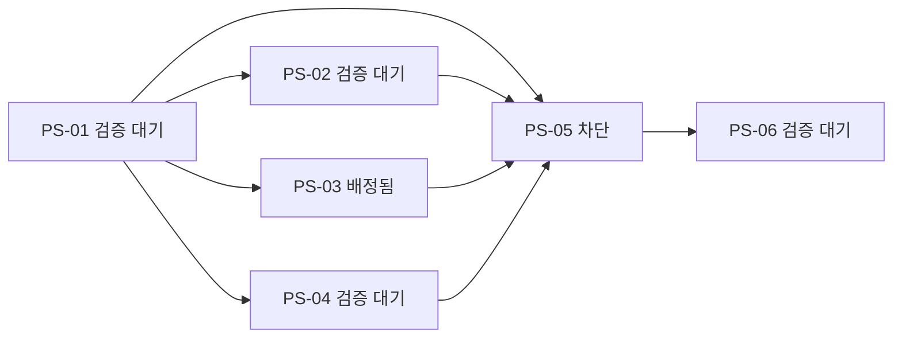
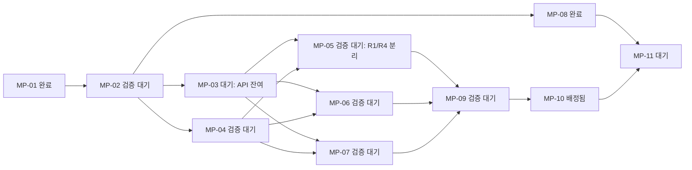

# 2026-11-12 통합 재계획 이전 진행 이력

이 파일은 과거 기록이다. 현재 상태와 실행 지시는 저장소 루트 Plans.md를 따른다. 아래의 현재/다음/실행 표현은 기록 당시의 상태이며 새 작업 승인이 아니다.

# benchmark 작업 상태

마지막 확인: 2026-11-12 KST. 작성 책임: GPT 오케스트레이터.

## 현재 목표와 확인 상태

- **전체 개발 중단·사용자 목표 재확정:** 사용자는 일단 작업을 멈추고 목표를 설명하도록 지시했다. LC-01 `ctx_6f2e0788387d`는 worker-stop 결과 `stopped`, `closed_agent_terminal`, `ptyKilled=true`로 중단 확인했다. 이전 AC-01도 실제 턴 중단·큐Held 상태이며 재개하지 않는다. 목표는 별도 프리뷰 백엔드에 프록시 연결하는 것이 아니라, 개발된 프리뷰/수집 관련 모듈을 원래 benchmark 백엔드의 인증·저장·수집 경로 안으로 이식하여 원래 관리 UI와 홈이 benchmark API를 사용하게 만드는 것이다. 원격Koyeb프록시/원래프론트 복사본은 통합 완료가 아니다. 현재5173 원격프록시,5174 목업JSON,8000 별도preview 앱인 미통합 상태를 사용자에게 구분해 설명하며 코드/설정/서버 추가변경을 멈춘다. 재개는 사용자 지시 후다.
- **최신 우선순위: 5173 원래 프론트 + 로컬 원래 FastAPI.** 사용자는 미배포 로컬 수집/프리뷰 코드를 시험하려 하므로 Koyeb 연결은 요구와 맞지 않는다. 직전 root가 원래 프론트를 `out/benchmark-connected/frontend`에 복사해5173에 띄웠지만 API를 Koyeb로 연결한 선택은 잘못이었다. 공개홈GET200/MSW미등록은 확인했으나 로그인 로컬출처400으로 통합완료도 아니었다. 배포 env/DB 변경은 하지 않았다. 현재 로컬8000은 preview전용앱이고 원래 관리/수집 모듈은 작업트리에서 삭제된 채 Git(c4d7d32)에 존재한다. 다음 범위는 기존 원래 FastAPI 코드의 로컬 기동 복구·개발 프리뷰 경로 공존 확인이며 원격 프록시를 최종 연결로 사용하지 않는다. 중단된AC-01은 재개하지 않는다.

- **사용자 지시로 현재 워커 작업 중단·연결 대상 정정:** 5173은 사용자가 말한 원래 benchmark 관리 페이지가 아니다. root의 잘못된 T2 대상 지정으로 생성 UI를 별도 검사 화면에 추가했다. 사용자는 기존 생성 결과/로직을 재사용해 원래 관리 페이지에 연결하고 현 워커를 중단하도록 지시했다. worker-stop은 외부 터미널이라 stop_unknown을 반환했으며, 같은 실제 DeepSeek 터미널에 Escape를 보내 작업이 종료되고 큐가 Held인 정상 입력 화면을 확인했다(프로세스 종료는 아님). 기존 코드/저장 결과는 보존했고 미완성 백엔드 변경은 검증 전 상태로 둔다. 새 워커는 시작하지 않는다. 다음 대상은 원래 프로젝트 관리 페이지이며 5173 추가 UI를 사용자 요구 완료로 수용하지 않는다.
- **현재 목표: 관리자 경기번호 생성·DB 재조회부터 구현.** 사용자가 개발 계획과 현재 단계 구현을 요청했다. [실행 계획](docs/superpowers/plans/2026-11-12-preview-admin-to-collection.md)을 작성했다. T1 백엔드(DeepSeek) → T2 관리자 연결(현재 GPT 직접) → 사용자 직접 시험 → T3 수집/홈 연결 순서다. 기존 DB는 preview_dev에 실행/섹션/원문을 이미 저장하며 홈5174는 아직 목업이다. 부분 콘텐츠를 자동 품질 실패로 막거나 새 판정 엔진을 추가하지 않는다. 경기별 각 모듈3회, 전체8/다른경기누적제한 제거가 최신 요구다. T1 전달 중이며 ready/착수는 아직 미관측이다. 신규 유료 실행은 사용자가 버튼으로 직접 한다.

| ID | 담당/모델 | 선행 | 상태 | 수용 기준·다음 행동 |
|---|---|---|---|---|
| AC-01 | DeepSeek Max, task_a5e848d9d621 / ctx_fc126409a089, term_56fd9ebf-b23c-4bc3-898d-02b6718fb95e | 없음 | 보류 | 사용자 지시로 실제 작업 인터럽트 확인. 감독 상태 stop_unknown(외부 터미널). 중간 변경 보존·검증 미완료, 새 실행 금지 |
| AC-02 | 현재 GPT, 프론트 직접 | 기존 생성/저장 로직 | 보류 | 5173 검사 화면 연결은 대상 오지정. 기존 UI/클라이언트는 재사용 후보로 보존. 원래 benchmark 관리 페이지로 계획 정정 후 연결 |
| AC-03 | 사용자 직접 시험 | AC-01·02 | 대기 | 경기·성공판단은 사용자가 결정. 자동표본/평가기 없음 |
| AC-04 | 다음 단계, 미배정 | AC-03 확인 | 보류 | T3: 수집→동일생성→DB→경기별 홈GET. 원본제품 연결대상 확인 후 구체화 |
| LC-01 | dsh task_7da6fe169979 / ctx_6f2e0788387d | 현재 로컬/원본 소스 | 보류 | 사용자 중단지시. worker-stop stopped/ptyKilled=true 확인. 읽기전용 조사 중단, 통합 구현 완료 아님 |

- **8회 제한 기획 근거 재확인:** 최초 설계§7은 SDK/큐/모듈의 재시도 증폭을 막기 위해 공통 상한을 두고 실제 수치는 제공자 설정/초기 측정으로 정하도록 했으며, 구현계획§5는 8회를 `초기 개발 설정 제안`으로 명시한다. 정확히8이 사용자 대기 UX나 측정에서 도출됐다는 근거는 없다. 이후 정상 호출이4→5→6으로 바뀌어도8이 유지돼 재시도 여유만 줄었다. 사용자 최종 목표는 수집 중 사전 생성·저장 결과 열람이므로 이 개발용8을 운영 요구로 유지하지 않는다. 이번 턴은 근거 설명이며 코드/유료호출 변경 없음.

- **호출 제한 의도 정정·실제 코드 설명:** 사용자가 의도한 모듈별 3회는 한 경기 생성 중 429/일시 오류 등에 대응하는 개별 모듈 시도 한도다. 다른 경기 누적·전체 프리뷰 합산으로 재시도를 제한하는 요구가 아니다. 현재 코드에서는 attempts_per_call=3 외에 전체 model_requests=8, 시험 집합 전체 모듈 누적3이 동시에 적용되고, live-once 스크립트는 별도로 전체6/시도1을 넘긴다. HTTP200 후 잘린 JSON/내용부족은 provider 재시도 대상이 아니며, 전망+스코어는 현재 한 요청이다. 이 차이를 소스로 재확인했고 이번 턴은 설명만 하며 변경/유료호출은 하지 않는다. 기존 설명의 경기 간 누적 제한은 사용자 의도의 잘못된 구현으로 정정한다.

- **다음 단계 grill-me 설계 토의:** 사용자는 기존 프로젝트 관리자 경기 지정 UI에 최신 생성 경로를 연결하고, 가까운 예정 경기 여러 건을 생성해 성공률/실패 원인을 확인한 뒤 수집 과정에 통합하려 한다. 현재는 요구 결정 단계이며 구현·유료 실행·자동 수집 연결은 시작하지 않는다. 코드 확인: 최신 `/admin/preview/bundle-runs`는 존재하지만 현 preview 프론트 API에는 해당 전체 생성 호출이 없고 섹션 실행 중심이다. 원본 ManagementView는 수집/번역 관리 중심으로 별도 연결 위치를 더 확인해야 한다. 첫 토의 대상은 성공의 정의, 대표 경기 집합, 경기 간 모듈별 호출 상한과 재시도 계수다.

- **AI 이름 강조 요청 반영 수용:** DeepSeek `ctx_5681050cf78c`가 forecast 프롬프트의 팀/선수 이름 강조 지침과 `mp11-bundle-forecast-prompt-4` 버전만 변경했다. root가 실제 프롬프트·버전 상수·40000 설정 유지 소스를 확인했다. 기록 transport의 실제 작성기 READY·JSON 문자열 강조 보존·스코어 int/근거ID 불변 및 기존 sections10검사 통과 보고, 새 실제 모델/HTTP/DB쓰기 없음. 기존 승인 행은 유지하며 새 생성/사용자 실행 승인을 자동 생성하지 않았다. 홈 목업은 강조 렌더 지원; 제품 관리자 기존 literal-text 화면은 아직 별표를 그대로 표시하므로 정식 UI 연결 시 지원이 필요하다.

- **추천경기 복구 직접 확인:** 5174 홈의 원본 9개 추천 목록, 첫 맨시티–첼시 선택, 별도 맨시티–풀럼 프리뷰 제목/본문/굵은 이름 8구간을 실제 DOM과 홈 캡처로 확인했다. typecheck0. Hallmark 렌더는 완료했지만 원본 HomeRecommendedSection에 남아 있는 focus/과거링크 문구 2FAIL·기존10px 등4REFLEX를 보고했다. 이번 복구 변경과 무관한 원본 디자인까지 수정 범위를 넓히지 않았다. 백엔드 프롬프트 작업은 완료 보고 대기다.

- **현 디자인 확정·추천경기 복구/AI 요청 반영:** 사용자가 현 형식을 선택하고 응답 강조 지침을 AI 요청에 넣도록 지시했다. 프론트는 root가 기존 9개 추천 경기·오늘 결과 JSON을 복구하고, 프리뷰 본문만 맨시티–풀럼 목업으로 유지했다(본문 대진 제목/상세 링크도 분리). typecheck0, 실제 홈 렌더 확인 중이다. AI 요청 변경은 백엔드 전용으로 기존 DeepSeek에 `task_dfbbbf2ffa8c` / `ctx_5681050cf78c` 배정했다: forecast/score_reasoning 이름 강조, JSON 숫자/근거ID 불변, 새 프롬프트 버전, 무호출 확인만. 프론트 파일 소유권은 root, 새 실제 생성·DB쓰기 없음.

- **홈 목업 팀·이미지·강조 직접 반영:** API 배당 행의 표시 이름을 API-Football로 바꾸고 보충 메시지를 제거했다. 선수/부상 팀 머리글에 36px 로고와 큰 이름, 사진은 정사각형·중앙 정렬·동일 라운딩으로 변경했다. 전망 근거 17px/제목18px, 전망/근거 문자열의 이름 굵게 표기를 안전한 strong 렌더로 지원한다. desktop/mobile 실제 캡처 확인 및 typecheck0, Hallmark 렌더0FAIL/REFLEX/WARN. 실제 생성 프롬프트는 미변경이며 정식 연결 시 Markdown 이름 강조를 반영할 요구를 목업 명세에 기록했다. 새 워커·모델 호출 없음.

- **프론트 직접 수정 지시·배당 타일 복원 완료:** 사용자가 프론트를 워커에 맡기지 말고 이 세션에서 진행하도록 명시했다. 이후 프론트 작업은 이 최신 지시를 적용한다. 격리 목업의 배당 표를 업체별 승·무·패 네모칸 3개로 직접 변경했다. 최대 3업체·기존 합성값·API 보충 표기·실제 증거 불변을 유지한다. 실제 standalone 렌더 캡처에서 업체별 3칸을 확인했고 Hallmark 렌더 0 FAIL/REFLEX/WARN이다. 공유 컴포넌트이므로 홈에도 같은 변경이 반영된다. 새 워커를 시작하지 않았다.

- **배당 3업체 목업 완료·캡처 수용:** `task_1422e17fe642` / `ctx_832c282d827b` 완료 보고 후 root가 데스크톱·모바일 실제 캡처를 확인했다. Bet365 1.35/5.20/8.00, William Hill 1.36/5.00/8.50, Unibet 1.34/5.25/8.20 합성 3행 및 `예시 배당`, 세 번째 `API-Football Odds 보충` 표기가 보인다. 외부 매체 패널 옆/모바일 아래에 정돈되어 있고 기존 그라데이션·본문 유지 보고, 타입 변경에 따른 typecheck 1회 통과. 실제 배당/API 연결 완료가 아닌 디자인 목업이며 원 생성 증거 배당 없음은 불변이다. 담당자 편집 종료, 5174 확인 가능.

- **배당 목업 재전달 수신 확인:** 사용자 `전달해` 지시에 따라 실패한 동일 Task `task_1422e17fe642`를 기존 DeepSeek 터미널로 재개했다. 새 Dispatch `ctx_832c282d827b`가 `ready`를 반환했다. 3개 업체 예시 배당 및 Odds API 보충 규칙의 전달 준비는 확인했으며 실제 착수·화면 반영은 아직 미관측이다. 새 워커/제품 API 호출은 만들지 않았다.

- **배당 목업 전달 차단:** 후속 전달 `task_1422e17fe642` / `ctx_e71144a2d00b`가 `agent_readiness: timeout`으로 실패했다. worker-show는 `liveness=unverifiable`, 실제 화면은 이전 mailbox 0건 조회와 queued 알림 상태이며, 목업 JSON/컴포넌트에는 아직 예시 배당이 없다. 중복 워커·새 Task 우회·강제 종료는 하지 않는다. 3업체 목업은 미구현, 기존 5174와 그라데이션 화면은 보존한다. 같은 Task 재개는 세션 상태가 확인된 뒤 처리한다.

- **배당 3자리·API 종류 확인:** 공식 API-Football 문서에서 경기 전 `/odds`가 북메이커 배당을 제공하며 `/predictions`는 알고리즘 전망임을 확인했다. 외부 사이트 우선, 빈자리는 Odds API의 다른 북메이커 값으로 채우되 업체 중복 제거·전체 최대 3개로 목업 요구를 전달했다. 합성 배당 3행과 예시 표시만 격리 UI에 구현하며 실제 API 연결·생성 증거 변경은 하지 않는다. 그라데이션 최소 보완 완료 보고는 수신했다.

- **HM04 예시 배당 추가 요청:** 사용자가 배당 확보 시 디자인을 확인하도록 목업 값 표시를 요청했다. 같은 담당자 `ctx_b9143830480d`에게 그라데이션 보완과 함께 격리 JSON/공유 컴포넌트에 가상 1X2 소수 배당(1.35 / 5.20 / 8.00)과 `예시 배당` 표시를 넣도록 전달했다. 실제 수집값·관측 시각·업체로 위장하지 않고 기존 생성 증거의 배당 null은 유지한다. 새 수집·모델 호출 없음.

- **HM04 수정본 확인·한 항목 보완:** v4 캡처와 보고서에서 선수별 패널 및 이름·사진 확대를 확인했다. 전망 근거 분리·매체/배당 패널은 구현 보고 수신. 다만 요청한 그라데이션이 단색 틴트로 구현돼 같은 담당자에게 배경만 최소 보완하고 전체 내용이 보이는 캡처를 남기도록 반환했다. 데이터·레이아웃 추가 변경 및 반복 테스트는 제외한다.

- **HM04 디자인 정돈 배정됨:** 전망 근거를 점수 아래에서 전망 본문 아래로 이동하고, 선수 이름·사진 확대 및 선수별 은은한 팀 색 그라데이션 패널, 매체·배당 독립 패널을 요청했다. 같은 DeepSeek 세션에 `task_7cab6955bc3b` / `ctx_65dc37211f54`로 전달했다. 격리 목업 공유 Vue/CSS만 수정하며 실제 문장·데이터·제품 소스·8000/5173은 유지한다. 5174 홈과 standalone의 데스크톱·모바일·다크 캡처로 확인 예정이며 현재 착수·완료는 아직 미관측이다.

- **HM03 홈 패널 반영 확인:** root가5174 / HTTP200·실제추천대진MCFulham캡처·브라우저DOM의선택버튼/경기전프리뷰region을확인했다. v2본문을공유MatchPreviewBody로분리해원래홈패널과standalone에서동일렌더,추천fixture1557474/팀50·36일치. 팀좌우·AI2-0·배당대시·사진8(배지포함10)유지. 단일패널scroll/이중main없음보고,격리typecheck0·렌더0FAIL/0WARN/원본10px REFLEX1. 원래제품frontend/8000/5173불변,목업JSON최종계약/운영이식아님. 사용자홈화면디자인확인단계다.

- **HM03 홈 패널 삽입 사용자 실행 지시:** 사용자가 현재 v2 목업을 홈 패널에 그대로 넣고 맨시티–풀럼으로 구성하도록 요청했다. 같은 DeepSeek에 5174 격리홈 / 의 추천대진/선택fixture를1557474로맞추고 같은JSON·본문렌더를재사용해홈패널에삽입하도록배정했다. standalone목업도유지,중복header/main/scroll없음·배당null·팀좌우유지. 현재8000/5173/제품source·실API·생성호출·DB불변,정식홈배포아님. 완료후홈직접캡처로확인하며새디자인기획/광범위테스트는하지않는다.

- **HM02 v2 화면 직접 확인·피드백 대기:** 같은목업URL의HTTP200과v2desktop캡처를root직접확인했다. 큰hero삭제·본문좌/AI점수우·추가면책문구제거·선수/부상모두홈좌원정우팀컬럼·매체좌배당우배치가반영됐다. 실제사진10/10·배당null/대시유지,원본홈·8000/5173불변. 보고서기준렌더0FAIL/0WARN·구조NOTE2개kept-layout기록·typecheck0. 현재는디자인수정본검토단계이며사용자최종승인/정식JSON스키마/제품홈이식은아직이다. v1캡처보존,v2 out/home-preview-mock/captures/mock-5174-v2.

- **HM02 사용자 목업 피드백 반영 배정:** 사용자가 원래 홈 레이아웃이 더 낫다고 평가, 새 kickoff hero 제거·전망 본문 좌/AI점수 우·불필요 면책 문구 삭제·선수와 부상 모두 홈 좌/원정 우 컬럼·매체 좌/배당 우 배치를 요청했다. 같은 DeepSeek에 격리 목업 Vue/CSS만 수정하도록 전달했다. 배당값은 null 유지하며 목업 배치용 대시만, 실데이터 수치 위조 없음. 원본홈/5174서버와 기존8000/5173 유지, 정식홈 이식/JSON계약 아직 없음. 이전 캡처 보존 후 v2 렌더로 사용자 판단하며 광범위 테스트/모델 호출 없음.

- **HM01 목업 가동·화면 직접 확인:** 원본홈 http://127.0.0.1:5174/ 및목업 /mock/man-city-fulham 가동보고수신,root목업HTTP200과실제desktop캡처를직접확인했다. 본문순서AI전망2-0→선수4사진→부상4사진→매체3,배당없음생략이다. 이미지10/10로드·sloplint렌더0FAIL/0REFLEX/0WARN·격리typecheck0보고. 원본비교홈은현재backend에homeAPI가없어격리copy MSW샘플응답을썼으며실운영홈응답재현은아니다. 현행frontend/8000/5173불변,제품이식/최종스키마확정전사용자목업피드백대기. 상세보고home-preview-mock-report.md,사진/캡처out/home-preview-mock. 아직디자인승인으로처리하지않는다.

- **HM01 실착수 checkpoint 확인:** DeepSeek dsh-tui 모델착수ACK와원본c4d7d32 frontend296파일격리export/원lockfile npmci완료보고수신. 현행frontend·8000/5173불변. 실제생성자료선수4/부상4/매체3/AI2-0/배당없음읽음. 다음5174기동·/mock/man-city-fulham목업구현이며현재서버기동성공/목업완성은아직미관측이다.

- **홈 목업 사용자 방향 확정·HM01 배정:** 사용자가기존홈정돈안및두괄식순서(AI전망/예상점수→주목선수→부상→외부뉴스/배당)를선택하고기존프론트서버기동·목업제작을명시요청했다. 공식API문서에서선수이미지정적URL확인,기존namesro로7명내부/외부ID매핑조회(쓰기0),홀란드1100/셰르키156477 PNG응답200확인. [목업범위](docs/implementation/match-preview/home-preview-mock-brief.md)작성후실제DeepSeek Max정상화면확인해task_6a82254e5611/ctx_b9bc70a898a1/term_56fd9ebf-b23c-4bc3-898d-02b6718fb95e배정(ready/착수아직미관측). out/home-preview-mock/격리원본frontend+mockJSON·목업만소유,기존8000/5173유지·본서버이식없음·새모델0. 최종JSON계약은목업디자인확인후다룬다.

- **원래 benchmark 홈 Git 소스 확인:** 사용자요청으로Git원본을조회했다. 삭제된홈파일은HEAD이력에남아있으며 c4d7d32의루트route는UiReviewHomeView→HomeDashboardCandidate→HomeRecommendedSection,56px AppHeader/라이트·다크/Pretendard/큰대진추천캐러셀→추천목록→홈내프리뷰구조다. 옛HomeView25/50/25는최신추천홈과다르므로그3패널을새기준으로사용하지않는다. 원래global/home-preview토큰·컴포넌트를읽기만했고삭제파일복원/관리자교체/운영변경없음. 따라서URL추가요청없이원본맥락으로목업방향토의가능하다.

- **홈 프리뷰 목업 설계 착수:** 사용자가 brainstorming/Hallmark로실제홈연결전에맨체스터시티–풀럼생성결과를사용한목업을만들어디자인을확보하도록요청했다. 최종UI용JSON스키마와홈이식은목업방향확정후연결한다. 현재workspace frontend는관리자전용이며기존추천홈은보관문서만확인됨. 연결Vercel앱은재인증필요로현재운영홈확인이안되어실홈URL확인예정. 과거홈명세를현재화면으로가정하거나admin테마를독자홈에강제하지않는다. 아직제품코드/목업/스키마구현·신규워커·모델호출없음.

- **최종 반영·이번 워커 정리:** root가 API 실제 module_send_cap=3/prior_module_usage 전달과 장부 오류시 전송전 거부 소스를 확인해수용했다. 기존backend정상종료후같은launcher로최종재기동,health/database/identity정상확인. frontend유지,추가모델호출없음. 구현/검토종료보고수신후두워커터미널을사용자정리요청에따라닫고ptyKilled확인했다. 독자preview는9c079eea/latest outlookv2로조회가능하나root브라우저는로그인필요401이므로인증된실화면은사용자확인대기다. 배당부족·한글별칭차이·선택구성본마지막AI실호출미검증은남은한계로명시한다.
- **매체3곳 실제저장 v2 확인:** outlook section_result fad82246-8fdf-48db-8db0-5641f576476d/v2·383자를무호출재처리append로저장했다. root가최종증거reader-preview-9c079eea.json에서complete true·전체1668자·4blocks·7출처URL·v1보존을확인했다. 원래live6전송불변,재처리mode=replay/external0구분,구성본선택실호출은미사용/미검증이다. API실호출cap/prior인자가여전히없어동일경계1곳만구현자에재지시(msg_2a66d37bd6da),새테스트/유료없음. reader조회는현재재시작된서버로가능하며생성버튼상한수정최종반영은아직이다.

- **화면 반영 기동·매체 v2 저장 진행:** 기존backend터미널의프로세스종료확인후동일launcher로재기동,health200/databaseok/identityok확인했다. frontend5173유지. 매체3곳복원은계산만이라same원문무호출재처리결과를새v2행으로append하도록task_dbc2c9e60df4/ctx_75fbc1882470에지시했고실제작업화면을관측했다. API trial태그는있으나module_send_cap/prior인자가없는것을root소스로확인해같은API경계최소수정반환했다(유료시험없음). 최종API수정후runtime반영은추가필요하며현재화면완료로표현하지않는다.

- **SF 실제 전체 생성 성공·직접 결과 확인:** run9c079eea-6f66-46bb-83e2-460850f0a22f succeeded/ready·6전송·133.2초의저장증거를root직접읽었다. usable본문6/후보9·검색AI요약7건·4개작성RequestSpec에요약전달보고,선수4명344자/부상4명592자/매체1곳164자/AI전망347자·2-0저장,배당만미확보다. 이번집합6모듈각1/3,자동재시도0. 구성본선택경로는이번실행미사용으로미검증구분한다. 실제본문에서외부요약URL2건이수집출처없음으로탈락하고reader이름표기불일치가남아저장응답무호출재처리/표시경계만확인하도록반환했다. 미배달APItrial태그1곳도실제로반영하도록지시했다. 새전체생성/추가유료/전체테스트없음,서버반영은아직이다.

- **UI試験태그직접회귀 최소수정 결정:** 검토자추가확인으로기존연결모두통과,관리자API bundle생성에trial_set_id미전달→UI최종AI재생성422만남음. root가API호출실소스에서확인하고같은활성집합ID를명시전달하도록구현자ctx_9aa3aba5fbab에지시했다. 거부를경고로낮춰상한우회하지않는다. 스크립트실생성은같은승인1회계속하며이미실행중이면끝난뒤API수정만,재실행없음. 새검토/추가테스트확대없음.

- **실생성 지시 전달 복구:** exec52382결과에서실행후속Task task_bbbdc68e3b4a/ctx_8724a9d4dd3c가agent_readiness timeout으로실패했음을확인했다. 기존구현터미널정상입력/DeepSeek Max·편집종료를실제화면에서확인후같은Task를--retry-of로재연결(ctx_9aa3aba5fbab),전달ready수신했다. 신규Task/중복유료run은만들지않았다. 실제생성착수는아직미관측이며기존실행지시의같은1회만허용한다.
- **SF 최종 직접 수용·실생성1회 지시 전달 중:** root가 재생성 trial 상한/prior 주입·새 결론 run 구성본 저장·reader 선택 본문 연결·긴 요약 원문 보존 발췌의 실제 소스를 확인했다. 추가 검토/테스트 없이 같은 구현자에게 trial-set:sf-b4-search-fallback의 실제 전체 생성 정확1회 실행 지시를 보냈다. 사전 집합 전송0 확인, 모듈별3·이번1시도·작성40000·동시2·HTTP24·정상6호출 기준이며 집합 이름 변경 초기화 금지다. 결과는 실제 저장 독자 preview 전체 본문과 모듈/요약/출처/실패/토큰/전송 원문으로 확인한다. CLI 전달 호출이 아직 응답 대기 중(exec session52382)이라 ready·실착수·성공을 확인했다고 표현하지 않는다.

- **SF02 수정확인 수신·최종 직접 회귀 수정:** 원지적요약접기/forecast게이트/구성본실호출/UI/선택버전중복제거는확인통과로수용한다. 새직접회귀인재생성budget의모듈3회상한누락만차단으로반환했다. 사용자가요구한전체결과확인에직결되는새결론run의구성본보존과600자초과요약의전체중단도같은3곳최소수정에포함했다. 기존원문은보존하고전달분만한도내부분발췌,요약한건실패로전체반려없음. 구현자에게이후범위확대/전면검토/반복검사금지를지시,root직접수용후실생성1회예정이다. 실행승인은이미있으며추가사용자승인대기가아니다.

- **SF 최신 작은 변경 동결:** 구현자가 지연 수신 메일을 반영해 우선순위 프롬프트·URLprovenance를 추가, bundle5/sections6 보고. 요약채택게이트추가는없다고보고했으며root는이후추가편집중단·옛메일재처리수정금지를명시했다. 검토자에게최신델타만전달하고원지적연결확인범위유지,전면재검토금지. 실제새시험전송0상태다.

- **SF02 지적 수정 보고·한정 확인 전달:** root가실제소스에서collection요약접기/forecast검색자료게이트/load_composition→composition_upstream/APIcomposition_id/UI saveComposition호출을확인했다. 독립검토자에게원지적2건과연결참고항목만수정확인하도록전달(task_5a2d67d362a2/ctx_2db17ce00f60,같은검토세션). 구현자후속메일경고는결과보고와분리,같은구현과업을새로만들지않는다. 현재무호출자료연결보고까지이며실생성전송0,수용후1회실행예정이다.
- **SF02 검토 수신·실제 연결2건 수정 반환:** search-fallback-review.md에서검색요약이collection의InformationBundle생성시누락되는것과저장구성본이마지막AI/UI실행에연결되지않는것을현재차단으로확인했다. 구현자에게검색요약collection→저장→작성/forecast게이트,선택UI→저장구성본→마지막AI호출을반환했다. 동일섹션여러버전동시출력은선택의미와직결되어같은투영수정에서해결,manifest/선택입력관리자타입/새시험run집합상한만직접연결범위에포함한다. 통과항목새검토·전체테스트확대없음,실생성전송0유지.
- **SF01 최신요약수정 보고·SF02 배정:** search_ai_summary 생성·유형·전달,수집0/메타0의실제RequestSpec(기록transport)·독자진단미노출보고를수신했다. root가실제프롬프트요약허용및자료유형/선택API연결을확인했다. 실제DeepSeek Max정상입력화면확인후별도검토자를배정,5개변경경로만읽기전용확인한다. pytest/vitest/유료호출없음. 새생성은이연결수용후진행한다.
- **SF01 수정 재개 실제 관측:** timeout 알림 이후 worker-show는settled/working혼재였으나 실제terminal화면에서 최신수정지시 전문과 search_ai_summary 유형·조사프롬프트·무호출입력연결 수정 계획을 처리 중임을 확인했다. 따라서 이미전달된것으로판단해지시재전송·신규Dispatch·중복워커를만들지않았다. 실제수정진행중,새유료0유지다.

- **SF01 완료 보고 수용 거부·최신 합의 수정 반환:** 선택 구성본·독자투영 변경 보고는 받았으나 root가 실제 조사 프롬프트를 읽으니 주소만 출력/요약금지가 남았다. 검색 AI 요약 자료유형과 전달도 없어 최신 사용자 명시승인과 불일치한다. 구현자에게 기존연결보존·search_ai_summary를조사출력→bundle→실제작성입력으로사용하도록반환했다. 메타데이터0이어도요약사용,실기사원문/직접snippet위장금지. 독립검토/새유료실행은이수정전시작하지않는다. 완료보고는검증대기이며현재요구미충족을완료로표시하지않는다.

- **검색 기반 AI 요약 사용 명시 승인·실착수 확인:** SF-01이 실제DeepSeek Max로착수ACK,저장Google응답에별도기사snippet이없음을보고했다. 해당제약설명후사용자가“검색 기반 AI 요약도 활용”을명시선택했다. 기사본문→검색AI조사요약+인용URL→DB로작성,grounding메타부재반려금지,자료유형은관리자/log에서구분으로최신설계수정및워커지시완료. supports.segment도모델답변부분이므로기사원문으로표시하지않는다. 현재구현진행중이며유료0단계다.
- **SF 변경 구현·실생성 사용자 승인 및 배정:** 사용자가 설계기준으로 구현해 전체프리뷰생성여부를실호출로판단하고 실패시원인을정확보고하도록지시했다. [새구현계획](docs/superpowers/plans/2026-11-11-preview-search-fallback.md)작성·자체대조후 실제DeepSeek Max정상입력화면을확인해 SF-01 task_1c4336bfee61/ctx_c425d31781b0/term_377ba85e-86a5-4814-9ce5-74344ebbfe82에배정했다(전달ready,착수아직미관측). 자료계약·선택구성본·독자투영을단일소유로통합하고후속별도DeepSeek한정검토후실생성한다. 새계약버전시험의모듈별3회·40,000토큰기준,과거실행장부불변. 지금구현중유료0지시,추가pytest/vitest반복없음. 새진단설명은독자본문에넣지않는다.

| 현재 작업 | 담당/모델 | 선행 | 상태 | 근거·다음 행동 |
|---|---|---|---|---|
| SF-01 검색 대체·선택 조합·독자 투영 | DeepSeek Max / 원task_1c4336bfee61 및후속 / term_377ba85e-86a5-4814-9ce5-74344ebbfe82 종료 | 최신 확정 설계 | 완료 | 구현·직접코드·저장독자preview확인,선택구성본AI실호출/인증화면은미검증한계분리 |
| SF-02 한정 독립 검토 | 별도 DeepSeek Max / 원task_45bd63ff7092 / 수정확인task_5a2d67d362a2·ctx_2db17ce00f60 / 검토터미널종료 | SF-01 편집 종료 | 완료 | 1회검토·지적부분확인,마지막API상한전달은root소스수용 |
| SF-03 실제 생성·저장 결과 확인 | 같은 DeepSeek / task_bbbdc68e3b4a / ctx_9aa3aba5fbab + GPT 수용 | SF-01/02 | 완료 | run9c079eea/6전송·각모듈1/3·4섹션ready·매체v2무호출저장·reader1668자. 배당생략/사용자승인0 |

- **검색 요약 대체 근거 사용자 확정:** 실제 기사 본문 우선, 본문 미확보 시 Google 도구가 실제 반환한 제목·요약문·URL 사용, 검색 정보도 부족하면 DB 기반 작성으로 확정했다. 모델이 따로 쓴 설명·URL 추정 내용은 실제 검색 요약과 구분하며 메타데이터 누락을 자동 반려 조건으로 삼지 않는다. 설계의 최신 확정 절에 반영했다. 모듈별 선택 결과 조합→추가 출처 재검증 없는 마지막 AI 결론, 내부 진단은 관리자/로그만이라는 요구도 함께 명시했다. 현재 URL 중심 구현은 이 기준으로 아직 변경되지 않았으며 워커·실행·검사는 시작하지 않았다.

- **사용자 모듈화 의도 재확인·현황 조사:** 생성 문체는 현 상태 유지. 수집 여부·실패 사유는 관리자/로그에만 두고 독자 프리뷰 본문·홈 UI에 내부 진단을 넣지 않는다. 목표는 모듈별 독립 재실행 결과 버전을 선택해 한 프리뷰로 조립하고, 그 선택 결과를 입력으로 마지막 AI가 추가 출처 검증 없이 결론을 쓰는 구조다. 현재 코드 조사에서 신규 bundle 전체 실행 내 upstream 합류는 있지만 재생성 API가 selected_result_ids를 전달하지 않고, 재생성의 upstream 조회도 base_run만 읽는다. 독자 preview는 여전히 옛 S1 경로를 읽으므로 신규 bundle 결과의 완전한 독자 조립은 연결 미완료로 설명한다. 수집은403/404 외에 표준클라이언트의3xx HTTPError 경로가리다이렉트처리와갈리는지확인필요하며URL후보는모델JSON의주소형식만검사한다. 현재는상황판단토의로구현·테스트·호출·워커재생성없음.

- **사용자 요청으로 워커 터미널 정리 완료:** benchmark의 작업 워커15개를 실제 terminal close로 종료했고 각 ptyKilled=true를 확인했다. 현재 workspace 터미널 목록에는 backend8000/frontend5173 두개만 남았다. 다른 프로젝트 터미널은 건드리지 않았다. 생성결과·장부·보고서·소스는보존, 종료직전화면은임시경로 /tmp/benchmark-worker-cleanup-20261111 에보관했다(장기인계근거는저장소보고서사용). 기존A/E/검토터미널은더이상live가아니며필요시새DeepSeek실행확인후배정해야한다. 추가모델/HTTP/DB작업은없다.

- **3차 실제 생성 결과 확인:** run270baa93-aff4-4b0c-a949-7610b631c6ac의 저장 증거를 root가 직접 읽었다. status succeeded/ready, 선수395자·AI전망360자/3-1, 한글명4명·팀당2명이며 작성절단은해소됐다. 이번4전송·3run누적13회, 조사2개/선수/전망은각3/3도달·추가전송금지. 웹후보14개모두실패(usable0), 부상/매체/배당본문없음으로웹수집기반전체요구완료는아니다. 선수/전망 source_count0이라DB근거입력과독자출처표시를구분한다. discovery의추론64k수치는작성섹션40k설정과다른경로이므로같은상한동작으로일반화하지않는다. 원문/장부보존,서버미반영,사용자섹션승인0. 추가검사·유료호출없이결과확인단계로종료한다.

- **최신 승인 단위 변경·실행 재개:** 사용자가 “승인한도는 전체가 아니라 각 모듈별 3회”로 명시 정정했다. 이전 전체누적10/추가6·누적15 승인 대기는 폐기한다. 같은 재시험의 이전 두 실행 전송(실패 포함)을 logical_call_id별 합산해 각모듈 최대3회로 제한한다. 출력40,000 유지, 새 전체 실행1회·자동재시도0·추가테스트0을 A에 지시했다. 기존 장부 모듈별 확인 및 전송 전 상한 적용 후 실행하며 새run으로 카운터를 초기화하지 않는다. 단일 실행의 정상6/동시2/HTTP24 기술적 제한은 유지하고 사용자 승인 단위와 구분한다. 현재 실행 지시 전달이며 착수/성공은 아직 확인 전이다.

- **사용자 출력40,000·기존 검사 중단 지시:** max_output_tokens를40,000으로 올리고 기존 테스트를 강제 종료하라는 지시를 받았다. 현재 프로세스 조회에서 pytest/vitest/live 스크립트는 발견되지 않았다. A에 기존 실행 중단·추가 검사 금지와 설정 최소 변경을 지시하고 E 편집 종료 파일의 설정 소유권을 A로 이전했다. 현재 누적9/10이므로 전체 재시험 추가최대6·누적최대15 또는 남은1회 선수만 실행 중 호출 범위는 사용자에게 비동기 확인했다. 답변 전 새 paid는 금지한다.

- **2차 실제 실행 완료·필수 미충족:** run216d11ca-7d13-4877-8a4e-f81687db7478의 저장 증거를 root가 직접 읽었다. 이번5전송·누적9/10·재시도0, 실행633.1초, HTTP6·usable1/후보6. 부상231자만ready, 선수/AI전망은MAX_TOKENS·불완전JSON으로본문없음, 매체조사503·배당구조미확보로전체failed다. DB선수/순위·수집구간의실제입력전달은보고됐지만사용가능전체프리뷰완료아님. 입력길이가절단원인이라는주장은미확정이며저장요청/응답의출력·추론·전체토큰메타만무호출로확인하도록A에지시했다. 부상본문의영문이름·용어와수집구간대조도기존자료읽기로한정한다. 추가paid금지,남은1회는추가실행허가가아니다.

- **최종 코드·호출 한도 확인 및 HOLD 해제:** native _ResolverHandle의 기본 fixture 범위 소비와 주입, live 스크립트 model6/normal6/attempt1 및 기존4회·누적10 가드를 root가 직접 확인했다. A에게 기존 실행 지시와 동일한 새 실행1회임을 명시해 HOLD 해제·즉시 실행을 전달했다. 이미 시작한 경우 중복 실행하지 않으며 실패해도 재호출하지 않는다. 현재는 실행 지시 전달 상태이고 실제 착수·결과는 아직 관측하지 않았다.

- **잔여 연결 수용·실제 재시험 지시:** root가 현재 소스에서 fixture 기본 scope를 실제 적용하는 래퍼와 재생성의 resolver/player_candidates 전달을 직접 확인했다. A에게 승인된 새 전체 실행 정확1회를 지시했다. 기존 live 스크립트는 아직8회/3시도이므로 실행 전에6회/정상6/1시도로 최소 수정·무료 값 확인이 필수다. 기존4회 이후 추가 전송 없음 확인, 신규최대6·누적최대10·자동 재시도/paid smoke 금지다. 실패 시에도 재호출 없이 원문·장부·5섹션 결과를 보존해 보고한다. 지시는 전달됐으며 실제 착수·실행 성공은 아직 관측하지 않았다.

- **A 최종 보고와 실제 파일 불일치·수용 거부:** root가 직접 확인한 _open_name_resolver는 여전히 캐시 예열 후 반환뿐이고 실제 handle은 기본 scope를 소비하지 않는다. 재생성 호출에도 resolver=None·player_candidates 누락이 남았다. 새 검사는 범위 전달/fixture_names만 확인해 실제 결함을 검증하지 못했다. A에 기존 handle의 fixture 기본 범위와 재생성 주입 두 지점으로 최소 수정 범위를 고정하고 실제 D0 이름 None 조건의 요청 근거를 요구했다. live 스크립트도 아직8회/3시도여서 실행 전 승인6회/1시도 값 반영이 필요하다. 현재 유료 전송은 보류다.

- **잔여 2건으로 축소:** 검토자 후속 §10에서 F7-b(홉의 사용량 전용 계상)·F5-a(재생성 분기 게이트 순서)를 통과로 확인했다. F2는 캐시 예열만으로 해결되지 않아 fixture 기본 팀 범위를 실제 호출에 보장해야 하며, F5-b 재생성 resolver/player_candidates 주입이 남는다. A에게 이 두 경계만 마무리하도록 전달했다. 동결 이후 수정은 root의 잔여 수정 재배정에 따른 것으로 무단 변경으로 판정하지 않는다. 유료 재시험은 두 연결 수용 후 실행한다.

- **수정 확인 결과·최소 잔여 연결:** ps06-post-fix-verification.md 수신. F1/F3/F4/F6/F8/F9 및 표시 규칙은 통과로 수용하고 반복 검사하지 않는다. F2 실제 해석기 팀 범위 누락은 차단이며, 원래 요구인 F5 재생성 API 게이트·이름 주입과 F7 홉/재시도 혼동도 A 한 소유자에게 좁혀 마무리 배정했다. E 파일 재편집 없이 fixture 범위를 해석기 주입 경계에서 연결한다. 모델 시도1과 별개로 HTTP 홉을 전송 전 계상하는 직접 검사를 요구했다. 전면 검토·전체 검사 재시작은 하지 않는다. 추가6/누적10 승인은 유지하되 이 연결 수용 전 유료 보류다.

- **실제 작성기 통합 증거 수신:** A가 임시 builder 대역을 제거하고 실제 작성기·기록 transport로 복원했다고 보고했다. 실제 요청에 선수 ID·표시명·통계·순위·팀명을 확인하는 직접 검사가 추가됐으며 기록 경로는 6호출·5섹션 저장·필수 ready다. 영향121건 통과 보고는 수정 확인자 ctx_81638d15a911/task_5d3d45c92b4f에 전달했다. 실제 모델 재시험 결과와 구분하며 A 변경은 확인 종료까지 동결한다.

- **F7 재수정 보고·한정 수정 확인 배정:** A가 실제 클라이언트의 홉별 전송 전 on_hop 게이트와 자동 리다이렉트 금지, 기존 이름 DSN 로딩, 명시적 builder 계약을 보고했다. 실제 소스의 게이트·E 시그니처를 확인했고 A에 코드 동결을 지시했다. 기존 독립 검토자에게 원래 F1~F9와 이름 연결만 수정 확인하도록 전달했다(새 전면 검토 없음). 사용자 추가6/누적10 승인은 이미 확보했음을 A에 다시 명확히 했으며 수정 수용 후 실행한다.

- **E 최종 인계 수신:** ps06-section-fixes.md와 실제 시그니처를 확인했다. 실제 D0 문장·부상 상태·선수 기록 입력, 전망 score 필수·부분 본문 보존, forecast 투영 및 DB 우선 표기 수정을 보고했다(직접22건·연결17건 증거). A의 임시 builder 대역으로 남은 파이프라인3실패는 실제 builder/기록 transport 연결로 확인하도록 지시했다. E는 편집 종료를 선언했지만 화면에서 잔여 메일 처리 턴이 관측돼 E 파일의 새 쓰기 소유권은 아직 이전하지 않았다. A는 자기 호출부·버전 연결을 진행한다. 유료 재시험 승인은 확보했으며 수정 수용 전 전송은 보류한다.

- **완료 워커 정리 지시:** 사용자가 다 쓴 워커를 주기적으로 제거하도록 요청했다. 앞으로 결과 수용·인계 종료 시 정리를 함께 처리한다. 현재 A/E 및 수정 확인용 검토자는 유지했다. 완료·폐기 워커 20건에 공식 worker-release를 실행했으나 외부 연결 터미널 18건은 external_terminal, 폐기 C 2건은 identity_unproven으로 보존되어 실제 종료는 0건이다. 이는 종료 완료가 아니며 강제 닫기로 우회하지 않는다. 실행 중 워커·서버 터미널은 정리 대상에서 제외한다.

- **사용자 재시험 예산 승인:** 사용자가 “추가 최대 6회로 한 번 재시험”을 명시적으로 선택했다. 신규 전송 최대6회, 첫 실행4회 포함 누적 최대10회, 자동 재시도 없이 새 전체 실행1회다. 이 승인은 아래 이전 승인 대기 기록을 대체한다. F7 실제 전송 제한·E 인계 통합·지적 항목의 수정 확인 후 실행하며, 그 전 유료 HOLD는 유지한다. 동일 예산에 대한 재승인을 요청하지 않는다.

- **A 수정 보고 수신·F7 수용 보류:** F5~F9 및 F1/F2 배선, 영향 검사 118건 통과 보고를 받았다. 실제 소스에서 예약3회 뒤 fetch가 6홉을 보낼 수 있고 사후 계상을3으로 자르는 경로를 확인해, F7은 실제 전송 전 제한으로 다시 수정하도록 지시했다. 이름 DSN은 이미 승인된 0600 설정 파일을 기존 실행 설정 경로에서 읽도록 하며 새 승인 대상이 아니다. E 인계 후 인자 필터링 대신 명시적 계약으로 연결한다. 추가 유료 전송은 계속 보류한다.

- **독립 검토 수신·한정 수정 재개:** PS06 보고 preview-sections-independent-review.md 확인. 예산/장부/병렬(기준1·2)은통과. F1~F9는DB자료프롬프트누락/통계후보미전달/전망구조화·점수필수/reuse옛경로/availability키/redirect사후차감/묶음해시/배당팀명미전달 결함이다. 현재수용실패9건을수정하며참고개선전면확대없음. 기존확정DB한글명/동일응답fallback 미배선은같은이름경로수정에포함했다. 새E는변환파일만, A는실행·API·수집·저장배선만수정해병렬진행한다. 추가유료승인은여전히대기,모델전송0지시유지. 검토자는완료/편집종료했으므로낡은메일알림을재전송해깨우지않고수정후§8항목만1회확인예정.

- **A 잔여 실행 새 Task로 명확화:** API/454검사보고이후에도새bundle_pipeline은StateGraph없는순차loop, provider의sessionless실전송장부우회가남아있음을실제확인했다. A화면에후속15개알림이큐대기해지시미반영반복. 구dispatchctx_664051d56385를fence하고정확terminalEscape/tui-idle/Interrupted확인후같은A문맥·같은파일을보존해새Task task_b19589753ef7/ctx_b6741b0714e4로재연결했다. 새과업은실제LangGraph2/3분기·장부없는실전송거부·stats11열role실제조회·그뒤한live통합뿐이다. 옛테스트전체재실행/옛outlook조사/추가워커생성금지. 새과업전달ready까지관측, 아직두필수조건해결/유료실행완료아님.

- **현재 개발 파동:** 사용자가 설계 최종본을 승인하고 구현 계획 작성 후 병렬 개발을 지시했다. [구현 계획](docs/superpowers/plans/2026-11-11-preview-sections-implementation.md)을 작성·자체 대조했고 실제 DeepSeek Max4세션의 정상 입력 화면/모델을 확인해 역할을 분리 배정했다. 공통 기반/수집/작성/화면은 병렬, 공유 연결·Git인덱스는 A 단일 소유, 독립 검토는 별도 새 DeepSeek로 후속 진행한다. 아래 과거의 문서승인대기 표시는 이전 시점 기록이다.
- **현재 차단/다음 행동:** 독립 검토의 현재 결함을 A와 E에 파일 소유권을 나눠 수정 배정했다. E는 전달 ready까지 확인했고 실제 착수는 아직 관측하지 않았다. 수정 후 지적 항목과 직접 영향 경로만 확인한다. 추가 유료 실행은 별도로 사용자 응답 대기이며 제안 범위는 신규 최대6회·기존4회 포함 누적10회·자동 재시도 없음이다. public 자료 무변경·preview_dev 신규 쓰기 기준을 유지하고 사용자 섹션 승인을 자동 생성하지 않는다.

- **테스트 범위 정리:** A의 전체preview실행436통과/15실패 보고에서 실패는 기존 test_outlook_module 고정시계/벽시계 혼용으로 조사됐다. 이전부터 알려진R3clock gap이며 현재직접회귀로확정되지않아별도후속, 지금수정미배정. A의소유직접/연결78통과증거재사용하고 전체반복검사중단, 새C연결·실자료수용에집중하도록지시했다. 옛outlook.py 소유권밖수정은되돌려clean이라는보고이며별도정상통과로바꾸지않는다.

- **PS03 기록동작 보고/실전송 경계:** A가5섹션기록동작/신규직접10검사·DB-only전망을보고했다. 동시에session없는live호출에서장부를생략하도록바꾼provider실제소스확인. 실제네트워크transport는세션/영속장부없으면전송금지하도록직접회귀1건을고우선순위지시했다. 비네트워크RecordedTransport와구분하고경계대표검사만확인,전체재검사확대금지. 이경계수정전paid보류,그후정상6/최대8한실행승인유지.

- **PS05 실제 코드 수용 차이:** 새bundle_pipeline은기록6호출/5섹션저장보고가있으나실제run_bundle_pipeline에StateGraph없이조사2/작성3이for-loop순차실행으로확인됐다. 승인LangGraph·병렬요구미충족으로A에게기존graph분기/branch별세션/공유budget을사용한실제병렬연결을지시했다. 전체함수를한graphnode로감싸는우회는불가. 기록transport대표겹침관측으로검증하고전체검사반복금지. sessionless실전송장부필수경계와이실행구조2건수정전LIVE보류, 코드가있다는보고를제품완료로처리하지않는다.

- **실제1차생성 실패·예산 변경 대기:** run0d938572-8427-409f-99f5-f805bee4c697/evidence ps05-live의JSON을root확인. 실제4전송(조사2/선수1/최종1), HTTP0/출처0, players본문미생성으로failed/insufficient. 조사도구누락/팀placeholder를A가수정, 의존성실설치·로컬추출확인보고. 추가full6이면누적10으로task8초과이므로새유료보류. 검색도구/실팀명/실추출의무료요청계약확인은진행, 추가6정확상한·자동재시도0의1회재시험을사용자에게확인한다. 첫4회실패증거보존, 새run으로예산초기화하지않는다.

- **무료 사전검증 근거 확인 완료:** evidence/ps05-live/preverify-free.json을root직접읽음. 실제기록RequestSpec에서조사2에GoogleSearch있음/호출된작성·최종3에검색없음, team13/4자리표시자없고실팀명·DB문맥있음, Trafilatura2.3.1/lxml6.1.3로로컬HTML229자추출·핵심정보보존, 새6상한/정상예약6/1시도에서6허용·7번째거부확인. 매체outlook은이번기록입력에자료없어미호출/예약반환이므로그요청을실행검증했다고일반화하지않음. 실제새후보URL품질만유료미확인. A편집종료/코드동결보고,첫실제장부4유지·추가유료0, 승인응답대기.

- **예산 대기 명시·불필요 메일폴링 중단:** 사용자추가6/누적10승인응답아직없음. A에게HOLD/코드동결/유료0/과거15알림재조회금지/턴종료idle대기를명시했다. Plans상차단으로기록하지만Orca task-update blocked는active Dispatch때문에거부돼실제Orca상태는active로남았다(상태변경성공으로표현하지않음). worker stopped-without-report 알림은이승인대기의의도적idle이며제품완료/실패재시작사유로해석하지않는다. 승인전새Dispatch/재시도생성안함.

## 현재 구현 파동 작업표 — 확정6개 중 검증완료0개

작업 개수는 제품 완성도/남은 시간 비율이 아니다. 과거 MP 상위11개 진행표와 현재 변경 작업6개는 범위가 다르다.

| ID | 담당·모델 / 실행 식별자 | 선행 | 상태 | 결과·다음 행동 |
|---|---|---|---|---|
| PS-01 | A DeepSeek Max / 구task_d6c4ab18aa4e, 잔여task_b19589753ef7 / term_4301899a-faf0-42db-8014-8728e937786f | 승인 설계·계획 | 검증 대기 | 장부·저장·API·기록preflight구현보고있음. 실제네트워크sessionless우회잔여는PS05새과업에서수정해야수용. 옛task는superseded/cancelled기록, 코드보존 |
| PS-02 | B DeepSeek Max / task_bd4191fc5928 / ctx_ccc230edddbd / term_b7643c6c-ec74-43c3-8724-ecbb500a0b01 | 계약은 PS-01, 자기 자료 구현은 즉시 | 검증 대기 | 완료/37검사보고·파일실존확인. 배당12probe미확보,stats grant미적용。실제reader/provisioner13열남아11열보정필요. 후속mail폴링을controlinterrupt로멈추고정상입력상태확인, A단일소유로인계 |
| PS-03 | 새E DeepSeek Max 화면확인 / task_9f66d175ce23 / ctx_37445b90d5d1 / term_1655310b-0113-47fc-b28b-e1ee7fa52532 | PS06 현재결함 F1/F2/F3/F4 | 배정됨 | bundle_sections/section_structured/전용검사·필요bundleprompt만소유. 실제D0키/통계후보/전망score필수/한글명fallback수정, A와파일분리. 기존DB-only생성가능주장은입력누락F1수정후확인필요 |
| PS-04 | D DeepSeek Max / task_16229b2ab2c9 / ctx_94b2cde1f628 / term_96866c52-5f10-485c-8abc-de7a13b5bded | 계약은 PS-01, 화면 기록 입력은 즉시 | 검증 대기 | v2수정115검사/typecheck보고·실제패널/adapter확인. 편집종료 후 메일폴링을 control interrupt로 중단하고 정상입력상태 확인. 이후 A 단독 통합으로 소유권 인계 |
| PS-05 | A 같은DeepSeek터미널 / task_b19589753ef7 / ctx_b6741b0714e4 | 기존변경·부분검사인계 | 차단 | 첫live4전송/출처0/필수players미작성실패·AI전망만ready330자·5섹션행저장은root증거확인. 조사tool/실팀명/의존성수정, 무료설정검사완료보고. 추가6/누적10/재시도0 사용자응답대기, 워커의누적12제안거부. 코드동결/추가유료0지시 |
| PS-06 | 별도DeepSeek Max / task_d30a83fbb1cd / ctx_a5a024139d3f / term_6ff6c26f-2d92-44ca-8407-beeda413e611 | PS-05 현재 코드·첫 live 증거 | 검증 대기 | 읽기 전용 1회 검토 완료, 현재 결함 9건 보고 수신. 예산·전송·병렬 통과. 수정 후 §8의 연결 경로와 이름 경로만 확인하며 전면 재검토하지 않는다. 완료 검토자는 idle 유지 |

PS-02~04는 계약 연결 전에도 자기 파일에서 기록 자료/화면을 병렬 구현한다. 도식의 선행선은 공유 계약 연결의 의존성이다. 모델 actual session metadata 확인은 각 워커 결과에 포함하도록 지시했고 시작 화면은4개 모두 deepseek-ai/deepseek-v4.1-flash-1017 / Max였다.

## 이전 조사·결정 이력

- **사용자 답변 반영·설계 최종 검토본:** 필수=경기전망/AI스코어/주목선수, 선택=부상/외부매체/배당. 선택 공백은 독자화면생략/관리자기록. 1차조정=선택섹션재생성/비교/승인, 직접본문편집·출처선택UI후속. 최신 설계에 반영했고 builder 질문은 모두처리했다. 정상6/최대8/동시2와 HTTP24공유 등의 조정자 제안까지 포함한 문서 최종승인 대기이며 구현계획/구현/추가호출 미착수.

- **Builder 확인 5질문 처리:** 보고서 preview-sections-builder-check.md 확인. DB만으로 최종 전망 허용/미시작 예약반환은 기존 요구로, 승인5단위(AI전망+스코어함께/배당별도)/시각미확인기사허용·명확한킥오프후자료제외는 조정자 제안으로 설계 보완했다. 사용자 판단은 정상완료 필수섹션과 1차 조정UI 범위2개로 추렸다. 추가 구현/테스트/생성 없음. 설계문서 최종승인 전.

- **brainstorming 접근법 선택:** 사용자②선택, ③후보유지. [설계](docs/superpowers/specs/2026-11-11-preview-sections-design.md)에 두 조사묶음과 공통수집/세작성/최종전망 연결을 구체화했다. 정상 모델6/최대8/동시2, 비모델24공유·출처발췌 제한은 조정자 제안이며 문서 승인 전이다. 별도 DeepSeek builder 확인1회 배정, 실제 제품 구현/설치/모델호출 없음. 검토에서 이미 답한 사항·사소한 구현 판단은 조정자가 처리하고 중요한 사용자 판단만 한 번에 확인한 뒤 문서승인→writing-plans로 진행한다.

- **섹션 실행 순서 사용자 확정:** 공통 웹·DB 수집/정보 원문 → 주목 선수·부상·외부 전망·배당 독립 처리 → 모든 결과와 DB를 읽는 AI 경기 전망/예상 스코어 → 추가 AI 호출 없는 화면 조립. [최신 확정 설계](docs/superpowers/specs/2026-11-11-preview-sections-design.md)에 통합했다. 현재 단계는 구조 확정이며 구현/새 생성 호출은 미착수다. 다음은 수집 공유·모듈 매핑·자료 읽기 범위·실제 호출예산을 명시한 구현 계획이며 전체8상한을 조용히 확대하지 않는다.

- **섹션 연결 사실 조사 수용:** [보고서](docs/implementation/match-preview/section-workflow-integration-facts.md) 확인. 기존 R4 전체3명 제한을 팀당2명으로 바꿔야 하며 R3 매체3곳 상한도 없다. DB 경기/순위 읽기 가능, 부상표 현재빈값, 선수 시즌통계는 좁은 역할로 읽기 거부, 배당표없음/실수집미연결이다. 특정 로컬 env의 키 부재를 전체 서비스 자격증명 부재로 일반화하지 않는다. 설계 제안은 공통 수집·정보원문 → 선수/부상/매체 병렬작성 및 배당 정리 → 모든 결과를 읽는 AI 경기전망·스코어 → 결정적 최종배치다. 호출 수는 검색/작성 분리 후 별도 산정하며 정상5/최대8을 자동 승계한다고 주장하지 않는다. 사용자 구조 확인 전 구현/호출 없음.

- **grill-me 외부 전망 확정:** 서로 다른 매체 최대3곳을 매체별 예상 스코어·이유로 제시한다. 점수가 없는 기사는 전망 요약만 싣고 점수를 생성하지 않는다. 매체 간 차이를 보존하며 우리 AI 예상은 별도로 둔다. 다음 단계는 현 코드/DB 읽기 경계와 공통 수집·섹션 실행 연결의 사실 조사다. 기존 R4 파일본문은 보존되어 있으며 관리자 화면 저장 연결은 아직 미완료다. 새 생성 호출은 하지 않는다.

- **grill-me 1차 답변 확정:** 사용자가 추천3개에 동의했다. 선수별 웹/DB를 함께 조사하되 양쪽 모두 확보를 필수로 하지 않는다. 부상 선수는 팀당 최대2명이며 인원 미달을 억지로 채우거나 불확실 상태를 확정부상으로 바꾸지 않는다. 배당은 우선 정규시간 홈승/무승부/원정승의 소수점 배당이며 시장·수집시각을 구분하고 없는 값을 추정하지 않는다. 다음 미결정은 외부 전망을 매체별 몇 건/어떤 형태로 제시할지다. 구현·생성 호출 없음.

- **최신 grill-me — 프리뷰 섹션 재구성 토의:** 사용자 목표는 경기 전망, AI 예상 스코어, 주목 선수 각 팀2명, 부상 선수 중 주목 선수 각 팀2명, 외부 매체 예상 스코어/이유, 외부 사이트 배당을 섹션 워크플로우로 구성해 한 프리뷰로 조합하는 것이다. 선수 이유에는 웹 조사와 DB 근거를 요구했다. 최신 턴은 설계 토의이며 구현·추가 호출을 시작하지 않는다. 미결정은 선수별 웹/DB 둘 다 필수인지, 부상자2명 미만일 때 인원을 줄일지, 초기 배당 시장 범위다. 공통 수집/정보 원문 형식은 공유하되 섹션별 작성 계약을 구분하는 방향을 제안한다. 이전 저장 경로 마무리 의향을 실행 완료로 간주하지 않는다.

- **R4 시험 정정 확정:** 후속 기존 로그 조사에서 실제 Vertex 전송 2개 프로세스를 확인했다(collect 단계의 의도치 않은 전송/응답 롤백, 이후 run a32f3ed4 성공). task 전체 최소2회이며 조정자의 최대1회 제한 위반이다. 첫 응답 사용량·비용은 미확인. 생성본문은 오프라인 재처리 파일에만 있으며 원래 section 4d5b51c2는 insufficient/본문0자다. DB는 경기 식별·로스터·순위 입력 및 한국어명3개에 사용됐으나 최종 사실 문장은 전부 웹 구간을 인용하므로 DB 기반 전망 경로가 입증된 것은 아니다. 해당 경기 프리뷰 기사 확보0건. 설계 방향의 일부 가능성만 확인했으며 제품 연결/전체 수용은 보류, 추가 호출/작업 미배정. 정정은 파일 수동 반영이므로 실험 출력 재생성 시 덮어쓰기 주의.

- **R4 시험 보고 수신 — 수용 보류:** 정보 원문/생성본문 파일을 확인했다. 브라우저 없는 수집 4건+DB 입력으로 홀란드/보브/디아스 소개가 생성됐으나, 보고서의 전체 전송1회 주장과 첫 유료응답 롤백 후 성공 실행 기록이 모순된다. task 전체 실제 전송 수는 미확정(롤백된 시도 포함 조사 필요). section_result_id도 summary에서 null이므로 관리자 화면 저장 완료로 표현하지 않는다. 후속은 기존 로그 기반 회계/문서 정정만 배정, 새 호출·DB쓰기·제품 수정 금지. 사용자 요구에 없는 강화된 사실 검증 엔진을 다음 필수 조건으로 추가하지 않는다.

- **최신 사용자 지시 — 정보 원문 기반 R4 시험:** 브라우저 없는 기사/내장 데이터/공개 API 수집 + DB 경기 자료로 정보 원문 묶음을 먼저 만들고 그 입력에서 프리뷰를 작성한다. 설계 상단에 반영했다. 새 DeepSeek 세션에 격리된 R4 시험 구현·실행을 배정했다. 저장 검색 URL 재사용, 수집 원문/DB 입력/최종 생성물을 함께 보존하며 작성용 Vertex 실제 전송은 최대1회로 제한한다. 제품 기본 경로 수정·전체 모듈 확대·새 검색 호출·브라우저 실행·승인·배포는 제외한다. 성공 후 사용자가 결과를 보고 후속 연결을 판단한다.

- **Fulham 본문 직접 대조:** 사용자 요청으로 저장 렌더 HTML의 `div.tiptap` 기사 4문단과 Trafilatura 출력 전체를 대조했다. 4문단 순서·내용 보존, 메뉴/푸터 제거 확인. 다만 `Men`/`4일 전` 2개 머리 정보 잔존, 제목/저자는 본문과 별도라는 한계가 있다. 저장 DOM 대비 확인이며 추가 로딩 영역의 완전성/기사 사실 검증은 아니다. 기존 CLI 읽기 실행만, 새 수집·AI 호출·DB/제품 변경 없음.

- **두 도구 비교 결과 확인:** [비교 보고서](docs/implementation/match-preview/scraper-comparison-report.md) 및 출력 발췌/브라우저 측정 JSON 확인. 기사형 2개에서 Trafilatura가 잡음을 줄였고 스쿼드 목록 1개에서는 명단을 잃었다. Scrapling 브라우저는 Fulham 정적 빈 페이지의 본문을 확보했다(렌더 2회 약14~15초). 동일 HTML 추출 반복은 수행됐으나 전체 페이지 Scrapling 경로와 기사 추출기의 비교이므로 범용 우열 판정은 하지 않는다. RSS 합산 약2.2GB는 공유 메모리 중복 가능성이 있는 로컬 근사값이며 배포 RAM 확정값이 아니다. 상호보완 조합은 유망하나 제품 연결·브라우저 배치는 미확정. 제품/DB/서버 변경 및 모델 호출0.

- **사용자 승인 — 두 도구 비교 실험:** Scrapling 단독, 동일 HTML의 Trafilatura 추출, Scrapling 브라우저 수집→Trafilatura 조합을 격리된 임시 환경에서 비교한다. 실제 저장 URL 6개를 재사용하고 네트워크 관측과 오프라인 추출 반복 측정을 분리한다. 본문 품질·처리 시간·메모리·설치 부담과 상호보완성을 확인한다. 임시 의존성 설치/실험 도구 구현은 DeepSeek에 배정했으며 제품 의존성·코드·DB·실행 서버는 변경하지 않는다. AI/유료 API 호출은 0회 범위다.

- **스크래퍼 사실 조사 수신·확인:** [조사 보고서](docs/implementation/match-preview/scraper-feasibility-facts.md)의 6개 저장 URL 접근 결과와 실행 범위를 확인했다. 최신 evidence 3개는 정적 텍스트 1개·403 차단 1개·JS 셸 1개이며, 이전 grounding 리다이렉트 3개는 HTML 텍스트가 나왔다. 이는 기사 본문 전용 추출 또는 Scrapling 성공 증거가 아니다. Scrapling은 사용자 지정 비교 후보에 포함한다. 같은 curl 측정 반복 대신 후속 승인 시 실제 본문 추출·브라우저 렌더링 차이를 비교한다. 제품 구현·설치·유료 호출 없음.

- **사용자 확정 — 기사 채택 기준(2026-11-11):** 실제 수집한 기사 내용은 그 기사를 근거로 사용한다. API·DB와 교차 대조하거나 충돌을 이유로 기사 내용을 탈락시키는 절차는 두지 않는다. AI 자체 전망은 API·DB 자료를 근거로 작성한다. 프리뷰에는 본문을 중심으로 표시하고 출처 연결·수집 및 처리 내역은 관리자 검사에서 추적한다. 아래 이전 질문의 기사 재검증 수준은 이 답변으로 해소됐다. 스크래퍼·배포 실현 가능성 조사는 별도 진행하며 구현 승인은 아니다.

- **grill-me 구조 검토:** 기존 Vertex 검색 → URL 후보 → 본문 수집 → 근거 기반 작성의 실현 가능성을 확인 중이다. Trafilatura/Crawl4AI는 아직 선정하지 않았다. 실제 저장 URL의 접근성·본문·경기 관련성 및 배포 자원을 별도 DeepSeek 사실 조사에 배정했다. 구현·설치·유료 호출은 하지 않는다. 사용자 답변(2026-11-11): 해당 경기의 외부 프리뷰·전망 기사를 우선 수집하고 그 기사에서 언급한 주목 선수를 먼저 선정한다. 기사 내용을 확보하지 못하면 API와 연결된 DB의 과거 경기 자료로 AI가 선정·판단한다. 외부 기사 기반 선정과 AI 자체 판단의 출처를 혼동하지 않는다. 다음 미결정은 기사의 선수 평가에 자체 과거 경기 통계 검증을 어느 수준까지 요구할지다.

- **최신 설계 제안:** 기존Vertex검색→수신evidence/metadata URL후보→스크래퍼본문확보→근거기반작성. 새Tavily/SearXNG검색도입안은채택되지않음. 사용자제안에대한추천/설계재검토중이며실행승인/제품변경/호출없음. R4두모델call방식전체확장시9회로기존8상한초과해예산재설계필요.

- **현재 작업은 brainstorming 조사·대안 비교:** 인용메타데이터누락으로프리뷰가막히는문제를공식문서/직접사례/현재코드로조사했다. 구현/설치/유료호출없음. 사용자가자료우선접근③선택. 세부설계초안을작성하고별도DeepSeek읽기전용builder검토배정,문서승인후writing-plans진행한다.

- **현재 UI결함 수정완료:** 85446ee에서attempt→모듈연결/기존유일모듈읽기투영/모델JSON·전체API응답라벨분리. 두실제run R4탭에서정확원문/candidates/metadata직접확인,backend반영완료. 사용자새로고침후응답탭확인가능.

- **후속 실생성 결과:** run22e1a19e/sectionc206fa53・새R4@4e632e66c83e3549。실제1send/attempt1저장성공・quality insufficient/본문없음. 실응답korean_labels5개·DB우선표시직접확인, 후보3명사실전제검증탈락. 추가호출없음.

- **최신 피드백 구현:** 일반축구용어는한국어(사용자지정 hat-trick→헤트트릭), 선수/감독/팀은DB한글명검색우선·없으면AI번역. 이전AI번역금지는이누락경우대체. 기존생성호출에포함하고추가번역call/예산증가/현재유료재생성없음. task_5a643557a659/ctx_3950e6f4a107 배정됨.

- **현재 실행 결과/수정:** 사용자추가1회승인후 R4 live생성·저장성공. run6176a8c6/sectionfd7f95c8 v1·ready·실제send1/attempt1·출처8·승인0. 저장본문일치직접재조회확인. 사용자결과확인대기.

- **최신 사용자 요구:** 경기력R1과 주목선수R4를 독립 모듈·섹션으로 분리한다. 주목선수 항목은 selected_player(DB 한글명)와 selection_reason(선정이유)을 분리해 출력·표시한다. 기존 서술 방식은 사용자 수용 상태이며 추가 문장품질 테스트/유료재생성을 하지 않는다.
- 팀/선수 표시는 실제DB 한글명을 우선한다. DB필드/동일인물매핑/최소이름읽기권한을 확인하는 resolver를 독립 배정했다. 원문/식별자는 보존한다. 최신사용자변경으로 DB미보유한글명은AI번역허용, DB값우선/동명이인충돌방지는유지한다. a45599c 표시경계 연결을 포함한 MP10코드로 backend8000을1회재시작했다. health/database/identity ok·새API로드확인. 브라우저는로그인화면까지만확인, 인증후한글표시미확인.
- 현재 사용자에게 제공한 v6/v5는 D0자료준비→기존R1(경기력+주목선수)→본문조립 결과다. R2/R3/S1의 전체조합이나 새 독립R4실행은 아니다. 이전 combined결과는 이력으로 보존한다.
- 기존 F1/F2/F3 보완은 커밋/서버반영·저장후보확인까지 끝났다. 기준6e59041av6(868자)/비교7c0af3c0v5(837자), form@3721e7df4a7f6a61·문장진단12개·manifest3개를 직접 조회 대조했다. 사용자승인0·추가모델/API0, 원문/이전본문 보존이다.
- 사실은API/검색으로 확인하고 AI선정/예측 결론 자체의 외부증명은 요구하지 않는다. 미확인사실 전제는 단정하지 않고 판단과 분리한다. 부상API상태·사유와 부분경위를 허용한다. 이 기준은 R4와 S1에도 유지한다.
- MP09는종합/독자UI 구현·기록응답검증 완료보고이며 코드가backend에로드됐다. 실제S1호출/사용자승인은없다. MP10전체연결·R1/R4분리4커밋/기록transport검증보고를수신했다. 후속c045799에서 R4패널마운트·본문줄바꿈표시도수정됐고16대표렌더검사/typecheck증거확인. 실제인증브라우저·새R4 live는미확인이다.
- 분리후 정상모델호출은4조사(R1/R2/R3/R4)+1종합(S1)=5회다. 전체8회상한/동시2회를유지하고 미시작정상호출예약을5로맞춘다. 현개발과새schema연결은실제품호출0이다.
- 남은자료공백: 검색citation0, 선수통계읽기범위미확정, 부상발생시점/경위불명, API-Football live미연결. 이름표시를위한최소식별/한글명읽기는이번사용자요구에포함하며통계권한확대와구분한다. 프론트5173/backend8000은전용터미널로유지한다.

## 현재 작업·워커 기록

| ID | 역할·실제 모델 | Task / Dispatch / 터미널 | 상태 | 마지막 확인·다음 행동 |
|---|---|---|---|---|
| SECTIONS-BUILDER-CHECK | 별도 DeepSeek·Max·hive/dsh-tui, 설계의 미결정 질문만 확인 | `task_8670aea6298b` / `ctx_cb0b4b8e97aa` / `term_77c55aa9-da3a-473d-a311-ed21a3ea71b6` | 완료 | 2026-11-11. 보고5질문 확인, 기존요구/조정자판단3건 설계반영, 사용자판단2건 대기. 구현/호출0 |
| SECTION-INTEGRATION-FACTS | DeepSeek·Max·hive/dsh-tui, 읽기 전용 연결/DB 자료 조사 | `task_91c77ce3669a` / `ctx_d34e4aa29d36` / `term_6b9b0f6f-9fef-4435-9387-37158f6f2841` | 완료 | 2026-11-11. 보고서 근거/경계 확인. 코드/DB쓰기/생성 호출0. 설계 구조와 후속 호출예산 판단으로 연결 |
| R4-BUNDLE-TRIAL | 정보 원문+DB 기반 생성 시험, DeepSeek·Max·hive/dsh-tui | `task_046446acb936` / `ctx_40dbf886465b` / `term_4c2ff03d-c0fa-4e01-b914-a46cb7a28328` | 보류 | 2026-11-11. 후속 task_82b92e3090d6/ctx_b11e856fd068 회계 정정 확인. 최소2전송으로 상한 위반, 생성파일만 존재·저장본문없음·DB전망 미입증. 제품 수용 안 함, 추가 실행 없음 |
| SCRAPER-COMPARE | 격리된 두 라이브러리 및 조합 실측, DeepSeek·Max·hive/dsh-tui | `task_56f06b4d7031` / `ctx_7d5adaccab0a` / `term_0af3e742-b346-4474-b556-88611800359c` | 완료 | 2026-11-11. 보고서와 출력·메모리 증거 확인, 편집 종료 보고. 비교 범위 한계 명시. 제품 채택·배포 자원은 미확정, 추가 실험 미배정 |
| SCRAPER-FACTS | URL·배포·기존 연결 사실 조사, DeepSeek `deepseek-ai/deepseek-v4.1-flash-1017`·Max·hive/dsh-tui | `task_9998e6f4deb4` / `ctx_b87907e3c0bd` / `term_0af3e742-b346-4474-b556-88611800359c` | 완료 | 2026-11-11. 사실 보고서 확인, 편집 종료 보고. 공개 URL 6개 접근 조사 완료; 기사 본문 추출 라이브러리·브라우저 실측 및 실제 배포 여유는 미확인. 후속 비교는 미배정 |
| MP-10 | 전체LangGraph연결/부분재개/승인버전적용, DeepSeek `deepseek-ai/deepseek-v4.1-flash-1017`·Max·hive/dsh-tui | `task_68ff6b6c2b1d` / `ctx_621041961f56` / `term_44bad355-144d-4ad1-819f-8b6193d22762` | 검증 대기 | 2026-11-11 05:03 KST. 기반/R1R4/names통합+서버반영+UI보완증거확인. 전체실연동/MP11독립검토미완료 |
| KO-NAMES | DB팀/선수한글명 resolver·실제필드/권한확인, DeepSeek·Max | `task_0c827d5b31a1` / `ctx_bee3cb12a042` / `term_3412c3c1-c8fb-4b7f-9de3-63d4ad8df51c` | 검증 대기 | 2026-11-11 04:35 KST. 최종21검사스냅샷 a45599c 통합확인, runtime 화면표시확인대기 |
| MP-05P/R4 | 독립선수선정·2필드JSON/패널, DeepSeek·Max | `task_397ce4b7a79a` / `ctx_e6afd1691a3d` / `term_c5a644a9-15e0-472d-a2f2-d51202e17e28` | 검증 대기 | 2026-11-11 04:36 KST. 最終9파일/편집종료·오프라인증거확인. 통합수정/index소유권 MP10인계, 실제화면/독립live미검증 |

| R4-UI | R4패널연결·선수/이유분리, DeepSeek·Max | `task_e3445a9b5405` / `ctx_44b2ac084ebc` / `term_44bad355-144d-4ad1-819f-8b6193d22762` | 완료 | 2026-11-11 05:03 KST. c045799의마운트/CSS·16렌더검사/typecheck증거확인. 실제인증브라우저/live는별도미검증 |

| R4-LIVE | 주목선수 실제1회생성·결과저장, DeepSeek·Max | `task_500927e4d12b` / `ctx_751746695ebf` / `term_44bad355-144d-4ad1-819f-8b6193d22762` | 완료 | 2026-11-11 05:34 KST. 조정자기존스크립트로승인추가1send실행·저장/재조회일치. run6176a8c6 v1, 사용자내용승인은별도 |

| KO-LANGUAGE | 한글용어·팀/선수/감독DB우선/AI보완, DeepSeek·Max | `task_5a643557a659` / `ctx_3950e6f4a107` / `term_44bad355-144d-4ad1-819f-8b6193d22762` | 검증 대기 | 2026-11-11 05:58 KST. 90c6498코드/합성번역증거확인. 감독DB권한·범위밖이름실제조회미완료, 별도마무리배정 |

| KO-DB-FINISH | 감독DB읽기·언급고유명DB우선검색마무리, DeepSeek·Max | `task_d5c6f55794e6` / `ctx_d31ba6162323` / `term_44bad355-144d-4ad1-819f-8b6193d22762` | 검증 대기 | 2026-11-11 06:13 KST. 서버반영·실모델번역필드/DB값우선확인. R4본문은사실전제검증탈락으로없음 |

| FULL-RESPONSE-UI | 전체API응답표시·attempt모듈연결수정, DeepSeek·Max | `task_4c06915cf64a` / `ctx_8b512c21fb2d` / `term_44bad355-144d-4ad1-819f-8b6193d22762` | 완료 | 2026-11-11 06:36 KST. 85446ee·실제2run R4attempt1/candidates/원문ID일치직접확인,backend재시작반영 |

| READABLE-JSON | 전체원문들여쓰기·중첩모델JSON읽기, DeepSeek·Max | `task_3c2467b1dfa5` / `ctx_8204a32ed14c` / `term_44bad355-144d-4ad1-819f-8b6193d22762` | 완료 | 2026-11-11 06:50 KST. e42b5b4실제diff/두artifact정렬증거확인. 프론트표시만/Vite반영대상·추가서버재시작없음 |

| EVIDENCE-DESIGN | 자료우선설계 builder검토, 별도DeepSeek·Max | `task_fc05cc6e274f` / `ctx_98d3b518db55` / `term_5187d123-1be0-4377-8b34-c936f215f37a` | 완료 | 2026-11-11 07:39 KST. 별도DeepSeek검토5질문수신·설계자판단으로본문보완. 사용자세부설계승인대기, 구현계획미착수 |

공통 구현/index소유자는 MP10 담당 한 명이다. 이름resolver와R4는NEW독립파일만편집하고최종인계전동시수정하지않는다. F1/MP09/F2F3/후보준비작업은종료·인계를마쳤다. 같은터미널이어도새감독Task로범위를구분한다. 독립검토는 완료했고 후속확인은 지적3항목/영향경로에 제한한다. 공통 진행 문서는 조정자만 수정한다. 이전 작업은 같은 TUI라도 완료 후 새 Task로 배정했다. 추가 지시는 전달 접수·실제 ACK·착수를 구분하며 완료된 작업에 반복 전송하지 않는다. 독립 검토가 필요하면 별도 DeepSeek 세션을 사용한다.

## 확정 작업표

검증 완료 작업 수 **2 / 확정 작업 수 11개 상위 단계** (MP-01·MP-08). 사용자추가R4는MP-05P하위구현으로포함하고명시하며단계수를조용히바꾸지않는다. 작업 수 비율은 제품 완성도·남은 시간이 아니다. 기반 코드 작성, 실제 연동, 사용자 내용 승인을 구분하며 보완 중인 단위는 완료로 세지 않는다.

| ID | 범위·담당 | 선행 | 상태 | 확인 결과·다음 행동 |
|---|---|---|---|---|
| MP-01 | 기존 ADMIN 로그인·권한, DeepSeek 구현/GPT 수용 | 실제 계정 연결 | 완료 | 사용자 정상 로그인 확인. 기동 오류 정정 뒤 로그인/세션/실행목록200 로그 확인. 기존 public 계정은 무변경 |
| MP-02 | 지속기록·본문/원문검사·undo·승인기록, DeepSeek | MP-01 | 검증 대기 | 저장/검사/undo증거 및 F2/F3수정·저장후보확인완료. 실제신규버전사용자승인은0 |
| MP-03 | 경기 선택·D0/API 자료, DeepSeek | MP-02 공통 계약 | 대기 | 운영 저장 경기50건 읽기·선택 화면 확인. API-Football transport live 연결은 아직 없으며 남은 하위 작업 미배정 |
| MP-04 | LangGraph·provider·429/예산·저장재생, DeepSeek | MP-02 | 검증 대기 | 기록경로·Vertex연결·F2/F3수정·후보provenance확인. 전체실연동은MP11잔여 |
| MP-05 | 경기력R1·독립주목선수R4(MP-05P), DeepSeek | MP-03·04 계약 | 검증 대기 | 서술방식사용자수용. R1/R4분리·두필드·DB한글명·UI연결구현완료. 새R4실생성/인증후화면미검증 |
| MP-06 | 부상·결장 섹션, DeepSeek | MP-03·04 계약 | 검증 대기 | 기록응답·통합 검사 통과. 사실/발생일 경계 보완 보고, 실제 섹션·사용자 내용 확인 미검증 |
| MP-07 | 배당·외부전망 섹션, DeepSeek | MP-03·04 계약 | 검증 대기 | 기록응답25backend/8UI·등록 완료. D0 odds/live 실제결과 확인 미검증 |
| MP-08 | 지표·필터·실행상세, DeepSeek 구현/GPT 증거확인 | MP-02 저장계약 | 완료 | 집계 대표13backend/10UI, 실제Chromium 필터왕복 증거. 실제 연구 표본 지표는 후속 실행자료로 확인 |
| MP-09 | S1 종합·독자용 전체프리뷰, DeepSeek 구현 | MP-03·04/조사 계약 | 검증 대기 | f97f5cd 구현·기록응답검증 후 MP10에서R4소비연결. 실제S1호출·전체독자화면확인미검증 |
| MP-10 | 전체그래프·재개·중복방지, DeepSeek 구현 | MP-03~07·09 계약 | 검증 대기 | 4커밋·정상5회기록경로검증·서버반영·c045799 UI보완확인. 전체실연동/MP11독립검토미완료 |
| MP-11 | 전체 흐름 검증·운영 인계, DeepSeek 구현/별도 DeepSeek 리뷰 | MP-08·10 | 대기 | 현재 범위 한정 실제흐름·독립리뷰1회, 현재 미배정 |

상세 파일 소유권·수용 기준·필요 검사 명령·제외 범위는 [구현 계획](docs/superpowers/plans/2026-11-10-match-preview.md)에 있다. 추가 수정을 위한 기존 유효 증거는 재사용하며 전수 검사를 반복하지 않는다.

모듈 계약과 모의 입력이 준비되면 MP-09 구현은 실제 연구/승인과 병렬 가능하다. 도식은 최종 통합·검증 의존성이며 계약 기반 구현을 일괄 차단하지 않는다.

## 실행 환경과 확인 방법

| 대상 | 현재 경로·터미널 | 확인 근거·유지 원칙 |
|---|---|---|
| 프론트 | http://127.0.0.1:5173/admin/sections · `term_baa21597-8ae5-4ccb-8094-dd524f05b407` | Vite, 전용 Local Dev 탭. 섹션경로200 직접 재확인 2026-11-11 00:38 KST |
| 백엔드 | http://127.0.0.1:8000/api/v1/health · `term_6ec2ef3b-6897-482f-92ce-1dd2929ab537` | `sh scripts/run_preview_dev.sh`. health database/identity ok 재확인 2026-11-11 00:38 KST. F1/F2/F3 및 S1라우트 반영으로 재시작 완료 2026-11-11 00:46 KST. `/health`는404이며 IPv6 localhost는 다른 컨테이너일 수 있어127.0.0.1 사용 |
| DB | 운영 Supabase의 기존 자료는 읽기전용, 신규 기록은 같은 DB `preview_dev` | identity_ro: app_user SELECT, fixture_ro: fixture/team/league/injury/standings SELECT, preview_dev_app: 개발영역 쓰기. 기존 역할·public 자료는 무변경 |
| 비밀 설정 | `~/.config/match-preview/preview-dev.env`, `model-live.env` | mode600·저장소 밖. raw uvicorn env-file은 DEV_DATABASE_URL 매핑이 빠지므로 전용 실행 스크립트 사용 |
| 제품 모델 | 기존 배포의 `gemini-3.5-flash`·global | transport1회+R1/비교 각1회, Vertex3 sends 관측. 개발자 모델 DeepSeek과 별개. 임의 모델대체 없음 |

기존 계정 비밀번호를 조정자가 대신 입력하거나 운영 계정을 테스트용으로 변경하지 않는다. 전용 서버 재시작은 조정자가 기존 명령으로 수행하며 워커가 임의로 대체하지 않는다.

## 최근 결과와 다음 행동

| 기록 | 결과·제한 | 근거 |
|---|---|---|
| 사실/판단 기준 정정 | API사실 기반 AI선정·예측 수용, 미확인사실은 단정금지. 부상 경위 부분확인 허용 | [설계§5](docs/superpowers/specs/2026-11-10-match-preview-design.md), [보완보고](docs/implementation/match-preview/fact-judgment-calibration-report.md) |
| 본문 내부ID 표시 수정 | 1a9bee1, 후보v2 append, 모델/API0, 구조화근거 보존 | [보고](docs/implementation/match-preview/reader-marker-fix-report.md) |
| 인용0 진단 | 제공자응답에 chunks/supports없음, 로컬유실아님, 코드수정0 | [진단](docs/implementation/match-preview/grounding-gap-report.md) |
| MIME 비교1회 | 같은 저장입력/MIME만변경, 실제send1, 여전히citation0. 제품기본값유지 | [비교](docs/implementation/match-preview/grounding-one-call-report.md) |
| 승인버전 수정 | 실제구성version 사용·실행/승인후보일치·과거결과보존. 호출0 | 임시 작업지시 `/tmp/preview-workflow-version-fix.md`는 task_d2d2d24feb0a spec에도 보존 |

다음 행동: 사용자에게현재저장후보링크와v6/v5선택을안내해실제본문평가를받는다. 실제사용자승인은별도이며대신만들지않는다. 승인기록일치는격리DB에서확인됐다. MP-09코드구현은 완료보고됐고 기록입력증거를 확인한다. F2/F3수정 뒤backend새라우트반영과 실제선택입력의 다음검증을 구분한다. 사용자에게 현재 후보본문/근거/버전을 제시해 내용평가를 받으며 MP-03 잔여/API는 별도 남은 범위다. 사용자 승인 행은 대신 만들지 않는다. 추가 유료 검색 실험은 현재 배정하지 않았다.

## 미승인 후보·유보

| 후보 | 상태·조건 |
|---|---|
| 선수 통계자료 읽기 경계 확대 | 보류. 이름표시의최소식별/한글명읽기는현재사용자확정작업, 통계자료읽기확대는별도필요범위확인 |
| 검색 질의/제공자/모델 변경 실험 | 보류. 동일원인 호출 반복 중단, 별도 구체적 목적·상한과 의미변경 버전 필요 |
| 홈 추천 경기 수집 시 자동 생성·마감 정책 | 후속 범위. 현재는 관리자 단독 경기/섹션 실행이 우선 |

## 기록 보관

긴 과거 배정·메일·커밋 경합·운영 결정은 [2026-11-10 보관본](docs/implementation/match-preview/history/Plans-2026-11-10.md)으로 이동했다. 과거 설명은 최신 사용자 기준보다 우선하지 않는다. 옛 속도측정·하네스 변경·참고 코드 조사는 그 보관본에만 두고 현재 제품 완료 증거로 재사용하지 않는다. 임시 `/tmp` 자료는 임시임을 표시하며 핵심 결과는 연결된 저장소 보고서에 보존한다.

### 2026-11-11 00:38 KST 사용자 요청: 실제 워커와 전체 진도 확인

worker-list와 현재5개 terminal을 대조했다. 현재 진행중 dispatch ctx_8ebbdeb339ee 하나만 live이며 실제 화면에서 runner/approvals/sections 수정과 집중검사 통과 뒤 저장재검증의 버전기록을 다루는 작업을 확인했다. HEAD는f56a8b5로 현재 버전수정은 미커밋/최종보고 전이다. 같은 terminal을 과거 사용한 succeeded/unverifiable dispatch들은 과거이력이지 동시 작업자가 아니다.

남아 있던 옛 MP-03/08 terminal2개는 최종 보고 후 정상 입력대기 화면이었고 실제로 닫아 ptyKilled=true를 확인했다. 파일/DB는 건드리지 않았다. 현재 개발worker1개+프론트/백엔드 전용터미널2개다. health database/identity ok와 /admin/sections200을 직접 확인했다. msg_5a03b73311bc로 현재 통과검사 반복 없이 기존 범위의 저장재처리/보고만 마무리하도록 전달했다.

진도 요약은 완료2(MP01/08), 코드구현 후 검증대기5(MP02/04/05/06/07), 자료연결 부분구현1(MP03), 미구현3(MP09/10/11)이다. 이는 제품완성도/남은시간 비율이 아니다. 승인버전 보완→서버반영→실제본문 사용자확인 후 최종종합·전체파이프라인을 이어간다.

### 2026-11-11 00:46 KST 승인버전 반영·실제 본문 확인·독립 작업2개 배정

45b442a 보고/근거를 확인했다.95 집중검사 통과 보고, baselinev5/candidatev4 새manifest후보·과거행보존·추가호출0이다. backend 전용터미널에서 정상종료 후 sh scripts/run_preview_dev.sh로 재기동, health ok를 직접 확인했다. 좁은 readonly조회로 두 최신본문과 현재candidate 모두 @dff5ef9da8f20f8a 일치·출처1개를 직접 확인했다. 실제 내용에 과거득점 전제가 남는 사례를 관측해 새한정독립검토의 구체적대상으로 명시했다. 이 검토는 모든예측에 외부근거를 요구하는 과거오류를 되풀이하지 않는다.

원 writer terminal13666dd6를 닫아 ptyKilled=true 확인 뒤 새DeepSeek·Max2개 정상화면을 확인해 REVIEW-R1(task_1b9a334b96b2/ctx_9c28bc07478e)와 MP09(task_9fcf26dbc6a0/ctx_2be45f5cfb69)를 배정했다. 임시지시 /tmp/preview-r1-bounded-review.md,/tmp/preview-mp09.md는 각 task spec에도 있다. 전자는 pinned45b442a 읽기전용으로 사실전제/버전2항목만 검토하고 후자는 기존계약/기록입력으로 독자용종합을 구현한다. 버전수정 기다림으로 독립S1개발을 계속 막지 않는다. 모두실제provider/API0·기존데이터읽기전용·신규preview_dev쓰기만 허용했다. 자동whole-reviewfleet나 반복전수검사는 배정하지 않았다. ready는 실행착수관측이 아니며 알림으로 갱신한다.

### 2026-11-11 01:27 KST 제한 독립검토3건 수용·분리된 수정 배정

[검토보고](docs/implementation/match-preview/r1-boundary-review.md)를 읽고 현재 요구위반 F1/F2/F3를 수용했다. F1은 이미 삭제한 과거득점/맞대결의 축약전제가 남는 것, F2는 재검증 진단이 R1행에 남지 않고 섹션문구가 문자단위배열이 되는 것, F3는 최신본문의 @dff5 스탬프 대신 옛모듈행에서 @7a18/@bf3b를 계산해 최신후보승인도 즉시SUPERSEDED가 되는 것이다. 승인0으로 실제사용자 피해승인은 없으며 과거행보존/단일manifest/옛결과가현재후보를덮지않음은 통과다. 주관적예측/선정의 외부증명 부재는 실패로 판정하지 않았다.

MP-09 실제화면에서 S1수정·검사 진행을 확인했고 msg_1649de7409a7로 공통 F2/F3만 추가 배정했다. 검토터미널a7ffb411는 idle확인 뒤 닫아 ptyKilled=true, 별도 새DeepSeek·Max terminal96e22ffa에서 F1 task_e58b775d1cdc/ctx_00b8fe764ca8를 배정했다. /tmp/preview-r1-f1-fix.md는 임시지시이며 task spec에도 보존한다. F1은form/필요compose/전용test만, MP09는sections/approvals/registry/versionmanifest/S1와 index를 맡는다. F1인계전 MP09가 해당파일을 동시에 수정하지 않도록 정확한 소유권을 전달했다. 추가범용검증/키워드동의어 나열/보안감사/유료호출은 제외했다. 완료된 검토워커를 구현에 재사용하지 않았다. 현재 전송접수와 실제ACK는 구분하며 후속알림으로 갱신한다.

### 2026-11-11 01:52 KST MP09완료보고·미수신F2F3의 새작업 배정

MP09-report.md와 f97f5cd 경로목록을 확인했다. 선택R1/R2/R3결과→근거검사→검색없는1회S1요청경로→allowlist독자응답/별도diagnostics·관리자previewUI를 기록입력으로 검증했다는 보고다.22 synthesis/13 presentation/11파일155집중/UI10/type/build·sloplint통과, 실제모델/API0이다. 새라우트는backend반영전이며 liveS1·사용자승인·MP10은 미완료다. MP09가공통파일을커밋했으나F1소유form.py는포함되지않았고 test_form_module.py는통합변경경로에포함돼있어 최종F1인계시현재변경보존이필요하다.

추가F2/F3는미수신 timeout msg_followup_a2bed0fe07168addb5eecd4c를수신했고 보고서에도미구현으로명시됐다. 전송만으로구현착수라고보지않는다. MP09최종보고/편집종료확인후terminal84873feb를닫아ptyKilled=true확인, 새DeepSeek·Max terminalfb4361c2의정상화면확인후 task_7f02f80a2fe8/ctx_a9e10011aae6를새감독배정했다. 임시spec /tmp/preview-f2f3-fix.md는task에도보존한다. 원dispatch재전송루프는하지않았다.

F1현재화면은관측문장전제분리작업으로확인됐다. msg_069e39960933으로범용분석/검사확대없이불안전한종속문장은제외하고관측3구절만처리하도록범위를좁혔다. 새공통F2F3소유자를F1에게전달했다. F1원본파일은인계전다른담당이수정하지않고, 인덱스는F2F3한명만쓴다. 두작업호출0이며 이후backend재시작을한번에처리한다.

별도기존gap: R3전용테스트가고정시계/실제시계혼용으로pre45b442a에서도23실패/2통과라고MP09가보고했다. 이번S1회귀로단정하지않고MP07현재검증gap으로기록한다. 이F2F3수정에R3검사전수복구를추가하지않는다.

### 2026-11-11 02:25 KST F1구현/인터페이스 인계 수신·현공통담당에게 전달

msg_ffc58bf3ea39는 F1 form.py구현 후 편집종료status다. R1 mp05-form-3/prompt2/compose2, 새 _Validated.dropped_facts/unasserted_premises와 private helper _Filtered객체 반환을 알려왔다. 최종테스트명령·결과/정확한전체수정경로 보고는 아직 없어 검증완료로 수용하지 않는다. shared/version등록은F1이건드리지않았으며현재F2F3 owner에게 msg_2e9bce9cd9b3로 전달했다. 예상 @3721e7df4a7f6a61은상수문자열로쓰기보다실제manifest로계산하게했다. 실제수신ACK는아직미관측이다. 최종인계전 F1전용파일을 공통담당이수정/스테이징하지않고, sharedadapter/diagnostics저장만 자기파일에서구현한다. 이전완료MP09에게는전달하지않았다.

### 2026-11-11 02:33 KST F1최종보고·파일6개 실제인계

F1최종보고/보고서/오프라인evidence를읽었다. 같은항목에서삭제된과거사실에종속된시간전제절과미확인제3자비판표현을제거하고미래전망/주관적전술평가/선수선정은유지했다. 실제before/after를확인했으며새DB행·모델/API·승인0이다.검증수는최종메시지100집중,보고서21form/83별도subset으로주장범위가달라 숫자합산을완료척도로쓰지않는다. 이미통과한검사재반복은요구하지않았다.

최종편집종료보고후terminal96e22ffa가메일알림으로만다시깨어있는상태였으며닫아ptyKilled=true를확인했다.6개경로를현재F2F3공통소유자에게전달해단일writer/index로모았다.보고서의MP09지칭은완료된옛담당이므로현재task_7f02f80a2fe8에게만인계했다.그수신/반영ACK는아직미관측이다.지금저장된후보는옛v4/v5이며F1은아직DB에적용되지않았다.새버전/진단/승인binding반영뒤공통확인과backend재시작을진행한다.

- 후속알림 msg_followup_b57e7b35933615f873fb901c의 terminal_not_writable은 최종인계뒤닫은 F1터미널에남은옛메일전달실패다. 코드실패/새작업아님. 현재F2F3에게 msg_6ac9f7cec4b8로 최종인계를전달했으므로 원F1재기동/재전송은하지않는다.

### 2026-11-11 03:03 KST 공통담당의 F1인계 확인 질문 답변

F2/F3담당question msg_3d55a7a8bee5는 실제구현·7개신규/34개영향경로통과보고와커밋/재시작결정을요청했다. 실제착수를확인해진행중으로갱신했다. msg_ea6ee51d2a88로 F1편집종료+ptyKilled증거, 정확한6경로를답했다. 인계F1과F2F3를출처명확한2개pathspec커밋으로나누되동일단일index소유자가수행하게했다. 미수정form.md/compose.py는추가로스테이징하지않는다. 실제R1버전3등록/진단필드저장과검토본문manifest일치를확인하도록했고기존green검사는재반복시키지않았다. 최종준비보고뒤조정자가backend만1회재시작, frontend는유지한다. 추가유료/실승인0원칙을유지하며현재보고를승인쓰기완료로미리수용하지않는다.

### 2026-11-11 03:15 KST F1/F2/F3최종근거확인·runtime반영·실제후보준비

F2F3최종보고/commit3dbcce2(인계F1),49644d5(공통수정),f8ee8cb/3b606c0(근거)을확인했다.7신규(수정전5실패)+72영향검사통과보고,새R1provenance/문장진단저장/검토SectionResult와승인manifest일치및즉시APPROVED증거가전용loopbackDB에서확인됐다.실제승인0·호출0이며R3기존시계실패는후속gap으로그대로뒀다.과거generation프롬프트와현revalidation코드를구분하는provenance한계도보고에유지했다.

전용backend를정상종료하고기존sh scripts/run_preview_dev.sh로재시작했다. healthdatabase/identityok와독자preview/diagnostics라우트2개로드를OpenAPI에서직접확인했다. frontend재시작은없다. 최종writerfb4361c2를닫아ptyKilled=true확인뒤새DSH44bad355의실제DeepSeek·Max·cwd·정상입력을확인해task_62b84677f48c/ctx_04b1dd2c4f4d를배정했다.임시spec /tmp/preview-prepare-current-candidates.md는task에도있다.기존함수로실제두원문의최신R1후보를준비/읽어보고하는운영작업이며새소스/테스트/유료/API/실제승인0이다.이미올바른최신후보가있으면재사용하고없을때만실행당1개append,기존행은보존한다.ready는접수이며현재후보준비성공을미리주장하지않는다.

### 2026-11-11 03:36 KST 실제후보준비수용·MP10독립개발배정

current-candidates-report.md/근거JSON을읽고두실행최신버전·본문SHA256·진단수를readonly직접조회해대조했다.원함수재검증각1회로baselinev6/comparisonv5·문장진단12건·원문생성prompt1과현검증impl3분리가보존됐다.해당운영작업은완료로수용하며실제사용자승인0/추가호출0이다.실제/정상전체프리뷰완료로확대하지않는다. 사용자는기준?run=6e59041a-3767-4756-a412-991008873f50에서v6, 비교?run=7c0af3c0-4f55-4270-9266-be58c65d8f6b에서v5를선택해야한다(기본v1).

전작업완료·정상TUI모델/Max확인된같은터미널에새task_68ff6b6c2b1d/ctx_621041961f56으로MP10을배정했다.임시spec /tmp/preview-mp10.md는task에도보존한다.계약기반전체LangGraph연결·공통예산/동시성·DB소유권/재개·정확한승인버전강제를기록응답으로구현한다.사용자섹션검토와개발병렬성을유지하되승인없는기본전체생성을승인완료처럼활성화하지않는다.실제모델/API0·공개홈/배포0·권한확대0이며기존R3시계실패는이단계범위외로명시했다.ready는접수이며실제착수는알림으로갱신한다.

### 2026-11-11 03:50 KST 사용자시험피드백: DB한글명·R1/R4분리·서술방식수용

사용자는팀/선수한글명을DB에서사용하고 경기력/주목선수를따로모듈화, 선수필드를선정선수/선정이유로나누라고명시했다. 현서술방식은추가피드백/테스트없이수용했으며별도실행버전/전체파이프라인사용자승인으로대신기록하지않는다. 설계/계획에DB표시명규칙·독립R4·selected_player/selection_reason·정상5/총8/동시2를반영했다. 문장평가/유료반복/스타일스위트추가는하지않는다.

KO-NAMES(task_0c827d5b31a1/ctx_bee3cb12a042)는actualDB필드/최소이름조회권한+NEWresolver, R4(task_397ce4b7a79a/ctx_e6afd1691a3d)는NEWplayers/prompt/schema/panel, MP10은기존R1의경기력전용화/공통그래프·스키마소비·예산·registry/UI연결및단일index를맡는다. 세TUI모델/Max/cwd/정상입력을확인하고각각새감독배정했다. 새2워커의ready는실제착수가아니다. 이전공통담당에게우선요구변경 msg_dd5e8ead9d73와정확소유권 msg_161fe8065a0a를전달하고ACK를요청했다. KO에는msg_d26f37c19909로R4연결규칙을전달했다. 실제ACK/DB필드는알림으로확인한다.

임시task지시 /tmp/preview-db-korean-names.md,/tmp/preview-r4-players.md는각task spec에도보존한다. 기존역할/운영자료변경은하지않고필요하면새최소name-only읽기역할을동일benchmark-v3에한정준비하도록했다. 모델번역·이름유사도추정으로틀린선수를고르지않는다. 표시명교정만으로재승인요구를늘리지않으며독립모듈분리의새의미버전은기존combined이력과구분한다.

### 2026-11-11 03:57 KST 한글명 실제 스키마·ID 경계 확인

KO-NAMES의 초기 보고(msg_7b3f722b802e)로 실제 착수를 확인했다. 한글명은 public.team_translation/team_id, public.player_translation/player_id를 내부 PK로 연결한다. 팀 name_ko는1250/1250, 선수는11761/12353으로 보고됐으며 누락592명은 원어 유지·관리자 진단 대상으로 둔다. 실제 예: 맨체스터 시티/풀럼, 엘링 홀란드/알렉산더 츄카 이워비/로드리고 무니즈. UI 적용 완료 근거는 아니다.

통합 주의: 저장 경기의 home/away_team_id는 내부 PK, API FixtureRecord 경로는 외부 API ID이므로 같은 숫자 공간으로 처리하지 않는다. resolver의 internal_ids/external_ids를 알려진 생산 경계에서 명시적으로 사용하며 과거 행의 의미를 바꾸지 않는다. MP10에 msg_decb668dd488, R4에 msg_19b9999555eb로 전달했고 수신 ACK는 아직 미관측이다. names에는 msg_adb56240e592로 범위 유지·최종 공개 인터페이스 인계를 요청했다. PREVIEW_NAMES_DATABASE_URL은 기존 비밀파일의 키로만 전달하며 새 이름 전용 열 SELECT 권한 준비는 아직 완료로 기록하지 않는다. 추가 문장평가·실모델 호출은 없다.

### 2026-11-11 04:14 KST 이름 resolver 인터페이스 인계 수신

msg_8ff457ee39ff: 이름 전용 column SELECT 역할과 PREVIEW_NAMES_DATABASE_URL 준비, NEW localized_names.py·test_localized_names.py·preview_dev_names_ro_provision.py를 보고했다. 대표17검사 통과 및 실제 저장868자 본문에서 대상 영문명 치환·URL 보존 확인은 워커 보고이며 조정자의 소스/최종 증거 수용 전이다. 보고서 작성/최종 편집종료 인계는 남았다. 상태를 완료로 올리지 않는다.

MP10 msg_f6c08ee8e8a4, R4 msg_3ad94d042a02로 DbNameLookup/load_name_index/DisplayNames 공개 인터페이스와 명시적 내부/외부ID, request별 bounded조회·pool종료, 표시단계 투영·원문/기존본문/승인보존, 실패시 원문유지·관리자진단을 전달했다. watch_players는 기존 player/team 키용이므로 새 R4 selected_player에는 resolve_player를 명시적으로 사용하도록 알렸다. names에는 msg_50b7f6a72c42로 보고서만 마치고 최종 소유파일/편집종료를 알리도록 했다. 실제 UI적용·새R4실행·수신ACK는 아직 미관측이며 추가검사/실모델호출을 요청하지 않았다.

### 2026-11-11 04:18 KST KO-NAMES 최종 보고 수용·통합 인계

최종 task_0c827d5b31a1 보고서와 증거01/02를 읽고19검사통과·실DB 팀2/로스터66·주목선수3한글명·대상영문잔여0·URL보존을 대조했다. git에서 최종6파일이 신규/미스테이징임을 확인했다. 터미널은 최종요약/빈입력 상태이나 이전메일 큐 표시는 남아 있어 프로세스 종료로 단정하지 않으며 신규수정을 배정하지 않았다. resolver 하위 산출물 인계만 수용하고 KO-NAMES 통합작업 상태는 검증 대기다.

공통소유자 MP10에 최종6경로/검사증거/alias확정후본문치환/새R4 resolve_player 사용/원문보존 규칙을 전달했다. 사용자 화면한글표시·독립R4 연결은 아직 완료가 아니다. 추가검사·유료호출을 요청하지 않았다. 보고서: [korean-names-report.md](docs/implementation/match-preview/korean-names-report.md).

### 2026-11-11 04:23 KST R4 초기 인터페이스 전달

msg_3748dbd0374a: NEW players.py/players_contract.py/players.md/PlayersPanel.vue/players.ts 생성·import 보고로 R4 실제 착수를 확인했다. selected_player/selection_reason 분리, build_players_implementations의 D0주입 및 DisplayNames 호환 resolver주입, 독립프롬프트/구현/출력계약/compose버전이 준비됐다. 아직 최종편집종료 전이므로 공통소유자 MP10에 조기연결계약만 전달하고 R4파일 편집/스테이징은 최종인계 후로 제한했다. 독자projection은두필드 중심으로 하고 model_selected_player·mapping_reason·raw응답 등 관리자정보는 노출하지 않도록 전달했다. 실호출/추가서술검사/새워커배정 없음.

### 2026-11-11 04:24 KST MP10 소유권 확인 질문 처리

msg_42ceef6dd690로 MP10의 실제 구현/74대표검사통과·실호출0 보고를 수신했다. names/R4 신규파일을 발견해 공통파일 동시수정 여부를 질문했으나 해당 두 워커는 공통파일편집금지/스테이징금지로 배정돼 실제 겹치는 writer는 보고되지 않았다. reply로 names 최종6파일 인계상태, R4는최종편집종료대기, models/retry/runner/registry/sections 등 공통파일·index는MP10단독임을 확인했다. 자신의 pathspec 우선커밋 허용, 남의 파일보존, R4최종인계전수정금지와 최신요구 R1/R4분리·두필드·정상5/총8 및 핵심메일을 전달했다. 작업취소/대체워커/검사범위확대 없이 소유권 차단을 해소하도록 지시했다. ACK는 미관측이다.

### 2026-11-11 04:25 KST MP10 최신요구 ACK 수신

msg_3b7a2d906455로 최신분리/소유권/역사보존/표시경계/정상조사4+종합1=5·총8·동시2를 명시적으로 수용했다. 다음단계의 5+1 표현은 총6으로 오해되지 않게 바로잡았고, names 최종인계는 이미 끝났으므로 R4를 기다리지 않고 독립 연결하도록 reply했다. R4파일은최종편집종료전수정금지 유지. 이전74검사증거를 재사용하며 실제UI연결·통합검사완료는 아직 보고되지 않았다.

### 2026-11-11 04:27 KST Names最終인계후 추가변경 보고: R4 모델ID 신뢰구분

msg_21b8c602eba7에서 names 워커가 R4 초기계약을 읽고 자신의 NEW파일만 추가수정했다. resolve_player에id_is_hint=False 및 conflict사유 추가,21대표검사통과·실DB표시동일·EDITING STOPPED재보고다. 조정자가 새검사를 배정한 것은 아니다. 기존 최종19검사스냅샷이 변경됐으므로 MP10에 현재스냅샷으로인계/기스테이징시중단보고/동시수정금지를 알렸다. R4에는 모델player_ref만hint=True, 검증된DB/API ID는strict유지하는 최소호출부수정을 전달했다. 공유파일편집·스테이징없음은 워커보고이며 새독립검토/유료호출/추가범위는 만들지 않는다. UI완료상태는 여전히미확인이다.

### 2026-11-11 04:35 KST MP10 기반·한글표시 통합 커밋 확인

msg_1b4069f775bc로3c8a479(기반20/영향106통과보고)·a45599c(names연결43통과보고)를 수신했다. 실제 git stat에서 pipeline/jobs/checkpoints/0005/models/retry/runner 및 names/config/display_names/section_preview 연결경로를 확인했다. admin API는3c8a479가 아니라a45599c에 포함돼 최종보고귀속을 바로잡도록 알렸다. 검사 재실행은 하지 않았다.

정상4회전송 증거는 R4추가전중간경로이며 최종목표 조사4+종합1=5회 검증으로 대체해 표현하지 않는다. R4최종인계후남은등록/S1/manifest통합과필요연결검사, 이후backend1회재시작·실제화면확인이 남았다. 이름resolver21검사스냅샷 보존보고이며 UI완료·사용자승인·live연구성공은 주장하지 않는다. 실모델/API0회 유지.

### 2026-11-11 04:36 KST R4 최종 인계·단일 통합 소유권 전환

R4 worker_done와 report §8/증거01 및 실제TUI 최종요약·빈입력을 대조하고9경로 미추적을 확인했다. selected_player/selection_reason 별도표시·실DB한글명·힌트ID 경계·vue-tsc0 증거를 확인했고 검사를 반복하지 않았다. 오프라인예시는 기존R1선정재사용(origin=reused_r1_selection)이며 새로운R4실생성/승인근거가 아니다.

MP10에게 R4최종9경로 통합/최소수정/index소유권을 명시적으로 넘겼다. R4가 form.validate_response 등공유API를 재사용하므로 R1경기력전용화시 이를훼손하지 않도록 전달했다. 다음은section_players등록/manifest/S1/UI연결·정상조사4+종합1 총5/상한8/동시2·필요연결검사1회·backend단1회재시작이다. 원문/과거본문/승인보존, 추가유료호출/문체평가/워커재배정 없음.

### 2026-11-11 04:55 KST MP10보고 수신·서버반영·R4UI연결누락 후속배정

4커밋3c8a479/a45599c/de4bf00/bbe211b와 MP10보고서/기록증거를확인했다. 정상경로5회(4조사+종합)·상한8·동시2·재개/중복/승인게이트 증거는 recorded transport이며 유료0이다. 보고상22pipeline/resume·21R1·영향148·typecheck통과, 새 broad검사없다.

전용backend터미널을Ctrl-C로정상종료확인한뒤 sh scripts/run_preview_dev.sh로정확히1회재시작했다. /api/v1/health에서status/database/identity전부ok, OpenAPI의runsPOST/resume/admission/sections경로로드확인. 프론트5173유지. Orca브라우저578d8257-8d01-464d-9910-f369ef86b41e는/admin/sections접근시로그인화면으로이동해실제인증후본문은미확인. 실제계정/쿠키를임의사용하지않았다.

직접연결조사에서 PlayersPanel.vue가 RunInspector에import/mount되지않고, SectionRunView가단일개행의선수/이유를보통p로출력해줄이합쳐지는현재요구누락을관측했다. MP10완료상태와구분해 R4-UI하위작업task_e3445a9b5405/ctx_44b2ac084ebc를동일DeepSeek TUI에새감독배정했다. 이전완료후메일체크반복중이던turn을interrupt하고빈입력확인후새task를시작했으며ready만착수로세지않는다. 소유권은RunInspector/SectionRunView·필요타입·자체보고한정, backend/UIprocess재시작·paid·DB쓰기·문체평가·테스트확대금지. 필요한typecheck와직접표시확인만한다. 전체MP10완료수용/MP11독립검토·live실행은아직아니다.

### 2026-11-11 05:03 KST R4-UI 보완 수용: 추가 개발 대기 없음

c045799의실제5경로stat와보고서/증거01, RunInspector의PlayersPanel import/R4 mount, 두화면의white-space:pre-line규칙을대조했다. 대표렌더2+기존화면14=16통과와typecheck0증거를확인했고재실행하지않았다. 이하위작업은구현/합성렌더수용으로완료한다. 실제로그인브라우저픽셀·실R4생성·사용자승인은완료로표현하지않는다. backend추가재시작불필요,5173Vite반영대상이다.

이번요구의코드변경은 R1경기력전용/R4독립·selected_player와selection_reason분리·DB한글표시·실행검사패널연결까지완료됐다. 과거v6/v5는분리전R1이력이며새R4결과가아니다. 새실제R4결과는0이며기존모의/재사용예시만있다. 추가문체검사·모델/API호출·DB쓰기·승인0. 다음은사용자의현화면확인과남은실연동/MP11범위이며자동으로새워커/유료호출을생성하지않는다.

### 2026-11-11 05:12 KST 사용자 실제생성 승인: R4 한 번 배정

사용자는실생성테스트후생성물을확인하겠다고요청했다. 바로앞의R4분리/선수·이유요구에맞춰 R4 section_players/기존경기1557474를최대1Vertexsend로제한해배정했다. 전체5회생성/다른섹션/API-Football/자동재시도/사용자승인행은범위밖이다. 기존실행스크립트가R1하드코딩/이름env미수입임을조사했으므로 DeepSeek에게현재계약을읽고최소실행스크립트만조정하도록했다. 제품검증규칙/문체수정·새테스트스위트없음.

DeepSeek기존TUI의이전완료·빈입력·모델을확인후새task_500927e4d12b/ctx_751746695ebf를시작했다. ready는착수/유료send증거가아니며보고대기한다. 산출물은새live결과/선정선수·선정이유/이름매핑·별도진단·정확run링크·저장후재조회증거이며기존행/계정/승인0유지다. 실패하면그대로보고하고자동재호출하지않는다.

### 2026-11-11 05:24 KST R4실생성 실패: 모델호출후 names adapter예외·저장롤백

msg_75ee55b9fe3e와summary.json을확인했다. 첫script예산상한예약불일치는전송전거부(0send), 수정후Vertex실제1send는응답파싱후sections._ResolverHandle.resolve_team이team_id를강제해R4name-only호출에서KeyError, 해당트랜잭션run/attempt/artifact/section결과롤백으로사용자생성물없다. 원인코드1194근처를직접확인했다. 현재1send를성공/저장완료로세지않는다. API-Football0/승인0, 기존자료변경없음보고다.

reply msg_993376cc02e6로 A안의sections.py최소근본수정을허용했다. 실제DisplayNames의name-only계약을adapter에서보존하고기존오프라인자료/실DB이름읽기로실제연결경로만무료확인한다. script우회/프롬프트조정/대형검사/새유료send금지. 워커가불필요하게요청한수정파일권한은조정자가기존요구내에서직접해소했다. 추가1send는기존에사용자에게안내한1회범위를넘으므로수정결과를먼저준비하고추가실행여부를안내한다.

### 2026-11-11 05:29 KST R4실패결함수정수용·재실행대기

7b7bf9b실제diff·6경로stat·보고/증거를확인했다. 실제DisplayNames에위임하는name-only팀조회·한정cache scope·미조회시None보존이며새매칭규칙을추가하지않았다. 같은R4실패지점의3명실DB오프라인매핑/unmapped0·예산1회허용2회거부·16pipeline/관련52검사통과보고를수용하고검사를반복하지않았다. 원문응답복구불가/최초1send와추가send0상태는그대로다.

전용backend정상종료확인후기존launcher로1회재시작해수정반영,health/database/identity ok확인. 프론트유지. 완료보고가수정파일4경로라했으나실제commit은증거2개포함6경로이며이를기록했다. 사용자에게앞서명시한1회상한을넘는추가유료1send여부를확인할준비가됐으며아직실행하지않았다. 새로운제품생성·사용자승인·추가개발완료로표현하지않는다.

### 2026-11-11 05:33 KST 사용자 추가1회 승인·기존검증도구 실행

사용자“네 생성해주세요”로추가1회가명시승인됐다. 모델수정/새실행스크립트개발이없으므로조정자가기존검증명령 .venv/bin/python scripts/preview_section_live_run.py --workflow section_players --fixture-id 1557474 --one-send --json-out docs/implementation/match-preview/evidence/r4-one-live/approved-retry-result.json 을직접실행했다. 세션90289진행중, 새DeepSeek개발/반복검사/전체파이프라인/유료자동재시도없음.

### 2026-11-11 05:34 KST 승인된 R4 실제생성 성공·저장재조회 확인

기존수정스크립트exit0. run6176a8c6-b6f3-41c5-a210-923890846da1, section_resultfd7f95c8-7798-47f7-bf39-4b981511569c, workflowsection_players@0f4df25ac59c0476, live/succeeded/ready. gemini-3.5-flash/global 실제send1·attempt1·budgetused1/remaining0·API0. 실행전체예산경과약39초(남은1800초예산1761.015), 선수엘링홀란드/오스카보브/필포든,각선정이유분리·검색출처8. 생성본문사실의완전검증/사용자승인을주장하지않는다. 진단에는2개미확인사실문장제외를기록했다.

쓰기후조정자가read-only트랜잭션으로store.get_run_detail재조회해section본문이approved-retry-result.json과정확히같고SHA256b50939d14d4446a0a825283440c99b72f1bb3fbf9bd5f09eb25826e10006841a,attempt1·승인총0·출처8을확인했다. 이전실패1send는별도로남기고이번승인추가send1을혼동하지않는다. 증거: docs/implementation/match-preview/evidence/r4-one-live/approved-retry-result.json.

확인링크 http://127.0.0.1:5173/admin/runs?run=6176a8c6-b6f3-41c5-a210-923890846da1 . 주목선수섹션v1·R4진단패널에서확인하며사용자승인은0유지. 이번실행은개발/테스트코드작성없어조정자가기존검증명령을직접구동했다. 이전워커의중복메일질문에는추가호출절대금지/체크반복종료를회신했다(msg_3fbb179c622f). 추가생성/테스트확대없음.

### 2026-11-11 05:44 KST 사용자 한국어 용어/고유명 AI보완 변경 배정

실제R4본문의hat-trick/Champions League/RB Leipzig/Coventry City/AEK Athens/Enzo Maresca 영어혼용에대한피드백이다. 사용자는팀·선수·감독DB검색후없으면AI번역하도록명시했다. spec/plan의과거AI번역금지문구를새요구로바로잡았다. 새유료생성은요청하지않았으므로이번작업은실제send0,기존정상5/상한8/동시2를유지한다. 기존호출응답내번역데이터·공유표시경계를사용하고별도번역모델서비스를추가하지않는다.

DeepSeek task_5a643557a659/ctx_3950e6f4a107에하나의coupled소유자로배정했다. 감독이름DB실제테이블확인/필요한최소name-column읽기외권한확대금지,매칭/번역출처구분·원문/ID보존,실체없는identity생성금지. 현6176.. live결과는보존하며오프라인합성번역데이터를live로표현하지않는다. 대표관측요구검사만,문체평가/전수행렬/자동재호출없음. ready만으로실제착수/구현완료를표현하지않는다.

### 2026-11-11 05:58 KST 한국어표시 코드보고수신·DB우선 미완료경로 추가인계

90c6498실제12파일stat/보고/summary를읽었다. 공유용어사전·R4 korean_labels응답/DB값우선/AI표시출처/버전 mp05p-r4-2,prompt2,output2 구현보고/85검사증거는확인하되재실행안했다. 영어6개전체변환예시는 실제저장본문+합성번역레코드이며liveAI번역이나현재화면전체한글화가아니다. 기존live본문에는korean_labels가없고해당행은그대로보존된다.

public.coach/coach_translation/team_coach실재하지만names역할권한거부로미적용이라는보고를받았다. 기존연결원천 Koyeb benchmark-v3/api DATABASE_URL은이미알려져있으므로환경변수미설정만으로중단하지않고기존원천을비밀노출없이사용해최소감독이름열읽기권한/조회까지마무리하도록 task_d5c6f55794e6/ctx_d31ba6162323를배정했다. 또한fixture2팀인덱스에없는RB Leipzig/Coventry City/AEK Athens를DB부재로단정하지않고실제한정이름조회후DB값우선을보장하도록범위를명시했다. 기존소유자편집종료/정상TUI확인후새단일소유자배정,추가유료호출/새스키마/공개자료쓰기/검사확대없음. 최종후backend1회재시작하며현재아직이커밋미반영이다.

### 2026-11-11 06:07 KST 사용자 한국어변경후 실제호출 승인

기존실제생성과별개의새R4 1회테스트를명시승인했다. DB우선/감독권한작업최종인계전에실행하면옛미완료snapshot이므로기다리며, 현재워커ctx_d31ba6162323에완료후조정자단독1send라고전달했다. 자동재시도/전체5회/번역추가call없음. 새응답korean_labels존재와DB/AI표시출처·저장본문을확인할예정이며아직새실행을시작한것은아니다.

### 2026-11-11 06:11 KST 감독DB/실제카탈로그 보완확인·승인1회실행착수

7992767실제5경로stat/보고·최종증거수신. names역할에감독identity/name/translation/link열읽기만부여, 금지열거부·비밀번호회전없음·임시DSN삭제보고를확인했다. 범위밖4이름모두DB실재하므로이전ai_translation/db_value_missing증거오류가정정됐다. 기록상Koyeb원천을사용했고새비밀요청없이완료했다. 조회정확/유일성보장·lookup수명수정포함,검사재실행없음.

전용backend정상종료를확인후기존launcher로1회재시작,health/database/identity ok. 사용자승인에따라조정자가기존preview_section_live_run.py --workflow section_players --fixture-id1557474 --one-send를실행했고세션86230진행중이다. 결과경로evidence/korean-fallback/live-result.json. 기존행/승인보존·실행상한1·API0유지. 아직실행결과를완료로표현하지않는다.

### 2026-11-11 06:13 KST 새한국어계약R4실생성결과: 번역필드수신·본문미생성

실행세션86230exit2(본문없음). run22e1a19e-52df-4774-a1b1-1de9f892a840, sectionc206fa53-76ba-4467-b4cd-2053d494e998, workflowsection_players@4e632e66c83e3549 live/succeeded이지만qualityinsufficient다. 실제Vertex1send/attempt1,API0,예산남음0. 전체실행예산경과약24.5초. run/section/원문/시도저장됐으며전실패처럼롤백되지않았다.

read-only재조회로section본문빈값/attempt1/승인0확인. 실제model korean_labels가5개왔다. 기존DisplayNameBridge로이필드를표시전용재생해모두db_value_wins/db_korean확인: 모델엘링홀란→DB엘링홀란드, 라얀체르키→라얀셰르키, 조쉬킹→조슈아킹, 팀맨체스터시티/풀럼. 이번실응답은번역필드발행/DB우선확인근거지만DB누락AIfallback실사용은해당사례가없어여전히live미검증이다.

raw모델후보3명ErlingHaaland/RayanCherki/JoshKing은수치/시즌기록/대표팀발탁을선정이유로포함했고현재사실검증에서각1문장탈락해채택0·본문없음. 원문/진단은보존했으며이를완성된프리뷰나선정자체가증명안돼탈락했다고표현하지않는다. 별도근본원인조사/검증정책변경/재호출은아직하지않았다.

증거evidence/korean-fallback/live-result.json과live-verification.json. 링크 http://127.0.0.1:5173/admin/runs?run=22e1a19e-52df-4774-a1b1-1de9f892a840 에서원문응답/진단확인. 이전6176..live결과와기타행/승인보존. 완료워커미전달timeout알림은이번조정자직접실행과무관하며재전송하지않았다.

### 2026-11-11 06:18 KST 늦게수신한실행검사표시커밋·Orca보고거부 구분

ctx_95841f4ba8bc/task_6cd2ec2f41d7의worker_done이sender_not_assignee로거부됐다는알림을받았다. 이dispatch는조정자가이번작업으로생성한ctx_d31ba6162323와다르므로lifecycle성공으로수용하지않는다. 워커는후속readiness timeout/failed로설명했으며새복구/재배정/추가전송은하지않았다.

대신실제5888b5b API diff와89cea97보고commit을읽어관측된추가변경을확인했다. 실행상세get_run이저장R4 korean_labels를실제표시bridge에등록하고sectionbody에적용하며finally닫도록연결됐다. 저장행/원문/승인불변,source경로는기존명세범위다. 관련파일미커밋변경없음확인. backend전용터미널정상종료후기존launcher1회재시작해새조회코드반영. 재시작은유료실행이아니며새실행/생성물은없다.

이후상태보고msg_36ac1a3830d5도같은내용이다. 실제DB우선검증/본문insufficient는기존결과와일치한다. DB누락AI번역fallback까지live입증됐다고확대하지않는다. 현재본문누락해결을위해프롬프트/필터수정을자동시작하지않고사용자에게현재상태를명시한다.

### 2026-11-11 06:21 KST URL근거 탈락 원인 설명 조사(수정/실호출없음)

사용자는evidenceURL이있는데근거없음이라는진단을질문했다. 조정자가저장run22e1..의R4raw_grounding/원문과form.py판정코드를읽었다. 실제모델evidence에는forebet/manchestercitynews/fulhamfcURL이있으나공급자grounding.sources0/supports0,query8이다. _resolve_sources는API허용fact ID또는grounding.sources에정확히있는URL만usable로인정하므로세URL모두불인정됐다. URL페이지접속/본문읽기검증을실행한것이아니다.

추가코드사실: _cited_fact_text는API FormFacts.fact.text만합치며,_filter_judgment_text/_clause_supported는그문자열의수치/사건토큰으로검사한다. 따라서출처URL있음/페이지내용검증안함을‘근거없음’으로뭉뚱그린진단과이전설명은부정확했다. 웹근거내용확인/연계부족이지실제웹문서가없거나주장이거짓임을입증한것이아니다. 해당APIstandings만으로개인득점9골등이확인되지않은것도구분한다. 코드수정/검증완화/새모델call은하지않고현재구현동작을설명한다.

### 2026-11-11 06:29 KST 사용자 화면 지적·원문응답 연결결함 확인

코드에서 PlayersPanel 원문응답은raw_model_text만표시하고,공통ModuleResultPanel 원문응답은attempt responseartifact를표시하도록분리돼있으나이름이혼동된다. root가실제run22e1.. store→build_run_inspection으로확인한R4 attempt_count0/response_attempts0, 실제run attempt1의module_execution_id=None·responseartifact740db1a0.. 존재로UI연결실패를확인했다. 이전에사용자에게안내한UI경로는실제이run에서는볼수없는잘못된안내였음을인정했다.

DeepSeek단일소유자에게최초연결원인수정·기존run의명확한provenance기반읽기투영(또는정직한미연결호출뷰)·모델JSON/Google전체응답라벨구분을배정했다. 첫raw_response는D0자료일수있어실제attemptresponseartifact로선택하도록명시했다. 기존2run전체응답파일은추출검증된그대로유지한다. 과거행수정·생성재호출·본문검증완화·새스키마/권한/인증변경없음. source/실행projection·대표render검사만허용한다.

### 2026-11-11 06:36 KST 전체API응답UI결함수용·서버반영

85446ee실제8경로stat/보고를확인했다. 신규context모듈실행ID전달·기존행불변의유일모듈읽기투영·모델JSON/전체API응답라벨분리다. 대표검사실행보고는재사용하고조정자는실제저장2run을읽기전용store→inspection으로직접확인했다. 두R4모두attempt_count1,response탭content가정확artifact(d3ef5acb/740db1a0),candidates포함이며기준grounding_chunks/supports있음·최신에는실제필드없음그대로확인했다.

전용backend정상종료확인후기존launcher1회재시작,프론트유지. 화면은새로고침후R4→노드·모듈진단정보→원문응답탭→GoogleAPI전체응답(비밀값제거·메타데이터포함)에서확인한다. 인증브라우저직접입력/픽셀검증은미실행이며반영확인은읽기투영+source/프로세스기동기준이다. 모델추가호출0,기존본문/품질insufficient/승인0유지.

### 2026-11-11 06:45 KST 사용자 원문 JSON 가독성 수정 배정

전체원문연결은고쳤으나Artifact.body가직렬화JSON문자열인데ModuleResultPanel.pretty가문자열을그대로반환해minified로표시하는구현을확인했다. 사용자원문정리요구에맞춰전체필드·타입불변/2칸들여쓰기·줄바꿈·별도접이식모델JSON표시로프론트한정수정배정. 전체API raw에서content.parts.text를객체로바꾸거나메타데이터를요약으로대체하지않는다. 실제2응답export를직접렌더예시로사용하고간단형식변환을반복검사하는새스위트금지,기존해당렌더/typecheck만한다. 유료call/DB쓰기/backendrestart없음.

### 2026-11-11 06:50 KST 원문JSON가독성 수정수용

e42b5b4실제4파일diff/오프라인증거를읽고전체원문artifactJSON문자열을parse후2칸들여쓰기·비JSON원문보존·content.parts.text문자열타입불변·유효중첩모델JSON별도접이식표시를확인했다. 실제export2건의root7필드·왕복값동일·229/70줄·nested42/64줄증거와기존렌더12/typecheck0보고를재사용했다. 전체원문필드누락/요약대체없음이며SDK메타데이터를모델JSON과구분한다.

프론트변경이라backend추가재시작없고Vite로반영되는파일이다. 사용자에게새로고침후같은실행R4진단원문응답탭의GoogleAPI전체응답정렬보기를안내한다. 실제인증브라우저픽셀확인미실행,원문저장바이트/행/승인/현재qualityinsufficient불변. 새테스트스위트/의존성/유료/API호출없음.

### 2026-11-11 06:51 KST 사용자요청 메타데이터원문 추출·비교

검증된전체응답export2건에서grounding_metadata만각JSON으로추출(필드/값불변·들여쓰기만),grounding-comparison.md에유무/개수·원문질의/출처/연결예시를정리했다. 이전6176..는queries14/chunks8/supports9/search_entry_point,최신22e1..는queries8/search_entry_point/retrieval_metadata빈객체이며chunks/supports필드자체없음. 빈배열로정규화하지않았다. 비교는API누락원인이나외부사실진위를입증하지않으며새호출/코드변경/DB쓰기없음.

### 2026-11-11 06:55 KST grounding누락 회복 설계 조사(구현전)

사용자$brainstorming명시요청. 기존requirement는유지하고공식Google검색grounding문서가metadata생략가능성을명시함을재확인했다. 직접사례 https://discuss.ai.google.dev/t/groundingchunks-missing-from-groundingmetadata-in-gemini-responses/131137 에질의/searchEntryPoint만있고chunks없는2026-03-12보고및2026-09JSON조합보고가있다. 커뮤니티보고를현재모델원인확정으로취급하지않는다. https://github.com/googleapis/js-genai/issues/829 는Vertex AI Search datastore+JSON조합사례(현재GoogleSearch와다름)로2026-02-12작성자가자료직접조회후프롬프트전달로우회했다고남겼다. ADK#3768은중간스트리밍metadata유실사례로현재nonstream직접SDK경로와구분했다.

공식LangChain retrieval문서의retrieval-before-generation패턴·공식LangGraph retrievalgraph·GoogleURLcontext의URL별조회상태/제한을확인했다. URL검색/접속성공은본문사실확인과다르며유료벽/실패/허위URL가능성을보존한다.

현재form._resolve_sources는grounding목록정확URL일치만웹근거로인정하고_cited_fact_text는API FormFacts문자열만합쳐웹본문근거를사실확인에넣지못한다. 공급자생략과앱검증설계결함을구분해야한다. 이전MIME제거1회는여전히chunks/supports0이라MIME제거만의성공을약속하지않는다. 범용문자열수치일치나URL있음만으로사실검증완료를선언하지않는다.

후보는(1)요청옵션/제한재시도중심(2)기존검색유지+URL본문확보보완(3)검색/자료확보를생성에서분리해자체source ID/근거본문을생성전에고정하는자료우선구조다. 추천/트레이드오프를사용자에게제시해접근법선택을받기전설계문서/구현계획확정하지않는다. LangGraph/Vertex/섹션단위승인/사실vs예측구분/독자진단미노출요구유지. 새검색서비스비용/보완모델call은미승인이라기존5/상한8을몰래늘리지않는다.

### 2026-11-11 07:10 KST 자료우선접근 사용자선택·설계초안/독립builder검토배정

사용자“네 그렇게합시다”는자료수집/생성분리접근③을선택한것으로기록했다. docs/superpowers/specs/2026-11-11-preview-evidence-first-design.md를세부설계승인전초안으로작성했다. Tavily Search+Extract를1차제안으로공식API/과금문서를확인했으나사용자제공자승인/계정/키/축구coverage/실사용은미확인이다. 검색질의템플릿→본문확보→자체source/passageID→R별1모델생성→검증/표현,기존정상5/상한8/비모델합계24를유지하는하위수집상한,API확정/웹인용수준구분·실패진단·as_of뉴스기준·원문롤백방지증거단위를제안했다. 이는전부세부설계승인대상이며제품코드는수정하지않았다.

brainstorming builder-check요구에따라기존구현세션과분리된새DSH TUI term_5187d123-1be0-4377-8b34-c936f215f37a를열어실제DeepSeek모델/Max/cwd/정상프롬프트를확인했다. 새독립검토를배정했고ready는실착수로세지않는다. 검토범위는계획을막는중요질문만,제품/테스트/DB/네트워크호출·커밋없음·보고서만작성이다. 최종검토수신후이미답이있는사항/설계작성자판단을정리하고세부설계승인을요청한다. 새유료/API요청·설치·구현스킬호출없음.

### 2026-11-11 07:39 KST 자료우선설계 builder검토 수용·설계문서제출준비

읽기전용보고를읽고5질문을설계서§17에대응했다. Q1단일E0(D0뒤/생성팬아웃앞)수집소유·run합계상한·단독동일수집기, Q2snippet은discovery_only/core미계수, Q3R공통판정→V0참조폐쇄→S1선택facts범위내조합, Q4주장종류별필수필드/원문인용·표시한글분리, Q5웹4출처/16passage/1500자/합계16000자·총입력32000자/실제전달구간만인용으로명시했다. 모든판단은조정자제안이며새사용자요구나이미승인으로표현하지않는다.

Tavily1차제공자·별도검색비용/as_of뉴스창/예산재배분을포함한문서승인을사용자에게요청할준비가됐다. 이번검토는제품승인/웹자료사실증명/동작검증이아니며제품코드·유료call·설치·writing-plans호출0. 새범용검토/추가워커반복없음. 설계문서승인후에만다음계획으로이행한다.

설계초안과읽기전용검토보고서2경로만7c17d11로커밋했다. 이것은설계승인/구현착수/배포가아니다. Plans·기타정책dirty변경과기존삭제는스테이징하지않았다.

### 2026-11-11 07:42 KST 사용자 비용 피드백: Tavily 대신 오픈소스 후보 조사

사용자는유료Tavily대신오픈소스스크래퍼대안을요청했다. Tavily도입/설계승인은없으며이제기본필수서비스로확정하지않는다. 공식repo/문서로SearXNG(검색URL발견),Trafilatura(HTML기사본문/metadata추출),Crawl4AI자가호스팅(브라우저기반동적페이지수집)을비교했다. Crawl4AICloud의검색기능을무료library기능과혼동하지않는다. 자가호스팅도서버비/운영및검색원차단문제가남는다고명시한다.

조정자추천은SearXNG+Trafilatura를기본후보로하고Crawl4AI는동적페이지필요시보완으로검토하는것이다. 축구사이트실제coverage/차단/성공률은미검증이며설치·실호출·코드변경없음. 검색단계와본문수집단계를분리하는사용자선택은그대로유지한다. 세부제공자선택/수집예산은새설계안에서확정할사항이며기존Tavily가격·Extract배치가정이이조합에그대로성립한다고표현하지않는다.

### 2026-11-11 07:46 KST 기존검색유지·URL스크래퍼보완 사용자제안 반영

사용자는모델evidence에온URL을스크래핑해본문확인후조합하면어떻냐고제안했다. 조정자가현재구조의타당한추천으로정리하고설계상단에기존독립검색서비스안을대체하는새제안상태를명시했다. 기존Vertex검색은그대로,Google인용metadata없어도후보URL본문을직접확보할수있지만후보URL/접속성공/사실지지여부를구분한다. 실제본문/출처구간저장→작성단계인용, 실패링크외자료/API유지,추가검색SaaS없음이다.

우선R4검색1+작성1=2모델call후보,스크래퍼기본Trafilatura/필요시Crawl4AI제안. 전체단순확장은9모델call이라현재상한8과모순됨을기록했으며기존정상5설계를그대로주장하지않는다. 제품/테스트코드/설치/외부실험없음. 원래builder검토와설계초안은이전접근의검토기록으로남기고신접근검토/사용자승인으로표현하지않는다.
