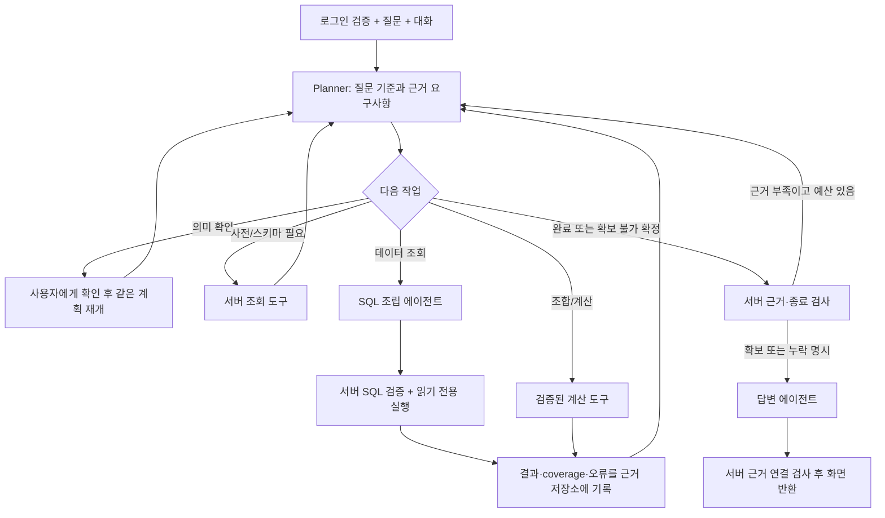

> **기획 참고 원문 · 2026-11-09 정리**
> 출처: `ax` 워크트리의 `docs/ax/natural-language-search/agentic-search.md`.
> 요구·설계·결정의 맥락을 보존한 자료입니다. 본문의 구현 완료, 검증 수치, 실행 명령, 작업 경로, 배포 승인은 당시 기록이며 현재 상태나 새 실행 승인이 아닙니다. 현재는 네 워크트리의 개발 코드가 삭제된 기획 보관 상태입니다. 상충하는 과거안은 상위 기획 요약과 최신 결정 기록을 따릅니다.

# 에이전트 기반 자연어 검색 설계

2026-10-25 후속: 핵심 구현·검증 상태 (원문 참조 경로: `agentic-implementation.md`; 이 기획 묶음에 포함되지 않음)와 [학습 안내](learning-agentic-search.md)를 따른다. 아래는 최초 설계 기록이며 현재 구현/미완료 판정은 구현 기록을 우선한다.

2026-10-25. 상태: 설계안 작성, 구현 전. 사용자가 고정 조건 검색의 한계를 지적하고 질문 해석·반복 계획·SQL 조립 등 역할을 에이전트로 구성하도록 요청했다. 현재 로컬 화면은 [대화형 v1](conversational-search.md)이며 이 문서의 루프가 이미 동작한다는 뜻이 아니다.

## 1. 목표와 현재 구조의 차이

질문을 해결하는 데 필요한 근거를 정의하고, 자료를 조회·계산·검토한 뒤 질문에 맞는 답변을 작성한다. 현재의 Retriever → 고정 Draft/QueryPlan → 단일 SQL → 서버 문장 템플릿을 역할별 에이전트와 서버 실행 루프로 확장한다. '상위 두 선수'는 예시이며 비교 인원을 2명으로 고정하는 기능 요구가 아니다. 의미 조건과 실행 자원 한도를 구분한다.

역할별 프롬프트·입출력·허용 도구를 분리하고 모두 지정 Vertex `gemini-4-argon`을 사용한다. 역할 분리는 별도 모델 제품·프로세스·에이전트별 무제한 위임을 뜻하지 않는다. 기존 FastAPI·Google Gen AI SDK를 유지한다. 후속 사용자 요청으로 LangGraph1.2.17을 도입했다. Redis 용도 확장/외부 통계 호출/배포는 포함하지 않는다.

## 2. 역할과 실행 권한

| 구성 | 판단/책임 | 입력 → 출력 | 할 수 없는 일 |
|---|---|---|---|
| Planner 에이전트 | 질문 구체화, 근거 요구사항·의존 작업 작성, 결과 확인 후 재계획/확인 질문/종료 제안 | 질문·대화·사전/coverage·작업 결과 → PlanDecision | 임의 수치 생성, DB 직접 접근, 확보되지 않은 근거 완료 처리 |
| SQL 조립 에이전트 | 할당된 조회 목적을 실제 스키마·관계·지표 정의에 맞는 SQL로 작성·수정 | QueryTask·허용 SchemaBundle·검증된 엔티티 참조 → SqlProposal | 접속 비밀 보유, 직접 실행, 사용자 조건/조회 대상 임의 변경 |
| 답변 에이전트 | 확보 근거·계산 결과로 설명/표 구성, 기준·누락·인과 추정 구분 | 확정 QuestionSpec·EvidenceBundle → AnswerDraft | 추가 근거 없이 통계/출처 생성, DB/외부 도구 직접 호출 |
| Orchestrator (서버) | 인증·세션·역할 호출·작업 상태·예산·취소·멱등성·종료 통제 | 모든 역할의 구조화 출력 → 검증된 상태 변경 | 모델에게 실행/권한 판정 위임 |
| 사전/스키마 조회 도구 | 실제 이름·별칭·지표 정의·허용 관계·자료 범위 반환 | 검색 요청 → 버전 있는 후보/정의 | 모델 기억으로 미등록 연결 생성 |
| SQL 검증·실행 도구 | AST·스키마·관계·범위·파라미터·비용·권한 검사와 읽기 전용 실행 | SqlProposal → ResultArtifact 또는 구조화 오류 | 모델이 게이트 검사/권한을 우회 |
| 계산·근거 검사 도구 | ID 기반 결합·차이·비율·정렬·완전성 검증 | 실제 결과 참조·허용 연산 → DerivedArtifact | 임의 Python/eval 실행, NULL을 0으로 대체 |

자료가 충분한지에 대한 의미 판단은 Planner가 하고, 서버는 필요한 근거 ref/자료 버전/coverage/계산 의존성이 실제로 존재하는지 독립 검사한다. 답변 에이전트가 '충분하다'고 선언하는 것만으로 완료하지 않는다. 별도 LLM 검수자는 초기 필수 구성으로 두지 않는다.

## 3. 실행 흐름

재귀 함수 호출 대신 서버 상태 루프로 구현한다. 역할이 서로 직접 호출하거나 별도 에이전트를 생성하지 않는다. 초기에는 의존 작업을 순차 처리하고 독립 조회의 병렬화는 비용/스냅샷 일관성 확인 뒤 적용한다. 단순 질문은 조회 1개로 종료할 수 있으며 모든 역할의 재검토를 불필요하게 반복하지 않는다.

## 4. 구조화 계약 초안

아래는 내부 설계 계약이며 새 공개 API나 Pydantic 구현 완료를 뜻하지 않는다.

- `QuestionSpec`: 사용자 목적, 확정/미정 평가 기준, 대회·기간·선수 범위, 적용 가정, 대화의 근거 ref. '잘한다' 같은 표현을 임의로 득점 지표로 바꾸지 않는다.
- `EvidenceRequirement`: requirement_id, 필요한 정보, 필요한 entity/기간/지표, 완료 조건, 필수 여부, status(pending/available/unavailable/needs_clarification), 근거 ref 및 누락 이유. '조회 완료'와 '질문에 충분함'은 다른 상태다.
- `PlanDecision`: action(lookup/query/calculate/clarify/finish/partial/unsupported), requirements, task_id/dependencies, 목적·기대 결과와 완료/종료 사유. 사용자에게 필요한 작업 요약만 저장·표시하고 숨은 사고 전문은 요청하지 않는다.
- `QueryTask`: 해결할 requirement, 허용된 엔티티/대회/시즌 ref, 필요한 필드·행 단위·집계·관계·완전성, 선행 ResultArtifact 참조. '선수3명'은 서버에서 검증한 이전 결과로 resolve한다.
- `SqlProposal`: task_id, SELECT SQL, 명명된 바인딩 params, 사용 SchemaBundle/지표 정의 버전, 예상 output columns/grain, 입력 근거 ref. 원문 이름을 문자열 보간하지 않는다. 이전 결과의 ID 목록은 서버가 실제 artifact에서 바인딩한다.
- `ResultArtifact`: 서버 발급 ref, task/requirement, 컬럼/타입/grain, 실제 행, 행 수·잘림 상태, 자료 범위·시각·snapshot 버전, SQL/정의 식별자. 대량 원문을 매번 모델에 복제하지 않고 필요한 결과/요약과 ref를 전달한다.
- `DerivedArtifact`: 허용 연산, 입력 artifact/ref와 join key, 계산 결과·단위·NULL/분모 정책, 원천 근거 연결. 서로 다른 선수/시즌을 행 순서로 연결하지 않는다.
- `AnswerDraft`: 설명·표 블록, 수치/통계 claim과 evidence_ref/derived_ref 연결, 적용 기준·누락·추정 구분. 서버에서 수치 참조를 확인하고 검증된 값으로 렌더링한다. 자유 서술의 의미 정확성을 정적 검사만으로 보장하지 않으며 독립 평가가 필요하다.

원시 SQL 생성은 기존 'Core만 SQL 작성' 결정에서 변경되는 제안이다. SQLAlchemy는 연결·트랜잭션·파라미터 실행에 재사용하되 현재 `sql_gate`를 원시 SQL 입력에 그대로 재사용해도 안전하다고 가정하지 않는다. 공개된 읽기 view/관계/함수만 지원하는 전용 게이트를 먼저 검증한다. 이 게이트가 준비되기 전에는 모델 작성 SQL을 실행하지 않는다.

## 5. 사례: 3명·두 시즌 비교

질문: '이번 시즌 EPL 득점 상위 3명의 직전 시즌 득점도 비교하고, 가장 많이 늘어난 선수를 알려줘.'

1. Planner가 EPL·이번/직전 시즌의 실제 범위를 확인하고 상위3명/이전득점/증감/최대증가의 요구사항을 만든다. 경계 동률이면 정확히3명 선택 기준을 확인하거나 동률 포함 범위를 명시한다.
2. SQL 에이전트가 이번 시즌 순위를 조회하는 SELECT를 작성한다. 서버가 검증·실행해 A1 artifact를 만든다.
3. Planner가 A1의 실제 선수 ID를 사용해 직전 시즌 득점 작업을 요청한다. SQL 에이전트는 검증된 ID/시즌 파라미터로 두 번째 조회를 작성한다. A2에 기록 없는 선수는 unavailable로 표시한다.
4. 서버 계산 도구가 선수 ID로 A1/A2를 결합하고 증감과 최대값을 계산해 D1을 만든다. 전원이 감소했다면 '가장 증가'라고 표현하지 않는다. 이전 기록 누락/0골 대비 증가율을 구분한다.
5. Planner가 요구사항별 확보/누락을 확인한다. 답변 에이전트가 A1/A2/D1에 근거한 비교표와 설명을 작성한다.

두 번째 결과가 질문에 충분하면 추가 조회하지 않는다. 동일 쿼리 반복으로 '자료 없음'을 해결하려고 하지 않는다. 한 SQL의 CTE/조인으로 충분할 때는 여러 SQL로 강제 분해하지 않는다.

## 6. 추상적 질문과 중단

- '요즘 가장 잘하는 선수': 대화에서 기간/기준을 찾고, 결과가 크게 달라지는 미정 기준을 묻는다. recent 자료가 노출되지 않았는데 이번 시즌 합계로 몰래 대체하지 않는다.
- '득점 효율': 실제 정의/분모/최소 출전 기준을 확인한다. 합의한 기준을 표시한다. LLM이 낮은 출전 시간·누락을 무시해 임의 추천하지 않는다.
- '가성비': 비용 자료가 없으면 unavailable이다. 외부 웹/API로 보충하거나 효율 지표를 연봉 대비 성과로 바꾸지 않는다.
- '왜 부진': 관측된 변화와 원인 추정을 구분한다. 저장 근거만으로 인과를 확정하지 않는다.

완료는 필수 requirement별 근거와 계산 의존성이 확보된 상태다. '전부 확보'는 DB 전체 추출을 뜻하지 않는다. 불가능한 필수 항목이 있으면 완전 답변 상태로 처리하지 않고 partial/확인 질문/비지원으로 종료한다. 0건·미수집·NULL·잘린 결과·기간 밖을 구분하며 잘린 상위100행으로 전체 집계/전체 최고를 주장하지 않는다.

반복 감지(task/SQL/파라미터 fingerprint), 단계·도구/SQL 호출·시간·token/byte 예산, 취소/동시성/멱등성은 서버가 통제한다. 오류 수정도 한도 내에서만 허용한다. 기존 전체 해석 deadline180초/DB3초·lock250ms·행100/256KiB·EXPLAIN 제한 등은 운영 확정값이 아닌 로컬 현재 기준이며 총 다단계 예산은 별도 설정·실측한다. provider429/권한 오류를 무한 재시도하거나 fallback 수치로 덮지 않는다.

## 7. 유지할 정책과 일관성

로그인·활성 USER/STREAMER/ADMIN, 기존 API-Football DB 저장본, 실제 최신2시즌, 일반 페이지 DB-only/6시간, NULL·부분 수집·수동 번역 보호 정책을 유지한다. SQL 에이전트에는 인증 비밀/일반 사용자 테이블을 제공하지 않는다. 함수·중첩 SELECT·CTE 전체·관계·tenant/scope 우회·다중 statement를 서버에서 검증한다. 파싱 성공은 의미/권한 검증 완료가 아니다.

여러 조회의 자료 버전을 대조한다. 현재 불변 로컬 mirror는 snapshot hash로 검증할 수 있으나 운영 갱신 중 일관성은 별도 설계가 필요하다. 모델 호출 중 DB 트랜잭션을 오래 유지하는 방식은 피하고 versioned projection/자료 버전 계약을 검증한다. 각 실행 시 freshness와 소유권을 확인하며 자료 변경 시 재계획 또는 명시적 중단한다.

## 8. 화면과 구현 순서

기존 글래스 검색창·대화·다크모드·취소/재시도 동선을 유지한다. 처리 중 작업 요약은 '비교 기준을 확인하고 있어요', '이번 시즌 기록을 조회하고 있어요', '직전 시즌 기록을 비교하고 있어요'처럼 실제 서버 상태에서 파생한다. 아직 모의 로딩인 화면에서 실제 진행 상태인 것처럼 표시하지 않는다. 사용자에게 SQL·모델 호출 수·내부 역할명을 설명할 필요는 없다.

[화면 요구](../../features/ax-agentic-search.md)를 먼저 목업으로 검증하고 요청/응답 계약을 정한 뒤 백엔드를 구현한다. 기존 endpoint에 필드를 추가할지 새 endpoint로 버전 분리할지는 FE 계약 단계에서 정한다. 기존 v1을 조용히 새 구조로 교체하지 않는다.

| 단계 | 완료 기준 | 현재 상태 |
|---|---|---|
| A-0 | 역할·상태·근거·종료·변경 결정 문서화 | 이 문서 작성 |
| A-1 | 다중 조회 진행·재질문·비교표·근거·부분 답변 FE 목업 및 테스트 플랜 | 미구현 |
| A-2 | FE 기반 API/내부 역할 계약, 독립 정답·실패 테스트 정의 | 미구현 |
| A-3 | Planner/state runner·도구·artifact·예산/취소 구현 | 미구현 |
| A-4 | SQL 에이전트·원시 SELECT 게이트·스키마/의미·실제 PG 검증 | 미구현 |
| A-5 | 계산/근거 검사·답변 에이전트·FE 실제 연동 | 미구현 |
| A-6 | 전체 흐름/실제 Vertex/독립 질문군·지연·비용·인수 | 미구현 |

검증은 특정 SQL 문자열·고정 경로 일치를 강제하지 않는다. 1개/복수 SQL 어느 경로든 실제 기대 ID/집계·질문 의미·근거 완전성·동률/누락·종료·비용 한도를 확인한다. 최소 질문군은 3명 이상 비교, 시즌 증감, 조건 결합/완화, 오래된 결과 참조, 추상 질문의 확인/가정, 자료 없음, 잘린 결과, 조인 중복, 비율 분모, 인젝션/권한, 반복/오류/429, 취소/응답 유실/사용자 격리다. 모델이 쓴 정답을 oracle로 재사용하지 않는다. 기존164개 단위/DB·UI27개 및 실제14턴 중13통과/1provider429는 v1 증거이며 새 구조 검증 결과가 아니다.

## 9. 조사 근거와 설계 판단

- [Google: Function calling](https://docs.cloud.google.com/gemini-enterprise-agent-platform/models/tools/function-calling): 모델이 도구 인자를 제안하고 애플리케이션이 실행 결과를 반환하는 기본 메커니즘. 권한/SQL 의미·완전성을 대신 보장하지 않는다.
- [Anthropic: Building effective agents](https://www.anthropic.com/research/building-effective-agents): workflow/agent 구분, 동적 작업 분해·도구 결과 피드백·종료 조건과 비용/지연 tradeoff를 검토했다. 2024년 패턴 설명을 참고했으며 최신 프레임워크 API 근거로 사용하지 않는다.

2026-10-25 확인. 위 문서는 구성 원리의 근거다. Planner/SQL/답변 3역할, 근거 요구사항 장부, 자체 FastAPI runner는 이 프로젝트의 설계 제안이다. 새 스택 설치·운영 전환·성능 보장을 의미하지 않는다.
