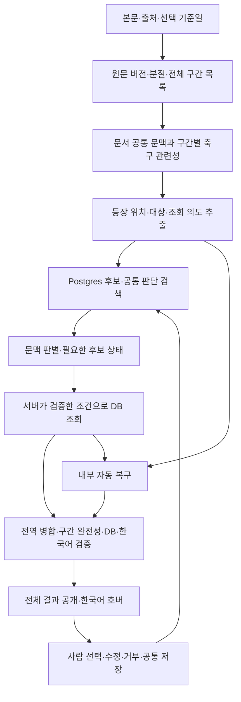

> **기획 참고 원문 · 2026-11-09 정리**
> 출처: `news-context` 워크트리의 `docs/ax/news-context/replan-v4.md`.
> 요구·설계·결정의 맥락을 보존한 자료입니다. 본문의 구현 완료, 검증 수치, 실행 명령, 작업 경로, 배포 승인은 당시 기록이며 현재 상태나 새 실행 승인이 아닙니다. 현재는 네 워크트리의 개발 코드가 삭제된 기획 보관 상태입니다. 상충하는 과거안은 상위 기획 요약과 최신 결정 기록을 따릅니다.

# 기사·커뮤니티 문맥 연결 재기획 v4

상태: **Opus 비평과 사용자 후속 의견을 반영한 설계안**. 제품 구현·평가 실행 전이다. v3와 과거 PASS는 이력으로 보존하며 이 문서의 완료 근거로 승계하지 않는다.

## 1. 유지할 사용자 목표와 이번 보완

활성 STREAMER/ADMIN이 외부 글 전문과 출처 URL을 입력하면 LLM이 축구 문맥을 이해하고 원문의 해당 영역에 DB 기본정보·문맥 기록·경기·이력을 연결한다. 입력은 최대 50,000 Unicode 코드포인트, 여러 언어·혼합 언어를 허용한다. 호버·키보드·터치의 정보·판단 근거·상태는 한국어다. 원문 언어와 문자는 그대로 보존한다.

모호한 해석은 후보·근거를 보여주고 사용자가 선택·수정·초기 후보 밖 DB 검색·연결 거부를 할 수 있다. 확인한 판단은 최소 구절·필요 문맥·출처·판단·편집자·변경이력과 함께 서비스 공통으로 저장하고 다음 분석에 실제 적용한다. 공통 저장과 화면의 임시 선택을 구분한다.

사용자 후속 의견(원문):

> 둘 다 사용성 측면에선 옳지 않은 것 같은데. 혹시 실패한 구간을 사용자 반응을 통해 재시도하는거라면 반대합니다.

따라서 **구간 실패는 시스템이 복구하고, 전체 처리가 검증된 결과를 한 번에 제공**하는 방향으로 보완한다. 구간별 재시도 버튼이나 실패 구간 선택을 사용자에게 요구하지 않는다. 아래 장문 복구 정책은 이 의견에 대한 설계 반영이며 사용자가 별도 선택지를 승인했다고 기록하지 않는다.

| 설계 결정 | 연결 요구 | 보완 내용 |
|---|---|---|
| D01 원문 등장 위치를 식별 | R01/R04/R07/R11 | 원문 버전·서버 분절·코드포인트 범위·인용·등장 순번. 반복과 겹침도 보존 |
| D02 조회 의도를 명시 | R05/R06 | 지표·기준일·대회·집계 단위·증거 필드를 가진 조회 사전 |
| D03 사람 판단의 적용 규칙 | R08/R09/R10/R13 | 종류별 유효 범위·충돌·거부·버전·취소. 적용한 판단을 추적 |
| D04 내부 자동 복구와 전체 결과 공개 | R01/R03/R11/R12 | 자동 재시도·제한된 재분할·전역 검증 후 단일 결과 공개 |
| D05 한국어 사실 표시 | R02/R06/R07 | DB 사실을 한국어 렌더러로 표시하고 생성한 해석과 분리 |
| D06 고정 평가와 실제 실행 증거 | R09/R10/R11/R14 | 평가 DB·독립 정답·반복 규칙·전체 흐름 증거를 함께 동결 |

## 2. 사용자 화면과 결과의 의미

1. **입력:** 전문·HTTP(S) 출처 URL. 게시 시각/기준일은 선택 입력이다. 상대 날짜가 있는데 기준이 없으면 추측하지 않고 결과에서 해당 해석만 확인 대상으로 둔다. 본문 날짜 후보를 보여주고 수정할 수 있다. URL 크롤링으로 게시일을 가져오는 기능을 추가하지 않는다.
2. **분석 중:** 원문과 입력을 유지하고 진행 상태를 한국어로 알린다. 아직 검증되지 않은 부분 카드를 최종 결과처럼 공개하지 않는다. 입력을 수정하면 이전 작업의 응답을 새 글에 붙이지 않는다.
3. **내부 복구 중:** 시스템이 일시 장애를 자동 복구한다. 필요한 경우 '분석이 지연되어 자동으로 처리하고 있습니다'로 알린다. 실패 구간이나 모델 오류 코드를 사용자가 해석하도록 요구하지 않는다.
4. **전체 결과:** 모든 원문 구간이 `분석됨/축구 아님/해석 확인 필요` 중 하나로 처리되고 전역 검증을 통과한 뒤 원문 강조와 카드를 한 번에 공개한다. 후보 확인 필요는 정상 결과의 일부이며 처리 실패와 다르다.
5. **사람의 해석 확인:** 카드에서 대상·경기·시점·집계 기준을 선택/수정하고 공통 적용 범위를 확인한다. 필요한 문맥만 보여주며 저장 성공 후에만 공통 판단으로 표시한다. 후보에 정답이 없으면 다른 DB 대상을 찾거나 명시적으로 연결을 거부한다.
6. **자동 복구 소진/권한 문제/서버 작업 유실:** 부분 결과를 완료로 바꾸지 않는다. 원문을 유지한 채 전체 분석 실패와 요청 ID를 안내한다. 구간 재시도 조작은 제공하지 않는다. 이후 전체 분석을 새로 요청할 수 있는 경로는 오류 복구의 필수 사용자 작업으로 취급하지 않는다.

호버 카드는 이름의 기본정보와 문장에 대응한 자료를 함께 제공한다. 기본정보만 나왔다는 이유로 문맥 조회를 완료 처리하지 않는다. 한국어 표시에는 해당 대회·시즌/기간·기준일·DB 수록 범위·자료 시각·누락 상태가 포함된다. '최근 5경기'가 팀의 5경기인지 선수의 5출전인지 미정이면 확인 대상으로 둔다.

## 3. 처리 구조와 기술 선택 방향

B안인 FastAPI·SQLAlchemy·Supabase/Postgres·Vue를 중심으로 한다. 정식명·번역명·확정 별명·초성·팀/시즌 후보를 먼저 검색하고 LLM이 문맥을 판별한다. 교차 문자 표기의 음역 추정은 후보 확장에만 사용하며 모델이 생성한 ID나 이름을 사실로 확정하지 않는다.

LLM은 대상·지표·기간·대회·경기/출전 기준의 **형식화한 조회 계획**을 만든다. 서버가 ID·필드·시점·권한을 검증한 뒤 SQLAlchemy로 조회한다. LLM이 만든 통계나 자유 SQL을 그대로 실행/표시하지 않는다. 한국어 사실 영역은 DB 값과 번역·도메인 표시 규칙으로 만들고, 생성된 판단 근거와 구분한다.

우선 도입 구성과 보류·재검토 조건은 [기술 선택 v2](technology-options-v2.md)에 적었다. 도구를 보류해도 다국어·문맥·공통 판단·이력·5만 자 요구는 그대로다. 최종 모델·검색 조합·분할 크기·동시성·대기시간 목표는 같은 정답셋의 실측으로 확정한다.

## 4. 원문 위치와 중첩 계약

- 입력 시 원문 스냅샷의 digest와 버전을 만든다. 검색용 정규화 문자열은 별도로 만들고 원문을 덮어쓰지 않는다. 본문이 바뀌면 기존 범위를 재사용하지 않는다.
- 서버가 원문을 논리 순서의 문단/문장으로 분절하고 각 segment의 `[start_cp,end_cp)`를 계산한다. 전체 처리 대상 목록은 분할 호출 전에 고정한다. 긴 문단을 나눌 때도 원래 위치로 돌아갈 수 있어야 한다.
- 모델은 `segment_id + 원문 그대로의 인용 + 해당 segment 내 등장 순번`을 낸다. 서버가 정확히 대조해 범위를 계산하고 인용이 모호하거나 불일치하면 자동 연결하지 않는다. 모델의 숫자 오프셋을 그대로 신뢰하지 않는다.
- 응답의 정본은 원문 버전·코드포인트 범위·정확한 인용·앞뒤 문맥·등장 ID다. 프론트의 단일 변환 경로가 이를 UTF-16 위치와 대응시킨다. 50,000자 길이 계산도 코드포인트다.
- 분할에서 중복 추출된 **동일 등장**만 병합한다. 같은 이름이 다른 위치에 나오면 별도 등장이다. 겹치거나 교차하는 이름/문맥 구간은 보존하며 범위를 잘라 여러 주석을 연결한다. 하나를 조용히 버리거나 글 전체를 문자열 치환하지 않는다.
- 원문 영역에 해당 카드가 여럿이면 이름 정보·기록 정보 등을 선택할 수 있게 한다. 카드로 포인터를 옮겨도 유지하고 키보드·터치·Escape·화면 경계를 검증한다.

인용·위치·문서 상태를 함께 쓰는 발상은 [W3C Web Annotation](https://www.w3.org/TR/annotation-model/)을 참고한다. W3C의 정규화된 문자열 위치 규칙 전체를 우리 원문 코드포인트 계약과 동일하다고 주장하지 않는다. 반복·NFC/NFD·보조평면·결합 문자·RTL·CRLF를 별도 고정자료로 검증한다.

## 5. 문맥 조회와 데이터 의존성

[조회 사전](query-catalog-v1.md)은 기본정보·선수 경기별/시즌 기록·시즌 비교·경기·상대전적·순위·팀 흐름·소속/감독 관측·이적·부상 의도를 정의한다. 지표별 DB 컬럼/JSON 경로의 실제 coverage와 집계 의미를 확인한다. 경로가 존재한다는 이유로 모든 값이 완전하다고 보지 않는다.

시점은 본문 명시 시각 → 사용자가 확인한 기준 시각 → 확인 필요 순서다. 분석한 오늘을 과거 글의 게시일로 자동 채우지 않는다. 상대 날짜에 필요한 시간대·날짜 해석도 확인한다. 현재 스냅샷 통계를 과거 시점의 통계로 바꾸어 표시하지 않는다.

최신 2시즌은 현재 수집 코드가 대회별 실제 현재/직전 시즌을 고르는 사실을 기준으로 정책과 대조한다. `2022`라는 연도만으로 제외하지 않는다. 대회·시즌 매핑을 확인해 조회 범위를 정하며 보관 정책을 임의로 확대/변경하지 않는다.

읽기 전용 DB 관찰(2026-10-29 02:15:54 UTC)의 이적·부상은 각각 0행이다. 기존 daily-sync 책임과 연계한 데이터 적재를 선행 의존성으로 둔다. 감독 번역 테이블은 이미 존재하며 신설 대상으로 잡지 않는다. 이력 요구를 미지원 표기나 최신 프로필 카드로 대체해 통과시키지 않는다.

조회 결과 상태는 `자료 있음 / 일부 미수집 / 자료 없음 / 보관범위 밖 / 기준 확인 필요 / DB에 해당 지표 없음`으로 구분한다. 이는 사용자에게 정확히 알리는 규칙이며 요구된 기능의 미구현을 허용하는 완료 규칙이 아니다. 필수 의도의 데이터·구현이 비어 있으면 개발·검증의 미완료로 남는다.

## 6. 공통 판단과 변경의 의미

[판단 정책](feedback-policy-v1.md)에 종류별 재사용 조건·거부·상충·취소·이력을 정의했다. 핵심은 표면형이 같다는 이유로 판단을 전역 치환하지 않는 것이다. 사람의 판단은 후보 검색/배제/판별에 실제 쓰이며 적용 판단 ID·버전을 남긴다. 한 분석은 읽은 판단 버전을 표시하고 결과 공개/공통 저장 직전 최신성 검사를 한다.

권한 철회는 새로운 읽기/쓰기/분석/이벤트 구독을 차단한다. 기존 판단은 해당 판단의 유효 상태와 감사 이력으로 관리하고, 편집자 역할 변경만으로 일괄 삭제하는 새 정책은 추가하지 않는다. 오류 판단의 수정·취소는 현재 권한을 가진 사용자가 수행할 수 있다.

이미 열린 결과는 판단 변경 이벤트와 카드 열기·포커스 복귀·저장 전 버전 확인으로 오래된 근거임을 표시한다. 버전 확인이 실패하면 최신 근거라고 확정하지 않고 공통 저장을 차단한다. 원문/기존 결과와 재분석 경로를 유지한다. 글 전문을 저장해 과거 글을 재열람하는 기능으로 확장하지 않는다.

## 7. 장문·장애·비동기 복구

장문 처리는 문서 공통 문맥 + 문단 묶음 추출 + 전역 병합을 기본 검증 가설로 삼고 단일 호출과 비교한다. 비축구가 섞인 글을 문서 단위로 전부 버리지 않는다. 긴 문장·문단을 포함한 모든 원문 구간은 처리 목록에 남긴다.

| 내부 상황 | 자동 처리와 사용자 결과 |
|---|---|
| 일시적 연결/timeout/429/5xx | 같은 작업의 실패 단위만 지수 백오프로 재시도. 정상 단위를 재호출하지 않음 |
| 출력 중단/MAX_TOKENS | 같은 요청을 그대로 반복하지 않음. 실패 단위를 더 작게 나눠 원문/공통 문맥을 유지하고 재처리 |
| 잘린 JSON/형식·인용 불일치 | 해당 단위 실패로 기록하고 제한된 재처리. 부분 JSON을 성공으로 채택하지 않음 |
| 만료 인증/권한 철회/취소 | 외부 호출·저장 중지. 가능한 기존 세션 갱신과 권한 재확인 이외의 우회 없음 |
| 프로세스 재시작/작업 유실 | 실패 상태를 알리고 브라우저의 원문 유지. 작업이 계속되는 것처럼 표시하지 않음 |
| 자동 복구 소진 | 전체 실패로 종료. 부분 결과를 분석 완료로 표시하거나 구간별 조작을 요구하지 않음 |

재시도는 동일 단위 최초 포함 최대 3회, 재분할 깊이는 초기 검증안에서 1단계로 제한한다. 1차 문맥 호출과 전체 호출 예산·작업 기한도 함께 관리해 무한 복구하지 않는다. 수치의 충분성·지연·비용은 5만 자 실측으로 검증하며, 실패한다고 지원 길이를 줄여 통과시키지 않는다. 조정 시 정답·판정 규칙은 유지하고 변경을 기록한다.

진행 통지와 판단 무효화 통지는 하나의 인증된 응답 스트림을 우선 검토한다. 주기적 상태 polling을 기본으로 두지 않는다. 스트림 재연결은 마지막 이벤트 위치와 동일 작업 ID로 자동 수행하고 분석을 중복 실행하지 않는다. 원문 재전송 없이 작업을 찾으며, 메모리에 없는 작업은 명시 실패다. API 경로·메시지 shape는 프론트 목업 뒤 endpoint 계약에서 확정한다. [Fetch 응답 스트림](https://developer.mozilla.org/en-US/docs/Web/API/Fetch_API/Using_Fetch), [SSE 이벤트와 재연결](https://html.spec.whatwg.org/multipage/server-sent-events.html)

원문 전문은 현재 UI와 진행 중 작업의 프로세스 메모리에만 둔다. 완료/실패/취소·세션 종료 후 재연결에 필요한 짧은 수명과 파기를 설계하고 로그·trace·체크포인트에 전문을 저장하지 않는다. 유휴 수명·작업 기한은 장문 측정과 프록시/서버 연결 검증 뒤 동결한다. 공통 판단/감사 이력에는 이 임시 수명을 적용하지 않는다.

## 8. 개발 전 평가 설계와 진행 순서

[평가 계획](evaluation-plan-v1.md)은 정답 원천 DB 스냅샷, 격리 피드백 DB, 독립 정답, 필수 자동 연결/금지/허용 보류, 실제 모델 반복 3회, 전체 사용자 흐름 및 코드 지문 증거를 정했다. 모든 필수 실패를 개별 보고하며 평균값·전부 보류·재생 응답만으로 통과할 수 없다.

| 순서 | 산출물 | 진입/완료 조건 |
|---|---|---|
| 1 설계 보완 | 이 문서·조회/판단/평가 정책·외부 계약 새 버전 | 사용자 원문과 14개 요구의 보존, 비평별 반영/유보 근거 |
| 2 검증 준비 | 실제 표본·독립 정답·DB snapshot·수집 의존성·실행기 | 고정 기준과 실행 가능한 명령, 실제 모델/DB/UI 증거의 공식 연결 경로 |
| 3 독립 명세 검토 | 전체 시나리오별 누락/관찰·판정 | 미준비를 PASS로 바꾸지 않고 확인된 설계/검증 누락 보완 |
| 4 프론트 목업 | 입력/진행/전체 실패/호버/교정/충돌 화면 | 사용자 흐름과 계약 근거 확인 후 endpoint 목록 작성 |
| 5 백엔드·영속화 | FE가 정의한 계약의 API/모델/migration | 워커 데이터 의존성과 분리해 구현, 임의 API 선제 구현 없음 |
| 6 실제 통합/독립 검토 | 실제 모델→DB→한국어 호버→공통 저장→다른 사용자 새 글→취소 반영 | 동결한 모든 필수 조건 통과, 동일 코드·자료·모델 증거 |

현재 Q-TESTSET(실제 자료/정답/실행 명령), Q-DATA(이력/JSON coverage), Q-VERIFY(공식 실행 증거 연결)는 준비 작업이다. 설계 문서를 작성한 것만으로 해결 처리하지 않는다. 제품 구현·DB 쓰기·push·배포를 이 설계 작업에서 수행하지 않는다.

## 9. 비평 반영 근거

- [Opus 회신](opus-design-critique-v1.md), [코드·설계 대조](opus-design-critique-assessment-v1.md)
- P0-1 → §6/판단 정책, P0-2 → 평가 계획, P0-3 → §5/조회 사전, P0-4 → §4, P0-5 → §5/데이터 선행 작업
- P1-1/2 → §7/평가 계획, P1-3/4/5 → §2/5/조회 사전, P1-6/8 → 판단 정책, P1-7 → §3/한국어 표시 검증
- P2 → 기술 선택 v2의 도입 조건·소유 파일/선행 작업·최소 보관. 감독 번역/2022 일괄 제외/polling 예외/실측 없는 대안 기각 지적은 대조 문서의 수정 방향을 적용했다.

외부 원문·계약·변경 receipt·독립 검토·현재 상태 정본은 `/Users/woolee/.local/state/benchmark-harness/operator-inputs/news-context-replan/`에 보존한다. 본문에 상태를 적는 것과 공식 하네스 상태 변경은 구분한다.
