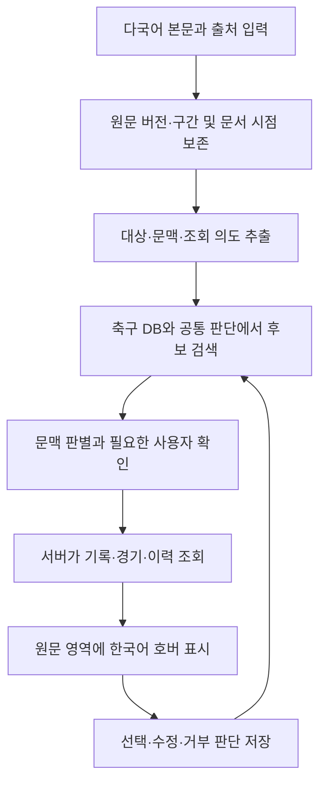

> **기획 참고 원문 · 2026-11-09 정리**
> 출처: `news-context` 워크트리의 `docs/ax/news-context/technology-options-v1.md`.
> 요구·설계·결정의 맥락을 보존한 자료입니다. 본문의 구현 완료, 검증 수치, 실행 명령, 작업 경로, 배포 승인은 당시 기록이며 현재 상태나 새 실행 승인이 아닙니다. 현재는 네 워크트리의 개발 코드가 삭제된 기획 보관 상태입니다. 상충하는 과거안은 상위 기획 요약과 최신 결정 기록을 따릅니다.

# 기사·커뮤니티 문맥 연결: 기술 선택 메모 v1

상태: **사례·공식 구현 조사에 따른 비교 제안**. 사용자 기술 선택과 동일 조건의 프로젝트 평가 전이며 채택 확정·구현 완료·성능 검증 보고가 아니다. 근거와 사례별 한계는 [조사 보고서](research-v1.md)에 연결했다.

## 1. 현재 권장하는 비교 방향

**FastAPI·SQLAlchemy·Supabase/Postgres·Vue를 기반으로, 후보 검색과 LLM 문맥 판별을 결합하고 사람이 확인한 판단을 공통 DB에서 재사용하는 안**을 우선 비교한다.

기본정보·관련 기록·경기·이력·다국어·최대 5만 자·한국어 호버·후보 교정·공통 재사용·수정/취소/감사·권한은 어느 비교안에서도 유지한다. 기능이 빠진 안과 완전한 안을 비용만으로 비교하지 않는다.

이 방향의 근거는 다음과 같다.

- BBC는 도메인 KB·자동 후보·사람 확인·즉시 사전 갱신을 연결했다.
- Washington Post는 읽던 구절에 필요한 짧은 설명을 같은 페이지에 제공했다.
- Guardian·FT는 표시 이름과 공통 ID, 과거 관계를 분리했다.
- BLINK·ReFinED·BELA와 최근 MHEL-LLaMo는 후보 생성·판별·NIL을 분리할 근거를 제공한다.
- 티오더·Uber는 도메인 지식과 조회 범위를 먼저 좁히는 구현을 공개했다.

[BBC](https://speakerdeck.com/jemrayfield/bbc-dynamic-semantic-publishing-sport%7Colympics-semtechbiz-uk), [Washington Post](https://www.niemanlab.org/2015/07/how-the-washington-post-built-and-will-be-building-on-its-knowledge-map-feature/), [Guardian](https://www.currybet.net/cbet_blog/2010/10/adding-linked-data-to-guardian-api.php), [FT](https://medium.com/ft-product-technology/navigating-the-financial-times-knowledge-graph-00d83f0374c1), [MHEL-LLaMo](https://aclanthology.org/2026.eacl-long.184/), [티오더](https://aws.amazon.com/ko/blogs/tech/torder-text2sql-case/), [Uber](https://www.uber.com/gb/en/blog/query-gpt/)

## 2. 세 가지 아키텍처 후보

| 비교 항목 | A. LLM 중심+기존 DB | B. 검색+LLM 혼합 | C. 전용 EL+같은 DB |
|---|---|---|---|
| 문맥 추출 | LLM이 구절·대상·조회 의도 추출 | LLM 추출과 DB 후보/공통 판단 검색을 조합 | 전용 EL 검출·연결, 복잡 문맥은 LLM |
| 후보 | LLM 정규화 이름+정식명/별명 조회 | 정식명/별명+철자/다국어 의미 검색+문맥 재판별 | 자체 entity index/profile 검색·전용 판별, 어려운 문맥은 LLM |
| 기록·경기·이력 | 서버에서 검증된 조회조건으로 DB 조회 | 동일 | 동일. EL/graph 결과만으로 통계 사실을 만들 수 없음 |
| 사람 교정 | 공통 판단 DB를 다음 분석에 실제 적용, 거부·수정·취소·감사 포함 | 같은 공통 요구를 후보 생성/제외/판별에서 적용 | 같은 공통 요구를 모델 index/판별·DB 갱신과 연결 |
| 장점 | 운영 구성요소가 적고 비교 기준으로 간결 | 후보 recall·판별 오류를 분리하며 기존 DB와 연결하기 쉬움 | 대량 EL·일관된 ID 연결, 모델별 속도/품질 절충 비교 |
| 주요 부담 | 새로운 표면형·언어의 후보 누락, LLM 호출/반복성 | 검색 인덱스·embedding 갱신·rank/보류 기준 평가 | KB resource/ID 변환·모델 자원·의존성·index 갱신 |
| 판단 | 완전한 요구를 유지한 기준안으로 평가 | **현재 우선 비교 후보** | 필요성이 확인된 구성요소를 선별해 비교 |

교정의 실제 재사용·거부·수정·취소·감사, 초기 후보 밖 대상 검색(R08-S02), 현재 화면의 구버전 판단 식별·재분석(R10-S04)을 포함한 [47개 시나리오](replan-v3.md)는 세 안의 공통 조건이다. 세 안 모두 공통 판단이 다음 분석의 결과를 바꾸는지 검증한다.

BLINK·ReFinED·Bootleg의 공개본은 영어 중심이고, mGENRE·BELA는 다국어 모델이다. BLINK·BELA·GENRE 저장소의 archived 상태와 GENRE의 NC 라이선스 등은 도입 비용에 반영한다. 코드·weight·원천 corpus 조건도 구분한다. [BLINK](https://github.com/facebookresearch/BLINK), [ReFinED](https://github.com/amazon-science/ReFinED), [Bootleg](https://github.com/HazyResearch/bootleg), [BELA](https://github.com/facebookresearch/BELA), [GENRE](https://github.com/facebookresearch/GENRE)

**그래프 저장·검색은 A/B/C와 별도의 선택 축이다.** 전용 EL은 대상 검출·연결 방법이며 graph는 관계 저장/검색 방법이므로 같은 선택으로 묶지 않는다. B안도 BELA를 후보검색기로 사용할 수 있다. 시간 관계·여러 출처의 다단계 탐색이 필요해지면 Postgres 관계 조회와 Graphiti/graph 저장소를 비교한다. GraphRAG 방법론의 주제 요약과 현재 구현의 유지보수 상태도 분리해 검토한다. [혼합 구현 MHEL-LLaMo](https://aclanthology.org/2026.eacl-long.184/), [Graphiti](https://github.com/getzep/graphiti), [GraphRAG](https://github.com/microsoft/graphrag)

## 3. B안으로 구현한다면 연결될 처리 단계

다음은 구현 검토용 흐름이며 구현을 시작한 것이 아니다.

### 단계 1. 원문·문맥·위치를 보존

원문은 번역하거나 정규화해 덮어쓰지 않는다. 문서 digest·기준 시점과 각 구절의 정확한 인용·앞뒤 문맥·위치를 연결한다. 검색용 NFC/case-fold/별명 확장은 별도 표현으로 다루며 원문 위치와 대조한다.

W3C의 인용/위치 selector를 참고한다. 화면과 서버의 5만 자 계산은 code point로 일치시키고 JS의 UTF-16 인덱스로 표시할 때 명시적으로 변환한다. RTL은 시각 순서가 아닌 논리 순서로 구절을 찾는다. 표준의 전체 matching/정규화 규칙을 무조건 적용하거나 동일 문자열의 모든 출현에 같은 대상을 붙이지 않는다. [W3C 표준](https://www.w3.org/TR/annotation-model/)

### 단계 2. 대상 연결과 자료 조회 의도를 분리

가상 문장 ‘사카의 최근 5경기 득점이 늘었다’에는 최소한 다음이 있다.

- ‘사카’가 가리키는 선수 후보.
- 득점이라는 지표와 해당 DB 필드/의미.
- ‘최근’의 기준일, 5경기의 범위, 대회·소속 조건.
- 원문의 증가 주장과 실제 DB 비교값의 차이.

선수 ID 하나를 찾았다는 이유로 이 전체를 완료 처리하지 않는다. 출력은 원문 근거와 대상 후보, 지표/기간/대회/경기 조건을 가진 구조로 받고 서버가 검증한다. structured output은 형식 제약이며 사실 검증은 별도다. [Google structured output](https://docs.cloud.google.com/gemini-enterprise-agent-platform/models/capabilities/control-generated-output)

### 단계 3. 후보 검색과 문맥 판별

1. DB 정식명·번역명·확정 alias/거부 판단을 조회한다.
2. 철자·언어 차이로 누락된 후보를 근사/의미 검색으로 보완한다.
3. 후보의 type·소속/시즌·대회·근거를 이용해 문맥 판별한다.
4. 불확실하면 한국어 근거와 구별 가능한 후보를 제시한다.

초기 후보 밖에 정답이 있으면 사용자가 DB에서 다른 대상을 검색·선택하거나 연결을 거부할 수 있어야 한다(R08-S02). 후보 검색 단계의 실패를 잘못된 후보 중 강제 선택으로 처리하지 않는다.

사용자 확인된 판단도 적용 문맥이 맞아야 한다. 하나의 높은 embedding 점수나 모델의 confidence만으로 확정하지 않는다. 후보 안에 정답이 없는 경우를 따로 측정한다.

### 단계 4. 기록·경기·이력을 검증해 조회

LLM이 SQL 전체를 자유 생성하는 경로와, **대상·지표·시간/대회 조건을 typed query plan으로 반환하고 서버가 SQLAlchemy 조회로 변환하는 경로**를 비교한다. 초기 우선 검토는 후자다. 이는 조회 가능한 기록을 임의로 줄이는 것이 아니라 필요한 지표·관계·JSON 필드를 조사해 의미를 정의하는 구현 방식이다.

예: `player / goals / last_n=5 / as_of / competition / appearance-or-team-fixture` 같은 조건을 명시한다. 확인되지 않은 조건은 사용자 선택과 연결한다. 새로운 관련 지표가 빠지면 어휘/조회 계약을 보완하며 ‘지원하지 않음’으로 조용히 제외하지 않는다.

경기 사실은 fixture, 경기별 지표는 fixture_detail, 시즌 통계는 player_season_stat 등 실제 저장 자료와 연결한다. 이적·부상 데이터가 없는 문제는 수집/적재 의존성으로 해결해야 한다. SQL 문법 검사만으로 집계 의미가 맞는 것은 아니다. [티오더 구현의 의미/스키마 구분](https://aws.amazon.com/ko/blogs/tech/torder-text2sql-case/)

### 단계 5. 한국어 호버 출력

DB의 한국어 명칭, 지표/국가/포지션의 한국어 표시, 사실과 근거의 한국어 설명을 조합한다. 입력 언어를 그대로 출력 설명 언어로 승계하지 않는다. 원문 고유명은 필요한 보조 식별값으로 구분한다. 번역 미확정은 한국어 상태로 표시하며 사실·수치를 번역 과정에서 바꾸지 않는다.

Vue의 본문 분절과 정보 카드는 기존 구조를 활용할 수 있다. Floating UI는 위치·경계 보정 후보이며, 후보 선택이 있는 interactive card의 키보드/터치/포커스 접근성은 별도로 구현·검증한다. [Vue bindings](https://floating-ui.com/docs/vue)

### 단계 6. 확인한 판단의 실제 재사용

공통 판단 DB에는 대상/조회조건과 최소 구절·문맥·출처·적용범위·편집자·버전·활성/취소를 연결한다. 이름 전체의 alias, 문서 내 대명사, 특정 경기 확인, 지표 용어 교정, 후보 거부를 구분한다.

다음 분석은 이 DB를 검색·판별 단계에서 읽고 `applied_decision_ids`와 지식 버전을 남긴다. 수정·취소 후 인덱스/cache의 구버전이 적용되지 않게 한다. 현재 Upstash의 세션 용도 정책을 바꾸거나 새 응답 cache를 전제로 하지 않는다.

현재 화면에서 이미 열어 둔 결과가 수정/취소된 판단을 참조하면 그 결과의 근거 버전이 달라졌음을 보여주고 재분석 경로를 제공한다(R10-S04). 이는 새 분석 갱신과 별도 시나리오이며 글 전문 보관 기능을 추가한다는 뜻은 아니다.

동시 수정·감사는 현재 서비스의 expected_version/409 및 transaction 패턴을 참고한다. 모델의 자동 추출이 사람 확정 판단을 조용히 덮어쓰지 않는다. [SQLAlchemy versioning의 적용 범위](https://docs.sqlalchemy.org/en/20/orm/versioning.html)

### 단계 7. 5만 자 처리 방식과 사용자 대기

현재 모델은 큰 입력을 지원하지만 요청의 출력 예산·언어·다수 언급·반복 구절은 별도 문제다. 전체 한 번의 구조화 호출과, 문서 공통 문맥을 유지하면서 문단별 처리/전역 병합하는 방식을 동일 표본에서 비교한다. 분할은 모든 영역을 덮고 경계의 지시어·중복·상충을 검사해야 한다.

현재 어댑터의 4,096 출력 설정을 그대로 고수하거나, 최대 출력만 크게 올린 것으로 안정성을 선언하지 않는다. finish reason·실제 사용량·시간·각 영역의 정답을 계측한다. [현재 모델의 공식 한도](https://docs.cloud.google.com/gemini-enterprise-agent-platform/models/gemini/3-5-flash)

실측 대기시간과 복구 필요에 따라 요청 내 처리/작업 상태 저장/별도 worker를 선택한다. LangGraph는 반복 검토·재개가 복잡할 때 비교할 수 있지만 공통 판단 저장소를 대신하지 않는다. 긴 작업 때문에 임시 본문을 보관해야 한다면 최소 근거 영속 보관과 구분해 처리·파기 수명을 설계해야 한다. [LangGraph interrupt·멱등성](https://docs.langchain.com/oss/python/langgraph/interrupts)

## 4. 구성요소별 선택 기준

| 영역 | 우선 비교할 방향 | 대안·채택 조건 |
|---|---|---|
| API/서버/ORM | FastAPI + Pydantic + SQLAlchemy | 현재 요구가 다른 서버 프레임워크를 필요로 한다는 근거 없음 |
| 원천 자료/판단·감사 | Supabase Postgres의 관계형 데이터·JSONB·version/event | 여러 출처의 시간 관계 탐색이 커지면 Graphiti/graph 저장소의 이점을 별도 실측 |
| 이름·alias 검색 | 정규화 필드/확정 alias + `pg_trgm` | CJK/문맥 검색 필요와 품질에 따라 PGroonga 비교 |
| 의미 검색 | pgvector + 관리형 다국어 embedding 비교 | BGE-M3 자체 호스팅의 자원·품질·비용과 비교. 필요가 입증된 경로를 채택 |
| 문맥 이해 | 기존 Vertex 구조화 출력 경로를 기준으로 동일셋 비교 | 뉴스 모델 교체는 평가 결과에 따라 결정. 별도 자연어 검색 모델을 임의 승계하지 않음 |
| 한국어 표시 | 기존 번역명 + 한국어 domain renderer/근거 설명 | 전체 입력 번역으로 span을 잃는 구조를 피하고 언어별 실제 출력을 검증 |
| UI | 기존 Vue + annotation 구조, 위치 보정 라이브러리 검토 | 인터랙션·모바일·접근성은 직접 수용 기준으로 확인 |
| 내부 정답/교정 작업 | 표본 규모에 따라 Label Studio 또는 내부용 Prodigy | 도구를 서비스 공통 권한/감사의 대체품으로 쓰지 않음 |
| 평가/진단 | pytest/Playwright + 고정 정답·실제 요청 증거, Promptfoo 비교 | Langfuse/Phoenix는 계측·협업 필요와 운영부담을 보고 선택 |

Supabase 공식 hybrid 예시는 keyword와 vector를 RRF로 합친다. `english` FTS 설정이 우리 다국어 요구를 충족한다고 가정하지 않는다. 선택은 이름·별명·초성·다국어별 후보 recall로 판단한다. [공식 hybrid 구현](https://supabase.com/docs/guides/ai/hybrid-search)

관리형 embedding은 기존 인증 재사용이 편하지만 입력 token/차원/자동 절단·호출 비용을 확인해야 한다. BGE-M3는 공식 1024차원·8192 sequence이지만 별도 추론 자원이 필요하다. 현재 pgvector 일반 HNSW의 2000차원 제한과 관리형 embedding의 기본 3072차원도 맞춰야 한다. [Vertex embedding](https://docs.cloud.google.com/gemini-enterprise-agent-platform/models/embeddings/get-text-embeddings), [BGE-M3](https://huggingface.co/BAAI/bge-m3), [pgvector](https://github.com/pgvector/pgvector)

현재 DB에서 `pg_trgm`·PGroonga·pgvector는 제공 가능 목록에 있지만 미설치다. 라이브러리/extension 설치나 운영 migration은 이 조사에서 실행하지 않았다.

## 5. 기술 확정 전에 비교할 실험

이 표는 **실험 설계이며 아직 미실행**이다. 기존 47개 필수 시나리오를 선택한 작은 실험으로 대체하지 않는다.

| 비교 | 같은 조건으로 고정할 것 | 판단 지표 |
|---|---|---|
| A vs B vs 전용 EL 기준 | 실제 기사/커뮤니티·다국어 정답·KB snapshot | mention 검출, candidate recall@k, 정확한 span+ID, NIL/잘못된 보류 |
| lexical vs hybrid | 동일 alias·canonical entity·기간/대회 조건 | 정답 후보 누락, 동명이인 오연결, 처리량/자원 |
| 단일 vs 분할 LLM | 5만 자 한/영/혼합, 앞·중간·끝, 30개 초과 언급 | 전체 구간 완전성·지시어·중복·상충·출력 중단·실제 token/시간 |
| 문맥 자료 조회 | 동일 대상·기준일·대회·경기/출전 정의 | fixture/기록/이력의 정답 일치, NULL/0·루머·과거 소속 |
| 피드백 전/후 | 동일 코드/모델/자료, 판단 버전만 변경 | 다른 사용자 새 글에서 적용·거부 효과, 문맥 반례, 수정·취소 반영 |
| 언어/화면 | 대표 언어·Unicode·동일 DB 자료 | 한국어 정보, 원문 위치, 키보드·터치·카드 안정성 |
| 운영 | 같은 입력·동시성·오류 조건 | p50/p95·실패율·호출/token/비용·복구·진단 가능성 |

수치는 실제 측정 후 기록한다. 후보 생성·연결·조회·한국어 표시 중 어디서 실패했는지 나누고, 전부 보류하거나 평균 점수로 필수 실패를 가리지 않는다. RAG/EL 논문의 서로 다른 benchmark 점수를 하나의 ‘정확도’로 나란히 비교하지 않는다.

평가 도구는 실제 요청·관찰을 관리하는 수단이다. 자동 trace가 원문 전문·전체 prompt를 저장하지 않도록 구성해야 하며, 저장 가능한 최소 근거와 식별자만 남기는 경로를 정한다. [Langfuse dataset/실험](https://langfuse.com/docs/evaluation/experiments/datasets), [Promptfoo assertion](https://www.promptfoo.dev/docs/configuration/expected-outputs/)

## 6. 확정 전 남은 항목

1. 실제 표본·독립 정답과 시나리오별 검증 파일/명령 준비.
2. 한국어·다국어 후보 검색의 어휘·정규화·embedding 선택.
3. 최근 5경기·시즌 비교·과거 관계의 실제 필드/수집 충족 확인. 비어 있던 이적·부상 데이터의 적재 의존성 해결.
4. 5만 자 실제 비용·시간·완전성 결과에 따른 처리 단위·대기/재시도 선택.
5. 실제 모델·DB·UI·격리 판단 저장 검증을 외부 제품 기능의 완료 증거에 연결할 경로.

이번 조사 결과는 기술 선택을 위한 근거다. 실제 모델·성능 비교를 아직 수행하지 않았고 제품 개발·검증 완료를 선언하지 않았다.
