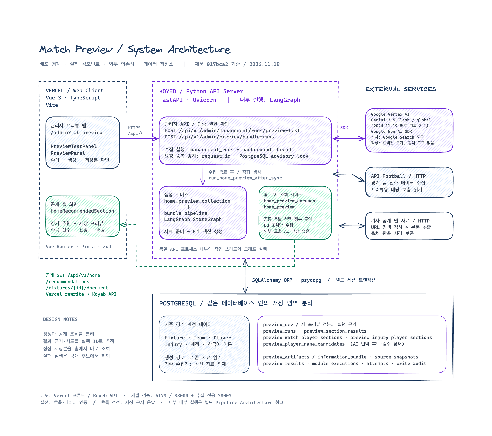

# 기능별 포트폴리오

[프로젝트 README](../../README.md)

이 문서 모음은 기능 이름에서 실제 구현으로 내려갈 수 있는 목차다. 화면 설명에 그치지 않고 API, 처리 모듈, 저장 경계와 실패 처리를 연결한다. 뉴스 관리·문맥 연결과 자연어 검색은 미구현 범위로 분류해 제외했다. 기존 뉴스 목록 조회 API를 뉴스 관리 기능의 완성으로 보지 않는다.

## 읽는 순서

서비스를 처음 보면 [홈](home/README.md)에서 공개 결과를 확인하고, [프리뷰 생성](preview-generation/README.md), [Vertex AI 호출 제어](vertex-ai/README.md), [선수 정본](player-storage/README.md) 순서로 읽는다. 수집부터 운영까지 살펴보려면 [수집 관리](collection/README.md)와 [배포](deployment/README.md)를 이어 읽는다.

[일반 조회](match-data/README.md), [인증](auth/README.md), [방송](broadcast/README.md)은 각 기능의 목적에 따라 독립적으로 읽을 수 있다.

| 문서 | 설명하는 구현 질문 | 근거 상태 |
|---|---|---|
| [홈 추천·저장 프리뷰](home/README.md) | 새 생성이 실패해도 공개 문서를 유지하는가? | 실제 두 경기의 공개 GET과 저장 결과 ID 대조 기록 |
| [경기·팀·선수·기록](match-data/README.md) | 목록과 경기 상세는 어떤 데이터를 읽는가? | 라우터·서비스·화면 소스 확인, 이번 전체 화면 검증 없음 |
| [프리뷰 생성 엔진](preview-generation/README.md) | 조사 결과가 다섯 섹션으로 어떻게 바뀌는가? | 두 경기 다섯 섹션 저장·공개 조회 기록 |
| [Vertex AI 호출 제어](vertex-ai/README.md) | 재시도와 실제 전송 횟수를 어디서 관리하는가? | 직접 검사 보고 및 실제 60초·300초 대기 관측 |
| [수집·실행 관리](collection/README.md) | 기존 수집 API가 새 생성 엔진을 어떻게 호출하는가? | 수집 1회부터 자동 생성·공개 조회까지 연동 기록 |
| [선수 정본·이름 번역](player-storage/README.md) | AI 결과와 DB 선수·한국어 이름을 어떻게 연결하는가? | 정본 저장·재조회 확인, 새 후보 검수 UI는 미완성 |
| [인증·권한·개발 세션](auth/README.md) | 기존 계정을 변경하지 않고 관리자 테스트를 하는가? | 코드 및 기존 로그인 연동 보고, 전체 보안 검증 의미 아님 |
| [방송 화면](broadcast/README.md) | 일반 조회와 방송용 갱신 경로가 어떻게 다른가? | 소스 확인. 이번 방송 실환경 E2E는 미실행 |
| [배포와 실행 경계](deployment/README.md) | 프론트와 API는 어디서 실행하고 무엇을 배포해야 하는가? | 11월 19일 Koyeb·Vercel 배포 보고 |

## 구현을 읽는 기준

모든 기능의 소스 링크는 제품 `017bca2ae67bb4957e81964ae1c9ca3b3edd422d`에 고정했다. 보고서는 `87f5693cdf189b1e5eff73e93d8aca84f74d7cfb`에서 연결한다. 두 리비전의 제품 소스는 같고 후자는 배포 보고서 커밋이다. 로컬 절대 경로에 의존하지 않도록 문서와 그림은 상대 링크, 제품 소스는 GitHub 커밋 링크를 사용한다.

이 README들은 과거 보고서를 현재 재실행 결과로 바꾸지 않는다. `코드 확인`은 처리 경로가 존재한다는 뜻이며, `연동 확인`은 보고서가 명시한 입력과 환경에서만 성립한다. 운영 전체의 정확도·성공률·처리량을 측정한 자료는 아니다.

## 아키텍처 도식

이 그림은 **프리뷰 서비스 범위**다. 방송·일반 데이터 기능 전체를 담은 그림으로 해석하지 않는다. [편집 가능한 Excalidraw 원본과 확대도](assets/README.md)에서 생성 그래프와 Vertex 호출 경계를 따로 볼 수 있다.

도식은 사용자 진입점, 처리 책임, 저장 경계, 실제 API·테이블 이름을 연결한다. 기능별 본문은 `문제 → 처리 흐름 → 설계 선택 → 확인 근거 → 남은 한계` 순서로 읽는다. 프리뷰에는 기존 도식 세 장을 재사용하고, 경기 조회·개발 인증·방송에는 간단 도식 세 장을 추가했다.

## 포트폴리오에서 설명할 기여

요구와 정책 결정, 아키텍처 선택, 실제 결과 확인·수용은 구현 코드 작성과 구분한다. 이 프로젝트는 코딩 에이전트가 구현·검사를 수행하고 사용자가 방향과 수용 기준을 정한 기록을 갖는다. 직접 작성하지 않은 코드를 손으로 모두 구현했다고 쓰거나, 측정하지 않은 성능 개선 수치를 덧붙이지 않는다.

면접에서는 “왜 이 경계를 나눴는가”, “실패하면 어떤 기록이 남는가”, “이 장치가 보장하지 않는 것은 무엇인가”를 설명할 수 있다. 각 기능 README 끝에 해당 질문을 연결했다.
