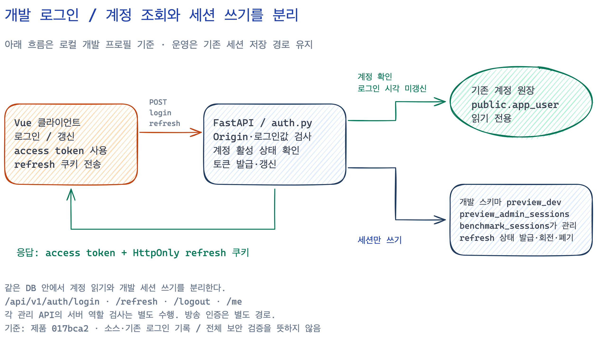

# 로그인·권한과 개발 세션 분리

[기능 목차](../README.md) · [프로젝트](../../../README.md) · [수집 관리](../collection/README.md)

관리자 기능은 기존 계정으로 로그인한 사용자의 서버 권한 검사를 재사용한다. 개발 검증을 위해 기존 계정의 비밀번호·역할을 바꾸는 대신, 계정 조회와 개발 세션 저장을 분리했다.

기준: 제품 `017bca2`, 확인일 2026-11-19. 프리뷰 관리자 연동 과정에서 기존 계정 로그인과 인증 요청을 확인한 기록이 있다. 모든 인증 경로를 보안 감사했다는 뜻은 아니다.

## 로그인과 갱신 과정

1. 프론트는 `POST /api/v1/auth/login`을 호출한다. 서버는 허용 Origin과 입력을 확인하고 기존 계정·비밀번호·활성 상태를 검사한다.
2. 서버는 access token과 사용자 공개 정보를 반환한다. refresh token은 `HttpOnly` 쿠키로 설정한다. 쿠키의 Secure·SameSite 값은 실행 설정을 따른다.
3. 프론트 API 경계가 인증 정보를 사용한다. refresh는 `POST /api/v1/auth/refresh`에서 세션을 회전하고 사용자 활성 상태를 다시 확인한다.
4. 로그아웃은 세션을 폐기하고 refresh 쿠키를 삭제한다. 세션 저장소 장애는 정상 로그아웃이나 정상 로그인으로 숨기지 않는다.

`GET /api/v1/auth/me`는 현재 사용자 확인 경로다. 페이지 라우터의 접근 제어와 API의 권한 검사는 모두 필요하다. 화면 버튼을 감추는 것으로 서버 접근을 허용하거나 차단하지 않는다.

## 개발 프로필의 별도 저장 경계

[Excalidraw 원본](../assets/auth-session-architecture.excalidraw). 같은 DB의 `public.app_user`를 읽고 `preview_dev.preview_admin_sessions`에 refresh 상태를 저장한다. 운영 프로필이나 방송 인증에 이 개발 경계를 그대로 적용하지 않는다.

로컬 개발 프로필은 `get_auth_db_session`으로 기존 계정을 조회하고 `touch_last_login=False`로 기존 계정 행의 로그인 시각을 갱신하지 않는다. 세션 발급·갱신은 `benchmark_sessions`를 통해 개발 영역에 남긴다. 로컬 프로필의 신규 가입은 403으로 막는다.

운영 프로필은 기존 세션 경로를 유지한다. 두 경로는 같은 응답 모양을 사용하지만 저장 위치가 다르다. 이 분리는 개발 프리뷰 쓰기와 계정 원장 변경을 같은 권한으로 취급하지 않기 위한 것이다.

관리 기능의 공통 라우터는 `manager_user`를 사용한다. 프리뷰 전용 경로에는 ADMIN 검사가 추가된다. 방송 API는 별도 인증 구현을 갖고 있어 이 문서의 공통 세션 보장을 그대로 적용할 수 없다. [방송의 경계](../broadcast/README.md)를 함께 확인한다.

## 구현을 확인할 위치

- [인증 API](https://github.com/lebind12/benchmarkV3/blob/017bca2ae67bb4957e81964ae1c9ca3b3edd422d/app/api/v1/auth.py): login·refresh·logout·로컬 가입 차단.
- [공통 세션](https://github.com/lebind12/benchmarkV3/blob/017bca2ae67bb4957e81964ae1c9ca3b3edd422d/app/core/sessions.py)과 [개발 세션 저장](https://github.com/lebind12/benchmarkV3/blob/017bca2ae67bb4957e81964ae1c9ca3b3edd422d/app/auth/benchmark_sessions.py).
- [DB 세션 경계](https://github.com/lebind12/benchmarkV3/blob/017bca2ae67bb4957e81964ae1c9ca3b3edd422d/app/db.py).
- [프론트 인증 상태](https://github.com/lebind12/benchmarkV3/blob/017bca2ae67bb4957e81964ae1c9ca3b3edd422d/frontend/src/stores/auth.ts)와 [개발 인증 검사](https://github.com/lebind12/benchmarkV3/blob/017bca2ae67bb4957e81964ae1c9ca3b3edd422d/tests/unit/test_benchmark_preview_auth.py).

## 검증 근거와 한계

[자동 게시 연동 보고서](https://github.com/lebind12/benchmarkV3/blob/87f5693cdf189b1e5eff73e93d8aca84f74d7cfb/docs/implementation/match-preview/preview-auto-publication-report.md)와 [배포 보고서](https://github.com/lebind12/benchmarkV3/blob/87f5693cdf189b1e5eff73e93d8aca84f74d7cfb/docs/implementation/match-preview/preview-generation-release-2026-11-19.md)는 관리자 실행 및 운영에서 로컬 인증 플래그를 켜지 않은 사실을 기록한다. 이번 문서 작성에서는 로그인·토큰 발급·계정 변경을 하지 않았다.

면접에서는 “개발 검증에서 운영 계정을 재사용할 때 무엇을 읽고 무엇을 따로 쓰는가”, “프론트 권한 검사와 서버 검사가 왜 모두 필요한가”를 설명할 수 있다.
