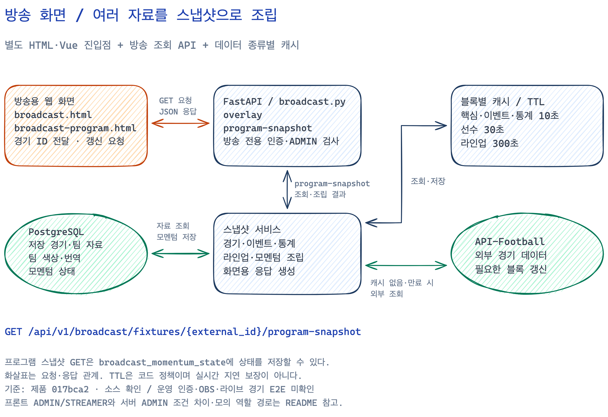

# 방송 오버레이와 프로그램 화면

[기능 목차](../README.md) · [프로젝트](../../../README.md) · [일반 경기 조회](../match-data/README.md)

방송 기능은 경기 정보를 별도 화면에 배치해 방송 소프트웨어에서 사용할 수 있게 한다. 오버레이와 프로그램 화면을 별도 진입점으로 두고, 서버가 경기·이벤트·통계·라인업을 화면용 스냅샷으로 조립한다.

기준: 제품 `017bca2`, 확인일 2026-11-19. 화면·API·서비스 소스가 존재한다. 이번 포트폴리오 문서 작업에서 방송 실시간 경기, OBS 합성, 운영 인증을 E2E로 확인하지 않았다.

## 별도 화면으로 들어가는 방법

Vue 라우터의 `/broadcast`와 경기별 방송 경로는 `beforeEnter`에서 `broadcast.html` 또는 `broadcast-program.html`로 이동한다. 경기 ID와 쿼리를 전달한 뒤 기존 SPA 라우팅을 중단한다. 라우터 항목에 있는 `PlaceholderView`만 보고 미구현이라고 판단하면 실제 진입점을 놓치게 된다.

`broadcastProgram.ts`가 `BroadcastProgramApp.vue`를 실행한다. 화면은 점유율·모멘텀·공격·통제·징계·라인업 같은 데이터를 조합한다. `apiFootballLive.ts`를 통해 스냅샷과 라이브 관련 요청을 분리한다.

## 스냅샷 API와 캐시

[Excalidraw 원본](../assets/broadcast-architecture.excalidraw). 그림 아래의 조립 경로는 프로그램 스냅샷 기준이다. 양방향 화살표는 요청·응답 관계를 나타내며, PostgreSQL 연결에는 저장 자료 조회와 모멘텀 상태 저장이 모두 포함된다.

오버레이는 `GET /api/v1/broadcast/fixtures/{external_id}/overlay`, 프로그램 화면은 `GET /api/v1/broadcast/fixtures/{external_id}/program-snapshot`을 사용한다. 첫 라이브 경기를 찾는 `/program-snapshot/first-live`도 있다.

`BroadcastProgramSnapshotService`는 경기 자료, 팀 색상·번역, 이벤트·통계·라인업과 모멘텀 데이터를 화면에서 읽기 쉬운 응답으로 조립한다. 외부 API-Football 클라이언트와 캐시를 주입받는다. 소스의 블록별 TTL은 경기 핵심·이벤트·통계 10초, 선수 30초, 라인업 300초다. 이는 코드의 캐시 정책이며 실제 갱신 지연을 측정한 수치가 아니다.

프로그램 스냅샷 GET은 읽기 전용이 아니다. 모멘텀 계산 결과가 유효하면 `persist_broadcast_momentum_from_cache`를 통해 `broadcast_momentum_state`에 upsert하고 커밋하는 경로가 있다. 저장 오류는 롤백하며, 계산 결과가 없을 때는 기존 저장 상태를 읽는 경로도 있다. 캐시는 Upstash 설정이 있으면 Redis를 사용하고 없으면 캐시를 사용하지 않는 구현이다.

일반 홈 문서 GET은 저장본만 읽지만 방송 경로는 외부 갱신과 주기적 요청을 포함한다. 두 기능에 같은 “조회 시 외부 호출 없음” 설명을 붙이지 않는다.

## 현재 인증 경계

확인한 방송 조회 API는 `get_broadcast_current_user` 뒤에서 ADMIN 역할을 검사한다. 프론트 방송 이동 조건은 ADMIN 또는 STREAMER여서 서버 조건과 일치하지 않는다. 또한 별도 JWT 검증과 `x_mock_role` 처리 경로가 존재한다. 따라서 공통 로그인 구조와 동일하게 검증된 운영 접근 제어라고 소개하지 않는다. 이 문서는 해당 구현을 설명할 뿐 인증 코드를 변경하거나 모의 경로를 사용하지 않는다.

## 구현을 확인할 위치

- [방송 라우트 전환](https://github.com/lebind12/benchmarkV3/blob/017bca2ae67bb4957e81964ae1c9ca3b3edd422d/frontend/src/router/index.ts): `buildBroadcastPageUrl`, `openBroadcast`, `openBroadcastProgram`.
- [프로그램 HTML](https://github.com/lebind12/benchmarkV3/blob/017bca2ae67bb4957e81964ae1c9ca3b3edd422d/frontend/broadcast-program.html), [Vue 진입점](https://github.com/lebind12/benchmarkV3/blob/017bca2ae67bb4957e81964ae1c9ca3b3edd422d/frontend/src/broadcastProgram.ts), [프로그램 화면](https://github.com/lebind12/benchmarkV3/blob/017bca2ae67bb4957e81964ae1c9ca3b3edd422d/frontend/src/BroadcastProgramApp.vue).
- [라이브 프론트 API](https://github.com/lebind12/benchmarkV3/blob/017bca2ae67bb4957e81964ae1c9ca3b3edd422d/frontend/src/lib/api/apiFootballLive.ts).
- [방송 API](https://github.com/lebind12/benchmarkV3/blob/017bca2ae67bb4957e81964ae1c9ca3b3edd422d/app/api/v1/broadcast.py), [오버레이 서비스](https://github.com/lebind12/benchmarkV3/blob/017bca2ae67bb4957e81964ae1c9ca3b3edd422d/app/services/broadcast.py), [프로그램 스냅샷](https://github.com/lebind12/benchmarkV3/blob/017bca2ae67bb4957e81964ae1c9ca3b3edd422d/app/services/broadcast_program.py).
- [모멘텀 상태 저장](https://github.com/lebind12/benchmarkV3/blob/017bca2ae67bb4957e81964ae1c9ca3b3edd422d/app/services/broadcast_momentum_persistence.py): 경기 외부 ID와 캐시 키 접두사 기준 upsert.

## 포트폴리오로 설명할 범위

별도 HTML 진입점과 SPA 사이의 이동, UI용 스냅샷 조립, 데이터 종류에 따른 TTL 분리를 설명할 수 있다. 프리뷰 생성의 Vertex 호출 예산을 방송 AI 해설에도 공통 적용했다고 주장하지 않는다. `broadcast_ai_commentary`는 별도 모듈이며 이번 생성 엔진 검증 범위 밖이다.

면접에서는 “방송과 일반 조회의 갱신 정책을 왜 나눴는가”, “화면별 API 호출을 스냅샷으로 묶을 때 얻는 점과 잃는 점은 무엇인가”를 소스 기준으로 설명할 수 있다. 운영 인증과 실시간 갱신의 전체 검증은 남아 있다.
