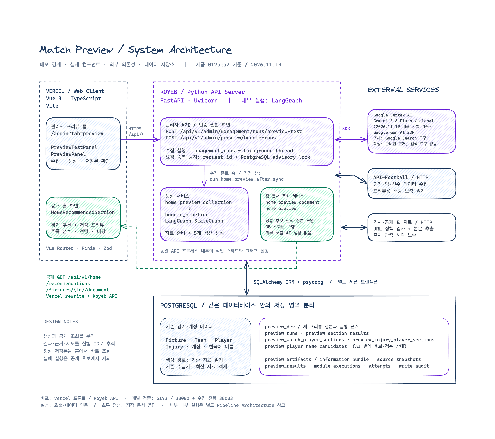

# 수집·실행 관리와 자동 생성 연결

[기능 목차](../README.md) · [프로젝트](../../../README.md) · [프리뷰 엔진](../preview-generation/README.md)

관리자는 수집 대상과 기간을 정하고 실행 결과를 확인한다. 수집이 끝나면 같은 실행 범위의 경기를 기존 프리뷰 생성 서비스로 전달한다. 수집 성공과 프리뷰 생성 성공을 별도 결과로 남겨 어느 단계에서 실패했는지 구분한다.

기준: 제품 `017bca2`, 확인일 2026-11-19. 기존 수집 API부터 두 경기 자동 생성·정본 저장·홈 조회까지 연동 기록이 있다.

## 사용자 요청부터 생성까지

관리 화면은 `ManagementView`와 `PreviewTestPanel`에서 카탈로그·수집 대상·기간·실행 상태를 보여준다. 서버의 `/api/v1/admin/management` 라우터는 관리 권한을 검사한다. 프리뷰 시험 후보와 수집 전용 경로에는 ADMIN 조건이 추가된다.

자동 생성까지 포함하는 경로는 `POST /api/v1/admin/management/runs/preview-test`다. `target_ids`, 기간, `preview_fixture_ids`, `generate_after_collection`을 받아 실행 범위를 저장한다. `management_runs`가 백그라운드 스레드에서 기존 수집기를 호출하고, 종료 처리에서 `home_preview_collection.run_collection_generation`으로 연결한다. 그 경계는 `generate_match_preview(trigger="collection")`를 사용하며 별도 생성 엔진을 만들지 않는다.

수집만 하는 `POST /api/v1/admin/management/preview-test/runs`는 다른 계약이다. 두 경기와 시간대가 있는 기간을 받고 자동 생성 필드를 받지 않는다. 수집 전용 API 호출을 곧바로 모델 호출이라고 해석하면 안 된다.

[편집 원본](../assets/preview-system-architecture.excalidraw). 이 도식에서 수집 진입점과 프리뷰 생성 경계를 함께 볼 수 있다.

## 실행 상태와 저장 근거

수집 실행 ID와 경기별 프리뷰 실행 ID는 서로 다르다. 수집 항목의 처리 결과, 실제 커밋된 경기 ID, 생성 결과를 따로 기록한다. 예외나 취소 때문에 결과가 없는 경우에도 `collection_evidence.partial`로 불완전한 수집 근거를 표시한다. 저장 성공 목록은 커밋이 확인된 뒤에만 추가한다.

정기 자동 생성 회차와 시험 회차도 나눈다. 정기 회차는 킥오프 기준이며, 시험 회차는 수집 실행 ID를 사용한다. 시험 실행이 정기 회차의 중복 방지 키를 먼저 소비하지 않게 하기 위한 구분이다.

현재 수집 후 생성에는 워크플로우 승인 gate가 없다. 승인 행을 자동으로 생성하는 대신 생성과 게시의 승인 의존을 제거했다. 번역 검수는 [선수 정본·번역](../player-storage/README.md)의 별도 경계다.

## 권한과 실패 경계

기존 경기 자료를 갱신하는 수집 연결과 `preview_dev`에 프리뷰를 쓰는 제한 연결은 역할이 다르다. 로컬 연동에서 수집 서버 38003과 일반 API 38000을 나눠 사용했지만, 이 포트 배치를 운영의 별도 마이크로서비스 구성으로 일반화하지 않는다.

실제로 수집 역할에 선수 정본 세 테이블의 INSERT 권한이 없어 생성 저장이 실패한 사례가 있었다. 해당 세 테이블 권한을 보완한 뒤 정본 저장과 공개 조회를 확인했다. 모델 HTTP 200만으로 DB 저장 성공을 판정하지 않은 사례다.

## 구현을 확인할 위치

- [관리 API](https://github.com/lebind12/benchmarkV3/blob/017bca2ae67bb4957e81964ae1c9ca3b3edd422d/app/api/v1/management.py): 대상·실행·시험 수집·취소 요청.
- [실행 관리](https://github.com/lebind12/benchmarkV3/blob/017bca2ae67bb4957e81964ae1c9ca3b3edd422d/app/services/management_runs.py): 스레드, 상태, 커밋 근거, 종료 처리.
- [수집 후 생성 연결](https://github.com/lebind12/benchmarkV3/blob/017bca2ae67bb4957e81964ae1c9ca3b3edd422d/app/services/home_preview_collection.py)와 [기존 수집기](https://github.com/lebind12/benchmarkV3/blob/017bca2ae67bb4957e81964ae1c9ca3b3edd422d/app/workers/daily_sync/runner.py).
- [프리뷰 시험 화면](https://github.com/lebind12/benchmarkV3/blob/017bca2ae67bb4957e81964ae1c9ca3b3edd422d/frontend/src/components/management/PreviewTestPanel.vue)와 [연결 검사](https://github.com/lebind12/benchmarkV3/blob/017bca2ae67bb4957e81964ae1c9ca3b3edd422d/tests/unit/test_home_preview_collection.py).

## 검증 근거와 한계

[연동 보고서](https://github.com/lebind12/benchmarkV3/blob/87f5693cdf189b1e5eff73e93d8aca84f74d7cfb/docs/implementation/match-preview/http-budget-live-report.md)는 수집 POST 한 번, 처리 단위 55/55, 두 경기의 새 프리뷰 다섯 섹션과 공개 결과 ID 일치를 기록한다. 55는 수집 처리 단위이지 생성 경기 수가 아니다. [권한 보완 보고서](https://github.com/lebind12/benchmarkV3/blob/87f5693cdf189b1e5eff73e93d8aca84f74d7cfb/docs/implementation/match-preview/collection-player-table-acl-report.md)는 변경한 권한 범위를 기록한다.

이 구현은 서버 내부 스레드 실행이다. 영속 작업 큐나 서버 재시작 후 자동 재개를 제공한다고 설명하지 않는다. 과거 맨시티 자료 수집의 첫 예외 원인은 아직 미확정이다.

면접에서는 “수집 성공인데 생성은 왜 실패할 수 있는가”, “시험 실행과 정기 회차의 중복 방지를 왜 나눴는가”를 설명할 수 있다.
