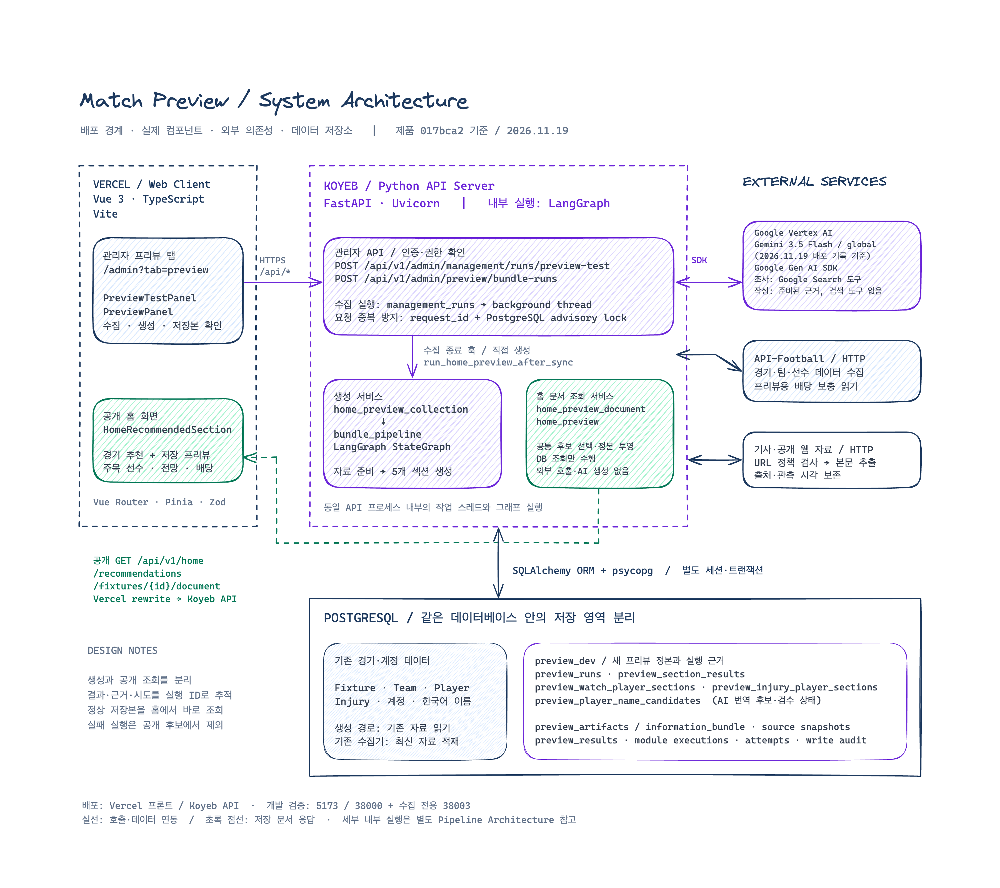

# 배포 구조와 실행 경계

[기능 목차](../README.md) · [프로젝트](../../../README.md) · [프리뷰 생성](../preview-generation/README.md)

Vue 프론트는 Vercel, FastAPI는 Koyeb에서 실행하고 PostgreSQL 저장본을 공유한다. 프론트의 `/api/*` 요청은 Vercel rewrite로 API 서버에 전달한다. 이 문서는 2026-11-19 배포 결과를 설명하며 배포 실행 지침이나 현재 상태의 실시간 대시보드가 아니다.

## 배포된 단위

| 구간 | 구현 | 확인한 책임 |
|---|---|---|
| 프론트 | Vue·TypeScript·Vite, Vercel | 정적 번들, SPA 경로, API rewrite |
| API | FastAPI·Uvicorn, Koyeb | 인증, 수집 요청, 생성 실행, 저장 문서 조회 |
| 생성 엔진 | 같은 API 프로세스의 LangGraph·모델 어댑터 | 조사·작성·전송 제어 |
| 저장 | PostgreSQL의 기존 도메인 자료와 `preview_dev` | 경기 읽기, 실행·정본·artifact·장부 저장 |

[Excalidraw 원본](../assets/preview-system-architecture.excalidraw)

실행별 세마포어는 API 프로세스 내부 객체다. 별도 분산 큐나 전역 모델 쿼터 서비스가 있는 구성으로 그리지 않는다. 로컬의 5173·38000·38003 분리는 개발 연동 배치이며 운영에 그대로 세 서비스가 배포됐다는 뜻은 아니다.

## 코드와 배포를 연결한 근거

제품은 `017bca2ae67bb4957e81964ae1c9ca3b3edd422d`, 보고서는 `87f5693cdf189b1e5eff73e93d8aca84f74d7cfb`다. 브랜치는 `lebind12/preview-api-migration`이며 main 병합 없이 푸시·배포했다. 보고서는 원격 SHA 일치와 Koyeb `APP_REVISION` 설정을 확인했다.

Koyeb 최종 배포 `c431d9a3`는 HEALTHY로 확인됐고, Vercel 결과는 [운영 alias](https://benchmark-v3-steel.vercel.app)로 승격됐다. backend health, 추천 API, 두 경기 문서 API가 200이었으며 공개 섹션 결과 ID 열 개가 로컬에서 검증한 저장 결과와 일치했다.

## 런타임 파일 누락에서 배운 점

초기 배포 묶음에서 `docs/`를 제외했을 때 추천 API가 500을 반환했다. 앱의 `app/schemas/home_preview.py`가 `docs/spec/schemas/*.json`을 런타임에 읽기 때문이다. 문서 디렉터리라는 이름만으로 배포 불필요 파일이라고 판단할 수 없었다. 필요한 스키마를 포함해 재배포한 뒤 공개 GET이 정상화됐다.

이 사례는 프로세스 health와 사용자 기능 health가 다르다는 것을 보여준다. 프로세스가 기동됐다는 사실에 더해 실제 추천·문서 응답과 저장 결과 ID를 대조했다.

## 구현과 기록

- [Vercel 설정](https://github.com/lebind12/benchmarkV3/blob/017bca2ae67bb4957e81964ae1c9ca3b3edd422d/frontend/vercel.json): Vite 빌드·정적 결과·API rewrite.
- [FastAPI 진입점](https://github.com/lebind12/benchmarkV3/blob/017bca2ae67bb4957e81964ae1c9ca3b3edd422d/app/main.py): 라우터 등록과 실행 경계.
- [런타임 JSON Schema 로딩](https://github.com/lebind12/benchmarkV3/blob/017bca2ae67bb4957e81964ae1c9ca3b3edd422d/app/schemas/home_preview.py).
- [배포 결과와 실패 이력](https://github.com/lebind12/benchmarkV3/blob/87f5693cdf189b1e5eff73e93d8aca84f74d7cfb/docs/implementation/match-preview/preview-generation-release-2026-11-19.md).

## 검증 한계

배포 당시 두 경기의 공개 GET과 저장 일치를 확인한 것이다. 부하·장시간 안정성·모든 화면·모든 권한을 검증한 기록은 아니다. 첼시 홈 링크 선택, HTTP 소유자별 수치 미영속, 과거 맨시티 수집의 첫 예외는 후속 항목으로 남았다. 이번 README 작업에서는 재배포·모델 호출·DB 변경을 하지 않았다.

면접에서는 “health 200인데 기능이 실패한 이유는 무엇인가”, “배포한 코드와 실제 응답을 어떻게 연결해 확인했는가”를 이 사례로 설명할 수 있다.
