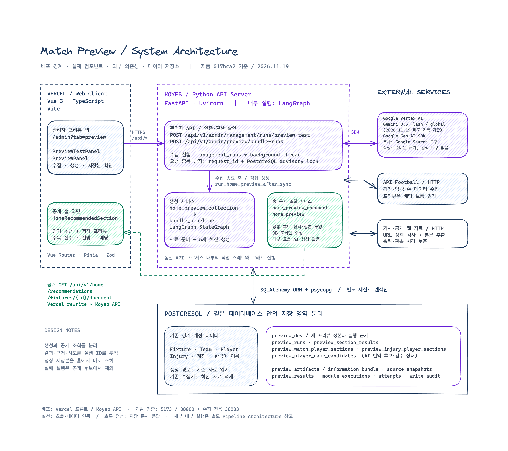

# 홈 추천과 저장 프리뷰

[기능 목차](../README.md) · [프로젝트](../../../README.md)

홈은 추천 경기를 고르고 이미 저장된 프리뷰를 보여준다. 사용자가 홈을 열 때마다 모델을 호출하지 않는다. 생성 실패가 기존 정상 문서를 밀어내지 않도록 공개 후보 선택을 생성 엔진과 분리했다.

기준: 제품 `017bca2`, 확인일 2026-11-19. 공개 GET 연동 근거가 있으며, 관리자에서 첼시 경기의 `홈에서 확인`을 눌렀을 때 맨시티를 선택하는 문제는 별도 미해결 항목이다.

## 요청이 문서가 되는 과정

1. `HomeRecommendedSection`이 추천 경기 목록을 요청한다. `GET /api/v1/home/recommendations`는 경기 목록과 프리뷰 제공 상태를 반환한다.
2. 선택한 경기의 `GET /api/v1/home/fixtures/{external_id}/document`를 요청한다. 프론트는 Zod로 응답을 읽고 요청한 경기 ID와 응답 ID를 대조한다.
3. `home_preview_document`가 `preview_dev`의 실행·섹션·구성본을 읽는다. 실패·취소·모의 실행과 이전 생성 방식(MP-10)의 실행은 공개 후보에서 제외한다.
4. 표시할 수 있는 본문이 있는 저장 문서를 선택한다. 선수 섹션은 정본을 다시 읽어 저장 결과와 대조한다. 불일치가 있으면 해당 본문을 공개하지 않는다.
5. 홈에는 공개 필드만 반환한다. 프롬프트·모델 원문·관리자 진단은 공개 응답에 섞지 않는다.

[도식 원본](../assets/preview-system-architecture.excalidraw). 이 기능은 그림의 공개 GET·저장 문서 선택 구간이다. 생성 구간은 [생성 엔진](../preview-generation/README.md)에서 설명한다.

## 설계에서 구분한 상태

문서가 없는 상태와 조회 실패는 다르다. 문서 없음은 정상 응답의 `status: none`이며, HTTP·계약 오류는 읽기 실패로 처리한다. 새 실행이 실패하면 이전 표시 가능 문서를 유지한다. 이 선택은 빈 화면을 줄이는 대신 오래된 문서를 제공할 수 있다.

`generated_at`, `saved_at`, 자료 기준인 `as_of`도 서로 다르다. 자료 시각이 없을 때 저장 시각을 대신 넣지 않는다. `as_of: null`을 허용해 미기록 상태를 보존한다.

`complete=true`는 모든 다섯 섹션의 성공을 뜻하지 않는다. 필수인 주목 선수와 예상 스코어를 포함한 AI 전망의 충족 여부를 별도로 보고, 부상·매체 전망·배당은 각 섹션의 상태와 본문을 확인해야 한다. 현재 게시에는 섹션 워크플로우 승인 조건이 없다.

## 구현을 확인할 위치

- [홈 API](https://github.com/lebind12/benchmarkV3/blob/017bca2ae67bb4957e81964ae1c9ca3b3edd422d/app/api/v1/home_preview.py): 추천·문서 조회의 진입점.
- [추천 서비스](https://github.com/lebind12/benchmarkV3/blob/017bca2ae67bb4957e81964ae1c9ca3b3edd422d/app/services/home_preview.py)와 [문서 선택 서비스](https://github.com/lebind12/benchmarkV3/blob/017bca2ae67bb4957e81964ae1c9ca3b3edd422d/app/services/home_preview_document.py): 추천 상태와 실제 문서의 선택 기준.
- [프론트 API](https://github.com/lebind12/benchmarkV3/blob/017bca2ae67bb4957e81964ae1c9ca3b3edd422d/frontend/src/lib/api/homePreview.ts): 응답 검증과 경기 ID 확인.
- [문서 동작 검사](https://github.com/lebind12/benchmarkV3/blob/017bca2ae67bb4957e81964ae1c9ca3b3edd422d/tests/unit/test_home_preview_document.py).

## 검증 근거와 한계

[배포 보고서](https://github.com/lebind12/benchmarkV3/blob/87f5693cdf189b1e5eff73e93d8aca84f74d7cfb/docs/implementation/match-preview/preview-generation-release-2026-11-19.md)는 두 경기의 공개 문서 GET 200과 다섯 섹션씩의 결과 ID 일치를 기록한다. API 응답 일치는 모든 탐색 버튼의 선택 동작이 맞다는 증거가 아니다. 첼시 홈 이동 불일치는 이 경계의 남은 과제다. 이번 문서 작성에서는 API를 다시 호출하지 않았다.

면접에서는 “생성 실패와 조회 실패를 왜 구분했는가”, “최신 실행과 최신 표시 가능 문서는 어떻게 다른가”를 이 경로로 설명할 수 있다.
