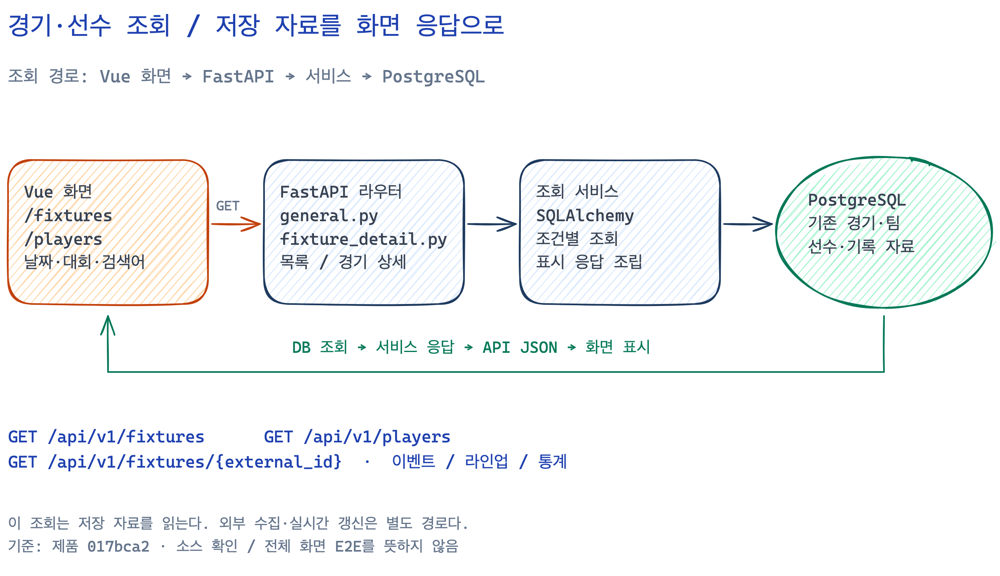

# 경기·팀·선수·기록 조회

[기능 목차](../README.md) · [프로젝트](../../../README.md) · [수집 관리](../collection/README.md)

일반 축구 화면은 수집해 둔 경기·선수·팀·순위 데이터를 읽는다. 화면 조회마다 API-Football을 새로 호출하는 대신, 저장 자료를 화면에 맞는 응답으로 조립하는 서비스 계층을 둔다.

기준: 제품 `017bca2`, 확인일 2026-11-19. 아래는 라우터·서비스·화면 소스에서 확인한 구현이다. 이번 작업에서 모든 리그·시즌·화면의 실제 데이터 정확성을 검증하지 않았다.

## 화면과 조회 경로

[Excalidraw 원본](../assets/match-data-architecture.excalidraw). 위쪽은 요청 경로이고 아래쪽은 서비스를 거쳐 화면으로 돌아오는 응답 흐름을 요약한다. 외부 수집은 이 조회 경로에 포함되지 않는다.

경기 목록 `/fixtures`는 `generalApi.fixtures`를 호출하고 날짜·기간·대회 조건을 전달한다. 화면은 반환 경기를 상태별로 거르고 대회 또는 시간순으로 묶는다. 선수 화면 `/players`는 리그·검색어·지표 조건을 API로 전달하고 이름과 기록을 표시한다.

`app/api/v1/general.py`는 `/api/v1/fixtures`, `/standings`, `/teams`, `/players`, `/coaches`, `/stats`를 제공한다. `app/services/general.py`가 SQLAlchemy 세션과 저장 자료를 사용해 응답을 만든다. 선수·팀 상세는 slug로 찾고, 경기 상세는 외부 경기 ID를 사용한다.

경기 상세는 별도 `app/api/fixture_detail.py`가 담당한다. `GET /api/v1/fixtures/{external_id}`와 이벤트·라인업 조회가 있고, 통계 `/{external_id}/statistics`는 `app/api/v1/fixture_detail_analytics.py`가 제공한다. 화면에서 어느 자료를 읽는지와 자료가 없는 구간을 기능별로 확인할 수 있다.

## 식별자와 표시 데이터

프론트 경로의 경기 ID는 API-Football 외부 ID다. 팀·선수 slug, DB 내부 키와 같은 값이라고 가정하지 않는다. 서비스가 팀·선수 참조에 원문 이름과 한국어 이름, 사진 URL을 담고 프론트 표시 함수가 이를 사용한다.

일반 페이지에서 `진행중` 상태를 표시하는 것과 실시간 점수 구독은 다르다. 저장된 상태를 보여주는 이 경로와 외부 자료를 갱신하는 [방송 경로](../broadcast/README.md)를 구분한다. 수집 누락이나 값 없음은 조회만으로 복원되지 않는다.

## 구현을 확인할 위치

- [일반 조회 API](https://github.com/lebind12/benchmarkV3/blob/017bca2ae67bb4957e81964ae1c9ca3b3edd422d/app/api/v1/general.py)와 [일반 조회 서비스](https://github.com/lebind12/benchmarkV3/blob/017bca2ae67bb4957e81964ae1c9ca3b3edd422d/app/services/general.py).
- [경기 상세 API](https://github.com/lebind12/benchmarkV3/blob/017bca2ae67bb4957e81964ae1c9ca3b3edd422d/app/api/fixture_detail.py)와 [경기 상세 서비스](https://github.com/lebind12/benchmarkV3/blob/017bca2ae67bb4957e81964ae1c9ca3b3edd422d/app/services/fixture_detail.py).
- [경기 통계 API](https://github.com/lebind12/benchmarkV3/blob/017bca2ae67bb4957e81964ae1c9ca3b3edd422d/app/api/v1/fixture_detail_analytics.py).
- [프론트 일반 API](https://github.com/lebind12/benchmarkV3/blob/017bca2ae67bb4957e81964ae1c9ca3b3edd422d/frontend/src/lib/api/general.ts).
- [경기 목록 화면](https://github.com/lebind12/benchmarkV3/blob/017bca2ae67bb4957e81964ae1c9ca3b3edd422d/frontend/src/views/ui-review/UiReviewFixturesView.vue), [선수 화면](https://github.com/lebind12/benchmarkV3/blob/017bca2ae67bb4957e81964ae1c9ca3b3edd422d/frontend/src/views/ui-review/UiReviewPlayersView.vue), [라우터](https://github.com/lebind12/benchmarkV3/blob/017bca2ae67bb4957e81964ae1c9ca3b3edd422d/frontend/src/router/index.ts).

## 확인 근거와 한계

`UiReview`라는 파일명만으로 모의 데이터 화면이라고 판단하지 않았다. 경기·선수 화면이 실제 `generalApi`를 호출하는 코드를 확인했다. 반대로 이 연결 존재만으로 모든 화면의 실환경 E2E가 끝났다고 표현하지 않는다. 프리뷰 두 경기 배포 결과를 일반 데이터 전체 검증 근거로 재사용하지 않는다.

면접에서는 “외부 ID와 내부 ID를 어디서 구분하는가”, “저장 조회와 실시간 갱신을 왜 분리하는가”, “서비스 계층이 DB 행을 그대로 반환하지 않는 이유는 무엇인가”를 이 경로로 설명할 수 있다.
