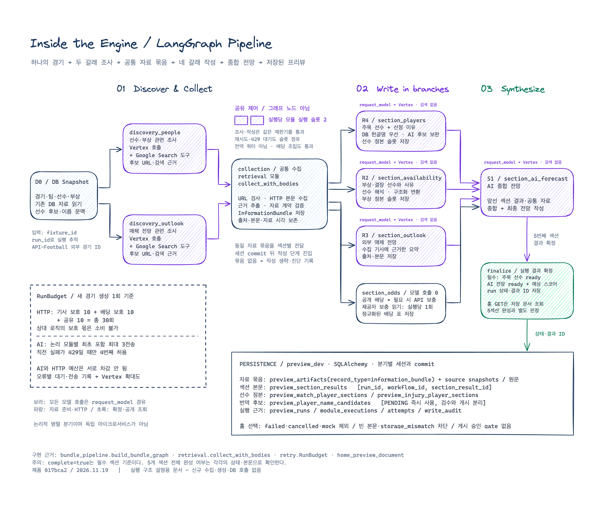

# 선수 정본 저장과 한국어 이름 처리

[기능 목차](../README.md) · [프로젝트](../../../README.md) · [생성 엔진](../preview-generation/README.md) · [홈 공개 조회](../home/README.md)

모델이 작성한 선수 설명을 문자열로만 저장하면 어느 선수인지, DB 이름인지 AI 번역인지, 다시 읽은 결과가 같은지 확인하기 어렵다. 주목 선수와 부상·결장 섹션은 선수 슬롯 정본을 따로 저장하고, 공개 문서를 만들 때 이 정본을 다시 읽는다.

기준: 제품 `017bca2`, 확인일 2026-11-19. 정본 저장과 PENDING 이름 후보 사용 경로는 구현되어 있다. 새 후보의 번역 검수·선수 수동 연결 관리 UI가 완성됐다는 뜻은 아니다.

## 생성 결과의 저장 구조

[기존 Excalidraw 원본](../assets/preview-pipeline-architecture.excalidraw)을 재사용했다. 그림의 `section_players`·`section_availability`와 아래 저장 영역을 함께 보면 부모 섹션과 선수 정본의 관계를 확인할 수 있다. 이 도식에 새 번역 검수 UI가 구현돼 있다는 의미는 없다.

`bundle_sections`의 결과를 `player_section_processing`이 계약에 맞게 처리한다. `player_section_store`는 부모 섹션 결과와 함께 다음 테이블을 저장한다.

| 테이블 | 책임 |
|---|---|
| `preview_dev.preview_watch_player_sections` | 주목 선수의 고정 슬롯과 표시 정보 |
| `preview_dev.preview_injury_player_sections` | 부상·결장 선수의 슬롯과 관련 정보 |
| `preview_dev.preview_player_name_candidates` | DB 한국어 이름이 없을 때 사용할 AI 이름 후보와 검수 상태 |

저장 함수는 호출자의 세션을 사용하고 내부에서 커밋하지 않는다. 부모 `preview_section_results`와 후보·선수 정본을 같은 트랜잭션으로 처리해 일부만 저장되는 상태를 막는다. 실행 ID와 섹션 결과 ID로 연결하므로 재생성한 결과를 이전 버전과 구분할 수 있다.

공개 읽기에서는 `player_section_read`가 정본을 다시 읽는다. 구성본에서 선택한 결과와 정본이 맞지 않으면 `storage_mismatch`로 처리하고 그 선수 본문을 공개하지 않는다. 프론트가 마지막으로 본 JSON만 믿고 저장 성공을 표시하는 구조가 아니다.

## 기존 번역과 새 후보는 다른 경로다

이름 표시에는 DB의 한국어 이름을 우선 사용한다. 한국어 이름이 없으면 AI 후보를 저장하고 PENDING 상태에서도 프리뷰에 사용할 수 있다. 미연결 선수나 미검수 번역이라는 이유만으로 프리뷰 전체를 게시 보류하지 않는다. 후보는 기존 선수 원장을 임의 수정하는 근거가 아니다.

기존 번역 관리 화면은 별도로 존재한다. `GET /api/v1/admin/management/translations`로 리그·팀·선수·감독 번역을 조회하고 `PATCH /translations/{kind}/{entity_id}`로 편집한다. `expected_version`을 비교해 다른 편집과 충돌하면 409를 반환한다. 성공 시 `human_modified`, 편집자, 변경 전후 값과 감사 기록을 저장한다.

이 기존 편집 경로가 새 `preview_player_name_candidates`의 검수와 선수 연결까지 처리한다고 설명하면 안 된다. 과거 섹션 워크플로우 승인 API도 번역 후보 상태를 변경하지 않는다. 현재 활성 프리뷰 탭에서는 그 게시 승인 패널을 제거했다.

## 구현을 확인할 위치

- [정본 계약](https://github.com/lebind12/benchmarkV3/blob/017bca2ae67bb4957e81964ae1c9ca3b3edd422d/app/preview/player_section_contracts.py)과 [테이블 모델](https://github.com/lebind12/benchmarkV3/blob/017bca2ae67bb4957e81964ae1c9ca3b3edd422d/app/preview/player_section_models.py).
- [결과 처리](https://github.com/lebind12/benchmarkV3/blob/017bca2ae67bb4957e81964ae1c9ca3b3edd422d/app/preview/player_section_processing.py), [정본 저장](https://github.com/lebind12/benchmarkV3/blob/017bca2ae67bb4957e81964ae1c9ca3b3edd422d/app/preview/player_section_store.py), [정본 재조회](https://github.com/lebind12/benchmarkV3/blob/017bca2ae67bb4957e81964ae1c9ca3b3edd422d/app/preview/player_section_read.py).
- [기존 번역 편집 서비스](https://github.com/lebind12/benchmarkV3/blob/017bca2ae67bb4957e81964ae1c9ca3b3edd422d/app/services/management.py): `edit_translation`, `translation_history`.
- [번역 관리 화면](https://github.com/lebind12/benchmarkV3/blob/017bca2ae67bb4957e81964ae1c9ca3b3edd422d/frontend/src/components/management/TranslationsPanel.vue)와 [정본 저장 검사](https://github.com/lebind12/benchmarkV3/blob/017bca2ae67bb4957e81964ae1c9ca3b3edd422d/tests/preview/test_player_section_storage.py).

## 검증 근거와 한계

[연동 보고서](https://github.com/lebind12/benchmarkV3/blob/87f5693cdf189b1e5eff73e93d8aca84f74d7cfb/docs/implementation/match-preview/http-budget-live-report.md)는 두 경기에서 watch·injury 정본 각각 한 행과 공개 섹션 결과 ID 일치를 확인했다. [앞선 재시도 연동 보고서](https://github.com/lebind12/benchmarkV3/blob/87f5693cdf189b1e5eff73e93d8aca84f74d7cfb/docs/implementation/match-preview/429-minute-backoff-live-report.md)에는 첼시 실행에서 PENDING 후보 한 건과 다섯 섹션 공개 결과가 함께 기록되어 있다.

이 근거는 번역 정확도나 선수 연결 정확도의 통계가 아니다. 관리자가 새 후보를 조회하고 직접 연결하는 후속 UI는 별도 작업이다. 이번 문서에서는 기존 번역 편집을 실행하거나 DB 값을 바꾸지 않았다.

면접에서는 “모델 결과와 선수 정본을 왜 함께 저장하는가”, “미검수 번역을 사용할 때 어떤 출처와 상태를 남겨야 하는가”, “게시와 번역 검수는 왜 다른가”를 설명할 수 있다.
