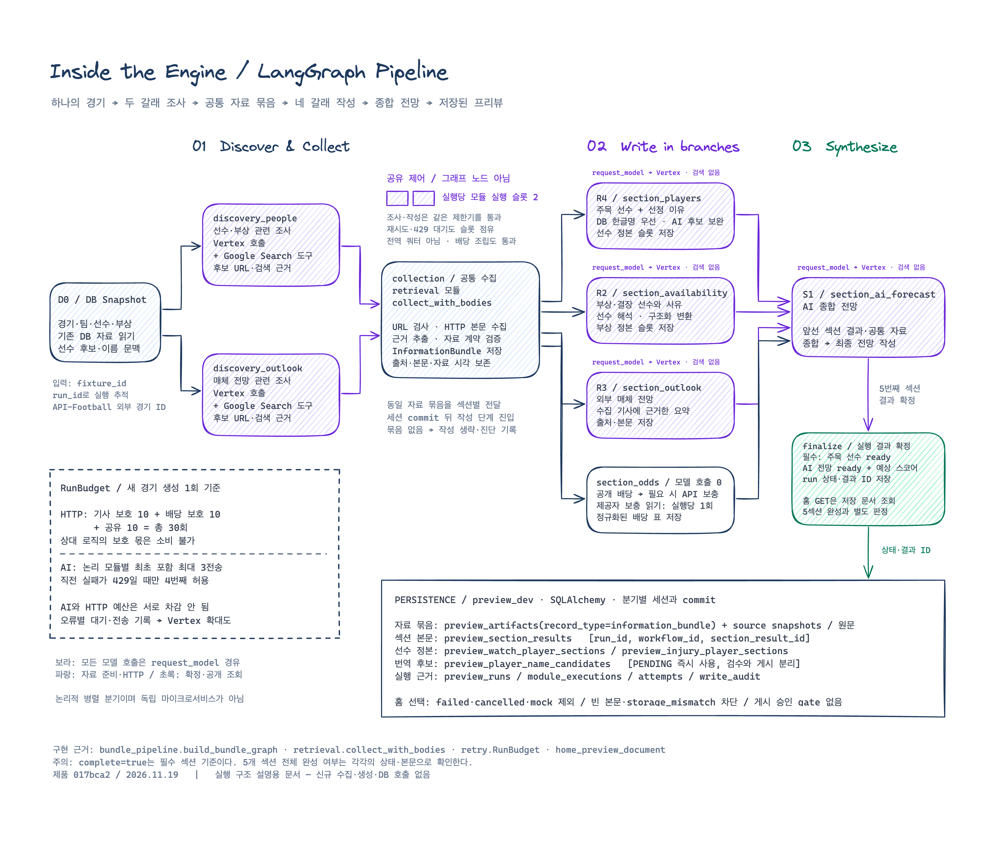

# 경기 프리뷰 생성 엔진

[기능 목차](../README.md) · [프로젝트](../../../README.md) · [수집 진입점](../collection/README.md) · [모델 호출 상세](../vertex-ai/README.md)

생성 엔진은 경기·선수 DB와 외부 근거를 모아 주목 선수, 부상·결장, 외부 전망, 배당, AI 전망을 작성한다. 검색과 작성의 책임을 나누고, 생성 결과가 실제 저장된 문서와 연결되는지 확인할 수 있게 구성했다.

기준: 제품 `017bca2`, 2026-11-19 배포 기록. 두 경기의 다섯 섹션 저장·공개 조회가 확인됐다. 과거 맨시티 실행에서 자료 묶음이 저장되지 않은 첫 예외의 원인은 미확정이다.

## 실행 구조

[Excalidraw 원본](../assets/preview-pipeline-architecture.excalidraw)

1. `D0`(입력 준비 노드)가 경기의 DB 문맥과 실행 입력을 준비한다.
2. 선수·부상 조사와 외부 전망·배당 조사를 두 갈래로 실행한다. 이 두 모델 요청에는 Google Search 도구를 붙인다.
3. `collection`이 조사 후보 URL의 본문을 수집하고 `InformationBundle`을 저장한다. 검색 모델이 작성한 요약과 수집한 원문은 구분한다. 현재 작성 입력에는 허용된 검색 요약과 DB 문맥도 포함된다.
4. 주목 선수·부상·외부 전망 작성과 배당 조립을 분기한다. 작성 요청에는 검색 도구를 붙이지 않는다. 배당 조립은 모델을 호출하지 않고 제공자 자료를 사용한다.
5. 앞선 자료와 섹션을 바탕으로 AI 전망을 만들고 `finalize`가 필수 결과를 판정한다.

정상 경로의 논리 모델 호출은 조사 2개, 섹션 작성 3개, 최종 전망 1개다. 실제 전송 횟수는 재시도와 단계 생략에 따라 달라진다. 노드 수, 섹션 수, 모델 전송 수를 같은 값으로 세지 않는다.

## 상태와 저장 경계

LangGraph의 `_GraphState`는 병렬 갈래의 조사·섹션·진단을 리스트 reducer로 합친다. SQLAlchemy 세션은 상태에 넣지 않고 갈래마다 연다. 각 갈래의 저장 트랜잭션과 외부 모델 전송을 기록하는 독립 장부는 별개다.

`InformationBundle`은 `preview_artifacts`에 `record_type=information_bundle`로 저장하고 출처 본문 artifact를 참조한다. 섹션 결과는 `preview_section_results`에 남는다. 주목 선수와 부상은 추가로 [선수 정본 테이블](../player-storage/README.md)에 저장한다. 홈은 이 저장 결과를 다시 읽는다.

그래프는 FastAPI 서버 프로세스에서 실행한다. 현재 생성 경로에 영속 checkpointer는 연결하지 않았다. LangGraph를 사용한다는 사실만으로 서버 재시작 후 중단 지점 재개나 외부 호출의 정확히 한 번 실행을 보장하지 않는다.

## 설계 선택과 실패 처리

명시적인 단계·분기·합류를 프레임워크 그래프로 표현해 로컬과 배포의 실행 구조를 맞췄다. 조사에만 검색 도구를 붙이고 작성은 준비한 입력을 소비하게 해, 작성에 사용한 자료를 실행 기록과 함께 확인할 수 있게 했다. 이 분리가 사실 정확성을 자동으로 보증하지는 않는다.

필수 결과는 주목 선수와 예상 스코어를 가진 AI 전망이다. 선택 섹션이 비어도 실행 전체 상태만으로 다섯 섹션의 성공을 판정할 수 없다. 수집 실패 진단에는 입력 복원·수집·저장·커밋 단계와 예외 종류·실제 시각을 남기며, 새 진단에 SQL이나 원문 예외 메시지를 그대로 저장하지 않는다.

## 구현을 확인할 위치

- [그래프와 실행기](https://github.com/lebind12/benchmarkV3/blob/017bca2ae67bb4957e81964ae1c9ca3b3edd422d/app/preview/bundle_pipeline.py): `build_bundle_graph`, `run_bundle_pipeline`, `_collection_node`, `finalize`.
- [조사 요청](https://github.com/lebind12/benchmarkV3/blob/017bca2ae67bb4957e81964ae1c9ca3b3edd422d/app/preview/discovery.py), [본문 수집](https://github.com/lebind12/benchmarkV3/blob/017bca2ae67bb4957e81964ae1c9ca3b3edd422d/app/preview/retrieval.py), [섹션 작성](https://github.com/lebind12/benchmarkV3/blob/017bca2ae67bb4957e81964ae1c9ca3b3edd422d/app/preview/modules/bundle_sections.py).
- [저장 서비스](https://github.com/lebind12/benchmarkV3/blob/017bca2ae67bb4957e81964ae1c9ca3b3edd422d/app/preview/store.py), [관리자 API](https://github.com/lebind12/benchmarkV3/blob/017bca2ae67bb4957e81964ae1c9ca3b3edd422d/app/api/v1/preview_admin.py).
- [직접 영향 검사](https://github.com/lebind12/benchmarkV3/blob/017bca2ae67bb4957e81964ae1c9ca3b3edd422d/tests/preview/test_bundle_pipeline.py).

## 검증 근거와 한계

[HTTP 예산 변경 후 연동 보고서](https://github.com/lebind12/benchmarkV3/blob/87f5693cdf189b1e5eff73e93d8aca84f74d7cfb/docs/implementation/match-preview/http-budget-live-report.md)는 수집 후 두 새 실행의 다섯 섹션 본문과 정본·홈 결과 ID 일치를 기록한다. [배포 보고서](https://github.com/lebind12/benchmarkV3/blob/87f5693cdf189b1e5eff73e93d8aca84f74d7cfb/docs/implementation/match-preview/preview-generation-release-2026-11-19.md)에는 운영 공개 GET 대조가 있다. 두 경기 결과를 일반 성공률이나 사실 정확도 지표로 확대하지 않는다.

면접에서는 “왜 검색과 작성을 분리했는가”, “병렬 갈래의 상태·DB 세션은 어떻게 나눴는가”, “프레임워크가 제공하는 기능 중 실제로 사용한 것은 무엇인가”를 설명할 수 있다.
