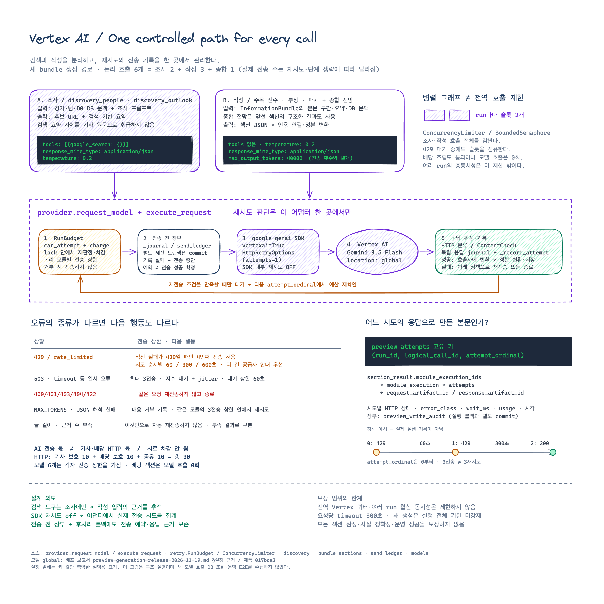

# Vertex AI 호출·재시도·전송 장부

[기능 목차](../README.md) · [프로젝트](../../../README.md) · [생성 엔진](../preview-generation/README.md)

이 계층은 모델을 호출할지, 얼마나 기다렸다 다시 보낼지, 전송을 어떤 키로 기록할지를 결정한다. SDK 내부의 숨은 재시도와 실행 트랜잭션의 롤백 때문에 실제 사용량을 놓치지 않는 것이 목적이다.

기준: 제품 `017bca2`. 배포 보고서의 제품 모델은 Vertex AI `gemini-3.5-flash`, 위치는 `global`이다. 개발 에이전트의 모델과 제품이 호출하는 모델은 별개다.

## 한 번의 전송이 지나는 경로

[Excalidraw 원본](../assets/vertex-call-architecture.excalidraw)

모듈은 `request_model`을 통과한다. 실행 예산을 판정하고 lock 안에서 다시 확인·차감한 뒤, 전송 전 `pending` 장부를 독립 커밋한다. 장부를 쓰지 못하면 전송하지 않는다. Google Gen AI SDK는 `HttpRetryOptions(attempts=1)`로 만들고 재시도는 어댑터가 소유한다.

응답은 내용 계약 검사와 결과 기록을 거친다. 추적 키는 `(run_id, logical_call_id, attempt_ordinal)`이다. 이 키는 DB 시도 식별자이며 Vertex에 전달하는 외부 중복 실행 방지 키가 아니다.

## 서로 다른 세 제한

동시성은 한 실행에서 함께 진행하는 모듈 수다. 실행마다 슬롯 2개를 만들고 모듈 전체를 감싼다. 재시도 대기 중에도 슬롯을 점유하며, 배당 조립도 같은 블록을 지난다. 여러 실행을 합친 전역 동시성을 제한하지 않는다.

모델 전송 예산은 논리 모듈마다 최초 포함 3회다. 직전 실패가 429이면 네 번째 전송을 허용한다. 기사·배당 HTTP 예산은 이 모델 예산과 별개다. 기사 10회와 배당 10회를 상대가 소비하지 못하도록 보호하고, 공유 여유 10회를 더해 한 생성 실행에서 총 30회로 제한한다. 따라서 기사가 20회 사용해도 배당 몫 10회가 남는다. 성공 10회나 강제 10회 호출을 뜻하지 않는다.

공급자의 rate limit은 외부 용량 제한이다. 실행별 슬롯과 예산이 있다고 해서 Vertex 프로젝트의 모든 요청량을 제어하는 것은 아니다.

## 오류에 따른 동작

429는 60초·300초·600초의 고정 구간으로 기다린다. 공급자 안내가 더 길면 더 긴 값을 사용한다. 이를 일반적인 지수 공식으로 계산한 백오프라고 설명하지 않는다. 다른 일시 오류에는 기존 대기 정책과 3회 상한을 유지하고, 400·401·403·404·422는 반복 전송하지 않는다.

모델 요청의 응답 대기 상한은 300초다. 클라이언트 타임아웃은 제공자가 작업을 취소했다는 뜻이 아니다. 결과를 알 수 없는 전송은 사용량에 보수적으로 포함한다. 기본 세 대기 합계 960초도 전체 생성 시간의 상한은 아니다.

## 전송 장부를 별도 커밋하는 이유

`preview_attempts`와 섹션 결과는 실행 트랜잭션이 롤백되면 사라질 수 있다. 그러나 이미 발생한 외부 호출을 DB 롤백으로 되돌릴 수는 없다. `preview_write_audit`의 독립 전송 장부는 예약과 수신 결과를 실행 저장과 별도로 남긴다.

예약만 남은 경우에는 전송 전 중단인지, 전송 후 응답 유실인지 확정하지 않는다. 장부는 실행별 사용량 복원에 필요한 근거이며 정확히 한 번 전송·전역 호출 한도·그래프 재개를 보장하지 않는다.

## 구현을 확인할 위치

- [provider.py](https://github.com/lebind12/benchmarkV3/blob/017bca2ae67bb4957e81964ae1c9ca3b3edd422d/app/preview/provider.py): 단일 호출 루프, SDK 설정, 오류 본문·RetryInfo·Retry-After 처리.
- [retry.py](https://github.com/lebind12/benchmarkV3/blob/017bca2ae67bb4957e81964ae1c9ca3b3edd422d/app/preview/retry.py): `RunBudget`, 소유자별 HTTP 몫, `ConcurrencyLimiter`.
- [send_ledger.py](https://github.com/lebind12/benchmarkV3/blob/017bca2ae67bb4957e81964ae1c9ca3b3edd422d/app/preview/send_ledger.py): 전송 예약, 응답 기록, 결과 불명 조회.
- [전송 검사](https://github.com/lebind12/benchmarkV3/blob/017bca2ae67bb4957e81964ae1c9ca3b3edd422d/tests/preview/test_provider.py)와 [예산 검사](https://github.com/lebind12/benchmarkV3/blob/017bca2ae67bb4957e81964ae1c9ca3b3edd422d/tests/preview/test_retry_budget.py).

## 검증 근거와 한계

[실제 재시도 관측](https://github.com/lebind12/benchmarkV3/blob/87f5693cdf189b1e5eff73e93d8aca84f74d7cfb/docs/implementation/match-preview/429-minute-backoff-live-report.md)에는 429 두 번 뒤 60초·300초 대기를 거쳐 세 번째 전송이 성공한 기록이 있다. 600초 구간 전체를 실측했다고 주장하지 않는다. [HTTP 격리 보고서](https://github.com/lebind12/benchmarkV3/blob/87f5693cdf189b1e5eff73e93d8aca84f74d7cfb/docs/implementation/match-preview/http-budget-isolation-report.md)는 양방향 보호 몫과 미등록 소유자 거부를 확인한다.

수치는 초기 제안 또는 사용자 확정 정책이며 최적화 벤치마크 결과가 아니다. HTTP 소유자별 카운터는 영속 복원 대상이 아니고 일부 옛 HTTP 예산 표시 필드는 이전 상한인 24회를 기록한다. 대기 중 취소는 즉시 반영되지 않는다.

면접에서는 “SDK 재시도를 왜 껐는가”, “세마포어와 예산 lock이 각각 필요한 이유는 무엇인가”, “독립 장부와 exactly-once는 왜 다른가”를 설명할 수 있다.
