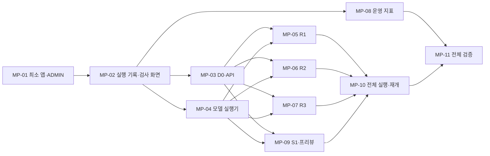

# 경기 프리뷰 Implementation Plan

> **For agentic workers:** 실행은 사용자가 지정한 pstack `poteto-mode`를 사용한다. 조정·계획·실행 증거 확인은 GPT/Opus, 제품·테스트·검사 UI·설정·스크립트 구현과 독립 검토는 검증된 DeepSeek 워커만 맡는다. 구현과 검토는 별도 세션으로 나누고 검토는 읽기 전용이다. Superpowers의 별도 실행 워크플로로 전환하지 않는다. 아래 체크박스는 실행 시 증거와 함께 완료한다.

**Goal:** 관리자가 경기 한 건의 주제별 조사와 프리뷰 생성을 실행하고, 각 호출과 자료 흐름을 검사하며 운영 지표로 유지보수할 수 있는 첫 버전을 만든다.

**Architecture:** 최소 FastAPI·Vue 앱을 새로 작성하고 PostgreSQL에 실행·자료·시도·결과 버전을 지속 보관한다. API 자료 D0를 공유하는 조사 R1/R2/R3/R4와 종합 S1을 독립 모듈로 실행하며, 관리자 진단과 독자용 프리뷰를 분리한다. 기록·검사 화면·지표를 기능과 함께 제공한다.

**Tech Stack:** 보존된 기술 방향인 Python/FastAPI·SQLAlchemy·PostgreSQL, Vue·TypeScript·Vite를 유지한다. 검증은 pytest·Vitest·Playwright, 제품 모델은 Vertex AI, 축구 데이터는 API-Football이다. 아래 과거 패키지 정보는 현재 설치 상태나 그대로 복구할 버전을 뜻하지 않는다.

**확정 기술 선택:** 사용자가 LangGraph와 모듈 추가 방식의 확장을 선택했다. 로컬·배포는 동일 실행 구조를 사용한다. [결정 기록](../../decisions/2026-11-10-preview-framework.md)을 따른다. MP-04는 Google 모델 호출 어댑터와 공통 예산·시도 기록을 LangGraph 노드에 연결하고, MP-10은 LangGraph의 분기·합류·체크포인트·재개 기능을 이용한다. runner·jobs 파일은 애플리케이션 연결 계층이며 범용 실행 엔진을 새로 만들지 않는다. 체크포인트는 preview_dev의 별도 실행 상태이고 사용자용 호출 원문·결과 기록과 구분한다. 실제 SDK/버전·Vertex 인증·DB 체크포인터의 스키마 한정은 구현 시 지원 조합을 확인한다. MP-02는 제품 기록·검사 계약을 유지하며 특정 프레임워크 내부 객체를 공개 API 계약으로 노출하지 않는다.

**Spec:** [확정 설계](../specs/2026-11-10-match-preview-design.md). 실행자는 이 계획과 설계, [프로젝트 정책](../../../AGENTS.md)을 함께 읽는다. 현재 진행 상태는 [Plans.md](../../../Plans.md) 하나에서 관리한다.

**상태:** 2026-11-10 사용자가 이 계획대로 개발 시작을 승인했다. 관리자 로그인과 호출 검사 화면을 먼저 완성한 뒤 독립 작업을 병렬로 진행한다. 실제 진행·검증 상태는 Plans.md를 따른다. 사용자는 이전 구현을 삭제해 별도 소스가 없음을 확인했다. 기존 앱을 찾는 작업을 반복하지 않고 이 기능에 필요한 최소 앱을 새로 만든다. 홈 추천·수집 자동화와 배포는 이 계획의 1차 실행 범위에 포함하지 않는다.

## Global Constraints

- “각 모델 호출을 개발 도중부터 따로 실행·확인할 수 있어야 한다.”
- “부상 자료처럼 API에서 직접 얻는 사실은 검색 실패를 기다리지 않고 활용한다.”
- “고정 사이트 목록에만 제한하지 않고 검색을 폭넓게 이용한다.”
- “정상 경로의 애플리케이션 모델 요청은 조사 4회와 종합 1회로 총 5회다(경기력/주목선수 분리).” 제공자 내부 검색 횟수와 구분한다.
- “완성된 프리뷰에는 빈 카드, 자료 누락·미확보 안내, API 대체 사유, 호출 실패·재시도 메시지를 넣지 않는다.” 진단은 관리자 기록에 남긴다.
- “독자용 프리뷰 응답과 관리자 진단 응답을 분리한다.” 공개 모양의 데이터에 내부 진단을 담아 화면에서만 가리지 않는다.
- “자료의 출처(API/검색)와 실행 방식(실호출/저장 응답 재생/모의 자료)을 별도 필드로 둔다.”
- “생성 완료 후 선발·부상 변경에 따른 자동 갱신은 범위에 넣지 않는다.”
- “한 경기 20~30분 생성도 괜찮다는 사용자 답변은 허용 시간의 예시다.” 아래 실행 제한은 별도로 제안한 초기 설정이며 사용자 발언을 강제 종료 값으로 바꾼 것이 아니다.
- ADMIN만 생성·로그·지표·재실행에 접근한다. STREAMER는 ADMIN의 대체 권한이 아니다.
- 모든 구현과 실행 가능한 테스트·재현 도구 작성은 DeepSeek만 한다. 이 문서의 테스트 이름과 검증 조건은 구현 요구사항이며 테스트 코드는 아니다.
- 기존 미커밋 삭제·변경을 일괄 복구하거나 스테이징하지 않는다. 새 기능에 필요한 파일만 작성하고 운영 DB를 개발용 초기화 대상으로 사용하지 않는다.

## Review Focus

1. **권한과 데이터 경계:** 과거 관리자 경로는 STREAMER도 허용했다. 서버의 ADMIN 검사와 진단 데이터 비노출을 MP-01·MP-02·MP-09에서 검증한다.
2. **다른 경기·오래된 자료·빈 응답:** 경기 외부 ID·시점·부상 불확실성·배당 시장을 검증하고 빈 배열을 무부상으로 바꾸지 않는다. MP-03·MP-06·MP-07 소유다.
3. **중첩 재시도·중복 실행·프로세스 중단:** 공통 호출 예산, 실제 요청마다 기록, 중단 시도와 새 시도 구별을 MP-04·MP-10에서 검증한다.
4. **결과 버전 혼합:** 선행 결과를 바꾼 뒤 옛 종합 결과를 새 결과처럼 사용하지 않는다. 같은 경기·입력 버전 조합을 MP-02·MP-09·MP-10에서 검증한다.
5. **잘못된 지표와 재생 증거:** 요청 시도와 논리적 실행을 구분하고 개발·모의·재생 데이터를 운영 성공률에 섞지 않는다. MP-08·MP-11 소유다.

## 1. 현재 근거와 착수 조건

2026-11-10 조사에서 등록된 Git/Orca 체크아웃은 현재 폴더 하나이고 app·frontend·tests·의존성 환경은 없었다. HEAD `5f354e37a15c1cc0c47054ddd1e7b06468e03b71`에 아래 과거 경로만 남아 있다. 사용자도 별도 소스가 없다고 확인했다.

| 과거 참고 | 새 구현에서 지킬 경계 |
|---|---|
| `app/workers/daily_sync/api.py`의 ApiFootballClient | 내부 재시도가 존재했다. 새 실행기의 예산과 중첩시키지 않는다. 코드를 자동 복구하지 않는다. |
| `app/api/v1/general.py`의 경기 조회 | API-Football 외부 경기 ID와 DB 내부 ID를 혼용하지 않는다. |
| `app/core/sessions.py`의 manager_user, 프론트 `/admin` | ADMIN 또는 STREAMER 허용이었다. 새 관리자 전용 검사를 작성한다. |
| `app/services/home_preview_vertex.py` | 원래 응답이 일부 값으로 축약됐다. 새 구현은 비밀값을 제거한 수신 payload와 추출 결과를 각각 보관한다. |
| `app/services/worker_runs.py` | 메모리 실행 상태와 daemon thread가 재시작 복구를 보장하지 않는다. 새 실행은 DB 상태를 기준으로 한다. |
| `frontend/package.json`, `pyproject.toml` | pytest, test:unit, test:e2e, type-check, build 명령의 과거 근거다. 새 환경을 만든 뒤 실제 실행해야 한다. |

착수 때 조정자는 기존 변경 목록과 파일 소유권을 기록하고 DeepSeek 실제 실행 모델을 확인한다. 기본 실행기는 Orca `dsh`, 프로필은 `dsh-tui`, 기존 확인 모델은 `deepseek-ai/deepseek-v4.1-flash-1017`이다. 이 값만 믿지 않고 새 세션의 실제 모델을 다시 확인하며 사용자 추론 강도를 유지한다.

사용자 변경 요구에 따라 MP-01은 기존 운영 DB의 로그인 계정·권한을 재사용하고, MP-03은 저장된 경기 자료를 읽기 전용 입력으로 사용한다. 새 로그인 계정을 기본으로 생성하거나 경기 자료를 임시 DB에 복제하는 경로를 필수로 삼지 않는다. 기존 영역은 읽기 권한만 사용하고 신규 세션·프리뷰·호출·결과·지표 테이블과 마이그레이션 이력은 같은 DB의 preview_dev 스키마에 둔다. 실제 대상·스키마·인증 방식을 먼저 확인하며 아직 연결 성공을 확인한 것은 아니다. API-Football은 저장 자료를 보완하는 명시적 수집 경로로 유지한다.

**DB 검증 경계:** AGENTS.md의 개발·테스트 DB 기준이 과거 로컬 전용 계획보다 우선한다. 운영 URL로 기존 DROP SCHEMA fixture를 실행하지 않는다. 단위 검사는 합성 자료로 수행할 수 있고 연동 검사는 기존 자료 읽기와 개발 영역의 쓰기·조회·실행별 undo만 확인한다. 기존 계정의 비활성·역할·비밀번호를 바꿔 실패 사례를 만들지 않는다. 현재 미완료 로컬 URL 가드를 범용 운영 접속 검사로 키우지 않고 실제 지원하는 연결·권한 경계에 맞춰 정리한다.

MP-02는 실행 ID별 개발 쓰기 내역과 소유 범위를 기록하고 조회·취소 경로를 함께 제공한다. undo는 자신이 만든 개발 기록만 대상으로 하며 다른 실행의 후속 변경은 충돌로 남긴다. MP-10은 관련 기록의 소유·의존 관계를 통합한다. MP-11은 대표 실행의 쓰기·조회·undo와 기존 영역 쓰기 권한 없음을 확인한다. 범용 변경 복구 시스템은 만들지 않는다.

실호출 전에 Vertex 프로젝트·인증·리전·정확한 모델 ID와 API-Football 인증·계정 제한을 실제 환경에서 확인한다. 비밀값은 로그·문서에 복사하지 않는다. 제품 모델 후보는 Gemini 3.8 Flash와 3.7 Flash이며 최종 모델 선택 전에는 모의·저장 자료 경로로 구현 검증을 진행할 수 있다. 다른 모델로 자동 대체하지 않는다. 모델 선택과 실제 호출 증거가 없으면 live 완료로 표시하지 않는다.

## 2. 공통 데이터 계약

MP-02가 `app/preview/contracts.py`와 프론트 `types.ts`에 아래 이름·필드를 정의한다. 상세 타입 선언과 테스트 코드는 DeepSeek이 작성한다. 작업자는 필드를 바꾸기 전에 조정자에게 의존 작업과 변경 이유를 보고한다.

| 계약 | 필수 내용과 의미 |
|---|---|
| FixtureIdentity | API 외부 fixture_id, league_id, season, home_team_id, away_team_id, kickoff_at UTC. 경기명은 표시용이며 동일성 키가 아니다. |
| FixtureCatalogQuery | 경기 선택 전에 목록을 수집할 league_id·date·timezone이다. 이때는 아직 한 경기의 FixtureIdentity를 요구하지 않는다. |
| ExecutionContext | run_id, module_execution_id, operation_kind(preview/module/fixture_catalog), environment(dev/test/prod), mode(live/replay/mock), actor_id, 실행 설정 버전과 상한. 단일 모듈 실행과 전체 실행의 같은 문맥이다. |
| SourceSnapshot | snapshot_id, 자료 범위(FixtureIdentity 또는 경기 목록의 FixtureCatalogQuery), source_kind(api/search), provider, 수집 시각, 제공자 갱신·게시 시각(없으면 null), 비밀값 제거 원문 참조, 검증 상태. 목록 수집 자료는 선택 경기의 D0 근거와 구분하고 재생 여부는 source_kind에 덮어쓰지 않는다. |
| EvidenceClaim | claim_id, 사실·외부 전망·API 예측·AI 해석 구분, 내용, 참조 snapshot_id/출처, 대상 선수·팀, 자료 시점, 채택·제외·상충 사유. |
| ModuleInput | FixtureIdentity, D0 snapshot 참조, 선택한 선행 result_id, input_hash, 프롬프트·계약·구현 버전. 모델에 실제 전달한 값도 별도로 저장한다. |
| ModuleResult | result_id, module_id(D0/R1/R2/R3/R4/S1), 입력 버전, 실행 상태, 자료별 확보 상태, claims, 내부 누락·오류·보완 사유. 실행 성공과 근거 확보는 독립적으로 표현한다. |
| SectionWorkflowRegistration / SectionResult | 사용자용 섹션 워크플로우 ID·표시 이름·버전·구성 모듈/노드·입력 계약·출력 섹션 목록·승인된 활성 버전과, 생성된 실제 본문·근거 참조·품질·워크플로우 실행/버전 참조를 정의한다. 내부 ModuleResult와 별개이며 일대일 대응을 요구하지 않는다. |
| ModuleRegistration | 모듈 ID·표시 이름·실행 동작·선행 자료·입출력 계약 버전·프롬프트 버전·검사 패널 연결이다. 등록은 한 곳에서 관리하며 D0/R1/R2/R3/R4/S1은 최초 등록 집합이다. |
| RequestSpec / ProviderResponse | 제공자·논리 호출 ID·모듈·비밀값을 분리한 요청·요청 제한과, 수신 상태·원문·오류·사용량·attempt 참조다. MP-02에서 계약을 고정하고 MP-04의 `execute_request`가 API/모델의 공통 예산·시도 기록을 담당한다. |
| AttemptTrace | attempt_id, logical_call_id, module_execution_id, run_id, provider/model, 시도 순서, 요청·응답 참조, 시작·종료·대기 시각, HTTP/오류 분류, 제공된 사용량, 알 수 없는 전송 결과 표시. D0의 여러 API 요청도 각각 구분한다. |
| PreviewDocument | 경기 표시, 확보된 관전 포인트·주목 선수·결장 영향·외부 전망, AI 예상과 이유, 독자용 출처, 생성·자료 기준 시각. 내부 진단·attempt·비밀값은 포함하지 않는다. |
| ValidatedResearch | FixtureIdentity, 선택한 result_id·입력 snapshot 버전, 채택된 EvidenceClaim, 제외·충돌 사유, 핵심 근거 충족 여부. V0가 생성해 S1의 입력으로 사용한다. |
| RunDetail / MetricsQuery / MetricsResult | 관리자의 실행·모듈·시도·버전 조회, 기간·환경·모듈·모델·버전 필터, 집계 건수·분자·분모·기간·상세 실행 필터를 담는다. |

실행 상태는 queued/running/retry_wait/succeeded/failed로, 프리뷰 품질은 pending/ready/insufficient로 구분한다. 종료 실패 이유에는 deadline_exceeded, configuration_error, invalid_output, unknown_outcome 등을 사용한다. `ready`는 모든 선택 자료의 확보를 뜻하지 않는다. 경기 식별·근거 있는 관전 포인트·근거를 설명하는 AI 예상이 있어야 ready다. 부족한 보조 섹션은 생략하고 내부 coverage에 남긴다.

각 모듈의 공통 동작 이름은 `execute_module`이며 ExecutionContext와 ModuleInput을 받아 ModuleResult를 반환한다. API 조회, 근거 검사, 공개 데이터 투영은 모델 호출 없이 수행한다. R1/R2/R3/R4는 각각 정상 모델 호출 1회, S1은 검색 없는 정상 호출 1회다. 실패 뒤 유효한 API 근거를 사용하면 그 처리와 실패 이력을 함께 남기고 모델 호출 성공으로 꾸미지 않는다.

ADMIN 로그인의 동작 계약은 `authenticate_admin`(로그인 정보로 유효한 관리자 세션 발급), `require_preview_admin`(요청의 활성·미만료 세션을 검사), `revoke_admin_session`(로그아웃 시 해당 세션 폐기)이다. `POST /api/v1/auth/login`, `POST /api/v1/auth/logout`, `GET /api/v1/auth/session`으로 연결한다. `AdminPrincipal`은 사용자 ID·역할·세션 ID를 담는다. 비밀번호·서명키·내부 설정은 응답에 포함하지 않으며 로그인에서 발급한 인증정보는 로그에 남기지 않는다. 일반 회원가입은 제공하지 않는다.

저장 엔터티는 관리자 계정·세션과 별도로 preview_runs, preview_module_executions, preview_attempts, preview_source_snapshots, preview_results, preview_artifacts로 나눈다. 원문은 처음에는 PostgreSQL의 접근 제한 아티팩트로 저장하고 별도 관측 플랫폼이나 객체 저장소를 필수로 도입하지 않는다. 공개용 자료는 PreviewDocument 허용 필드로 투영한다. 보관 기간이 지난 원문 참조는 expired로 구분하며 읽기 실패와 섞지 않는다.

### 이후 조사 모듈을 추가하는 기준

- 사용자 테스트·승인은 섹션 워크플로우의 생성 결과 기준이다. 내부 모듈 구현→필요한 노드를 포함한 섹션 워크플로우 실행→실제 본문·근거·이전 결과 비교→조정→사용자 워크플로우 버전 승인→기본 프리뷰 조합 순서로 진행한다. 노드별 승인·테스트 작업을 늘리지 않는다.
- SectionWorkflowRegistration은 후보·승인된 활성 버전과 구성 버전 집합을 연결한다. 승인 기록은 workflow_id/version·구성 모듈/프롬프트/구현/계약 버전, 확인한 run_id·section_result_id, 승인자·시각을 참조한다. 내부 ModuleRegistration의 구현 여부나 실행·품질 ready를 사용자 승인으로 간주하지 않는다.
- 새 조사 모듈은 같은 ExecutionContext·ModuleInput·ModuleResult 계약을 따르고 registry.py에 등록한다. 임의 파일을 자동 실행하는 플러그인 로더는 도입하지 않는다.
- 전체 생성기는 등록된 모듈 중 해당 실행에 선택된 목록과 선행 관계를 사용한다. 첫 설정은 R1/R2/R3/R4→S1이다. 종합 입력은 세 개의 고정 위치 필드가 아니라 선택한 ModuleResult 목록으로 전달한다.
- 공통 검사 화면·기록·집계는 등록된 모듈 ID와 계약을 기준으로 작동한다. 새로운 결과의 특화 표현이 필요할 때만 전용 패널을 추가한다. 기본 요청·응답·변환·근거는 공통 패널로 확인할 수 있어야 한다.
- 모듈 추가 시 등록·선행 관계·종합에 반영할 항목·정상 호출 수·호출 예산·테스트·검증 안내를 함께 갱신한다. 모듈을 추가했다고 호출 상한을 자동으로 높이지 않는다.
- 이미 확보한 내용을 다른 문체로 표현하는 변경은 새 조사를 강제하지 않고 종합·표현 단계에서 처리한다. 새로운 자료가 필요한 경우에 조사 모듈을 추가한다.

## 3. 파일 배치와 소유권

아래 경로는 새로 작성할 파일이다. 아직 존재하는 구현처럼 참조하지 않는다. 프리뷰 모듈은 `app/preview`, UI는 `frontend/src/features/match-preview`, 테스트는 `tests/preview`에 모은다.

| 소유 작업 | 주요 파일 |
|---|---|
| MP-01 최소 앱·ADMIN | `pyproject.toml`, `requirements.txt`, `.env.example`, `.gitignore`(기존 파일 제한 수정), `app/main.py`, `app/db.py`, `app/core/config.py`, `app/auth/models.py`, `app/auth/service.py`, `app/api/v1/auth.py`, `alembic.ini`, `alembic/env.py`, `alembic/versions/0001_preview_access.py`; `frontend/package.json`, `frontend/package-lock.json`, `frontend/index.html`, `frontend/tsconfig.json`, `frontend/vite.config.ts`, `frontend/vitest.config.ts`, `frontend/playwright.config.ts`, `frontend/src/main.ts`, `frontend/src/App.vue`, `frontend/src/router/index.ts`, `frontend/src/lib/api/http.ts`, `frontend/src/views/AdminLoginView.vue`; `scripts/preview_admin.py` |
| MP-02 기록·검사 공통 | `app/preview/contracts.py`, `models.py`, `store.py`, `artifacts.py`, `retention.py`, `inspection.py`, `registry.py`, `app/api/v1/preview_admin.py`, `alembic/versions/0002_preview_runs.py`; UI `types.ts`, `api.ts`, `PreviewRunsView.vue`, `RunInspector.vue`, `ModuleResultPanel.vue`, `RunVersionCompare.vue` |
| MP-03 D0·API | `app/preview/data.py`, `app/preview/sources/api_football.py`, `app/preview/sources/fixtures.py`; UI `FixtureSelector.vue`, `panels/DataPanel.vue` |
| MP-04 모델·재시도 | `app/preview/provider.py`, `retry.py`, `runner.py`, `app/workers/preview.py`; UI `panels/AttemptPanel.vue` |
| MP-05 R1 | `app/preview/modules/form.py`, `app/preview/prompts/form.md`; UI `panels/FormPanel.vue` (경기력 전용) |
| MP-05P R4 | `app/preview/modules/players.py`, `app/preview/prompts/players.md`; 별도 player JSON 계약, UI `panels/PlayersPanel.vue` |
| MP-06 R2 | `app/preview/modules/availability.py`, `app/preview/prompts/availability.md`; UI `panels/AvailabilityPanel.vue` |
| MP-07 R3 | `app/preview/modules/outlook.py`, `app/preview/prompts/outlook.md`; UI `panels/OutlookPanel.vue` |
| MP-08 지표 | `app/preview/metrics.py`, `app/api/v1/preview_metrics.py`; UI `PreviewMetricsView.vue`, `metrics.ts` |
| MP-09 S1·독자용 렌더 | `app/preview/modules/synthesis.py`, `app/preview/prompts/synthesis.md`, `validation.py`, `presentation.py`; UI `MatchPreview.vue`, `GroundingSources.vue` |
| MP-10 전체 실행·재개 | `app/preview/pipeline.py`, `jobs.py`; 공통 등록·수명주기 연결은 통합 담당자가 순차 수정 |
| MP-11 전체 검증·인계 | `tests/preview/test_live_preview.py`, `frontend/e2e/match-preview.spec.ts`, `docs/features/match-preview-operations.md`; 결함 수정은 해당 파일 소유자에게 전달 |

표에서 축약한 Python 파일은 `app/preview/`, UI 파일은 `frontend/src/features/match-preview/` 기준이다. Python 패키지 초기화 파일은 해당 디렉터리 소유자가 함께 작성한다. 각 작업의 테스트·샘플 파일은 아래에 별도로 정한다.

공유 수정 지점은 app/main.py, 설정·의존성·마이그레이션, preview_admin.py, registry.py, 프론트 router·types.ts·api.ts·ModuleResultPanel.vue다. MP-02 담당자를 기능 통합 소유자로 지정하고 MP-01 이후 이 지점은 그 소유자 한 명만 순차 편집한다. 모듈 워커는 자기 모듈·프롬프트·전용 패널·테스트만 수정한다. 연결 요청은 정확한 입력·출력과 함께 보고하고, 통합 소유자가 등록한 뒤 같은 검사 화면으로 검증한다. 새로운 플러그인 자동 탐색 체계는 만들지 않는다.

## 4. 병렬 실행과 전달 기준

- **Blocking first steps:** 최소 앱과 ADMIN 경로, 공통 계약·기록·검사 화면을 먼저 검증한다. 실제 모델과 인증 확인 전 live 성공을 주장하지 않는다.
- **Independent workstreams:** MP-03/04/08을 병렬 배정한다. 이후 MP-05/06/07/09는 고정된 계약으로 독립 구현 가능하다. MP-09는 완성된 실제 조사 결과를 기다리지 않고 명시된 모의 결과로 시작하되 최종 live 검증은 MP-11에서 한다.
- **Shared mutable state:** 공통 등록·DB 마이그레이션·설정·라우터는 통합 소유자 한 명이 편집한다. 병렬 작업의 파일을 분리하고 전역 설정 변경은 조정자에게 모은다.
- **Smallest safe decomposition:** 각 단위는 단독 실행·자기 검사 패널·검증 근거가 있는 기능이다. 함수별 워커나 조사 단계별 추가 리뷰 무리를 만들지 않는다.

개발 워커는 처음에는 최대 3개로 제한하고 파일 충돌이나 통합 대기가 있으면 수를 줄인다. 제품의 모델 동시 호출 상한과 개발 워커 수는 별개다. 워커 한 명이 끝나면 그 결과를 확인해 준비된 다음 작업을 즉시 배정한다. 전체 묶음이 끝날 때까지 기다리지 않는다. 통합 편집이 필요하면 새 워커 수를 늘리기보다 빈 슬롯을 통합 담당자에게 배정한다.

각 워커에게 이 계획·설계·AGENTS.md·poteto-mode의 절대 경로, 맡은 파일, 선행 결과 버전, 테스트 명령과 수용 조건을 전달한다. 기획·과거 조사 전체를 다시 수행시키지 않는다. pstack의 how·architect는 확정 계약과 실제 코드 차이를 확인하는 데 사용하고 이미 결정한 제품 대안을 다시 경쟁 구현하지 않는다. 구현에 필요한 설계 골격과 리뷰 수정도 DeepSeek이 맡는다.

조정자는 Plans.md에 Task/Dispatch·실제 모델·시작/완료·근거를 기록한다. 워커 보고는 검증 대기로 받은 뒤 수용 조건을 충족하면 완료로 바꾼다. 구현·자체 검증·독립 검토·대기 시간을 구분해 기록하며, 1회 결과로 속도 향상을 단정하지 않는다. 공통 파일 변경은 이전 소유자의 완료를 확인한 뒤 새 소유자에게 인계한다.

## 5. 실행 설정과 검증 명령

다음은 계획 검토를 위한 **초기 개발 설정 제안**이다. 계정 한도가 더 낮으면 낮은 쪽을 적용하고 변경 값을 기록한다. 마감·비용 제한을 더 높이는 변경은 이유와 영향이 보이게 남긴다.

| 항목 | 초기 설정 |
|---|---|
| 제품 Vertex 동시 요청 | 전체 실행을 합쳐 최대 2개 |
| API-Football 동시 요청 | 전체 실행을 합쳐 최대 2개, 분당 제한은 실제 계정 한도를 확인해 별도 적용 |
| 논리 호출의 최대 시도 | 최초 포함 3회. 영구적인 인증·권한·형식 오류는 동일 요청 재시도 대상에서 제외 |
| 전체 프리뷰 모델 요청 예산 | 재시도·명시적 출력 수정 포함 8회. 정상 호출은 5회(조사4+종합1). 아직 시작하지 않은 필수 단계의 최초 호출 몫을 남기고 추가 시도를 배정 |
| D0 외부 API 요청 예산 | 페이지 조회·재시도 포함 24회. 상한에서 중단하고 확보된 범위와 누락 사유 보존 |
| 대기 | 유효한 Retry-After를 우선하되 전체 기한을 넘기면 재시도하지 않음. 없으면 1초부터 지수 증가, 무작위 지연 포함 60초 상한 |
| 요청 제한 | 모델 응답 대기 최대 300초, 축구 API 요청 최대 30초 |
| 전체 실행 기한 | 첫 버전 개발 설정은 요청 접수 후 1,800초. 큐·재시도 대기도 포함. 사용자 발언을 그대로 확정한 값이 아니며 검토 가능한 계획 제안 |
| 보관 | 개발 기본값은 비밀값 제거 원문 30일, 구조화 실행·품질·지표 기록 180일. 적용 시각·기간을 표시하고 원문 삭제 후 재생 불가를 표시. 운영 보관 정책은 배포 전에 재확인 |

하나의 실행기가 재시도와 예산을 소유한다. SDK나 HTTP 클라이언트가 숨겨 재시도하지 않게 설정하거나, 끌 수 없다면 실제 시도 기록과 공통 예산에 포함되는지 증명한다. 공개된 한도가 없는 값은 임의로 성공했다고 넘기지 않는다. 설정이 누락된 live 호출은 원인을 표시하고 실행하지 않는다.

초기 자료 채택 정책은 해당 경기·대회·선수의 일치와 킥오프 이전 자료를 기준으로 한다. 배당은 경기 전 승무패 시장이며 제공자 갱신 시각이 확인되고 수집 시점 기준 6시간 이내인 값을 사용한다. 부상은 해당 경기의 API 상태와 수집 시각을 보존하고 더 최신의 확인 가능한 보도와 충돌하면 충돌로 남긴다. 시점이 확인되지 않은 값은 최신 확정 사실로 승격하지 않는다. 최근 맥락 검색은 킥오프 전 7일 자료를 우선하되 과거 성적·기록은 날짜가 명시된 배경 자료로 구분한다. 이 수치들은 초기 계획 제안이며 다른 날짜 경기와 단순히 오래된 배경 자료를 같은 것으로 처리하지 않는다. 출처를 모델이 보고한 것과 실제 원문을 확인한 것을 검증 상태로 구별한다.

아래 명령은 MP-01이 환경을 구성한 후 실행할 계획이며 지금 통과한 명령이 아니다. backend는 저장소 루트의 `.venv/bin/python -m pytest`, frontend는 `npm --prefix frontend run test:unit -- <테스트 경로>`, 타입 검사 `npm --prefix frontend run type-check`, 빌드 `npm --prefix frontend run build`, E2E는 `npm --prefix frontend run test:e2e -- e2e/match-preview.spec.ts`를 제공한다. unit/integration/live 마커를 분리하고 live는 명시적으로 선택해야 실행되게 한다.

검증 범위는 AGENTS.md의 테스트·검토 범위와 종료 기준을 따른다. 현재 수용 기준의 핵심 동작과 관측된 결함에는 의미 있는 실패 테스트를 먼저 작성하고 구현·통과 증거를 남긴다. 문서·단순 설정 변경까지 일률적으로 새 테스트를 요구하지 않는다. 아래 테스트 이름은 필요한 동작을 식별하며 개수 목표가 아니다. 기존 검사로 동등한 동작을 증명하면 재사용하고 근거를 남긴다. 문서가 지정한 테스트 이름·조건은 실제 검사에서 같은 의미를 가져야 한다. 공통 완료 절차는 자기 파일·수정 범위·명령 결과·해당 단계가 요구하는 UI 실행 증거·미검증 항목을 보고하고 통합 소유자가 검사 화면 연결을 확인하는 것이다. 로컬 커밋은 검증된 자기 작업 파일만 선별하며 기존 대량 삭제를 함께 커밋하지 않는다.

## 사용자 확정: 사실 확인과 AI 선정·예측의 구분

[설계 §5](../specs/2026-11-10-match-preview-design.md)의 최신 기준을 적용한다. 구현/검사는 사실의 근거와 AI 판단의 이유를 구분한다. 주목 선수 선정·관전 포인트·예상 스코어 결론에 직접 검색 URL이나 외부의 동일 선정을 요구하지 않는다. API로 확인한 사실을 바탕으로 하는 AI 판단은 검색 인용 없이도 수용 가능하다. 사실과 해석이 섞인 항목은 미확인 사실만 제외/단정 해제하고 사용 가능한 판단까지 일괄 삭제하지 않는다.

부상 API의 상태·사유를 활용하고 날짜·발생 경기·경위는 필요한 수준에서 보완한다. API 기준 경기/수집 날짜를 실제 발생 사건으로 오인하지 않는다. 경위 일부 미확인만으로 섹션 전체를 실패시키거나 과도한 조사로 확대하지 않는다. 미확인 부분은 단정하지 않고 관리자 기록에 남긴다.

최소 수용 사례는 (1) API 사실 기반 선수 선정/관전 포인트가 외부 선정 출처 없이 유지됨, (2) AI 예상 스코어에 결론 증명을 요구하지 않음, (3) 확인되지 않은 수치/부상 발생 사건은 사실로 단정되지 않음, (4) API 부상 사유가 있으나 발생 날짜/경기 미확인인 경우에도 사용 가능한 섹션과 관리자 기록이 유지됨이다. 해당 변경이 있는 코드 경로에서 대표 사례만 검사하고 전수 행렬을 만들지 않는다. 기존 저장 응답 재생을 우선하고 추가 모델 호출을 숨겨 넣지 않는다.

## 섹션 워크플로우 중심 사용자 테스트

사용자가 경기와 프리뷰 섹션을 선택해 실행하면 자료 준비·조사·검증·본문 구성까지 거쳐 해당 섹션의 읽을 수 있는 결과와 근거를 표시한다. 노드 상태·JSON이 기본 결과물이 아니다. 원문·노드 입출력·재시도는 상세 진단으로 펼친다. 이전 실행과 본문·근거를 비교한 뒤 조정·재실행·워크플로우 버전 승인을 한다. 이 사용자 실행·결과 확인을 기능의 기본 테스트로 정의하며, 자동 검사는 꼭 필요한 권한·기록·연결 회귀만 보조한다.

- MP-02는 섹션 워크플로우의 식별·버전·승인·실행 증거 연결을 지원한다. 현재 실제 생성기는 없으므로 mock 검사 경로와 실제 섹션 실행 준비 상태를 구분한다.
- MP-04는 LangGraph의 섹션 단독 실행 진입점과 workflow_id/version을 공통 실행 기록에 연결한다. 내부 run_module은 진단·구성용이며 사용자 승인 단위가 아니다. 여러 섹션에 공유되는 자료·연구 결과는 버전·시점을 확인해 재사용한다.
- MP-05~07은 각 조사 결과를 이용하는 섹션 워크플로우의 실제 본문·근거를 화면에 제공하고, 대표 경기에서 실행한 결과를 사용자에게 보여준다. 추가 모델 호출이 필요하면 변경된 4+1 설계와 예산 영향부터 명시한다. 결과를 예쁘게 보이게 하려고 숨은 추가 호출을 넣지 않는다.
- MP-09는 전체 종합과 독자용 표현을 연결하고 섹션 단독 생성 결과와 최종 포함 결과의 관계를 확인한다. MP-10은 승인된 섹션 워크플로우 버전으로 전체 그래프를 구성한다. 내부 자료 준비/검증 노드마다 사람 승인을 요구하지 않는다.
- 실제 섹션의 수용은 생성된 본문·근거·이전 결과 비교·조정·사용자 버전 승인으로 확인한다. 테스트 통과 개수와 mock 화면 시연만으로 실제 생성 기능을 완료 처리하지 않는다.

## 6. 구현 작업

### MP-01 — 최소 앱과 ADMIN 접근

**선행:** 사용자 실행 승인 완료. **담당:** DeepSeek 기반 환경 담당. **Files:** §3 MP-01 전체, `tests/preview/conftest.py`, `tests/preview/test_admin_access.py`, `frontend/src/views/AdminLoginView.test.ts`, `frontend/e2e/preview-access.spec.ts`. 공통 테스트 DB·인증 fixture는 conftest.py에 두고 MP-02 이후 통합 소유자에게 넘긴다.
**Interfaces:** 인증 결과 `AdminPrincipal`은 활성 사용자 ID·역할·세션을 가진다. `require_preview_admin`은 요청 인증을 검사해 ADMIN만 반환한다. 비인증은 401, 인증된 비ADMIN은 403이다. 공통 HTTP 래퍼 `previewRequest`는 인증을 일관되게 전달하고 오류를 화면용 데이터로 반환한다.

- [ ] 기존 운영 DB 대상·인증·경기 스키마·읽기 권한과 preview_dev 쓰기 권한을 확인한다. 단위 검사와 비파괴 연동 검사 설정을 분리하고 운영 연결에서는 파괴적 fixture가 실행되지 않게 한다.
- [ ] `test_admin_access`에 비인증·USER·STREAMER·비활성·만료 세션 거부, ADMIN 허용, 로그아웃 후 세션 거부를 작성한다. 프론트 로그인·만료 처리도 검사한다.
- [ ] `.venv/bin/python -m pytest tests/preview/test_admin_access.py -q`에서 아직 구현하지 않은 인증 동작의 실패를 확인한다. Python·DB·의존성 부재를 기대한 실패 증거로 대신하지 않는다.
- [ ] 최소 앱·기존 계정 기반 관리자 로그인과 개발 전용 세션을 연결한다. 마이그레이션은 preview_dev의 새 테이블에 한정한다. 기존 계정 생성·수정·운영 영역 초기화는 하지 않는다. 일반 회원관리·홈 재구축은 포함하지 않는다. Hallmark로 관리자 화면의 공통 시각 방향을 정한다.
- [ ] 위 backend 테스트, `npm --prefix frontend run test:unit -- src/views/AdminLoginView.test.ts`, `npm --prefix frontend run test:e2e -- e2e/preview-access.spec.ts`를 통과시키고 ADMIN 로그인 뒤 빈 실행 목록 화면을 실제 브라우저에서 확인한다.
- [ ] 설정·의존성·인증 파일의 소유권과 사용한 로컬 환경을 기록하고 해당 작업만 선별 커밋한다. 비밀값은 산출물에 넣지 않는다.

### MP-02 — 지속 실행 기록과 단독 검사 화면

**선행:** MP-01. **담당:** DeepSeek 기능 통합 소유자. **Files:** §3 MP-02 전체, `tests/preview/test_run_store.py`, `tests/preview/test_inspection_api.py`, `tests/preview/test_retention.py`, `frontend/src/features/match-preview/RunInspector.test.ts`, `tests/preview/fixtures/recorded_run.json`.
**Interfaces:** `store_run`, `append_attempt`, `save_module_result`, `get_run_detail`, `compare_result_versions`는 §2 계약을 사용한다. `GET /api/v1/admin/preview/runs`, `GET /runs/{run_id}`, `GET /runs/{run_id}/modules/{module_execution_id}`는 기록만 읽는다. 모든 뒤 경로는 동일한 `/api/v1/admin/preview` 접두어를 가진다.

- [ ] `test_trace_survives_restart`, `test_trace_redacts_secrets`, `test_version_compare_keeps_old_result`, `test_read_does_not_call_provider`, `test_expired_artifact_keeps_summary`, `test_registered_module_uses_generic_inspector`를 작성한다. 실제 수신 본문과 정규화 결과가 각각 유지되는지 검사한다.
- [ ] `.venv/bin/python -m pytest tests/preview/test_run_store.py tests/preview/test_inspection_api.py tests/preview/test_retention.py -q`의 해당 실패를 확인한다.
- [ ] 계약·DB 저장·원문 아티팩트·보관 기간 처리·버전 비교와 공통 검사 화면을 구현한다. 명시적인 mock/recorded 검증 자료로 첫 화면 경로를 완성하고 미구현 모듈은 실행 가능으로 표시하지 않는다. 요청·응답·변환·다음 입력 탭과 실행 방식 표시는 처음부터 제공한다.
- [ ] backend 테스트와 `npm --prefix frontend run test:unit -- src/features/match-preview/RunInspector.test.ts`를 통과시킨다. 앱을 다시 시작해 동일 실행을 열고 이전 원문·버전을 볼 수 있음을 확인한다.
- [ ] 공통 계약 버전을 고정해 후속 워커에게 전달하고 선별 커밋한다. 이후 공통 등록·라우터 수정은 이 소유자가 순차 담당한다.
- [ ] 섹션 워크플로우 버전의 검토 대기·조정 필요·승인 상태와 증거 실행/섹션 결과를 공통 검사 화면에서 연결한다. app/preview/approvals.py와 대응 관리자 API·UI를 최소 확장한다. 미승인 후보가 기존 승인 버전을 대체하지 않는 대표 검사만 추가한다. 실제 본문 생성 전에는 미구현 상태를 표시하고 mock JSON을 실제 섹션 생성으로 꾸미지 않는다. 실제 활성 버전의 전체 파이프라인 적용은 MP-10이 맡는다.

### MP-03 — D0 경기 선택과 API 자료

**선행:** MP-02. **담당:** DeepSeek 데이터 담당. **Files:** §3 MP-03 전체, `tests/preview/test_data.py`, `tests/preview/test_api_football.py`, `tests/preview/fixtures/api_football.json`, `frontend/src/features/match-preview/FixtureSelector.test.ts`.
**Interfaces:** `import_fixtures`는 FixtureCatalogQuery의 관리자 명시 요청으로 경기 후보를 저장하고 `list_fixtures`는 저장본만 읽는다. 목록 수집은 operation_kind=fixture_catalog로 기록하며 전체 프리뷰 실행과 구분한다. `prepare_match_data`는 FixtureIdentity와 ExecutionContext를 받아 D0 ModuleResult 및 SourceSnapshot을 반환한다. API 원문·상태·coverage는 함께 보존한다.

`POST /api/v1/admin/preview/fixtures/import`는 명시적 경기 목록 수집, `GET /api/v1/admin/preview/fixtures`는 저장된 목록 조회다. MP-03은 MP-02의 RequestSpec/ProviderResponse 계약으로 모의 실행기를 주입받아 MP-04와 병렬 구현한다. 실제 API transport와 단독 live 실행은 MP-04의 공통 실행기가 준비된 뒤 연결한다.

- [ ] `test_external_fixture_identity`, `test_empty_injuries_not_zero`, `test_questionable_preserved`, `test_wrong_fixture_rejected`, `test_api_error_not_missing`, `test_view_uses_stored_fixtures`를 작성한다.
- [ ] `.venv/bin/python -m pytest tests/preview/test_data.py tests/preview/test_api_football.py -q`의 실패를 확인한다.
- [ ] 관리자 경기 목록 수집·선택과 D0를 작성한다. 경기·최근 성적·선수 기록 중 제공되는 자료, injuries, odds, predictions를 공통 근거로 정리한다. 기존 문서의 미확인 필드·coverage·오래된 정책을 그대로 복구하지 않고 공식 계약과 실제 응답으로 확인한다. GET 화면 조회는 새 수집을 일으키지 않는다.
- [ ] backend 테스트와 `npm --prefix frontend run test:unit -- src/features/match-preview/FixtureSelector.test.ts`를 통과시킨다. D0 단독 실행에서 API 요청별 원문→자료 묶음을 검사한다. 실 API 인증이 없으면 mock 검증과 live 미검증을 구분해 보고한다.
- [ ] D0 결과 계약·자료 시점·확인된 live 여부를 인계하고 선별 커밋한다. 라이브 API 호출에도 MP-04와 같은 공통 예산·시도 계약을 사용하며 통합 전 숨은 재시도를 두지 않는다.

### MP-04 — 모델 호출과 제한된 재시도 실행기

**선행:** MP-02. **담당:** DeepSeek 실행기 담당. **Files:** §3 MP-04 전체, `tests/preview/test_provider.py`, `tests/preview/test_retry_budget.py`, `tests/preview/test_module_runner.py`, `frontend/src/features/match-preview/panels/AttemptPanel.test.ts`.
**Interfaces:** `execute_request`는 RequestSpec·ExecutionContext를 받아 ProviderResponse를 반환하고 API/모델에 같은 예산·시도 계약을 적용한다. `request_model`은 이를 사용해 실제 모델 요청과 제공자 원문을 기록한다. `run_module`은 모듈 ID·ModuleInput·ExecutionContext로 단독 실행을 예약한다. `POST /api/v1/admin/preview/module-runs`는 run_id를 반환하며 UI는 저장된 실행 상태를 읽는다. `replay_result`는 저장 응답을 사용한 변환 재생이고 외부 모델을 호출하지 않는다. 관리자 `POST /api/v1/admin/preview/results/{result_id}/replays`에서 실행할 수 있다.

- [ ] `test_429_then_success_two_attempts`, `test_shared_budget_not_multiplied`, `test_budget_reserves_unstarted_steps`, `test_401_no_blind_retry`, `test_deadline_includes_wait`, `test_raw_payload_preserved`, `test_replay_has_zero_network_calls`를 작성한다.
- [ ] `.venv/bin/python -m pytest tests/preview/test_provider.py tests/preview/test_retry_budget.py tests/preview/test_module_runner.py -q`의 실패를 확인한다.
- [ ] 제공자 어댑터와 실행기를 작성하고 §5 상한·동시성·대기·시도 기록을 적용한다. API와 모델 제공자 오류를 구분한다. 모델명·설정·실제 수신 payload를 기록하고 응답 추출은 별도 보관한다. 출력 수정 요청도 명시적인 새 호출로 예산에 포함한다.
- [ ] backend와 `npm --prefix frontend run test:unit -- src/features/match-preview/panels/AttemptPanel.test.ts`를 통과시킨다. 화면에서 429→대기→성공의 두 시도를 확인한다. 제공자·모델·설정이 확정되면 작은 실제 호출 한 건으로 transport를 확인하고 원문·사용량·시간을 기록한다.
- [ ] 요청·재시도 계약과 실제 모델 확인 결과를 인계하고 선별 커밋한다. 모의 429 시험은 실제 계정의 429 발생률 측정으로 보고하지 않는다.

### MP-05 — R1 경기력·주목 선수 조사

**선행:** MP-03·MP-04의 계약과 모의 경로. **담당:** DeepSeek R1 담당. **Files:** §3 MP-05 전체, `tests/preview/test_form_module.py`, `tests/preview/fixtures/form.json`, `frontend/src/features/match-preview/panels/FormPanel.test.ts`.
**Interfaces:** `research_form`은 D0 snapshot을 가진 ModuleInput과 ExecutionContext를 받아 R1 ModuleResult를 만든다. 정상 호출 1회이며 `request_model`을 통해서만 모델을 호출한다. FormPanel은 ModuleResult와 연결된 AttemptTrace를 읽는다.

- [ ] `test_form_claims_reference_sources`, `test_old_match_news_excluded`, `test_player_claim_without_evidence_rejected`, `test_api_facts_remain_without_search`를 작성한다. 같은 입력 결과에서 실제 다음 단계에 전달되는 근거 식별자가 일치해야 한다.
- [ ] `.venv/bin/python -m pytest tests/preview/test_form_module.py -q`의 실패를 확인한다.
- [ ] 최근 경기력·이번 경기의 의미·주목 선수와 이유를 조사한다. API 결과가 있어도 매체·맥락 검색을 수행하고 미확보 여부를 기록한다. 단정할 근거가 없는 선수 평가는 사실로 만들지 않는다. 전용 패널에서 채택 사실·해석·출처를 구분한다.
- [ ] backend와 `npm --prefix frontend run test:unit -- src/features/match-preview/panels/FormPanel.test.ts`를 통과시키고 통합 소유자의 등록 후 R1만 단독 실행한다. R2·R3·S1이 호출되지 않는 증거와 입력·응답·처리 결과를 남긴다.
- [ ] 샘플 결과와 계약 버전을 인계하고 선별 커밋한다. 실호출 여부와 내용 검토 결과를 별도로 보고한다.

### MP-06 — R2 부상·결장 영향 조사

**선행:** MP-03·MP-04의 계약과 모의 경로. **담당:** DeepSeek R2 담당. **Files:** §3 MP-06 전체, `tests/preview/test_availability_module.py`, `tests/preview/fixtures/availability.json`, `frontend/src/features/match-preview/panels/AvailabilityPanel.test.ts`.
**Interfaces:** `research_availability`는 API 부상 상태·근거 시각과 검색 자료를 이용해 R2 ModuleResult를 만든다. 부상 사실과 전력 영향 해석을 분리한다. AvailabilityPanel은 선수별 원래 상태·근거·상충·변환 결과를 표시한다.

- [ ] `test_questionable_not_confirmed_absence`, `test_empty_list_not_no_injuries`, `test_conflicting_reports_preserved`, `test_injury_impact_has_basis`, `test_api_only_availability_result`를 작성한다.
- [ ] `.venv/bin/python -m pytest tests/preview/test_availability_module.py -q`의 실패를 확인한다.
- [ ] 정상 모델 호출 1회로 API의 부상 자료와 검색을 결합한다. 검색이 없어도 API 사실을 사용하고, 수신 오류·미제공·빈 응답을 구분한다. 핵심 선수라는 평가와 전술 영향에는 근거를 연결한다.
- [ ] backend와 `npm --prefix frontend run test:unit -- src/features/match-preview/panels/AvailabilityPanel.test.ts`를 통과시키고 R2 단독 실행 화면에서 API 원문 상태→정규화 상태→영향 해석을 확인한다.
- [ ] 결과·누락 사유·live 확인 범위를 인계하고 선별 커밋한다. 재시도한 시도를 지우고 마지막 성공만 제출하지 않는다.

### MP-07 — R3 배당·외부 전망 조사

**선행:** MP-03·MP-04의 계약과 모의 경로. **담당:** DeepSeek R3 담당. **Files:** §3 MP-07 전체, `tests/preview/test_outlook_module.py`, `tests/preview/fixtures/outlook.json`, `frontend/src/features/match-preview/panels/OutlookPanel.test.ts`.
**Interfaces:** `research_outlook`은 배당·매체 의견·API 알고리즘 전망을 서로 다른 EvidenceClaim 종류로 반환한다. OutlookPanel은 업체·시장·기준 시각, 매체 URL·게시 시각, API 예측의 출처를 구분한다.

- [ ] `test_pre_match_market_not_qualification`, `test_other_fixture_odds_rejected`, `test_api_prediction_not_media_opinion`, `test_missing_media_uses_api_without_fabrication`, `test_grounding_metadata_missing_is_visible_in_admin`를 작성한다.
- [ ] `.venv/bin/python -m pytest tests/preview/test_outlook_module.py -q`의 실패를 확인한다.
- [ ] 정상 모델 호출 1회로 검색 기반 전망을 조사하고 API 배당·예측을 참고한다. 경기 전 승무패와 다른 시장을 섞지 않는다. 원문 예상 스코어가 없으면 외부 매체의 예상을 만들어 채우지 않는다. 검색의 인용 근거와 Search Suggestions를 보존한다.
- [ ] backend와 `npm --prefix frontend run test:unit -- src/features/match-preview/panels/OutlookPanel.test.ts`를 통과시키고 R3 단독 화면에서 세 자료 종류와 검색 실패 시 API 보완 이유를 확인한다.
- [ ] 결과와 출처 표시 요구를 종합 담당자에게 인계하고 선별 커밋한다.

### MP-08 — 운영 지표와 원인 추적

**선행:** MP-02의 이벤트·결과 계약. **담당:** DeepSeek 지표 담당. **Files:** §3 MP-08 전체, `tests/preview/test_metrics.py`, `tests/preview/fixtures/metrics_events.json`, `frontend/src/features/match-preview/PreviewMetricsView.test.ts`.
**Interfaces:** `query_metrics`는 MetricsQuery를 받아 MetricsResult를 반환한다. `GET /api/v1/admin/preview/metrics`는 저장 기록만 읽으며 선택한 집계 항목의 필터를 실행 목록에 전달한다. 새 모델/API 호출을 하지 않는다.

- [ ] `test_attempt_and_execution_denominators`, `test_mock_replay_dev_excluded_from_prod`, `test_catalog_and_module_runs_not_preview_runs`, `test_duplicate_event_not_counted_twice`, `test_missing_usage_not_zero`, `test_metric_drilldown_keeps_filters`를 작성한다. 두 논리적 모듈 실행 중 하나는 429→200, 다른 하나는 200이나 근거 없음인 자료에서 실행 성공 2/2, 429 응답 1/3, 근거 확보 1/2, 추가 재시도 1회임을 검사한다. 오류 후 성공은 오류 빈도에 남아야 한다.
- [ ] `.venv/bin/python -m pytest tests/preview/test_metrics.py -q`의 실패를 확인한다.
- [ ] 설계 §6.2의 완료율·모듈 성공·자료 확보·API 보완·429·재시도·처리 시간·사용량을 표와 필요한 그래프로 구현한다. 기간·분모·표본 수·환경·버전을 표시하고 비용 미확인 값은 추정해 채우지 않는다. 조회 시점 기준으로 진행 중과 종료 결과를 구분한다.
- [ ] backend와 `npm --prefix frontend run test:unit -- src/features/match-preview/PreviewMetricsView.test.ts`를 통과시킨다. 그래프에서 실행 목록→시도 원문으로 이동하고 앱 재시작 후 동일 기록의 집계가 유지되는지 확인한다. 모의 검증 자료를 운영 지표로 발표하지 않는다.
- [ ] 집계 정의·필터 계약·검증 수치를 인계하고 선별 커밋한다. 후속 모듈이 추가돼도 같은 공통 기록으로 집계되어야 한다.

### MP-09 — S1 종합과 독자용 프리뷰

**선행:** MP-03·MP-04 계약, MP-02가 고정한 R1/R2/R3/R4 결과 계약. 실제 조사 구현 완료를 기다리지 않고 명시적 모의 결과로 시작 가능하다. **담당:** DeepSeek 종합 담당. **Files:** §3 MP-09 전체, `tests/preview/test_synthesis.py`, `tests/preview/test_presentation.py`, `tests/preview/fixtures/synthesis_inputs.json`, `frontend/src/features/match-preview/MatchPreview.test.ts`.
**Interfaces:** `validate_evidence`는 선택된 ModuleResult·SourceSnapshot의 경기·근거·버전을 검사해 ValidatedResearch를 만든다. `synthesize_preview`는 이 검증 결과와 ExecutionContext를 받아 S1 ModuleResult와 PreviewDocument를 만든다. `to_preview_document`는 허용된 독자용 필드만 선택한다. `GET /api/v1/admin/preview/runs/{run_id}/preview`는 ADMIN에게 독자용 투영을 보여주며 내부 상세는 별도 진단 경로로 제공한다.

- [ ] `test_synthesis_has_no_search_call`, `test_selected_result_versions_match_input`, `test_added_module_claims_reach_synthesis`, `test_fact_citation_must_exist`, `test_missing_optional_section_is_omitted`, `test_diagnostics_absent_from_preview_payload`, `test_insufficient_core_not_ready`를 작성한다. 핵심 근거가 있으면 보조 자료 누락만으로 실패시키지 않는다.
- [ ] `.venv/bin/python -m pytest tests/preview/test_synthesis.py tests/preview/test_presentation.py -q`의 실패를 확인한다.
- [ ] 정상 호출 1회로 관전 포인트와 AI 예상·이유를 종합한다. 새 검색·숨은 검토 호출은 하지 않는다. 새 사실을 추가하면 근거 검사에서 제외하거나 결과를 보류한다. Hallmark 방향에 맞춰 프리뷰를 구성하고, 없는 보조 항목은 빈 카드나 누락 메시지 없이 생략한다. 출처·AI 해석 표시·시각·검색 출처 표시 요구는 유지한다.
- [ ] backend와 `npm --prefix frontend run test:unit -- src/features/match-preview/MatchPreview.test.ts`를 통과시킨다. 배당/매체 의견 없는 사례의 프리뷰 응답·본문에 진단이 없고 관리자 상세에는 정확한 누락 이유가 있는지 확인한다. 근거 있는 출전 불확실 표현은 보존한다.
- [ ] 사용한 결과 버전 목록과 실제 모델 입력을 인계하고 선별 커밋한다. 독자용 데이터 형식 완료는 공개 홈 배포 완료가 아니다.

### MP-10 — 전체 생성과 부분 재개

**선행:** MP-03~MP-07·MP-09. **담당:** DeepSeek 기능 통합 소유자. **Files:** §3 MP-10 전체, `tests/preview/test_pipeline.py`, `tests/preview/test_resume.py`, `frontend/src/features/match-preview/RunVersionCompare.test.ts`. 공통 runner·store·registry 수정은 이전 소유권을 인계받아 순차 수행한다.
**Interfaces:** `start_preview_run`은 FixtureIdentity·실행 의도·설정 버전으로 run_id를 만든다. `resume_preview_run`은 보존된 결과와 남은 예산으로 미완료 단계만 재개한다. `rerun_module`은 선택 모듈의 새 결과 버전을 만들고 `resynthesize_preview`는 명시적으로 선택한 result_id 집합을 사용한다. `POST /api/v1/admin/preview/runs`, `/runs/{run_id}/resume`, `/runs/{run_id}/module-reruns`, `/runs/{run_id}/synthesis-runs`는 상태 조회 가능한 실행 식별자를 반환한다.

- [ ] `test_normal_path_four_research_one_synthesis`, `test_registered_module_dependency_and_budget`, `test_global_concurrency_and_budget`, `test_duplicate_request_joins_existing_run`, `test_resume_keeps_successful_modules`, `test_stale_worker_cannot_overwrite_result`, `test_new_source_version_marks_old_synthesis`, `test_unknown_attempt_outcome_is_preserved`를 작성한다. 추가 모듈 시험은 테스트 전용 모의 실행기를 등록해 연결·지표·종합 입력과 예산을 검사하며 실제 새 조사 기능이나 유료 호출을 추가하지 않는다.
- [ ] `.venv/bin/python -m pytest tests/preview/test_pipeline.py tests/preview/test_resume.py -q`의 실패를 확인한다.
- [ ] D0→R1/R2/R3/R4→V0→S1→V1 흐름을 연결한다. DB 기반 작업 소유권·진행 상태·예산을 사용하고 종료 결과를 원자적으로 저장한다. 같은 경기·입력 snapshot·모델/프롬프트/구현 버전의 진행 중 요청은 기존 실행에 연결한다. 의도적인 재실행은 새 ID로 보존한다. 한 단계 실패가 성공한 자료를 삭제하지 않게 한다. MP-02의 보관 기간 처리를 개발 워커의 유지보수 경로에 연결하고 운영 DB에서는 배포 정책 확정 전 자동 삭제하지 않는다.
- [ ] 테스트와 `npm --prefix frontend run test:unit -- src/features/match-preview/RunVersionCompare.test.ts`를 통과시킨다. 프로세스 중단·재시작, 한 모듈 실패, 저장 결과를 바꾼 종합 재실행을 검사 화면으로 확인한다. 원래 결과와 새 결과가 함께 남고 무관한 모듈은 재호출되지 않아야 한다.
- [ ] 통합 결과·실제 호출 수·복구 제한을 보고하고 선별 커밋한다. 외부 호출 전송 후 응답 보존 전에 중단되면 결과는 불명확하다. 이를 unknown_outcome으로 남기고 재호출을 새 시도·예산으로 기록하며 외부 호출의 정확히 한 번 실행을 보장한다고 주장하지 않는다.

### MP-11 — 실연동·화면 검증과 유지보수 인계

**선행:** MP-08·MP-10. **담당:** DeepSeek 검증 도구·수정, 별도 DeepSeek 워커의 독립 검토, GPT/Opus 조정자의 기존 명령 실행·증거 확인·수용. **Files:** §3 MP-11 전체. 수정 발견 시 원래 파일 소유자에게 배정하며 검토 워커는 읽기 전용으로 운영하고 GPT/Opus는 구현을 대신하지 않는다.
**Interfaces:** live 검증은 선택한 실제 경기 ID·실행 설정·명시적 live 플래그를 사용해 run_id와 증거를 남긴다. 재생 검증은 보존된 응답·입력 버전을 사용하며 새 검색 품질의 증거로 대신하지 않는다.

- [ ] `test_live_preview_trace_links`와 브라우저 사례를 작성한다. 실제 경기 정상 경로, 검색 근거 없음/API 보완, 429 복구, 비ADMIN 거부, 새로고침·재시작 후 이력, 지표→원문, 수정 전후 재생을 각각 검증할 경로를 만든다. 실서비스가 특정 오류를 반환할 때까지 호출하지 않고 오류 조건은 모의 transport로 재현한다.
- [ ] `.venv/bin/python -m pytest tests/preview -m 'not live' -q`, `npm --prefix frontend run test:unit`, `npm --prefix frontend run type-check`, `npm --prefix frontend run build`를 실행하고 새 결함이 있으면 담당 DeepSeek이 고친다.
- [ ] 모델·API 인증과 계정 제한을 확인한 환경에서 `.venv/bin/python -m pytest tests/preview/test_live_preview.py -m live -q`를 명시적으로 실행한다. 경기 한 건의 D0·각 조사·종합 실제 요청과 결과를 보존하고 외부 근거·AI 판단 내용을 독립적으로 읽어 평가한다.
- [ ] `npm --prefix frontend run test:e2e -- e2e/match-preview.spec.ts`와 실제 브라우저 확인으로 관리자 단독 실행·최종 프리뷰·운영 지표를 검증한다. live 성공, 모의 오류 시험, 저장 재생, 내용 검토의 근거를 나눠 보고한다.
- [ ] `docs/features/match-preview-operations.md`에 실행·재시도·기록·지표·원문 만료·버전 비교·장애 조사 방법과 명령을 기록한다. 최종 변경 범위를 검토해 선별 커밋하고 미해결 사항을 Plans.md에 인계한다. API나 모델 연결이 없으면 live 항목을 미검증으로 두며 전체 완료로 선언하지 않는다.

## 7. 1차 완료와 후속 범위

1차 완료에는 MP-01~MP-11의 요구 충족, DeepSeek 구현 모델 확인, 실제 경기의 모델/API 호출, 관리자 화면과 진단 없는 프리뷰, 지속 로그·정확한 지표·원인 추적·재생 비교의 증거가 필요하다. 단순 테스트 개수나 모의 시연만으로 완료하지 않는다. 최종 생성물의 사실·AI 해석 품질 검토 결과도 남긴다.

후속 자동화는 별도 계획으로 수집 이벤트→추천 대상→중복 방지→완성본 저장→홈 읽기 경로를 다룬다. 현재 홈 코드가 없으므로 추천·수집 기반의 새 구현 범위도 그때 정한다. 경기 시작 1시간 전의 엄격한 마감과 늦은 결과 공개 여부, 운영 인증·DB 접속·보관 정책·배포는 후속 착수 전에 확정한다. 이 단계에서도 같은 생성기와 실행 기록을 재사용한다.

## 8. 계획 자체 검토 기록

계획 작성자가 설계와 대조해 점검한다. 별도 검토 워커를 계획 자체 검토의 대체로 사용하지 않는다. 앞선 조사 워커는 과거 연결 경로·현재 부재만 확인했다.

| 설계 요구 | 계획에서 소유하는 작업 |
|---|---|
| 관리자 요청·권한·최소 실행 환경 | MP-01·MP-02·MP-03 |
| API·검색 결합, 주제별 호출, 부상·배당 의미 보존 | MP-03~MP-07 |
| 정상 4+1 호출, 근거 확인·종합·독자용 내용 | MP-04·MP-09·MP-10 |
| 호출별 입출력·실행/재생·버전·지속 기록 | MP-02·MP-04·MP-10 |
| 누락은 관리자 기록에만, 핵심 부족은 초안 | MP-06·MP-07·MP-09 |
| 지표·분모·원인 추적·수정 비교·장기 유지보수 | MP-02·MP-08·MP-10·MP-11 |
| 이후 모듈 추가 시 공통 실행·검사·지표 재사용 | MP-02·MP-08·MP-09·MP-10. 등록 목록과 종합 입력을 기준으로 테스트 |
| 제한된 재시도·동시성·중복·재시작 | MP-04·MP-10 |
| 실제 연결·실제 화면·내용 검토 | MP-11 |
| 추천·수집·홈·마감 정책 | 1차와 구분한 후속 계획. 이미 구현된 것으로 가정하지 않음 |

계획 작성자는 필드·동작 이름, 테스트 조건 소유 작업, 공통 파일 충돌, 설계 대비 누락과 문서에 실행 가능한 구현을 넣지 않았는지 대조했다. 그 결과 API와 모델의 공통 RequestSpec/ProviderResponse 계약, 원문 만료의 소유 작업·테스트, 남은 필수 호출의 예산 예약, 경기 목록 수집과 실제 프리뷰의 집계 구분, V0의 ValidatedResearch 출력을 보완했다. MP-01의 환경 부재를 기대한 테스트 실패로 오해하지 않도록 순서도 수정했다.

이는 문서 자체 검토 결과이며 제품·테스트가 실행됐다는 뜻이 아니다. 실제 명령은 MP-01 이후 수행하며 실연동은 MP-11에서 따로 입증한다. 실행 방식은 이미 정해져 있으므로 계획 검토 후 pstack·DeepSeek 방식으로 이어가며 다른 실행 방식을 고르게 하지 않는다.

## 9. 다음 작업과 스킬 사용

다음 개발의 첫 결과는 **ADMIN 로그인 → 실행 목록 → 저장된 호출의 입력·응답·처리 결과 확인**이다. MP-01·MP-02가 이 경로를 만든다. 공통 기반이 검증되면 MP-03/04/08을 병렬 배정하고 조사·종합 모듈로 이어간다. 현재는 계획과 안내만 작성했으며 개발 워커를 배정하지 않았다.

| 시점 | 스킬 | 이 계획에서의 역할 |
|---|---|---|
| 계획 작성·범위 수정 | writing-plans | 현재 계획 작성에 사용했다. 새 기능 범위가 정해지면 해당 작업·계약·검증을 갱신한다. |
| 개발 시작·재개 | poteto-mode | 기본 진입점. 계획에 따라 pstack 조정자가 작업을 배정하고 결과를 검증한다. 구현은 DeepSeek 전용이다. |
| 관리자·검사·프리뷰 UI 작성 | hallmark | UI의 시각 방향과 완성도를 담당한다. 코드·프로토타입은 DeepSeek이 작성한다. |
| 독립 작업을 병렬로 배정할 때 | swarm | 명확한 파일·산출물·완료 기준으로 나눈 작업을 병렬 조정하는 보조 스킬이다. 전체 실행 소유권은 poteto-mode 조정자에게 남는다. |
| 앱이 실제로 기동하고 첫 검증 경로가 생긴 뒤 | create-verification-skill | 실제 실행·인증·화면 조작·증거 보존 절차를 프로젝트 검증 스킬로 만드는 후속 선택지다. 대시보드를 대신 구현하는 스킬은 아니다. 생성할 경우 자기 지침대로 한 기능을 실제 실행해 증명한다. |
| 새 모듈·화면을 추가한 뒤 | maintain-verification-skill | 만들어 둔 검증 스킬과 기능 지도를 현재 기능에 맞춘다. 아직 검증 스킬이 없다면 먼저 생성해야 한다. |

사용자가 위 스킬을 한꺼번에 호출할 필요는 없다. 개발 진입점은 poteto-mode이고 조정자가 필요한 보조 스킬만 적용한다. 모든 보조 스킬에도 AGENTS.md의 모델 역할·Orca 운영 정책이 우선한다. 검증 도구나 실행 가능한 검증 스킬 보조 스크립트의 작성·수정은 DeepSeek에 맡긴다. 다음 작업을 시작하려는 사용자 요청은 계획을 근거로 목표·완료 증거를 적으면 충분하다.

## 최신 사용자 수정: R1/R4 분리·DB 한글명

위 기존 MP-05는 경기력과 주목선수를 합쳐 구현했으나 이제 경기력 R1과 선수선정 R4를 독립 실행/섹션으로 나눈다. MP-05P는 MP-05 안의 승인된 추가 하위 작업이며 원래 11개 단계의 제품 완료율과 혼동하지 않는다. 새 모듈/워크플로우/output 버전과 기존 이력은 구분한다. 새 R4 항목의 selected_player는 실제 DB 한글명 문자열, selection_reason은 선정 이유 문자열로 별도 출력·표시한다. ID/출처는 내부 메타데이터로 유지한다.

한글명 작업은 실제 team/player 필드·ID/별칭·최소읽기권한을 확인한 별도 resolver로 제공하고 기존 원문을 임의 번역하거나 운영 행을 변경하지 않는다. 기존 파일 연결은 MP-10 공통 소유자만, resolver/R4는 새 독립 파일만 편집하며 최종 인계 전 동시 편집하지 않는다. 전체 그래프는 R1/R2/R3/R4→S1, 정상5회/전체8회/동시2회를 사용한다.

현 서술 방식은 사용자 수용 상태이므로 문장 품질 추가 테스트·유료 생성·동의어 행렬을 만들지 않는다. 새 R4를 위해 별도 테스트 스위트를 추가/반복하지 않고 기존 형식/연결 확인을 최소 수행한다. 실제 사용자 승인이나 새R4live 실행이 있었다고 대신 주장하지 않는다.

## 2026-11-11 사용자 변경: 한국어 용어·고유명 DB 우선/AI 보완

현재 R4 실생성 결과의 hat-trick, Champions League, Enzo Maresca 등 영어 혼용을 바로잡는다. 일반 축구용어·대회명은 한국어로, 팀·선수·감독은 DB 검색/한글명 우선이며 미보유 시 AI 번역 허용으로 이전 원문유지 정책을 갱신한다. DB 매핑/AI 번역 출처·원문·ID를 구분하며 기존 저장본문/승인은 불변이다. 감독 이름·번역 저장소 유무와 최소 이름읽기만 확인한다. 별도 번역 모델 호출이나 정상5회/상한8/동시2 확대는 하지 않는다. 기존 생성 응답/공유 표시 계약에 포함한다.

하나의 DeepSeek 소유자가 프롬프트·표시계약·resolver bridge·소비경로를 일관되게 수정한다. 같은 파일에 병렬 writer를 추가하지 않는다. 현재 실제 R4 응답을 대표 오프라인 입력으로 사용해 DB값 우선/누락AI번역/일반용어한글화·원문보존만 확인하고 문체재평가·대형검사·자동유료재생성은 하지 않는다.
