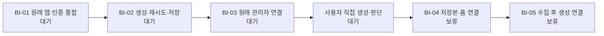

# Benchmark Preview Integration Implementation Plan

> **For agentic workers:** REQUIRED SUB-SKILL: Use superpowers:subagent-driven-development (recommended) or superpowers:executing-plans to implement this plan task-by-task. Steps use checkbox (`- [ ]`) syntax for tracking.
>
> 실행에는 프로젝트 AGENTS.md와 이미 정한 Orca 방식을 우선 적용한다. 최신 사용자 제공 AGENTS.md에 따라 프론트를 포함한 구현·테스트·설정·독립 검토는 실제 DeepSeek이 맡는다. GPT는 계획·연결 확인·수용을 맡는다. 위 일반 스킬 문구로 다른 모델 구현을 허용하거나 없는 실행 스킬을 자동 설치하지 않는다. 이 문서는 구현 코드/패치 대신 인터페이스·검사 단언을 명시한다.

**Goal:** 새 프리뷰 로직을 원래 benchmark 백엔드에 통합해 원래 관리 화면에서 한 경기를 생성·DB 재조회하고, 사용자 시험 후 같은 로직을 수집과 홈에 연결한다.

**Architecture:** 원래 benchmark 앱이 인증·관리·홈·수집 라우터를 소유하고 `app/preview/`의 기존 LangGraph를 라이브러리로 호출한다. preview 설정과 개발 저장 연결만 전용 이름공간으로 옮겨 원본 config/DB와 충돌을 없앤다. 생성 서비스는 하나이며 관리자와 수집이 이를 호출하고 홈은 저장본만 읽는다.

**Tech Stack:** 기존 FastAPI, SQLAlchemy/PostgreSQL, LangGraph, Vertex/Gemini, Vue 3/TypeScript/Vite. 새 서버·큐·검색 SaaS 도입 없음.

**Spec:** [사용자 요구와 연결 기준](../specs/2026-11-12-benchmark-preview-integration.md). 이 계획은 이전 `2026-11-12-preview-admin-to-collection.md`의 실행 지정을 대체한다. 과거 섹션 설계는 이 명세와 충돌하지 않는 계약만 재사용한다.

## Global Constraints

- “별도로 개발한 프리뷰 생성 기능을 **원래 benchmark 백엔드의 기능으로 통합**한다.”
- “실제 생성을 누르는 사람은 사용자다.” 자동 표본·유료 smoke·첫 시험 대행 없음.
- “각 논리 AI 모듈의 최초 전송 포함 최대 3회”. 전체 독립 8회·trial-set 누적 차감 없음. 정상 성공 모듈 재전송 없음.
- 모델 동시 2, 요청당 300초, 출력 상한 40,000 유지. 전망과 점수는 한 호출. 배당은 모델 0회.
- 기사 본문 → 검색 기반 AI 요약과 인용 주소 → DB. 자료 부족을 이유로 새로운 품질 실패/재생성 체계를 만들지 않는다.
- 기존 계정·경기·선수·운영 세션 읽기 전용, 새 쓰기는 같은 DB의 `preview_dev`만. 시작 시 마이그레이션/수집 자동 실행 없음.
- 기존 DB 결과·원문·버전·승인과 미완성 코드 보존. 전체 복원/reset·자동 stage/commit 없음.
- 정식 소스는 저장소 `app/`, `frontend/`. `out/` 복사본과 원격 프록시는 통합 완료로 인정하지 않는다.
- 관리자 시험 결과를 공개 승인으로 자동 간주하지 않는다. 사용자가 콘텐츠 성공을 판단한다.

## Review Focus

1. 같은 앱의 원본 public 모델과 preview 모델이 엉뚱한 DB/스키마를 사용하지 않는가 → BI-01의 session-bind 단언.
2. 원래 로그인에서 기존 계정 갱신·운영 refresh 저장소 쓰기가 발생하지 않는가 → BI-01의 무변경 인증 검사.
3. 동시 모듈 실패·다른 경기·실행 복구 시 3회 의미가 달라지지 않는가 → BI-02의 실제 transport 계수 검사.
4. UI가 이전 경기 응답·내부 ID·중복 클릭으로 다른 경기/두 실행을 만들지 않는가 → BI-03의 입력 변경·중복 클릭 검사.
5. 부분 본문·구성본의 선택 결과가 DB 재조회에서 사라지거나 GET이 생성으로 바뀌지 않는가 → BI-02/03의 저장 결과 및 GET 전송 0 검사.

---

## 범위와 단계

2026-11-12 사용자가 계획과 프리뷰 탭을 확인하고 병렬 실행을 승인했다. 이번 구현 대상은 **BI-01~03**, 그 다음은 사용자의 직접 시험이다. **BI-04~05는 후속 단계이며 지금 배정/활성화하지 않는다.** 실제 상태는 Plans.md를 따른다. BI-02의 논리 구현과 BI-03의 UI는 BI-01과 병렬로 수행하고 최종 연결만 BI-01 계약에 의존한다. 구체적인 소유권은 bi01-worker-brief.md/bi02-worker-brief.md로 분리했다.

후속 단계는 관리자 시험 결과로 별도 상세 실행 계획을 확정한다. 여기서는 연결 대상·책임·종료 기준을 고정하고 새 출판/수집 구현을 앞당기지 않는다.

## 파일 구조와 병합 원칙

| 파일/영역 | 책임과 처리 |
|---|---|
| `app/main.py`, `app/core/config.py`, `app/db.py` | 원래 benchmark 계약을 `c4d7d32`와 현재 이력/변경을 대조해 복구·병합. 원래 auth/home/management router 유지 |
| `app/models/`, `app/services/`, `app/workers/`, 원본 API/스키마 | 원본 앱의 import 의존 파일을 목록화해 복구. 프리뷰 옛 생성기는 파일이 남아도 신·구 두 경로가 함께 실행되지 않게 함 |
| **Create** `app/preview/config.py`, `app/preview/db.py` | 현재 preview 전용 설정/engine/Base를 이동. 기존 스키마·테이블·환경 키 보존 |
| `app/auth/models.py`, `identity.py`, `service.py`; **Create** `app/auth/benchmark_sessions.py` | 읽기 전용 신원과 개발 세션 재사용, 원본 인증 응답/refresh 동작에 연결 |
| `app/api/v1/auth.py`, `app/core/sessions.py`, `app/services/auth.py`; **Create** `app/preview/access.py` | 원래 인증 진입점 복구, 로컬 세션 저장 분기, preview ADMIN dependency 연결 |
| **Create** `app/services/match_preview.py` | 관리자/후속 수집이 공유하는 생성 진입점. 엔진 재구현 없음 |
| `app/preview/{retry,provider,bundle_pipeline,send_ledger,store,section_preview}.py`, `modules/bundle_sections.py` | 기존 로직 유지, 중단된 변경을 확인한 뒤 호출 제한·기술 재시도·부분 결과 연결만 수정 |
| `app/api/v1/preview_admin.py`, `preview_metrics.py` | 같은 benchmark 앱 안에서 기존 `/admin/preview` API 재사용. 로컬 별도 서버 프록시 없음 |
| `requirements.txt`, `pyproject.toml`(기존 파일 존재 시), **Create** `scripts/run_benchmark_dev.sh` | 원본/preview 의존성 병합과 한 앱 로컬 기동. 배포·scheduler·자동 migration 없음 |
| `frontend/{package.json,package-lock.json,vite.config.ts,src/main.ts,src/App.vue}`, `src/router/`, `src/stores/`, `src/lib/api/`, 원본 view/component/style | root가 원본 앱 복구. 현재 preview 기능 파일은 보존. API 목적지는 로컬8000 |
| **Create** `frontend/src/components/management/PreviewPanel.vue`; `src/views/ManagementView.vue`, `src/lib/api/preview.ts` | 원본 관리 화면의 프리뷰 탭과 기존 생성/조회 client 연결 |
| `frontend/src/components/home-preview/MatchPreviewBody.vue`, `src/styles/match-preview.css`, `src/styles/match-preview/tokens.css`, `src/lib/api/previewView.ts` | 확정 목업 디자인을 데이터 props 기반으로 이식, 실제 저장 결과의 표시용 매핑. 목업 JSON import 금지 |
| 기존 `frontend/src/features/match-preview/` | 앞서 잘못된 별도 화면에 만든 클라이언트·진단·안전한 강조 렌더를 재사용할 재료. 새 독립 앱의 진입점으로 사용하지 않음 |

작업 시작 시 변경 파일/삭제 목록과 diff를 보존한다. `c4d7d32`는 **원본 조사 기준**이지 저장소 전체를 되돌릴 명령이 아니다. 복구 목록은 각 태스크 인계에 붙이고, 원래 앱 import에 불필요한 과거 파일/테스트 일괄 복원은 하지 않는다. 일반 리팩터링이나 프리뷰 기능 재작성은 제외한다.

### BI-01: 원래 benchmark 앱 안에 preview 기반과 인증을 연결

**담당:** 백엔드/런처/검사 DeepSeek A, 원본 프론트 복구·Vite 연결 인계는 DeepSeek C. 파일 소유권은 위 표의 backend/frontend로 분리한다.

**Files:** 위 표의 원본 app/config/db/model/auth/route·preview config/db/access·requirements·로컬 런처, frontend 앱/인증/라우터/연결 설정. 생성 프롬프트·재시도는 아직 수정하지 않는다.

**Interfaces:**
- 원본 `app.db.get_db_session()`/`SessionLocal`은 원본 모델용 연결로 유지한다. 로컬 실행에서는 기존 영역 읽기 전용 권한만 사용한다.
- `app.preview.db.get_db()`/`get_session_factory()`/`Base`/`SCHEMA`는 현재 preview 쓰기 계약을 이름공간만 옮긴다. schema는 `preview_dev`다. 모든 preview caller와 관련 검사/스크립트의 import를 함께 이관한다.
- `app.preview.config.get_settings() -> PreviewSettings`는 현재 PREVIEW_* 설정을 제공한다. 원본 `app.core.config.get_settings()`와 singleton을 공유하지 않는다.
- 원본 `/api/v1/auth/login`, `/refresh`, `/me`, `/logout` 및 access-token/refresh-cookie 응답 계약 유지. 로컬 세션 adapter의 `issue_session(user)`, `rotate_session(token)`, `revoke_session(token)`은 원본 `app.core.sessions`의 인자·반환 계약을 그대로 따른다.
- `app.preview.access.require_preview_admin()`은 원본 `current_user` 결과에 **ADMIN**을 요구하고 preview API가 쓰는 `user_id`·`email`·`role`을 제공한다. 필요하지 않은 가짜 session_id/expiry를 만들어 기존 principal을 채우지 않는다.

- [ ] **1. 변경 목록을 고정한다.** 중단된 AC-01 diff와 현재 preview를 보존하고 원본 앱 복구 파일·이름 충돌·담당자를 기록한다. `out/benchmark-connected`를 새 정식 소스로 결정하지 않는다.
- [ ] **2. 직접 경계 검사를 준비한다.** `tests/unit/test_benchmark_preview_runtime.py`: 한 앱에 `/health`, 원본 관리·추천 GET, preview GET/POST가 존재하고 중복 auth route가 없음을 단언한다. 원본/preview 세션 bind가 다르고 preview 모델의 schema가 `preview_dev`임을 단언한다. 실제 DB 연결 없는 합성 설정을 사용한다.
- [ ] **3. 설정·DB 이름공간과 원래 앱을 병합한다.** 원본 DB 모델을 유지한 채 preview consumer의 import를 이동하고 원본 main에 preview router를 등록한다. 전역 dependency override로 원본 쓰기 세션을 preview 세션으로 바꾸지 않는다.
- [ ] **4. 인증 경계 검사를 준비한다.** `tests/unit/test_benchmark_preview_auth.py`: 기존 계정 검증 후 원본 형태의 login/refresh/me가 동작하고, `last_login_at`/비밀번호/role 갱신과 원격 session 쓰기는 0임을 단언한다. ADMIN 허용·비로그인401·STREAMER의 preview 생성403을 확인한다.
- [ ] **5. 로컬 인증을 연결한다.** 기존 암호 검증과 JWT 메커니즘을 재사용하고 로컬 refresh 상태만 기존 `preview_dev.preview_admin_sessions`에 기록한다. 원래 운영 인증 동작은 유지한다. 로컬 서명키·쿠키 이름·출처를 운영과 분리하되 Origin 검사를 제거하지 않는다. 로컬의 가입/기존 데이터 변경 동작은 활성화하지 않는다.
- [ ] **6. 원래 frontend를 복구한다.** 원본 라우트·로그인·관리·추천 화면을 `frontend/`에 병합한다. root가 남긴 복원·프록시 부분 변경은 C가 인계해 검증한다. `/api`는 로컬 통합 backend를 향하게 하고 MSW는 기본 실행에서 끈다. 원본 추천 목록을 임의 경기로 바꾸지 않는다. 5174 디자인 목업은 비교 자료로 보존한다.
- [ ] **7. 한 번 검증한다.** `.venv/bin/python -m pytest tests/unit/test_benchmark_preview_runtime.py tests/unit/test_benchmark_preview_auth.py -q`, `npm --prefix frontend run type-check`. 기대: 위 연결/권한 단언 통과. 단위검사에 운영 URL을 넣지 않는다.
- [ ] **8. 로컬을 전환한다.** import/검사 후 `scripts/run_benchmark_dev.sh`로 통합 benchmark를8000에, 정식frontend를5173에 띄운다. scheduler와 자동 수집은 off. 기존 프로세스 소유를 확인하고 해당 서버만 전환한다. 실제 브라우저에서 로그인·관리/추천 읽기를 확인하되 생성·수집 버튼은 누르지 않는다. 자격증명이 필요한 사용자 로그인은 사용자 입력으로 수행한다.
- [ ] **9. 수용·인계한다.** 실제 원래 앱/로컬 API 연결, 개발 세션 쓰기와 기존 영역 쓰기 권한 없음의 근거, 복구 목록을 확인한다. 읽기 권한 부족이면 정확한 테이블/연결만 차단으로 남기고 관리자 DSN으로 우회하지 않는다.

**완료 결과:** 원래 benchmark 화면과 로컬 benchmark 앱이 로그인·조회로 연결되고, 그 앱 안에 preview 기능이 장착돼 있다. 아직 새 생성 버튼 시험을 완료했다고 보고하지 않는다.

### BI-02: 한 경기 생성 서비스·모듈별 3회·저장 결과 연결

**선행:** BI-01. **담당:** DeepSeek. **Files:** `app/services/match_preview.py`, `app/api/v1/preview_admin.py`, `app/preview/retry.py`, `provider.py`, `bundle_pipeline.py`, `send_ledger.py`, `section_preview.py`, `modules/bundle_sections.py`, 필요한 `discovery.py`/`contracts.py`/기존 호출자만. 현재 `scripts/preview_bundle_live_once.py`는 개발 전용으로 분리하고 관리자·수집 경로가 의존하지 않게 한다.

**Interfaces:**
- 공통 진입점 `generate_match_preview(*, fixture_id: int, actor_id: int | None, trigger: Literal['admin','collection']) -> BundlePipelineOutcome`, `app/services/match_preview.py`. fixture_id는 외부 경기 번호. 내부에서 기존 `run_bundle_pipeline`을 한 번 호출하고 preview 세션을 사용한다. collection의 시스템 actor는 실제 관리자 ID로 위장하지 않는다(후속 BI-05에서 연결).
- `GET /api/v1/admin/preview/fixtures/{fixture_id}` → 기존 `FixtureCandidate` **단건 객체**. 저장 번호 없음404, 저장소 읽기 실패503, 모델0회.
- `POST /api/v1/admin/preview/bundle-runs` → 입력 fixture_id와 mode='live', 기존 `BundlePreviewRunResponse` 유지. 과거 전체 식별자 입력은 저장 경기와 충돌하면422.
- 기존 `GET /runs/{run_id}/preview`, `/section-results`, `/information-bundle`, 실행 상세는 DB만 읽는다. 기존 `POST /section-runs`·composition API도 같은 인증·세션·재시도 정책을 사용한다.
- 실행 상태는 기술적 실행/저장 사실이다. 기존 quality/complete 필드는 진단 호환에 남길 수 있으나 본문 반환·표시·재전송의 품질 문턱으로 사용하지 않는다. 승인 버전 정책과 기술 오류는 별도로 유지한다.

- [ ] **1. 중단된 T1 변경을 확인한다.** fixture-id 입력과 파생 예산이 어디까지 반영됐는지 기존diff와 실제 호출부를 대조한다. 보고만 믿고 완료로 표시하거나 기존 변경을 덮어쓰지 않는다.
- [ ] **2. 경기 해석을 공통 서비스로 묶는다.** 서버가 저장 경기에서 내부/외부ID·팀·시즌·킥오프를 읽고 기존 reader/resolver/transport를 LangGraph에 전달한다. 관리자 명시적 시험에는 원래 자동 후보의6시간 범위를 강제하지 않는다.
- [ ] **3. 전송 제한 검사를 보완한다.** `tests/preview/test_retry_budget.py`: 같은 실행의 여섯 모듈이 필요하면 각각3회를 사용할 수 있고 어느 모듈의4번째도 보내지 않음, 경기B가 경기A 계수에 막히지 않음, 같은 실행 복구는 장부 사용분을 유지함을 transport 계수로 단언한다. 전체8과 시험집합차감이 실제 호출자에서 재주입되지 않는지도 같은 경로로 확인한다.
- [ ] **4. 제한을 단일 소유자에게 연결한다.** 각 논리 모듈 최초 포함3회로 통일하고 전체8/trial prior를 활성 생성 정책에서 제거한다. 집계용 횟수·과거 장부는 보존한다. 전역1800초가 정상적인 모듈별 재시도를 잘라내는 경로도 제거하되 요청별 timeout/취소는 유지한다.
- [ ] **5. 기술 실패 재시도를 연결한다.** `tests/preview/test_provider.py` 및 `test_bundle_sections.py`에서 429→MAX_TOKENS 또는 JSON오류→정상 응답의 실제3전송,4번째0을 확인한다. HTTP200이라는 이유로 절단을 성공 처리하지 않는다. 401/설정오류·짧지만 파싱 가능한 본문은 불필요한 재전송이 없어야 한다. SDK와 그래프에 별도 retry loop를 추가하지 않는다.
- [ ] **6. 부분 결과·구성본을 보존한다.** 예외가 난 모듈의 원문/사유와 이미 작성된 섹션을 저장한다. 선택적 배당 없음·기사 수집 실패가 다른 본문을 숨기지 않게 한다. 재생성은 해당 모듈만, 최종 결론은 선택된 같은 경기 결과만 소비한다.
- [ ] **7. API 저장 경계를 검증한다.** `tests/preview/test_bundle_integration.py`에 번호 단건/충돌, 부분 결과 저장후GET, 기존 `9c079eea` 유형 구 결과 호환, 같은 경기 구성본/타경기 거부 대표 사례를 연결한다. GET transport0, `preview_dev`밖 쓰기0 단언. 운영 행을 초기화하는 fixture는 쓰지 않는다.
- [ ] **8. 영향 검사와 인계를 마친다.** `.venv/bin/python -m pytest tests/preview/test_retry_budget.py tests/preview/test_provider.py tests/preview/test_bundle_sections.py tests/preview/test_bundle_pipeline.py tests/preview/test_bundle_integration.py -q`. 기존 증거가 유효한 검사는 반복하지 않고 변경 때문에 필요한 항목만 선택 실행해도 된다. 새 실제 모델/HTTP smoke 없음. 변경된 워크플로우 버전은 갱신하되 승인 행을 자동 생성하지 않는다.

**완료 결과:** benchmark 관리자 API에서 한 경기의 기존 LangGraph를 실행·저장할 계약이 완성되고, 사용자의3회 의미를 직접 확인했다. 글의 좋고 나쁨은 자동 판정하지 않는다.

### BI-03: 원래 관리자 UI에서 생성·저장 결과 열람

**선행:** BI-01의 원래 프론트, BI-02의 API. **담당:** DeepSeek C, frontend 단독 소유. A/B backend 파일 편집 없음. GPT는 원래 화면 여부·연결·수용 기준을 확인한다.

**Files:** `frontend/src/views/ManagementView.vue`; **Create** `src/components/management/PreviewPanel.vue`, `src/lib/api/preview.ts`, `src/lib/api/previewView.ts`; `src/components/home-preview/MatchPreviewBody.vue`, 관련 스타일. 앞서 작성한 `src/features/match-preview/{BundleGenerationPanel,InlineEmphasis,InformationBundlePanel,CompositionPanel}.vue`, `api.ts`, `types.ts`는 필요한 기능만 가져오고 중복 client를 만들지 않는다.

**Interfaces:**
- 화면 위치 `/admin?tab=preview`, 원래 관리 네 탭 유지, ADMIN만 생성 UI 노출. 서버 권한 판정은 BI-01에 의존한다.
- client `getPreviewFixture(fixtureId: number): Promise<FixtureCandidate>`, `generatePreview(fixtureId: number): Promise<BundlePreviewRunResponse>`, `getPreviewRun(runId: string): Promise<PreviewRunData>`는 BI-02의 API를 호출한다. `PreviewRunData`는 preview(`ReaderPreview | null`)와 sections(`SectionResultsResponse`)를 담는다. `FixtureCandidate`는 기존 `features/match-preview/fixtures.ts`, 나머지 응답 타입은 기존 `types.ts`를 재사용하고 별도 모양으로 복제하지 않는다. 원래 JWT API client를 사용한다.
- `previewView.ts`의 `toMatchPreviewView(input: PreviewRunData): MatchPreviewView`는 저장 reader/structured 결과를 표시용으로 변환하며 문장을 새로 만들지 않는다. `MatchPreviewView`는 같은 파일에서 fixture, generated_at, ai_forecast(본문·nullable 점수·근거 목록), players, injuries, external_forecasts, odds, sources를 정의한다. 각 선수의 팀 외부 ID·표시명·nullable 사진·이유, 부상의 상태·상세·영향, 매체의 이름·문장·URL, 배당의 출처·1X2 값을 저장된 구조에서 매핑한다. 없는 섹션은 null/빈목록으로, structured가 없어도 남아 있는 본문은 해당 섹션 텍스트로 보존한다. `MatchPreviewBody`의 preview prop이 이 타입을 받는다. 내부/외부 player ID가 확인된 경우에만 API-Football 사진 주소를 만든다.

- [ ] **1. API·UI 직접 검사를 준비한다.** `frontend/src/components/management/PreviewPanel.test.ts`: 진입 시 생성0, 번호 확인 뒤 클릭한1경기만 POST1, 입력을 바꾼 뒤 이전 조회 응답으로 실행하지 않음, 중복 클릭POST1을 단언한다.
- [ ] **2. 원래 관리 화면에 탭을 연결한다.** 번호→대진·시각 확인→전체 프리뷰 생성의 최소 흐름을 구현한다. 원래 관리 상단의 별도 읽기 실패가 프리뷰 탭 자체를 무조건 막지 않게 탭별 필요한 데이터만 읽는다. 기존 별도 검사앱을 iframe/다른 서버 링크로 넣지 않는다.
- [ ] **3. DB 결과 표시를 연결한다.** 생성 응답에서 run_id를 받고 저장 preview/sections를GET한다. 본문 우선, 진단접기, `저장 결과 다시 읽기`는GET만. 네트워크가 끊겼다고 POST를 자동 재전송하지 않고 실행 이력을 확인할 수 있게 한다.
- [ ] **4. 확정 디자인을 데이터로 구동한다.** 전망·점수·전망근거, 팀별 선수/부상 패널, 매체/배당을 유지한다. `**이름**`은 텍스트와 strong 노드로만 렌더하고 HTML을 실행하지 않는다. 목업 수치·고정팀·API보충 문구를 실제 응답에 섞지 않는다. 내용이 없는 섹션은 있는 것처럼 꾸미지 않는다.
- [ ] **5. 섹션 작업을 이어 쓴다.** 기존 재생성/구성본 컴포넌트를 같은 관리자 탭 안에 연결한다. 본문 확인 뒤 사용자가 원할 때만 해당 섹션 재생성 또는 선택 결과로 최종 AI를 호출한다. 조회/저장 응답 재처리/새 모델 호출을 구분한다.
- [ ] **6. 결과 표시 검사를 마친다.** 부분 본문이 표시되고 재조회가 추가 POST를 만들지 않음, 안전한 굵게 표시, 타경기 결과 혼입 없음의 단언을 같은 UI 검사에 둔다. `npm --prefix frontend run type-check`, `cd frontend && npx vitest run src/components/management/PreviewPanel.test.ts`를 실행한다. 기존 재사용 컴포넌트의 직접 영향 검사는 수정한 경우에만 추가한다.
- [ ] **7. 실제 연결을 확인한다.** 브라우저5173의 원래 관리에서 기존 저장 run `9c079eea-6f66-46bb-83e2-460850f0a22f`를 열고 새로고침 후 동일 저장 결과가 나오는지 확인한다. 로컬 API 경로·권한·GET 전송0 확인. 생성 버튼은 사용자에게 남긴다.
- [ ] **8. 수용 후 구현을 멈춘다.** BI-01~03 독립 검토는 같은 단위를 중복 심사하지 않게 경계별1회만 한다. 사용자가 직접 로그인/경기번호/생성/결과를 확인할 경로와 남은 한계만 인계한다. 자동 시험 경기나 성공률 집계를 만들지 않는다.

**완료 결과:** 사용자가 원래 benchmark 관리자에서 직접 실행할 수 있고, 이미 저장된 결과를 실제 디자인으로 다시 볼 수 있다. 원격API/JSON목업으로 통합을 대체하지 않았다.

## 사용자 직접 시험: 구현 종료와 콘텐츠 판단 분리

사용자가 원하는 예정 경기 번호를 넣고 결과물을 보고 판단한다. 첫 시험도 사용자 직접 실행이다. 운영 데이터 변경 없는 기존 DB 읽기와 새 `preview_dev` 저장만 발생한다. 요청이 오면 특정 실패의 전송/원문을 확인해 그 모듈만 수정하며, 모든 섹션을 반복 생성하거나 새로운 평가 엔진을 만들지 않는다.

콘텐츠에 대한 사용자의 확인과 섹션 워크플로우 버전 승인 기록을 연결한다. 자동검사 통과·워커 완료·`ready` 필드가 사용자 승인을 대신하지 않는다.

## 후속 BI-04: 저장 프리뷰의 JSON 계약과 원래 홈 연결 — 보류

**대상:** `app/api/v1/home_preview.py`, `app/services/home_preview.py`, `app/preview/section_preview.py`, `app/preview/store.py`, 원본 `frontend/src/lib/api/homePreview*.ts`, `HomeRecommendedSection.vue`, BI-03의 `MatchPreviewBody.vue`.

**확정할 인터페이스:** 기존 추천 GET은 유지. 기존 `/api/v1/home/fixtures/{external_id}/prematch`가 새 저장 프리뷰를 조회하도록 한다. 독자 payload는 fixture외부ID/팀·로고, generated_at, ai_forecast(본문·점수·근거), players, injuries, external_forecasts, odds, sources로 BI-03 표시 모델과 맞춘다. 없는 값은 nullable/빈목록으로 두고 기존 스키마의 과도한 근거/완성도 게이트로 새 결과를 버리지 않는다. 관리자 원문·usage·계정·내부진단은 공개하지 않는다.

**저장 결정:** 경기→채택 저장본 연결은 `preview_dev`에 추가하는 최소 publication 매핑으로 유지하고 기존 public publication을 개발작업으로 쓰지 않는다. 채택본은 run/구성본·섹션 결과 버전을 고정한다. 구 결과와 수정본을 혼합하거나 일부 재생성으로 기존 채택본을 자동 지우지 않는다. 워크플로우 승인 뒤 해당 버전의 경기 결과를 사용하는 정책을 후속 계획에 명시한다.

**종료 기준:** 서로 다른 경기2개에 대한 저장 응답/선택 전환이 맞고, 새로고침·서버 재시작 후에도 같은 저장본을 읽으며 GET 전송0. 추천경기 목록은 원래 정책 유지, 고정맨시티목업/합성배당 제거. 이 단계 상세 스키마·변경/검사 파일은 사용자 시험 종료 후 별도 계획으로 확정한다.

## 후속 BI-05: 원래 수집 완료 경로에서 같은 생성 서비스 호출 — 보류

**대상:** `app/services/management_runs.py:run_home_preview_after_sync`, `app/workers/home_preview/__init__.py:run_cycle`, 원본 daily_sync의 동일 hook, `app/services/match_preview.py`. 옛 `home_preview_generation.process_fixture`와 `ProductionPreviewGenerator`를 새 생성과 동시에 호출하지 않는다.

**연결:** 기존 수집이 경기 자료를 저장한 뒤 기존 후보 선택에서 얻은 외부 fixture ID마다 BI-02 서비스를 호출한다. 관리자는 fixture1개, 수집은 선정된fixture를 하나씩 같은함수로 전달한다. 다섯경기를 한 모델 요청에 묶지 않는다. 수집 재시작/같은주기 중복 hook은 같은 생성작업을 이어받거나 기존결과를 사용하며 전체모듈을 처음부터 재전송하지 않는다.

**범위:** scheduler·추천 대상/시각은 원래 정책을 재사용하고 변경이 필요한 값만 사용자 시험 후 확정한다. 실제 기존 수집의 운영 쓰기/배포/자동 활성화는 현재 로컬 관리자 시험 범위에 포함하지 않는다. preview 실패가 이미 성공한 경기자료 수집을 롤백하지 않으며, 실패 원인과 작성된 부분 결과는 저장한다.

**종료 기준:** 기존 수집 hook → 동일 생성 서비스 → `preview_dev` 결과/채택본 → 홈 GET이 한 흐름으로 연결됨을 기록 transport로 먼저 확인한다. 실제 자동수집 활성화는 사용자 시험/워크플로우 승인과 이 단계 실행 지시 후다. 새 스케줄러·평가기·별도 엔진은 만들지 않는다.

## 종료·인계 규칙

- 코드 작성, 실제 로컬 연동, 사용자의 글 평가, 수집/홈 연결은 각각 따로 보고한다.
- 태스크 완료 보고에는 실제 변경파일·검사 명령/결과·저장 증거·미해결만 남긴다. 공통 진행은 `Plans.md` 한 곳에 기록한다.
- 현재 작업트리의 큰 미커밋 변경 때문에 자동 git add/commit하지 않는다. 태스크 diff를 구분해 인계하고 커밋은 별도 지시에 따른다.
- 계획 self-review: 요구1~7을 BI-01~05에 연결했고, Review Focus5개를 해당 직접 검사에 배치했다. 미확인 원본 경기번호 UI는 존재한다고 단정하지 않았다. 후속 공개JSON/자동수집은 상세 설계 완료로 표현하지 않는다.
- **계획 확인 완료:** 사용자가 원래 관리의 프리뷰 탭과 DB 경기번호 검색 흐름을 확인하고 병렬 구현을 지시했다. BI-01~03을 실행한다. 실제 생성·수집 자동화·배포까지 승인된 것으로 확대하지 않는다.
