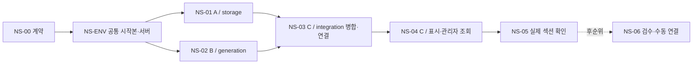

# 선수 섹션 저장 개발·배치 계획

> 워커 실행 지침 — 2026-11-16 21:59 KST 사용자 변경: 이번 선수 섹션 개발에서는 기존 DeepSeek 배정을 모두 **Gemini Hydrogen**으로 대체한다. 준비·제품 구현·테스트·마이그레이션·통합·충돌 수정·독립 설계/코드 검토·후속 수정 호출에 동일하게 적용한다. 독립 검토는 구현자와 별도 Hydrogen 세션으로 수행한다. GPT는 조정·요구사항·계약·배정·증거 확인·Plans.md를 담당한다. 이 작업의 사용자 명시 예외이며 AGENTS.md의 전역 기본 정책과 과거 기록을 변경하지 않는다. 제품 안에서 프리뷰를 생성하는 AI 제공자·모델 변경은 포함하지 않는다.
>
> 실행기는 Orca `antigravity`(로컬 `agy`), 지정 모델은 **`gemini-4-hydrogen-high`**다. 21:59 KST `agy models`에서 `Gemini 4 Hydrogen (High)` 제공을 확인했다. 별도 effort 설정은 강제하지 않는다. 매 세션의 실제 선택 모델과 스킬 읽기 기록을 확인한다. 모델 목록 확인은 실제 생성 호출 성공의 증거가 아니다. 실행 실패 시 DeepSeek·GPT·Claude·다른 Gemini 모델로 자동 대체하지 않는다.

**Goal:** 주목 선수와 부상 선수의 실제 AI 응답을 새 고정 컬럼 테이블에 저장하고, 선수 ID·한글명·사진 연결을 실제 조회 화면에서 확인한다.

**Architecture:** 기존 LangGraph의 두 섹션 작성·저장·조회 경로를 확장한다. 새 섹션 본문의 정본은 고정 컬럼 테이블이며, 기존 실행·섹션 결과 ID는 실행 이력과 승인 연결에 재사용한다. 기존 저장 프리뷰는 원래 조회 경로로 보존한다.

**Tech Stack:** 기존 Python, SQLAlchemy, PostgreSQL `preview_dev`, LangGraph, FastAPI, Vue, TypeScript.

**Spec:** 이 문서 §1의 대화 확정 요구사항. 근거는 [Plans.md](../../../Plans.md)의 2026-11-16 SC-DESIGN 결정 이력과 [기존 저장 구조 조사](../../planning/2026-11-13-preview-content-structure-findings.md)다. 사용자는 구현 시작을 승인했다. §2의 미결정 세부 계약은 NS-00에서 고정하고, 승인 범위의 준비·배정을 진행한다. 새 섹션의 공개 활성화는 별도 사용자 확인 대상이다.

**작업 방식 확정:** 사용자 후속 지시로 구현 A·B는 별도 워크트리와 각각의 프론트·백엔드를 사용한다. A는 5173/38000, B는 5174/38001이다. 세컨드 브레인의 8000은 유지한다. 통합 담당 C는 세 번째 워크트리에서 두 브랜치를 합치고 API·프론트·실제 테스트를 마무리한다. 통합 준비 포트는 5175/38002를 제안하며, 최종 확인 주소는 A 종료 후 5173/38000을 C가 인계받는다. 이 지시는 앞선 8000 유지안과 A의 통합 재사용·별도 UI 병렬 배치안을 대체한다.

## 1. 확정 요구사항

- 기존 프리뷰를 보존한다. 앞으로 생성할 두 섹션은 새 테이블에 저장한다.
- 홈1·홈2·원정1·원정2 자리를 컬럼으로 고정한다. 각 자리에 선수별 설명 전문, DB에서 확인한 선수 ID, 원문 이름, 표시 한글명, 미연결 사유를 연결한다.
- 주목 선수의 `home_etc`, `away_etc`는 현재 NULL로 둔다. 팀당 두 명을 넘는 응답은 앞의 두 명을 대상으로 한다.
- 팀·경기 정보를 활용해 기존 DB에서 선수를 찾는다. 모델이 출력한 정수를 검증된 내부 ID로 간주하지 않는다.
- 선수 ID가 확인되면 기존 DB 한글명을 사용한다. 한글명이 없으면 AI 번역을 미검수로 저장하고 즉시 사용한다.
- 선수 자체를 확정하지 못하면 ID는 NULL로 두고 AI 한글명과 설명을 보존한다. 사진 자리에 한글명을 표시한다. 관리자는 미연결 선수와 실제 사유를 확인할 수 있어야 한다.
- 사진 URL에는 해당 선수의 DB 외부 ID를 사용한다. 외부 미디어가 제공하는 기본 이미지는 그대로 표시한다.
- 생성한 설명 전문은 이후 번역 수정으로 바꾸지 않는다. 본문 인명을 변수화하지 않는다.
- 첫 응답의 설명 누락 또는 동일 선수 중복은 해당 섹션 전체를 한 번 재생성하는 사유다. 다른 섹션을 자동 재생성하지 않는다.
- 마지막 응답을 기준으로 처리하며 앞 응답과 합치지 않는다. 설명이 없는 선수는 최종 선수 컬럼에 저장하지 않는다. 마지막에도 중복이면 설명이 있는 첫 항목 하나만 남긴다. 한 명만 남으면 한 명만 표시한다.
- 관리자의 번역 확인·수정 및 수동 선수 연결은 후순위다. 먼저 실제 응답의 저장·선수 연결·한글명 연결을 입증한다.

## 2. 범위와 공통 계약 제안

### 저장 구조

| 신규 대상, 모두 preview_dev | 제안 책임 |
|---|---|
| `preview_watch_player_sections` | 주목 선수의 네 고정 자리와 home_etc·away_etc |
| `preview_injury_player_sections` | 부상 선수의 네 고정 자리. 부상 상태를 원문 의미대로 보존 |
| `preview_player_name_candidates` | 기존 DB에 쓸 수 있는 한글명이 없을 때의 AI 번역·검수 상태·출처. ID 미확인 후보도 보관 |

공통 식별자는 기존 section_result_id와 run_id, 경기 식별, 홈·원정 내부 팀 ID, 저장 계약 버전, 생성 시각이다. 같은 결과 ID의 중복 저장은 새 선수 결과를 만들지 않도록 한다. 새 생성 결과는 새 결과 ID를 사용한다. 기존 public 경기의 내부 키와 외부 fixture ID를 혼용하지 않는다.

각 고정 자리는 `player_id`, `original_name`, `name_ko`, `body`, `unresolved_reason`을 갖는다. 번역 출처와 후보 연결은 `name_source`, `translation_candidate_id`로 구분하는 안을 계약 확정 때 검토한다. 빈 자리와 ID만 미확인인 자리는 다르다. 부상 상태용 기존 정보는 유지하며 전문 문자열에서 다시 추측하지 않는다.

DB에서 확인된 선수·팀 ID만 저장한다. 외부 사진 ID는 해당 player_id로 읽는다. 기존 public 테이블에 외래 키를 새로 거는 작업은 권한·기존 영역 무변경 조건을 확인하기 전 확정하지 않는다. 개발 영역 내부 참조와 서버의 public ID 확인을 구분한다.

기존 DB 번역은 읽기 전용이다. 새 후보와 이후 검수 결과는 개발 영역에 둔다. 미확인 선수를 이름 문자열만으로 다른 선수와 합치지 않는다. 동일 선수의 후보 재사용, 동시 저장, 나중 검수 반영의 기준은 NS-00에서 정한다. `human_modified`를 검수 완료의 증거로 삼지 않는다.

새 테이블의 값을 읽어 기존 카드 응답 형식으로 변환한다. 새 결과에서 테이블 조회가 실패했는데 옛 payload를 읽어 성공처럼 표시하는 처리는 금지한다. 옛 결과의 구형 조회는 결과 계약 버전으로 구분한다. 기존 본문·근거·모듈 결과·승인 이력을 덮어쓰지 않는다.

### 실행과 검증 경계

- 현재 실제 생성 경로는 논리 모듈당 최초 포함 실제 전송 최대 3회다. `retry.py`에 남은 옛 공용 8회 상수를 새 경로 정책으로 오해하지 않는다.
- 내용 오류 재생성은 최대 1회다. 통신 오류·응답 잘림·JSON 오류 재시도와 합쳐도 기존 모듈 전송 상한을 늘리지 않는다. 별도 논리 호출 ID를 만들어 상한을 초기화하지 않는다.
- 재전송 후 유효 응답 자체가 없는 경우와 유효 응답에서 일부 선수가 빠지는 경우를 구분한다. 이전 응답을 섞어 정상 결과로 만들지 않는다. 실제 전송 예산 소진·통신 실패는 기존 실패 계약으로 남긴다.
- 기존 운영 자료는 읽기 전용이다. 개발 쓰기·마이그레이션·undo는 `preview_dev`의 해당 실행 소유 범위에 한정한다. 시작 시 자동 마이그레이션을 추가하지 않는다.
- `tests/preview/conftest.py`는 초기화 fixture를 포함한다. 해당 pytest 명령은 안전 검사가 통과한 로컬 합성 테스트 DB에서만 실행한다. 운영 자료를 사용하는 실제 연동 검증은 이 fixture를 통하지 않는다.
- 본문과 자료 채택 의미가 바뀌므로 두 섹션의 새 워크플로우·출력 계약 버전을 구분한다. 관리자 시험 후 사용자 섹션 승인 이전에는 기본 전체 프리뷰에 활성화하지 않는다.

## 3. 작업 단위와 의존 관계

아래는 배정안이다. 실제 Task·Dispatch·모델 확인 기록과 상태는 Plans.md에서만 관리한다.

| ID | 결과물 | 담당 제안 | 선행 | 완료 근거 |
|---|---|---|---|---|
| NS-00 | 테이블·입출력·파일 소유권 계약 | GPT 조정자, 구현 가능성 독립 검토는 Gemini Hydrogen | 이번 계획 논의 | 아래 미결정 계약 확정, 읽기 전용 검토 1회 |
| NS-ENV | 공통 시작본·세 워크트리·작업별 서버 | Gemini Hydrogen C 준비, A·B는 자기 서버 인계, 조정자는 Orca 배치 | NS-00 | 같은 시작 리비전, A 5173→38000·B 5174→38001 연결·기존 ADMIN 진입 |
| NS-01 | 새 DB 저장·번역 후보 저장·실행별 undo | Gemini Hydrogen A / storage 워크트리 | NS-00·NS-ENV | 저장·재조회·후보 연결·권한 경계·undo 확인 |
| NS-02 | 두 섹션 응답 처리·선수 확인·재생성·기존 관리자 프론트 검사 | Gemini Hydrogen B / generation 워크트리 | NS-00·NS-ENV | 실제 응답·고정 슬롯·ID·시도별 전송을5174에서 확인 |
| NS-03 | 두 브랜치 병합·실제 생성·저장·조회 API 연결 | Gemini Hydrogen C / integration 워크트리 | NS-01·NS-02 편집 종료 인계 | 실제 응답→새 행→동일 결과 ID 조회 연결 |
| NS-04 | 두 카드 표시·관리자 저장 검사 | Gemini Hydrogen C / integration 워크트리 | NS-03 | 저장값 기반 표시·미연결 사유·이름 대체 확인 |
| NS-05 | 두 섹션 실제 실행·사용자 확인 | GPT 조정자·사용자, 도구 수정은 Gemini Hydrogen | NS-03·NS-04·단위별 검토 | 실제 실행/결과 ID·본문·사진·DB 연결·사용자 승인 기록 |
| NS-06 | 번역 검수·수정·수동 선수 연결 | 후속 Gemini Hydrogen | NS-05와 별도 상세 계약 | 후순위. 이번 1차 완료의 선행 조건이 아님 |

NS-00의 읽기 전용 검토와 NS-ENV의 원본 보존·환경 사전 조사는 독립적으로 병렬 진행한다. NS-ENV의 공통 계약 구현·서버 준비는 NS-00 계약 확정 후 진행한다. 이후 NS-01과 NS-02가 서로 다른 워크트리에서 병렬 진행한다. 각 작업 환경은 프론트·백엔드를 함께 띄워 사용자가 따로 확인할 수 있다. C는 시작본과 기동 설정을 준비하고 두 구현자의 인계를 받은 뒤 통합 워크트리에서 병합·연결·UI를 마무리한다. 다른 워크트리의 작업 중 파일을 사용자 확인용 서버에 직접 복사하지 않는다.

독립 검토 R은 별도 Gemini Hydrogen 세션이다. 구현 단위별 인계 후 1회 검토하고, 수정 확인은 지적한 항목에 한정한다. 검토가 끝난 독립 작업은 다음 작업으로 진행한다. 모든 작업을 끝낸 뒤 같은 범위를 다시 전면 심사하지 않는다.

### 워크트리와 서버 소유권

| 워크트리 가칭 | 담당 | 소유 범위 |
|---|---|---|
| `player-section-storage` | A | NS-01의 저장·마이그레이션·번역 후보 구현과 자체 검사 |
| `player-section-generation` | B | NS-02의 응답·선수 확인·재생성·기존 관리자 응답 검사 연결과 자체 검사 |
| `player-section-integration` | C | 두 브랜치 병합, 충돌 수정, NS-03·04, 확인용 서버와 실제 연동 마무리 |

세 워크트리는 같은 공통 시작 리비전에서 만든다. 현재 원본 작업공간에는 미커밋 수정·삭제가 있으므로 Git HEAD만 복제한 상태를 현재 제품의 시작본이라고 간주하지 않는다. 필요한 현재 제품 상태와 변경 목록을 격리된 기준 브랜치에 보존하고 세 작업공간의 시작 상태를 대조한다. 원본을 reset·clean하거나 미커밋 변경 전체를 무심코 add하지 않는다. 비밀값과 의존성·빌드 산출물은 기준 커밋에 포함하지 않는다.

A·B는 편집 종료 후 브랜치·최종 커밋·변경 파일·직접 검사 결과·미해결 사항을 C에게 인계한다. C는 두 커밋을 통합 브랜치에 병합하고 필요한 수정은 직접 수행한다. 충돌 해결도 Gemini Hydrogen 작업이다. 원본 main으로의 병합은 이번 통합 워크트리 완료와 별개다. 완료 전 작업 브랜치를 삭제하지 않는다.

| 실행 환경 | 프론트엔드 | 백엔드 | 프로세스 소유자 |
|---|---|---|---|
| A 개별 확인 | `http://localhost:5173` | `http://localhost:38000` | A |
| B 개별 확인 | `http://localhost:5174` | `http://localhost:38001` | B |
| C 통합 준비, 제안 | `http://localhost:5175` | `http://localhost:38002` | C |
| C 최종 확인 | `http://localhost:5173` | `http://localhost:38000` | A의 종료·포트 인계 후 C |

각 프론트의 API 프록시는 같은 행의 백엔드만 가리킨다. CORS 허용 주소·실행 설정도 환경별 포트와 맞추되 기존 인증 방식을 재사용한다. 포트가 점유됐다고 자동으로 다음 포트에 실행해 안내 주소가 달라지지 않게 한다. 다른 작업자의 서버를 종료하지 않는다. 공용 DB 마이그레이션 적용은 C가 통합 리비전으로 한 번 수행하며 A는 마이그레이션 구현·로컬 검사를 맡는다. 코드와 포트가 나뉘어도 DB는 공유되므로 run_id·소유 범위와 개발 쓰기 제한은 그대로 적용한다.

개발 중에는 각 환경의 마지막으로 확인된 실행본을 유지하고, 미완성 편집으로 확인용 화면을 깨뜨리지 않는다. 새 통합본은 5175/38002에서 시작·기본 조회를 확인한 다음, A의 편집·검사 종료와 서버 인계를 확인해 5173/38000으로 전환한다. 전환 전까지 A·B의 개별 확인 환경을 유지한다. 반영 시 필요한 짧은 재시작은 알리고, 실패하면 직전 실행본을 복구한다. 무중단 전환 시스템을 새로 만드는 범위는 아니다. 최종 통합 서버는 워커 종료와 별개로 유지하며 사용자 요청 없이 정리하지 않는다.

Plans.md 상단에 확인용 URL, 실제 실행 경로·리비전, 반영된 작업, 미반영 작업, 마지막 확인 시각을 기록한다. 단순 health 200만으로 완료 처리하지 않고 프론트→백엔드 연결·기존 ADMIN 로그인 진입·저장 결과 조회를 확인한다. 새 생성 테스트는 실행 ID로 구분한다. 무변화 상태를 상시 폴링하는 감시 시스템은 추가하지 않는다.

계획 수정 중 실제 관측: 5173은 연결 거부, 8000은 `second-brain-api-1` 컨테이너가 점유하며 `/health`는 200이다. 이 200은 경기 프리뷰의 준비 완료 근거가 아니다. 사용자 최신 지시로 백엔드를 38000번대로 옮겨 충돌을 피한다. 세컨드 브레인 변경은 필요하지 않으며 앞선 이동·중단 질문은 더 이상 선행 조건이 아니다. 최근 Orca 포트 조회에서 5173·5174·5175·38000·38001·38002 리스너는 없었다. 실제 기동 시 다시 확인한다.

## 4. 배정별 파일·계약·수용 기준

### NS-00: 구현 전에 계약을 고정한다

담당은 조정자이며 제품 코드·DDL·실행 가능한 패치를 작성하지 않는다.

- [ ] §2의 가칭 테이블·고정 컬럼을 최종 계약 문서로 확정한다. AI 입력은 이름·팀·설명·한글명 후보·근거이고, 서버 출력은 검증된 ID가 포함된 네 자리다.
- [ ] 번역 후보의 기존 한글명 우선순위, ID 확인 전후 소유 키, 동시 생성 시 재사용, 실행 undo가 다른 실행에서 쓰는 번역을 삭제하지 않는 범위를 정한다.
- [ ] 필터링 후 남은 항목은 원래 순서를 유지해 1번부터 채우는 방안을 명시한다. team을 홈·원정에 배치할 수 없는 항목, 최종 응답 전체를 해석할 수 없는 경우는 정상 선수 행으로 꾸미지 않는다.
- [ ] 실제 DB 대상·필요 읽기 권한·새 테이블 작성 권한을 확인하는 배정서를 만든다. 비밀값은 문서에 복사하지 않는다. 현재 정책 충족 여부를 과거 보고만으로 완료 처리하지 않는다.
- [ ] 별도 Gemini Hydrogen에 이 계약의 읽기 전용 검토를 1회 배정한다. 실제 모델·연결이 확인되지 않으면 검토 실행을 보류하고 GPT가 대신 검토하지 않는다.

완료 조건은 다음 워커가 필드 이름·본문 정본·ID 공간·쓰기 경계·재시도 횟수를 다르게 해석할 여지가 없는 계약이다. 새 기능 범위가 필요한 질문만 사용자에게 올린다.

### NS-ENV: 세 워크트리의 시작본과 확인용 서버를 준비한다

- [ ] A 5173/38000, B 5174/38001, C 준비 5175/38002의 포트 가용성을 확인한다. 8000의 세컨드 브레인은 그대로 유지한다.
- [ ] 원본의 필요한 현재 제품 상태를 공통 시작 리비전으로 보존한다. C가 NS-00에 맞춘 최소 `app/preview/player_section_contracts.py`를 구현해 두 작업자가 같은 계약에서 출발하도록 한다. 이 단계에서 저장·생성 로직을 대신 구현하지 않는다.
- [ ] 공통 시작 리비전에서 Orca의 세 워크트리를 구성한다. NS-00의 계약은 모두 같은 버전으로 전달한다.
- [ ] C가 환경별 기동 설정을 준비하고 A·B에게 각 서버를 인계한다. 개발 연결의 대상·권한과 기존 ADMIN 인증을 확인한다. 비밀값은 저장소 밖 설정을 재사용한다.
- [ ] 프론트→API·로그인 진입·기존 저장 프리뷰 조회를 확인하고 실제 리비전·URL·프로세스/터미널 식별자를 Plans.md에 남긴다.

구현 시작은 승인됐다. 워크트리·서버의 실제 준비 상태는 Plans.md의 마지막 관측을 따른다. 실행용 스크립트나 설정 수정이 필요하면 Gemini Hydrogen C가 맡는다.

### NS-01: 새 저장소와 번역 후보를 만든다

소유 파일 제안:

- 신규 `app/preview/player_section_models.py`, `app/preview/player_section_store.py`, `app/preview/player_name_candidates.py`. 공통 시작본의 `app/preview/player_section_contracts.py`는 A·B가 공유하며 변경이 필요하면 조정자와 C를 통해 같은 버전으로 갱신한다.
- 신규 `alembic/versions/0006_player_section_storage.py`. 실행 전 번호 충돌을 확인한다.
- 기존 `scripts/preview_dev_migrate.py`, 모델 등록에 필요한 `app/preview/models.py`, 실행별 감사·undo 연결의 `app/preview/store.py`.
- 신규 `tests/preview/test_player_section_storage.py`. 기존 마이그레이션 검사는 해당 새 저장소 영향 부분만 보완한다.

입력은 run_id·section_result_id·경기/팀 식별·네 자리 최종값·번역 후보다. 출력은 재조회 가능한 저장 결과와 후보 ID다. AI를 호출하지 않는다. 새 저장 함수의 구체 서명은 NS-00 계약에 반영한 뒤 B에게 전달한다.

- [ ] 동일 결과 ID 재저장, NULL 선수 ID, 빈 자리, 기존 결과 보존, 후보 연결을 대표 사례로 검사한다.
- [ ] 새 테이블·인덱스·이력만 개발 영역에 추가하는 명시적 마이그레이션을 구현한다.
- [ ] 실행 소유 쓰기를 기존 감사·undo에 연결한다. 공유 번역 후보의 소유 관계를 확인하며 다른 실행 사용분을 삭제하지 않는다.
- [ ] `.venv/bin/python -m pytest tests/preview/test_player_section_storage.py -q`를 안전한 로컬 합성 DB에서 실행한다. 새 검사이며 구현 워커가 작성한다.
- [ ] 실제 적용용 마이그레이션·권한 경계·undo 확인 방법을 C에게 인계한다. 공유 DB 적용과 실제 저장·조회·해당 실행 undo 확인은 NS-03에서 C가 수행한다. 기존 계정·경기 행을 바꾸지 않는다.

NS-01의 코드 완료 근거는 로컬 마이그레이션 적용 내역, 대표 저장·재조회 값과 undo 검사다. 실제 DB 연동 근거는 NS-03 인계 후 구분해 남긴다. DB 전체 초기화나 전체 회귀는 완료 조건이 아니다.

### NS-02: AI 응답을 네 자리로 확정한다

사용자 추가 요구: C 통합을 기다리지 않고 B 환경의 기존 프론트에서 실제 AI 응답을 확인한다. 주소는5174이며 백엔드는38001이다. 새 관리 페이지를 별도로 만들지 않고 기존 섹션 실행 화면과 `/admin/runs` 실행 검사 화면을 재사용한다.

현재 코드에서 `SectionRunView.vue`는 경기·섹션 실행과 본문 확인, `RunInspector.vue`는 본문·근거와 진단 펼침, `ModuleResultPanel.vue`는 요청·시도별 전체 응답·모델 생성 JSON·변환·다음 입력을 표시한다. B는 이 실제 기록 연결을 우선 사용하고, 새 고정 자리와 선수 연결 상태가 빠진 부분만 보완한다. 이는 코드 확인이며 B 환경의 현재 기동·실호출 검증을 의미하지 않는다.

소유 파일 제안:

- 기존 `app/preview/modules/bundle_sections.py`, `app/preview/prompts/bundle_players.md`, `app/preview/prompts/bundle_availability.md`, `app/preview/localized_names.py`의 필요한 이름 확인 부분.
- 신규 `app/preview/player_section_processing.py`.
- 기존 `app/preview/provider.py`는 최종 응답 보존·내용 재시도 연결에 필요한 최소 변경만. 전역 정책을 바꾸지 않는다.
- 신규 `tests/preview/test_player_section_processing.py`, 기존 `tests/preview/test_bundle_sections.py`의 영향을 받는 대표 검사.
- 기존 `frontend/src/features/match-preview/SectionRunView.vue`, `RunInspector.vue`, `ModuleResultPanel.vue`의 필요한 검사 연결 부분. 고정 자리 표시는 신규 `PlayerSectionProcessingView.vue`로 분리해 기존 검사 화면 안에 배치한다. 필요한 `types.ts`·`api.ts`의 검사 데이터 계약과 `app/api/v1/preview_admin.py`의 해당 조회 직렬화만 B가 소유한다. C는 B 편집 종료 후 이 파일들을 인계받는다.
- 신규 `frontend/src/features/match-preview/PlayerSectionProcessingView.test.ts`. 기존 `RunInspector.test.ts`는 변경한 연결 부분에 한해 재사용한다.

입력은 기존 정보 묶음·경기·팀 후보·이름 조회기와 NS-01 저장 계약이다. 출력은 최종 네 자리와 번역 후보, 제외·미연결 사유, 실제 전송 기록이다. 새 선수 테이블 저장은 A·C의 소유다. B는 기존 실행·원문 진단 저장 경로와 관리자 화면을 사용해 실제 응답을 보여준다. A의 후보 저장 구현을 기다리지 않고 계약 대역으로 처리 단위를 진행할 수 있다.

- [ ] 선수·부상 응답의 이름과 설명을 분리하고, 팀 범위로 DB 대상을 확인한다. 이름 한글화 실패와 선수 식별 실패를 구분한다.
- [ ] 기존 DB 한글명이 없으면 작성 응답에서 AI 한글명을 함께 받는 방향을 우선한다. 별도 번역 API·모델 변경·전송 예산 확대를 기본 경로로 추가하지 않는다.
- [ ] 빈 설명과 동일 선수 중복을 첫 응답의 재생성 사유로 처리한다. 같은 논리 모듈의 전송 기록과 남은 횟수를 재사용한다.
- [ ] 마지막 응답에서 설명 없는 항목을 제외하고 중복은 설명 있는 첫 항목만 남긴다. 팀당 앞의 두 자리를 채우고 etc는 NULL로 전달한다.
- [ ] 기존 경기 선택→주목 선수 또는 부상 섹션 실제 실행→본문·근거 확인→`/admin/runs`에서 요청·응답·변환 확인 흐름을 B 환경에서 연결한다. 섹션 실행은 기존 LangGraph 경로를 사용한다.
- [ ] 검사 화면에는 네 자리별 원문 이름·설명, 확인한 player_id·외부 ID, 표시 한글명·이름 출처, 미연결 사유와 최종 제외 사유를 제공한다. 프리뷰 본문을 먼저 표시하고 원문·변환 표는 펼쳐 본다.
- [ ] 시도1·시도2의 실제 원문을 각각 확인하고 어떤 시도가 최종으로 채택됐는지 표시한다. 누락·중복 재생성 사유와 실제 전송 횟수를 함께 확인한다. 조회/새로고침은 새 생성 호출을 하지 않는다.
- [ ] 새 선수 테이블 연동 전 네 자리 값은 '저장 예정 값'으로 표시한다. 기존 원문 기록 저장과 새 선수 테이블 저장 완료를 혼동하지 않는다. B의 확인만으로 최종 DB 저장 성공을 선언하지 않는다.
- [ ] frontend에서 `npm run test:unit -- src/features/match-preview/PlayerSectionProcessingView.test.ts`와 `npm run type-check`를 실행한다. 실제 응답 한 건을 B의5174 화면에서 확인하고 run_id·시도 ID와 연결한다. 같은 실제 실행으로 본문·원문·변환·재조회 확인을 재사용한다.
- [ ] `.venv/bin/python -m pytest tests/preview/test_player_section_processing.py -q`와 기존 `test_players_split_name_and_reason_per_team`, `test_players_never_exceed_two_per_team`, `test_availability_keeps_uncertain_status_and_caps_two_per_team`을 실행한다. 기존 파일은 로컬 fixture 적용 경로임을 지킨다.

필수 대표 사례는 정상 두 명, 선수 미확인, 선수는 확인됐으나 번역 없음, 첫 응답 누락·중복 후 재생성, 최종 누락·중복, 전송 상한이다. 검사마다 사용자 결과와 연결되는 이유를 한 문장으로 보고한다. 부상 상태·근거의 기존 의미도 보존한다.

B의 사용자 확인 결과는 'AI 응답과 해석 결과 확인'이다. C가 A의 저장소를 연결하면 같은 실행 검사 흐름에 '실제 저장 후 재조회 값'을 붙여 저장 예정 값과 비교한다. 검사 화면을 별도로 다시 만들거나 B의 응답 확인을 최종 섹션 승인으로 대체하지 않는다.

### NS-03: 실제 생성·저장·조회 경로를 연결한다

담당 C는 A·B 모두의 편집 종료·최종 커밋·계약 인계를 확인하고 통합 워크트리에 두 브랜치를 병합한다. 인계 이후 통합 파일의 소유자는 C다. 필요한 후속 수정은 C가 맡거나 특정 파일을 명시적으로 되돌려 배정하며 같은 파일을 동시에 고치지 않는다.

소유 파일은 `app/preview/bundle_pipeline.py`, `app/preview/section_structured.py`, `app/api/v1/preview_admin.py`, `app/services/home_preview_document.py`, `app/preview/registry.py`, `app/preview/version_manifest.py`의 해당 등록 부분이다. 기존 `tests/preview/test_bundle_pipeline.py`와 신규 `tests/preview/test_player_section_integration.py`에서 직접 연결을 검사한다.

- [ ] `_save_draft`에서 새 버전의 두 섹션 결과를 새 저장소에 연결한다. 결과 이력과 새 본문의 저장이 불일치한 채 성공 처리되지 않게 한다.
- [ ] 실제 DB 대상·권한 확인 후 인계받은 개발 영역 마이그레이션을 명시적으로 적용한다. 실제 새 행 저장·조회·실행별 undo와 기존 영역 쓰기 권한 없음을 확인한다. 로컬 초기화 fixture를 이 연결로 실행하지 않는다.
- [ ] 저장된 결과 ID를 기준으로 새 본문을 조회한다. 기존 프리뷰와 선택 구성본의 다른 실행 결과 ID도 정확히 유지한다.
- [ ] 관리자 조회에는 슬롯별 저장값·이름 출처·미연결 사유·원문과 실제 전송 진단을 제공한다. 공개 조회에는 카드 표시용 정보만 제공한다.
- [ ] `.venv/bin/python -m pytest tests/preview/test_player_section_integration.py -q`를 로컬 합성 DB에서 실행한다. 기존 pipeline 검사 중 변경 연결에 해당하는 항목만 재사용한다.

완료 조건은 실제 AI 응답과 새 테이블의 결과, 같은 결과 ID의 API 응답이 연결되는 것이다. 이 단계는 새 버전의 공개 활성화 승인이 아니다.

### NS-04: 저장 결과를 화면에서 확인한다

소유 파일은 필요한 `frontend/src/features/match-preview/sectionStructured.ts`, `types.ts`, `api.ts`, 관리자 섹션 검사 컴포넌트, `frontend/src/components/home-preview/PreviewPlayerPhoto.vue`, `HomePlayerWatchpoints.vue`, `HomeInjurySummary.vue`다. 계약에 맞는 최소 수정만 하며 전체 디자인을 재구성하지 않는다.

- [ ] 새 조회 계약을 사용해 네 자리의 본문·한글명·사진을 표시한다. 저장하지 않은 빈 자리는 표시하지 않는다.
- [ ] ID 미확인은 사진 영역에 한글명을 표시한다. 정상 연결된 URL과 외부 기본 이미지를 임의로 교체하지 않는다.
- [ ] 관리자에는 생성된 본문을 먼저 보여주고, 선수 연결 상태·사유와 저장 컬럼을 확인할 수 있게 한다. 요청·응답·변환 진단은 펼쳐서 본다.
- [ ] 신규 `frontend/src/features/match-preview/PlayerSectionStorage.test.ts`에 연결·미연결·빈 자리·이전 프리뷰 보존을 확인하는 대표 표시 검사를 둔다.
- [ ] frontend에서 `npm run test:unit -- src/features/match-preview/PlayerSectionStorage.test.ts`와 `npm run type-check`를 실행한다. 기존 타입 실패와 새 실패를 분리해 보고한다.

C가 NS-03의 실제 저장 응답으로 화면을 확인하고 사용자 확인용 실행본에 반영한다. 관리자 수동 선수 연결·번역 수정 버튼은 NS-06 소유다.

### NS-05: 실제 섹션 워크플로우를 확인한다

새 스크립트가 필요하면 Gemini Hydrogen가 구현하며 GPT는 기존 도구 실행·결과 확인을 맡는다.

- [ ] 기존 ADMIN 인증과 실제 경기 자료를 사용한다. 새 버전은 관리자 시험에서 실행한다.
- [ ] 주목 선수 한 섹션을 실제 생성하고 AI 응답·저장 행·조회 API·카드의 같은 결과 ID를 확인한다. 이어 부상 섹션도 확인한다.
- [ ] 부상 자료가 없으면 실제 없음으로 기록한다. 부상 본문·사진 경로는 적합한 실제 경기 또는 재사용 가능한 실제 실행 증거로 보완하며 합성 결과를 실제 생성 근거로 바꾸지 않는다.
- [ ] 한글명이 없는 경우와 ID 미확인 처리는 저장 응답 재처리 또는 합성 검사로 보조한다. 실제 선수·계정 자료를 바꿔 경계 사례를 만들지 않는다. 충분한 증거를 얻은 뒤 추가 실호출을 반복하지 않는다.
- [ ] 사용자가 각 섹션의 본문과 근거를 확인한 뒤 해당 워크플로우 버전을 승인한다. 자동 테스트 통과를 사용자 승인으로 대신하지 않는다.

수용 증거는 실제 실행·섹션 결과 ID, 새 테이블 조회 요약, 사진에 쓰인 외부 ID와 확인된 내부 ID의 대응, 화면, 호출 기록이다. 비밀값은 포함하지 않는다. 코드 완료·실제 연동 완료·사용자 승인 여부를 별도로 기록한다.

## 5. 후순위 NS-06

미검수 번역을 선수명·팀·사진으로 찾고 승인 또는 수정한다. 미연결 결과는 기존 DB 선수를 검색해 수동으로 연결한다. 본문 전문은 바꾸지 않는다.

이 단계에서 검수 결과의 카드 이름 반영, 후보 병합, 수정 충돌, 감사 기록을 구체화한다. 기존 public 번역 테이블에 반영하는 운영 전환은 현재 개발 영역 정책과 별도로 결정한다. NS-06은 별도 상세 계획 후 배정하며 NS-01~05를 기다리게 하는 선행 작업으로 만들지 않는다.

## 6. 검토 초점과 종료 기준

| 현재 요구에서 생기는 실패 | 담당과 검증 |
|---|---|
| 내부 ID를 사진용 외부 ID로 오사용 | NS-02 확인, NS-03 조회, NS-04 실제 카드 |
| 첫 응답을 버린 척하면서 재생성 응답과 혼합 | NS-02 전송·최종 응답 대표 검사 |
| 새 결과 조회 실패를 옛 payload로 감춤 | NS-03 새/구형 계약 구분 검사 |
| 후보 번역을 다른 실행도 사용하는데 undo가 삭제 | NS-01 소유·참조 확인 대표 검사 |
| 미승인 새 결과가 기존 공개 프리뷰를 교체 | NS-03 기존 버전·승인 선택 유지, NS-05 공개 전 상태 확인 |

전역 회귀·전체 보안 감사·미지원 DB·새 재시도 엔진·새 인증 방식은 범위 밖이다. 직접 검사와 영향 경로 확인이 통과하면 해당 단위를 종료한다. 같은 문제를 두 번 수정·검증했는데 실패하면 워커는 확대 검사 대신 원인과 최소 해결 범위를 조정자에게 보고한다.

매 워커 명세 첫머리에 `/Users/woolee/benchmark/.agents/skills/poteto-mode/SKILL.md` 전문 읽기를 지시한다. 읽은 기록·실제 Gemini Hydrogen 모델·사용자 추론 설정·파일 소유권을 확인한 뒤 시작으로 표시한다. 배정·실제 착수·완료 상태는 Plans.md에 실제 관측 근거로 기록한다.
