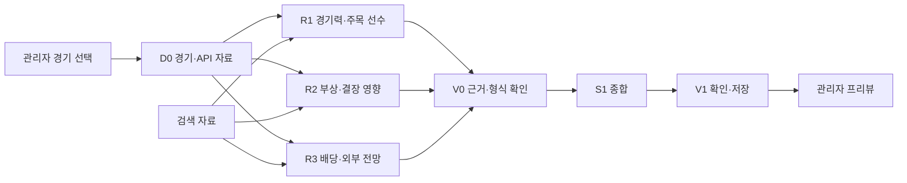

# AI 리서치 기반 경기 프리뷰 설계

작성: 2026-11-10, GPT 오케스트레이터. 상태: 사용자 설계 확정, 구현 계획 작성·자체 검토 완료, 사용자 실행 승인.
사용자가 이 설계를 "확정한 경기 프리뷰 설계"로 명시하고 writing-plans 구현 계획 작성을 요청했다. 실행은 pstack, 구현은 DeepSeek 전용으로 유지한다. 아래에 명시한 후속 자동화 정책과 실행 환경 확인은 계획의 선행 조건으로 남으며 확정된 값으로 바꾸지 않는다.
이 문서는 구현 코드가 아닌 요구사항·설계 제안이다. 현재 진행 상태는 [Plans.md](../../../Plans.md)에서 관리한다.

## 1. 목적과 범위

축구를 어느 정도 아는 독자와 중계를 준비하는 스트리머가 경기 전에 관전 포인트, 주목 선수, 주요 결장과 전력 변화, 외부 전망과 AI의 예상을 이해하게 한다. 정보의 나열만으로 완료하지 않고 이번 경기를 어떻게 볼지 설명한다.

사용자가 선택한 방식은 **독립된 주제별 조사 모듈 → 근거가 남은 결과 → 최종 프리뷰 조합**이다. 각 모델 호출을 개발 도중부터 따로 실행·확인할 수 있어야 한다. 기존 축구 API도 사용하며 검색 결과가 없을 때 API 자료로 보완한다. 부상 자료처럼 API에서 직접 얻는 사실은 검색 실패를 기다리지 않고 활용한다.

완성된 프리뷰에는 자료 누락·미확보 같은 운영 메시지를 표시하지 않는 것이 사용자 요구다. 누락과 실패는 실행 로그에 남기고, 관리자 실행 대시보드의 표·그래프·빈도 지표에서 확인한다. 이 도구는 개발 중 검증과 이후 운영·유지보수에 계속 사용한다. 프리뷰의 독자용 내용과 관리자의 진단 정보를 별도 계약으로 관리한다.

| 단계 | 포함 범위 | 완료 결과 |
|---|---|---|
| 1차 | 관리자가 특정 경기를 선택해 모듈 또는 전체 생성을 요청. 호출·변환·조합 결과, 실행 이력과 집계 지표를 관리자 화면에서 확인 | 실제 검색·API·모델이 연결된 경기 한 건과 단계별 증거를 따라가며, 진단 메시지가 없는 최종 프리뷰를 확인할 수 있음 |
| 후속 | 검증한 생성기를 기존 수집·추천 경기 흐름에 연결. 완성된 프리뷰를 홈에서 제공 | 추천 경기의 자동 생성과 실패·중복 처리, 홈 읽기 경로 검증 |

생성 완료 후 선발·부상 변경에 따른 자동 갱신은 범위에 넣지 않는다. 1차 결과는 관리자 확인용으로 두고 공개 홈 연결은 후속 단계로 분리하는 것이 조정자의 제안이다. 모듈 재실행은 개발·검증 기능이며 공개된 프리뷰를 자동으로 덮어쓰는 기능과 구분한다.

한 경기 20~30분 생성도 괜찮다는 사용자 답변은 허용 시간의 예시다. 자동 생성의 목표는 경기 시작 1시간 전 완료로 해석했으며 설계 검토 시 확인한다. 30분을 승인된 강제 종료 값으로 간주하지 않는다.

## 2. 확인된 환경과 제약

- 제품 AI 제공자는 사용자가 지정한 GCP Vertex AI다. 모델 후보는 3.8·3.7 Flash이며 최종 선택은 아직 없다. 우선 검토 후보를 3.8 Flash로 두되 실제 계정의 호출·검색·출력 지원과 429를 확인한 뒤 계획에 반영한다.
- 제품 안에서 호출할 모델과 개발 에이전트의 모델은 별개다. 제품·테스트·검사 UI·스크립트 구현과 독립 검토는 DeepSeek만 수행한다. 구현·검토는 별도 세션으로 분리하고 GPT/Opus는 기획·조정·실행 증거 확인을 맡는다.
- 사용자는 이전에 홈 추천과 연결된 데이터 API를 설명했으며, 구현 계획 작성 중에는 이전 구현을 모두 삭제해 별도 소스가 없다고 확인했다. 로컬·Git/Orca 등록 조사에서도 실행 가능한 제품 체크아웃을 찾지 못했다. API-Football, FastAPI·SQLAlchemy, Supabase/Postgres, Vue·Vite는 보존된 기술 방향이지 현재 설치된 앱이 아니다.
- 구현 계획은 현재 저장소에 프리뷰를 위한 최소 앱·ADMIN 접근·API 연결을 새로 작성하는 범위로 구체화한다. 사용자 추가 요구에 따라 기존 운영 DB의 경기·계정은 읽기 전용으로 재사용하고, 신규 기능·개발 세션·검사 기록은 같은 DB의 preview_dev 스키마 새 테이블에 저장한다. 개발 쓰기의 내역 조회와 실행별 undo를 제공하며 기존 자료는 수정·초기화하지 않는다. 홈 추천·수집 기반과 전체 서비스 재구축은 후속 범위로 구분한다. 실제 DB·인증·권한과 API·모델 연결은 실행 전에 확인한다.
- 기존 API나 DB에 이미 수집된 자료를 활용하되 출처·수집 시각을 남긴다. 새 수집이 필요하면 서버에서 수행한다. 관리자 화면을 열 때마다 외부 API·AI를 새로 호출하지 않는다.

## 3. 비교한 접근 방식

| 접근 | 장점 | 한계 | 선택 |
|---|---|---|---|
| 한 번의 모델 요청으로 조사부터 프리뷰까지 작성 | 호출 단계가 적고 연결 구조가 단순 | 중간 조사 결과의 독립 검증과 부분 재시도가 어려움 | 미선택 |
| 주제별 조사 결과를 보존하고 별도 종합 호출로 작성 | 각 호출의 의도·실제 결과·프리뷰 반영을 확인하고 재사용 가능 | 호출·상태·상충 자료 관리 필요 | 사용자 선택 |

고정 사이트 목록에만 제한하지 않고 검색을 폭넓게 이용한다. API 자료가 있더라도 외부 매체 전망과 경기 맥락을 찾는 검색을 일괄 생략하지 않는다. 검색 횟수나 자료 개수 자체를 성과로 삼지 않고 주제별 근거가 확보되면 조사를 끝낸다.

## 4. 모듈 경계와 호출 흐름

사용자는 LangGraph와 모듈 추가 방식의 확장을 선택했고, 이후 사용자 테스트·조정·승인 단위를 **프리뷰 섹션의 내용을 생성하는 워크플로우**로 구체화했다. 하나의 워크플로우는 자료 준비·여러 노드/모듈·근거 검사·본문 표현을 포함할 수 있다. 사용자는 경기와 섹션을 골라 워크플로우를 실행하고 실제 프리뷰용 본문·근거와 이전 결과의 차이를 확인한다. 내부 노드 하나씩 실행·승인하는 방식은 기본 흐름으로 삼지 않는다. 기존 요청·응답 검사 탭은 펼쳐보는 진단 정보로 유지한다.

예를 들어 최근 흐름·관전 포인트/주목 선수, 부상·결장 영향, 배당·외부 전망을 생성하는 섹션 워크플로우와 전체 종합을 구분한다. 이 구분 때문에 자동으로 새로운 모델 호출을 추가하지 않는다. 최종 조합은 승인된 섹션 워크플로우 버전을 사용하고, 사용자는 매 경기마다 승인할 필요가 없다. 승인에는 워크플로우·구성 버전과 확인한 실행·본문 결과를 연결한다. 의미 있는 변경은 후보 버전으로 다시 확인한다. 실행 성공·품질·사용자 승인은 별도 상태다. 선택 근거는 [프레임워크 결정](../../decisions/2026-11-10-preview-framework.md)에 남긴다.

다음 세부 모듈 구성은 선택된 접근을 구체화한 조정자 제안이다. 각각의 입력과 출력 계약을 먼저 정의하고 같은 계약으로 단독 실행과 전체 실행을 지원한다.

| 모듈 | 입력과 역할 | 출력 | 모델 호출 |
|---|---|---|---|
| D0 경기·API 자료 준비 | 경기 ID·팀·대회·시즌·킥오프를 확인하고 최근 성적·선수 기록·부상·배당·API 전망 중 제공되는 자료를 확보 | 출처·시각·누락 사유가 붙은 공통 자료 묶음 | 없음. 실제 API 요청은 개별 기록 |
| R1 경기력 조사 | D0와 검색을 활용해 최근 흐름과 이번 경기의 의미 조사 | 근거별 사실·해석·관전 포인트 후보 | 정상 경로 1회 |
| R4 주목 선수 선정 | 경기·선수 자료를 바탕으로 AI가 선수를 선정하고 DB 한글명으로 식별 | 선정 선수와 선정 이유가 분리된 구조화 결과 | 정상 경로 1회 |
| R2 부상·결장 영향 조사 | API의 부상·출전 불확실 정보와 검색 자료를 바탕으로 핵심 공백과 영향 설명 | 결장 상태, 근거 시각, 영향과 불확실성 | 정상 경로 1회 |
| R3 배당·외부 전망 조사 | 검색으로 매체 전망을 찾고 API 배당·예측도 함께 참고 | 공개 배당, 매체 의견, API 알고리즘 예측을 구분한 결과 | 정상 경로 1회 |
| V0 근거·형식 확인 | 각 모듈의 경기 일치·형식·근거 참조·누락 표시를 검사하고 충돌 자료 표시 | 채택 가능한 조사 결과와 제외·충돌 목록 | 없음. 별도 LLM 검토 호출을 숨겨 넣지 않음 |
| S1 프리뷰 종합 | V0를 통과한 모듈 결과와 그 결과가 참조하는 D0 근거만 전달 | 관전 포인트·주목 선수·결장 영향·외부 전망·AI 예상과 근거 | 정상 경로 1회. 새 검색은 하지 않음 |
| V1 결과 확인·저장 | 필수 구조와 근거 연결, 미확인 사실 단정 여부 등을 확인 | 독자용 프리뷰 데이터와 별도의 관리자 진단·품질 상태 | 형식·참조 검사는 프로그램으로 수행. 내용 품질은 실제 사례 검토로 검증 |

정상 경로의 애플리케이션 모델 요청은 경기력·부상·외부전망·주목선수 조사 4회와 종합 1회로 총 5회다(사용자 요청에 따른 주목선수 독립 분리). 제공자 내부 검색 실행 횟수와 HTTP 요청 수는 별개다. 재시도·출력 수정 요청이 생기면 각각 별도 시도로 기록하고 호출 예산에 포함한다. 관측하지 못하는 제공자 내부 동작을 추적했다고 표시하지 않는다.

R1~R3는 D0의 같은 자료 버전을 사용한다. 독립적으로 실행하되 공통 동시 호출 상한을 지킨다. 서로를 재귀적으로 호출하거나 매 단계가 조사 전체를 다시 시작하지 않는다. V0에서 다시 조사가 필요해도 해당 모듈과 사유를 명시하고 남은 예산 안에서만 재실행한다.

## 5. 검색과 API 자료를 결합하는 원칙

검색은 설명·최신 소식·매체 전망을 넓히고 API는 구조화된 경기 사실을 제공한다. API가 항상 검색보다 정확하거나 최신이라고 가정하지 않는다. 같은 경기·시점에 맞는 근거를 우선하고 충돌은 출처와 시각을 비교해 드러낸다.

| 상황 | 처리 |
|---|---|
| 검색과 API 모두 사용 가능 | 중복을 합치고 출처를 유지. 불일치는 양쪽 근거와 차이를 남김 |
| 검색 근거가 없고 API 자료는 있음 | API를 근거로 조사 결과를 구성. 검색 미확보와 API 보완 사유는 관리자 기록에 남김. 프리뷰에서는 근거가 있는 내용만 제공 |
| API에 없고 검색 근거는 있음 | 경기·선수·대회·자료 시점이 확인되는 검색 근거 사용 |
| 양쪽 모두 없거나 접근 실패 | 관리자 기록에서 미제공·검색 미발견·호출 실패를 구분. 프리뷰에 빈 항목·누락 안내를 넣거나 모델 지식으로 사실을 채우지 않음. 핵심 근거가 부족하면 관리자 초안으로 유지 |

### 사실 검증과 AI 판단의 경계 — 사용자 확정

출처 검증은 확인 가능한 사실과 사실로 서술하는 원인·경위를 대상으로 한다. 주목 선수 선정, 관전 포인트, 전술 해석, 예상 승무패·스코어는 AI의 판단이며 그 결론 자체를 외부 자료로 증명하거나 같은 결론의 보도를 찾도록 요구하지 않는다. AI 판단에 사용한 사실은 제공된 API 스냅샷 또는 확보된 검색 자료로 추적한다. API 사실로 충분한 판단에 검색 URL을 추가로 요구하지 않는다.

예를 들어 득점·출전 기록은 확인할 사실이고, 그 기록을 바탕으로 특정 선수를 주목 선수로 고르는 것은 AI의 선정이다. 예상 스코어는 AI 의견이며 예측값 자체의 사실 확인을 요구하지 않는다. 외부 매체가 제시한 예상 스코어라고 서술할 때에는 그 매체가 실제 그 예상을 했는지만 확인한다.

사실과 판단이 한 문장/항목에 섞여 있으면 두 부분을 구분한다. 미확인 수치·발생 사건을 확인된 사실로 내보내지 않되, 근거 있는 사실과 별도로 가능한 AI 판단까지 항목 전체에서 일률적으로 버리지 않는다. AI 의견이라는 표시와 판단 이유를 유지하며, 선정 자체의 외부 인용 부재는 탈락 사유가 아니다.

부상은 API가 제공하는 선수·상태·사유를 우선 활용한다. 발생 시점·발생 경기·구체적인 경위는 독자가 이해하는 데 필요한 범위에서 검색으로 보완한다. API의 기준 경기/조회·수집 날짜를 부상 발생 경기/발생 날짜로 바꾸지 않는다. 경위 확인이 완전하지 않아도 확보된 부상 사실과 AI의 전력 영향 분석으로 섹션을 제공할 수 있다. 확인되지 않은 경위를 지어내거나 확정하지 않고, 빠진 부분·충돌·보완 시도는 관리자 기록에 남긴다. 프리뷰에 필요한 설명 수준을 넘는 전수 조사나 완벽한 원인 입증을 완료 조건으로 삼지 않는다.

API-Football의 부상 응답에는 경기 결장과 출전 불확실 상태가 구분된다. 빈 응답을 부상자 0명으로 단정하지 않는다. API의 predictions는 알고리즘 예측으로 매체 의견이나 이 서비스의 AI 결론과 구별한다. coverage 표시가 있어도 경기별 실제 자료 존재를 확인해야 한다. [API-Football 공식 문서](https://www.api-football.com/documentation-v3)

배당은 경기, 시장 종류, 업체, 기준 시각을 함께 남긴다. 다른 경기·지난 시즌·라이브·진출 시장을 경기 전 승무패 자료에 섞지 않는다. 출전 불확실인 선수를 결장 확정으로 바꾸지 않으며, 선수의 중요도·전술적 영향은 근거에 기반한 분석으로 구분한다.

검색 결과의 링크만 있다고 전체 기사를 읽은 것으로 표시하지 않는다. Google Search grounding의 응답·출처 연결 정보를 기록하고, 실제 원문을 별도로 확인한 경우에만 원문 확인 여부를 표시한다. 제공된 출처와 Search Suggestions의 표시 요구를 반영한다. 본문 보관 범위는 제공자 조건과 필요한 증거 범위 내로 정하며 무제한 전체 기사 수집을 기본값으로 두지 않는다. [Google Search grounding 안내](https://docs.cloud.google.com/gemini-enterprise-agent-platform/models/grounding/grounding-with-google-search)

## 6. 개발·운영에서 계속 사용하는 실행 대시보드

검사 도구는 마지막에 붙이는 부가 기능이 아니라 각 모듈의 완료 조건이다. 첫 모듈이 만들어질 때부터 관리자 화면에서 단독 실행과 결과 확인이 가능해야 한다. 실행 이력·표·그래프·집계 지표도 1차 제공 범위에 포함하며, 완성 뒤 폐기하는 임시 개발 도구로 만들지 않는다. 시각 스타일과 실제 화면 구현은 Hallmark와 DeepSeek이 담당하며 여기서는 기능 계약만 정한다.

관리자는 경기와 실행 기록을 선택하고, 모듈별 상태 목록에서 다음을 확인한다.

1. **요청**: 목적, 실제 모델과 설정, 프롬프트 버전, 전달한 경기·API·이전 단계 자료.
2. **응답**: 실제 수신한 모델/API 응답, 검색어·출처 메타데이터, 오류·소요 시간·제공자가 반환한 사용량.
3. **처리 결과**: 추출된 자료, 채택·제외 이유, 충돌·누락, 검증 통과 여부.
4. **다음 입력**: 어느 출력의 어떤 버전이 다음 호출에 전달됐는지와 실제 전달 값.
5. **프리뷰 반영**: 최종 문단과 연결된 조사 결과·근거. AI 해석은 해석임을 표시.

각 실행에는 실행 ID, 모듈 ID, 시도 ID를 부여한다. 실제 모델 호출 재시도도 한 행으로 뭉개지 않는다. 자료의 출처(API/검색)와 실행 방식(실호출/저장 응답 재생/모의 자료)을 별도 필드로 둔다. 재생을 live 성공으로 계산하지 않는다.

개발 중 지원할 조작은 모듈 하나 실행, 저장된 결과 열기, 저장 응답으로 변환만 재생, 선택된 모듈 재호출, 선택된 결과 버전으로 종합 재실행이다. 새 호출과 무료 로컬 재생을 명확히 구분하고, 이전 결과를 보존해 비교할 수 있게 한다. 수정된 선행 결과를 선택하면 그 결과에 의존하는 종합본은 이전 버전으로 표시하고 명시적으로 다시 만든다. 입력이 같은 무관한 모듈은 다시 호출하지 않는다.

원문 응답은 인증 토큰·비밀 헤더를 제외한 실제 수신 payload를 뜻한다. 숨겨진 모델 사고 과정은 요구하거나 표시하지 않는다. 검색·API 응답은 데이터로만 취급하고 지시로 실행하지 않는다. 모델 응답과 외부 HTML은 실행되지 않는 방식으로 표시한다. 기록·단독 실행·재실행 접근에는 서버의 관리자 권한 검사를 적용한다.

### 6.1 실행 이력과 원인 확인

실행 목록은 경기, 요청·완료 시각, 소요 시간, 실행 상태, 프리뷰 품질 상태, 호출·재시도 수와 자료 확보 상황을 보여준다. 경기·기간·모듈·제공자·모델·프롬프트/구현 버전·실행 방식으로 좁혀 볼 수 있다. 실행 중인 항목도 마지막 관측 시각과 함께 표시한다. 구체적인 갱신 수단은 기존 앱 구조에 맞춰 구현 담당자가 정한다.

각 자료 종류에 대해 확보, 검색 미발견, API 미제공, 조사 미실행, 호출 오류, 검증 탈락, 출처 충돌을 구분해 남긴다. 원인 미확인은 미확인으로 둔다. API와 검색의 일반적인 결합과, 검색을 얻지 못해 API로 보완한 경우를 구별한다. 오류 뒤 재시도로 성공하더라도 최초 오류를 보존한다. 프리뷰 완료 상태가 자료를 모두 확보했다는 뜻이 되지 않게 자료 확보 상태를 별도로 유지한다.

표·그래프의 항목에서 해당 실행 목록으로, 다시 모듈·시도별 기록과 실제 요청·응답으로 이동할 수 있어야 한다. 필터 조건과 집계 기간을 상세 조회에서도 유지해 숫자의 원인을 따라갈 수 있게 한다.

### 6.2 초기 지표와 집계 기준

아래 지표 구성과 표시 방식은 사용자 요구를 구체화한 조정자 제안이다. 모듈의 논리적 실행과 실제 요청 시도를 별도로 세며, 재시도가 실행 성공률의 분모를 늘리지 않게 한다. 모든 비율에는 분자·분모·기간을 함께 표시한다.

| 지표 | 계산·구분 기준 | 표현과 사용 목적 |
|---|---|---|
| 프리뷰 완료율 | 전체 실행 중 종료된 건을 완료·정보 부족 초안·실패로 구분. 진행·대기 중인 건은 종료 분모에 넣지 않고 별도 건수 표시 | 기간별 추이와 건수. 실제로 읽을 수 있는 프리뷰를 얼마나 만들었는지 확인 |
| 모듈 실행 성공률 | 종료한 논리적 모듈 실행 중 유효한 형식·검증 결과를 반환한 건의 비율. 근거 없음 응답도 형식이 유효할 수 있으므로 자료 확보율과 구별 | 모듈별 표·추이. 호출·처리 문제 위치 확인 |
| 자료 확보율·누락 빈도 | 해당 자료를 조사 대상으로 삼은 종료 모듈 실행 중 채택 가능한 근거를 얻은 비율. 자료 종류·API/검색·미실행/미제공/미발견/오류/검증 탈락 사유를 함께 제공 | 부상·배당·매체 전망 등의 확보율 표, 누락 사유별 막대그래프 |
| API 보완 사용 빈도 | 검색 근거를 얻지 못해 API 자료로 보완한 모듈 실행 수. 검색을 조사 대상으로 삼은 종료 실행 수를 함께 표시 | 검색 경로가 약한 주제·대회 확인. 정상적인 검색+API 결합과 별도 집계 |
| 429·오류율 | 실제 보낸 요청 시도 중 해당 오류 응답 수. 제공자·모델·모듈별로 구분. 내부에서 관측 못 한 제공자 검색 호출은 포함했다고 주장하지 않음 | 오류 코드·분류별 빈도와 시간 추이 |
| 재시도·복구 | 재시도 요청 수, 재시도한 논리적 실행 수, 그중 최종 성공·실패 건수 | 재시도 증폭과 실제 복구 효과 확인 |
| 처리 시간 | 전체 실행의 대기 포함 총시간과 모듈 처리·제공자 응답·재시도 대기 시간을 구분. 완료·실패 상태별로 나누고 표본 수와 함께 중앙값·95백분위 표시 | 느린 모듈과 대기 원인 확인. 진행 중인 실행의 경과 시간은 별도 표시 |
| 사용량 | 제공자가 반환한 토큰·검색 사용량과 실제 요청 수. 미제공 값은 0으로 채우지 않음 | 과도한 호출 확인. 비용 환산은 가격 기준·적용 시각이 확인된 경우에만 별도 추정값으로 제공 |

운영 실호출, 개발 실호출, 저장 응답 재생, 모의 자료 실행을 구분하고 기본 운영 지표에 시험 결과를 섞지 않는다. 같은 이벤트·실행 ID의 중복 수신은 중복 집계하지 않는다. 표본이 없으면 데이터 없음으로, 표본이 적으면 건수와 함께 표시하며 한두 건의 백분위로 일반 성능을 단정하지 않는다. 지표의 데이터 없음·누락 메시지는 관리자 대시보드에서 허용되며 독자용 프리뷰로 전달하지 않는다.

### 6.3 기록을 이용한 유지보수

기록은 배포 후에도 조회할 수 있는 저장소에 보존하고 임시 로컬 파일만을 근거로 삼지 않는다. 각 실행에 모델·프롬프트·모듈 계약·구현 버전과 사용한 입력 자료 버전을 연결한다. 저장 용량, 원문 보관 기간, 요약 지표 보존 정책은 구현 계획에서 명시한다. 원문 보관 기한이 지나면 해당 기록의 원문 조회·재생 불가를 관리자에게 표시한다.

유지보수 경로는 **이상 지표 선택 → 관련 실행·원인 확인 → 담당 모듈 수정 → 같은 저장 자료로 재생·비교 → 필요한 실제 연동 검증**이다. 입력 자료가 바뀐 실호출과 같은 입력의 재생 비교를 구별한다. 재생은 변환·검증·조합 로직의 수정 확인에 쓰며, 현재 모델·검색의 응답 품질 개선 증거로 대신하지 않는다. 프롬프트 수정은 같은 입력 스냅샷으로 새 모델 호출을 하고 호출 버전·비용·결과를 별도로 기록한다.

수정 전후 결과를 이전 버전을 보존한 채 비교할 수 있어야 한다. 새 자료·버전으로 만든 결과는 기존 공개 프리뷰를 자동으로 교체하지 않는다. 지표 조회와 기록 열기는 외부 모델/API 호출을 일으키지 않는다. 내부 구조화 기록에서 집계를 다시 계산할 수 있도록 하고, 외부 관측 서비스 도입 자체를 현재 요구로 추가하지 않는다.

## 7. 실패·재시도와 데이터 일관성

- 대기, 실행 중, 재시도 대기, 완료, 정보 부족, 실패를 구분한다. 단계 완료와 프리뷰 품질 완료는 별개다.
- HTTP 429는 제공자와 오류 상세로 분류한다. API-Football의 제한과 Vertex AI의 제한을 섞지 않는다. 일시 오류는 유효한 대기 지침 또는 상한 있는 지수 백오프·무작위 지연을 적용한다. 지속적인 권한·설정 오류를 용량 문제처럼 반복하지 않는다.
- 재시도 횟수, 경기 전체 호출 수·누적 대기 시간, 동시성에 공통 상한을 둔다. SDK·작업 큐·모듈이 각각 재시도를 증폭하지 않도록 한 계층이 책임진다. 구체적인 수치는 실제 제공자 설정과 첫 실행 측정으로 구현 계획에서 정하고 유료 실행 전 적용한다.
- 한 주제의 검색 실패가 나머지 주제 결과를 버리는 이유가 되지 않는다. 사용 가능한 API 자료가 있으면 그 근거로 제한된 결과를 만들 수 있지만 실패 이력을 지우지 않는다.
- 경기 식별 불가, 잘못된 경기 자료, 종합 호출 실패, 유효하지 않은 최종 구조·근거 참조는 완성된 프리뷰로 저장하지 않는다.
- 자료 누락과 원인은 관리자 로그·대시보드에 남긴다. 조정자의 완료 기준 제안은 경기 식별, 근거 있는 관전 포인트, AI 예상과 그 판단 이유를 핵심으로 삼는 것이다. 이를 충족하면 일부 보조 자료가 없어도 확보된 내용으로 프리뷰를 완료할 수 있다. 핵심 판단의 근거가 부족하면 관리자 정보 부족 초안으로, 종합 가능한 사실이 전혀 없으면 실패로 남긴다. 초안·실패를 완성된 독자용 프리뷰로 내보내지 않는다.
- 실행 중단·재시작 때 이미 끝난 결과를 보존한다. 동일 경기·입력 버전·모듈 설정의 중복 요청은 실행 중 작업에 연결한다. 의도적인 새 실행에는 새 ID를 쓰고 저장된 결과를 덮어쓰지 않는다.
- 후속 자동화에서는 마감 상태와 공개 반영을 생성 상태에서 분리하고 과거 결과를 새 성공으로 재표시하지 않는다. 경기 시작 1시간 전을 엄격한 종료 시점으로 삼을지, 그 뒤라도 킥오프 전 완성본을 허용할지는 후속 자동화 설계에서 확정한다. 이 미결정을 1차 관리자 단독 실행의 일률적인 종료 규칙으로 적용하지 않는다.

이 절의 실행 구조는 조정자 제안이다. 429 원인 분류와 제한된 재호출 자체는 사용자 요구다. [Google 공식 API 오류 안내](https://docs.cloud.google.com/vertex-ai/generative-ai/docs/model-reference/api-errors)

## 8. 프리뷰의 내용과 품질

초기 출력 구성은 경기 개요, 핵심 관전 포인트, 주목 선수와 이유, 주요 결장·전력 영향, 공개 배당과 외부 전망, AI 예상 흐름·승무패·스코어 및 판단 이유로 제안한다. 확보한 자료에 맞춰 구성하며 근거가 없는 보조 항목은 섹션 또는 해당 항목 자체를 생략한다. 완성된 프리뷰에는 빈 카드, 자료 누락·미확보 안내, API 대체 사유, 호출 실패·재시도 메시지를 넣지 않는다. 분량의 고정 글자 수보다 이번 경기와 관련된 근거와 읽기 쉬운 구성을 우선한다.

확인된 사실, 외부 전망, API 알고리즘 예측, AI의 해석을 섞지 않는다. AI 예상은 독립적인 종합 의견으로 표시하며 근거 없이 정밀한 확률을 만들지 않는다. 예측에 사용한 사실의 확인 범위와 판단 제한을 관리자 기록에 남긴다. 예측 결론에 대한 외부 증명, 검색 인용 부재, 보조적인 부상 경위 미확인만으로 초안으로 강등하지 않는다. 경기·팀을 식별할 수 없거나 실제 제공 가능한 사실·판단이 전혀 없는 경우는 기존 실패·초안 기준을 따른다. 생성 시각과 자료 기준 시각을 표시한다. 선수의 출전 불확실처럼 근거가 있는 경기 정보의 불확실성은 정확히 표현한다. 운영 메시지를 숨기는 요구를 선수의 상태나 전망을 확정적으로 바꾸는 이유로 삼지 않는다.

독자용 프리뷰 응답과 관리자 진단 응답을 분리한다. 내부 누락·오류·재시도 상세를 공개 응답에 담고 화면에서만 가리지 않는다. 관리자 대시보드에서 독자용 프리뷰를 열어도 그 본문에는 같은 표시 원칙을 적용하고 진단은 별도 영역에서 본다. 출처 인용, AI 예상이라는 표시, 자료 기준 시각은 독자의 이해를 위한 정보로 유지한다.

종합 단계는 각 모듈의 구조화된 결과와 근거 식별자를 읽어 조합한다. 조사 문장을 그대로 이어 붙이기만 하는 기능도, 근거 없이 새 사실을 추가하는 기능도 완료로 보지 않는다. 형식 검사만으로 사실 검증과 사용자 관점의 품질 검토까지 끝났다고 주장하지 않는다.

## 9. 개발 순서와 수용 기준

[writing-plans 구현 계획](../plans/2026-11-10-match-preview.md)을 작성했다. 소스 부재 확인에 따라 최소 앱·ADMIN 접근 → 공통 자료·지속 보관하는 호출 기록·검사 화면 → 독립 조사 모듈과 대시보드 지표 → 종합 → 전체 실연동 검증 순서로 구성한다. 이후 홈·수집 자동화를 별도 계획으로 연결한다. 조사 모듈은 고정한 입출력 계약과 파일 소유권에 따라 DeepSeek 워커에 병렬 배정한다. 검사 도구·집계 지표·테스트도 해당 모듈 변경과 함께 갱신한다.

| 확인할 동작 | 완료 근거 |
|---|---|
| 각 모듈 단독 실행 | 다른 조사·종합 호출 없이 실행되고 실제 입력·응답·처리 결과가 관리자에게 보임 |
| 실 API 부상 자료 사용 | 해당 경기의 원래 상태와 근거 시각을 보존해 영향 분석에 전달. 불확실·빈 응답 사례 별도 확인 |
| 검색이 없는 경우 | API 근거로 생성하며 검색 미발견·보완 사유는 관리자 기록에만 남음. 매체 의견·선수 사실 창작 없음 |
| 자료 충돌·다른 경기 혼입 | 충돌 표시 또는 제외되며 최종 입력에 어떤 자료가 들어갔는지 확인 가능 |
| 모듈 결과 조합 | 종합 입력과 선택한 모듈 버전 일치. 최종 주요 사실에서 근거까지 추적 가능 |
| 부분 실패·429·재개 | 실패한 호출만 제한 내 재시도. 성공한 모듈 재호출 없음. 오류·대기·시도별 기록 보존 |
| 모의·재생·실제 실행 구별 | 화면과 기록에 실행 방식 표시. 실제 연동 완료에는 실호출 증거 필요 |
| 관리자 권한 | 생성·기록·재실행에 비관리자 접근이 거부됨 |
| 완성본과 진단 정보 분리 | 선택 자료가 없는 사례에서 독자용 응답·화면에 빈 항목과 누락·실패·재시도 안내가 없고, 동일 실행의 관리자 기록에는 원인·처리가 남음 |
| 운영 집계의 정확성 | 429 후 성공, 정상 응답이나 자료 없음, 검증 탈락, 중복 이벤트, 모의·재생 사례로 분자·분모와 실제 기록이 일치하는지 확인. 시험 결과는 운영 성공률에서 제외 |
| 지표에서 원인 추적 | 표·그래프에서 필터가 유지된 실행 목록과 원래 요청·응답으로 이동해 근거를 확인 |
| 수정 후 재검증 | 같은 저장 입력으로 수정 전후 버전 비교 가능. 재생 검증과 새 모델 실호출 검증을 구별하며 과거 성공·공개 결과를 덮어쓰지 않음 |
| 운영 기록 지속성 | 앱 재시작 후 이력·집계·허용된 원문을 조회할 수 있고, 지표 조회만으로 외부 호출이 발생하지 않음 |
| 사용자 관점 검증 | 실제 경기 한 건으로 모듈별 검사와 전체 프리뷰를 시연. 모델/API 실호출, 화면 확인, 내용 검토를 구분해 보고 |

모델의 모든 내부 검색을 재현하거나 예측 적중률을 한 경기 시험으로 보장하는 것이 완료 조건은 아니다. 모의 오류 시험과 실제 연결 시험은 각각 무엇을 검증했는지 표시한다. 검증 결과가 없는 항목은 미검증으로 남긴다.

## 10. 설계 검토와 실행 계획에서 다룰 사항

사용자가 이미 선택한 내용은 주제별 모듈과 종합, 개별 호출 확인, 기존 API 활용, 관리자 생성, Vertex AI, 429 처리, 프리뷰에서 누락 메시지 제외, 내부 로그·실행 대시보드·지표를 통한 지속적인 유지보수다. 다시 선택을 요구하지 않는다.

사용자의 설계 확정 이후 초기 조사 3모듈+종합 1호출, 관리자 검사·지표, 결과 버전별 재실행과 품질 기준을 구현 계획에 반영했다. 새 최소 앱의 파일·데이터 계약·병렬 소유권과 호출·보관 상한의 초기 제안도 계획에 작성했다. 모델 최종 선택·실제 인증·계정 제한은 실호출의 선행 확인 사항이다. 제품 코드 실행이나 핵심 기술 변경을 문서 작성만으로 완료했다고 간주하지 않는다.

2026-11-10 읽기 전용 구현 관점 검토에서 두 정책 질문을 받았다. 모듈별 확인에서 API·검색 결합·종합으로 연결하는 경로와 실호출·재생 구분에는 추가 계획 차단 질문이 없었다. 다음 사항을 구분해 처리한다.

- **사용자 답변 반영:** 완성된 프리뷰에는 자료 누락·미확보 메시지를 표시하지 않고 로그와 실행 대시보드에서 확인한다. 표·그래프·빈도 등으로 유지보수에 활용한다는 답변에 따라 §6~§9를 보완했다. 경기 식별·근거 있는 관전 포인트·근거를 설명하는 AI 예상을 완료의 핵심으로 삼고, 선택 항목 누락은 내부 기록에 남기는 조정자의 제안을 설계 검토 대상으로 유지한다. 이 보완은 조정자가 반영·검토했으며 앞선 독립 검토가 새 지표 세부까지 검증했다고 주장하지 않는다.
- **후속 자동화에 유보:** 경기 시작 1시간 전 완료의 엄격성, 그 뒤 완성본의 사용 여부. 자동 생성 일정·마감·홈 반영 작업을 배정하기 전에 확정한다. 1차 관리자 실행 설계의 차단 사항은 아니다.

이 설계는 사용자가 구현 계획의 기준으로 확정했다. 제품 코드 변경·배포 완료를 뜻하지 않으며, 과거 구현과 당시 검증 수치는 현재 수용 기준의 통과 증거로 사용하지 않는다.

- **추가 사용자 확정:** 사실/원인·경위의 확인과 AI 선정·예측을 구분한다. 선정·예측 결론을 증명하는 외부 출처는 요구하지 않으며, 부상 경위는 프리뷰에 필요한 수준에서 부분 확인을 허용한다. §5의 사용자 확정 기준이 이전의 포괄적인 항목별 근거 검사 표현보다 우선한다.

## 사용자 확정: 한글명과 주목선수 독립 모듈

경기력(R1/section_form)과 주목 선수(R4/section_players)는 별도 호출·실행·결과·승인 단위로 분리한다. 기존 합친 R1 저장 결과는 이전 이력으로 보존하며 새 R4가 생성한 것으로 바꾸어 표시하지 않는다. 부상 R2·외부 전망 R3·종합 S1은 별도로 유지한다.

팀·선수·감독의 표시는 DB 한글명을 우선한다. 안정된 ID와 확인된 DB 이름/별칭으로 동일 인물을 매칭하고, 해당 이름이나 한글값이 DB에 없으면 AI의 한글 번역 표기를 사용한다(2026-11-11 최신 사용자 변경). DB 값이 있으면 AI 표기로 덮어쓰지 않는다. 동일인물이 충돌하는 경우 다른 사람의 DB 번역을 붙이지 않으며 원문/식별자와 미해결 사유를 보존한다. 관리자 기록에서 db_korean과 ai_translation 및 미해결을 구분한다. 기존 원문/저장본문/승인은 유지한다.

주목선수의 각 출력 항목은 selected_player(선정 선수, DB 한글명 문자열)와 selection_reason(선정 이유 문자열)을 구분한다. 내부 ID·근거·출처는 내부 메타데이터이며 두 표시 필드를 하나의 문장 필드로 합치지 않는다. UI도 이름과 이유를 분리해 배치한다. 선정 결론은 AI 판단이고 사실 전제만 기존 기준으로 확인한다.

사용자는 현 서술 방식을 수용하고 이에 대한 추가 테스트 없이 다음 작업을 진행하도록 했다. 문장 품질 재평가·모델 반복 호출·새 스타일 검사 추가를 하지 않는다. 필요한 스키마/기존 연결 형식 확인만 최소 수행한다. 전체 정상 호출은 4조사+1종합으로 바뀌되 전체 모델8회 상한·동시2 상한은 유지하고 미시작 정상호출 예약을5로 맞춘다. 동일 인물의 한글 표시명 교정만으로 의미 변경 재승인을 요구하지 않는다. 독립 모듈 분리는 새 워크플로우/출력 계약 버전으로 남긴다.

## 최신 사용자 변경: 축구 용어 한글화·DB 미보유 이름 AI 번역

일반 축구 용어와 대회명을 최대한 자연스러운 한국어로 작성한다. 사용자 지정 예인 hat-trick은 ‘헤트트릭’으로 표시한다. 선수·감독·팀 이름은 DB 검색을 우선하고 DB에 해당 엔티티/한글명이 없으면 AI 번역을 사용한다. 이는 이전의 ‘AI 음역 금지/무조건 원문 유지’를 해당 누락 경우에 한해 대체한다. 감독 이름 조회도 실제 이름·번역 저장소가 있을 때 한정 읽기로 사용하며 없다고 임의 스키마를 만들거나 운영 자료를 수정하지 않는다.

DB 원문 이름/ID와 AI 표시 번역을 구분하고 AI 번역을 DB 사실/검증된 공식명으로 표현하지 않는다. 사실 전제나 선수 소속·기록을 번역 과정에서 변경하지 않는다. 관리자 진단에 표기 출처를 남기되 독자 본문에 누락/매핑 메시지를 넣지 않는다. 번역은 기존 생성 호출과 공유 표시 경로에 포함하고 별도 번역 호출이나 호출 예산 증가는 만들지 않는다. 프롬프트 등 결과에 영향을 주는 변경은 버전을 갱신하고 기존 결과·승인 이력을 보존한다. 이번 작업은 구현 요청이며 별도 유료 재생성을 자동 실행하지 않는다.
